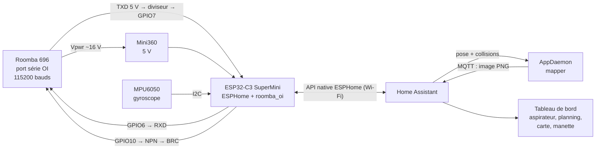
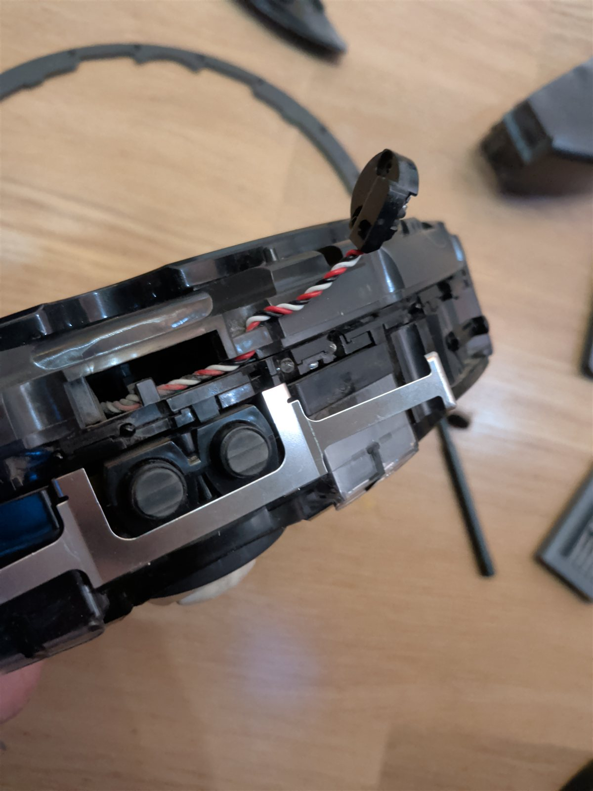
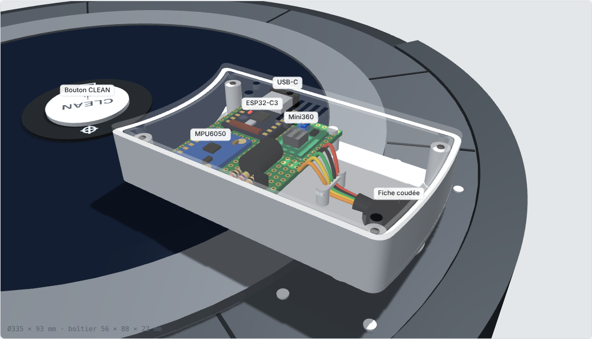
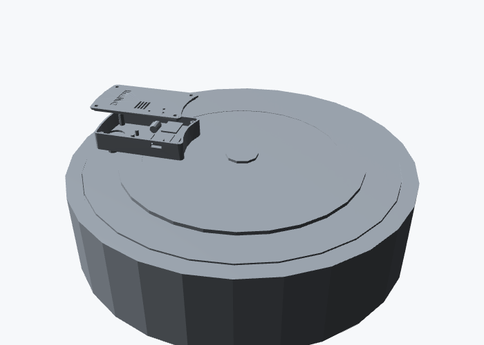
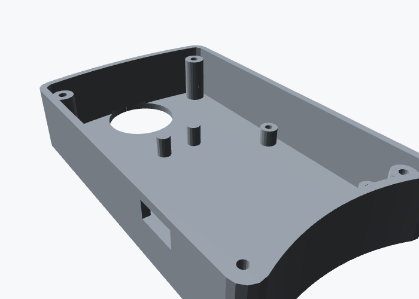
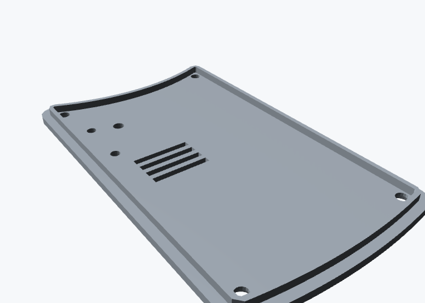
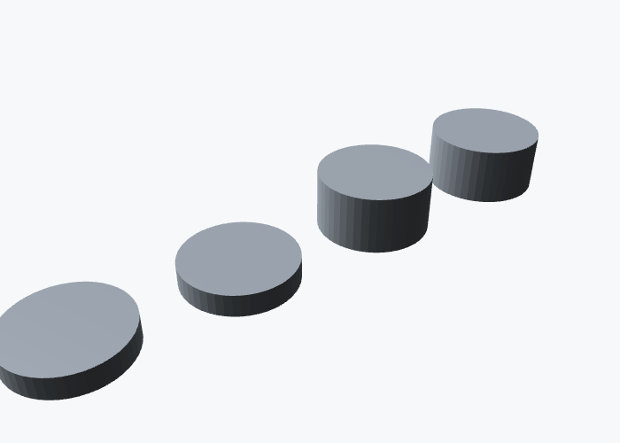
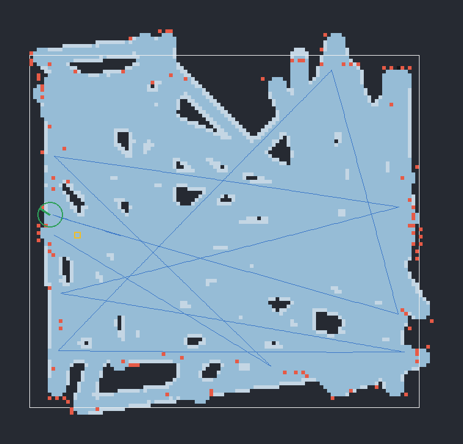

# OpenRobots — Aérobot ESP

Libérer un **Roomba 696** (surnommé **Dimitri**) du cloud iRobot. Un ESP32-C3 se branche sur le port série du robot (l'« Open Interface »), tourne sous **ESPHome** et s'intègre à **Home Assistant**. On récupère le contrôle local, un planning, une manette, et une carte approximative de la pièce. Tout reste à la maison, sans compte iRobot.

<p align="center">
  
</p>

> **État du projet : démarrage.** Le robot est ouvert, le port série est repéré sur le dessus, et le boîtier 3D est dessiné (ses STL sont prêts). Le firmware, la config Home Assistant et le mapper sont écrits mais **n'ont jamais tourné sur du vrai matériel** : rien n'a été flashé ni imprimé. Détail dans [`docs/ETAT_AVANCEMENT.md`](docs/ETAT_AVANCEMENT.md).

| Brique | État | Vérifié sur matériel ? |
|---|---|---|
| Repérage du port série | fait (photos) | oui |
| Brochage du port | déduit de la spec | **non**, à confirmer au multimètre |
| Boîtier 3D | dessiné, compilé, STL prêts | **non**, pas encore imprimé |
| Firmware ESPHome + composant `roomba_oi` | écrit | **non**, jamais compilé |
| Home Assistant (aspirateur, planning, tableau de bord, manette) | écrit | **non** |
| Carte (mapper) | écrit, testé | en simulation seulement |

## Sommaire

- [Objectif](#objectif)
- [Comment ça marche](#comment-ça-marche)
- [Matériel](#matériel)
- [Câblage](#câblage)
- [Où est le port série](#où-est-le-port-série)
- [Le boîtier](#le-boîtier) et ses [modèles 3D](#modèles-3d)
- [Le firmware ESPHome](#le-firmware-esphome)
- [Home Assistant](#home-assistant)
- [La carte de la pièce](#la-carte-de-la-pièce)
- [Démarrer](#démarrer)
- [Feuille de route](#feuille-de-route)
- [Dépannage rapide](#dépannage-rapide)
- [Questions fréquentes](#questions-fréquentes)
- [Limites connues](#limites-connues), [Sécurité](#sécurité), [Contenu du dépôt](#contenu-du-dépôt), [Sources](#sources)
- [Aperçu 3D interactif](#aperçu-3d-interactif)

## Objectif

| Fonction | Prévu |
|---|---|
| Contrôle local sans cloud (démarrer, arrêter, retour base, bip de localisation) | oui |
| Planning géré par Home Assistant, avec seuil de batterie | oui |
| Retour automatique à la base (batterie faible, fin de cycle) | oui |
| Manette (joystick) dans le tableau de bord | oui |
| Carte d'une pièce de 20-25 m² avec la position du robot | oui, grossière (grille de 5 cm, sans lidar) |
| Notifications (robot endormi, robot bloqué) | oui |

Budget visé : **50 € maximum** pour toute l'électronique (le Roomba est déjà là). Les prix sont des estimations, à vérifier au moment d'acheter.

## Comment ça marche



- **Le Roomba nettoie avec son propre mode Clean.** L'ESP reste en mode **Passive** : il écoute le flux de capteurs du robot (pare-chocs, falaises, roues, encodeurs, batterie) sans prendre la main.
- **Position (x, y, θ).** La distance vient des encodeurs des roues (environ 0,44 mm par impulsion), le cap vient du **gyroscope MPU6050**. Quand le pare-chocs touche un mur de face, le firmware recale le cap sur un multiple de 90° (pièce supposée rectangulaire). La position revient à zéro quand le robot est immobile sur sa base.
- **Home Assistant** voit un vrai aspirateur (`vacuum.aerobot`) avec planning, seuils de batterie et notifications.
- **La carte** est construite par une petite app Python (AppDaemon) à partir de la position et des collisions, puis renvoyée à Home Assistant comme image.
- **La manette** passe le robot en mode **Safe** et envoie des commandes environ 10 fois par seconde. Sans commande pendant **400 ms**, les moteurs s'arrêtent ; après **30 s** sans commande, le robot repasse en Passive pour pouvoir recharger.

## Matériel

| Pièce | Rôle |
|---|---|
| Roomba 696 (r696040) | le robot, déjà possédé |
| ESP32-C3 SuperMini | cerveau Wi-Fi, parle au robot en série (115200 bauds) |
| MPU6050 (module GY-521) | gyroscope pour le cap |
| Mini360 | convertit la batterie du robot (~16 V) en 5 V |
| 2 NPN (BC547 ou 2N2222), résistances 1 kΩ, 4,7-5 kΩ et 10 kΩ, condensateur 470-1000 µF 16 V | réveil du robot (BRC), adaptation des niveaux, réserve d'énergie |
| Fiche mini-DIN coudée (ou câble sacrifié) | branchement dans le port série |
| Perfboard 50 × 40 mm, fil fin, gaine | assemblage |
| Boîtier imprimé en 3D, 8 vis M2, adhésif double face épais | posé sur le dessus du robot (voir [Le boîtier](#le-boîtier)) |
| **Outils** : multimètre, fer à souder, outil plastique, imprimante 3D | mesures, soudure, démontage, boîtier |

Liste détaillée : [`hardware/WIRING.md`](hardware/WIRING.md) et [`TUTORIEL.md`](TUTORIEL.md), section 2.

## Câblage

| ESP32-C3 | Relié à | Détail |
|---|---|---|
| GPIO6 (TX) | broche 3 du robot (RXD) | direct : un niveau haut de 3,3 V suffit au robot |
| GPIO7 (RX) | broche 4 du robot (TXD) | **par un diviseur 5 kΩ / 10 kΩ** : le robot sort du 5 V |
| GPIO10 | broche 5 du robot (BRC) | par un transistor NPN (base via 1 kΩ) ; GPIO10 à 1 met BRC à 0 V |
| GPIO4 / GPIO3 | MPU6050 SDA / SCL | I2C à 400 kHz, MPU alimenté en 3,3 V |
| 5V / GND | sortie du Mini360 (réglée à **5,0 V**) | entrée du Mini360 sur les broches 1 (Vpwr) et 6/7 (GND) du robot |

Les broches choisies évitent les broches de démarrage du C3 (GPIO2, 8, 9) ; GPIO8 est la LED de la carte. **Pendant les tests, alimente l'ESP en USB** et ne relie que TX, RX, BRC et la masse : le port du robot ne fournit que 200 mA en continu. Schéma complet et précautions : [`hardware/WIRING.md`](hardware/WIRING.md).

## Où est le port série

Le port série est un **mini-DIN 7 broches sur le dessus du robot**, sous la bague décorative argentée. Sur Dimitri il est à l'**avant gauche**, environ 40° à gauche de la tourelle infrarouge vue de dessus (la tourelle est à l'avant), à environ 134 mm du centre (mesuré sur photo). **Il suffit de retirer la bague argentée** pour l'atteindre : pas besoin d'ouvrir le capot.

Dimitri a quand même été démonté assez largement (batterie, brosse latérale, pare-chocs, vis du dessous retirés), ce qui a servi aux photos ci-dessous.

<p align="center">
  
  
</p>

*À gauche : les pièces retirées. À droite : la tourelle infrarouge (à l'avant du robot) reste reliée au capot par des fils rouge et blanc. Si tu ouvres le capot, débranche son connecteur avant de soulever de plus de 2-3 cm, sans tirer sur les fils.*

<p align="center">
  
  
</p>

*Le port série, sur le dessus à l'avant gauche, près de la tourelle infrarouge (à gauche), et de près (à droite) : 7 trous, une clé rectangulaire au centre, la fente du boîtier en bas à gauche.*

### Brochage

<p align="center">
  
</p>

| Broche | Nom | Rôle |
|---|---|---|
| 1, 2 | Vpwr | batterie non régulée, environ 16 V (fusible 200 mA) : ne jamais relier à autre chose |
| 3 | RXD | entrée du robot, reçoit de l'ESP |
| 4 | TXD | sortie du robot, 0-5 V |
| 5 | BRC | réveil / anti-veille |
| 6, 7 | GND | masse |

La numérotation vient du schéma de la spec iRobot (p. 3) posé sur la photo. **Sûr** : 1 et 2 (Vpwr) et 6 (GND). **À confirmer au multimètre** : 3/4 et 5/7 peuvent être inversés si le schéma de la spec est une vue de dessous. En attendant, ne rien brancher dans 1 et 2, alimenter l'ESP en USB, ne prendre la masse que sur 6 et essayer 3/4 dans les deux sens. Détails : [`hardware/WIRING.md`](hardware/WIRING.md) et [`docs/ETAT_AVANCEMENT.md`](docs/ETAT_AVANCEMENT.md).

## Le boîtier

Toute l'électronique tient dans un boîtier imprimé en 3D **posé sur le dessus du robot**, centré sur le port série. Une fiche mini-DIN coudée descend dans le port par un trou du fond : rien ne passe sous le capot.

<p align="center">
  
  
</p>

*Aperçus 3D (modèle, pas une photo). À gauche : boîtier fermé, tourelle IR à gauche de l'image. À droite : couvercle transparent, avec l'ESP32-C3, le MPU6050, le Mini360, les composants passifs, les fils et la fiche coudée.*

| Caractéristique | Valeur |
|---|---|
| Encombrement | 56 × 88 mm, 22 mm de haut avec les pieds |
| Forme | bords intérieur et extérieur en arc, qui suivent le robot (rayon 56 à 144 mm) |
| Hauteur du robot avec le boîtier | ≈ 109 mm (93 mm sans) |
| Fixation | 4 cales imprimées à part (2 de 2 mm, 2 de 5,2 mm) + adhésif double face épais (type VHB) |
| Couvercle | 4 vis M2 × 10 fraisées, lèvre de centrage, aération, trous pour la LED et BOOT/RESET, gravure « DIMITRI » |
| Flash de l'ESP | câble USB-C par une fente de la paroi arrière |
| Distances de sécurité | 8 mm du pare-chocs, au moins 15° de la tourelle IR |

Le modèle est paramétrique : [`hardware/enclosure.scad`](hardware/enclosure.scad). Les STL prêts à imprimer sont dans [`hardware/stl/`](hardware/stl) (voir [Modèles 3D](#modèles-3d)). **Avant d'imprimer le boîtier**, imprime le gabarit plat et pose-le sur le robot : son anneau doit entourer le port. Corrige au besoin `port_r`, `port_a`, `feet_in_h` et `feet_out_h` en haut du fichier, puis régénère les STL. Étapes détaillées : [`TUTORIEL.md`](TUTORIEL.md), section 10.

## Modèles 3D

Clique sur une pièce pour l'ouvrir dans le visualiseur 3D de GitHub, ou télécharge le STL depuis cette page. L'assemblage complet, à faire tourner à la souris, est [en bas de cette page](#aperçu-3d-interactif) ([`apercu_assemblage.stl`](hardware/stl/apercu_assemblage.stl)).

<p align="center"></p>

| [Gabarit](hardware/stl/mock.stl) | [Boîtier](hardware/stl/box.stl) | [Couvercle](hardware/stl/lid.stl) | [Cales](hardware/stl/feet.stl) |
|:---:|:---:|:---:|:---:|
| [](hardware/stl/mock.stl) | [](hardware/stl/box.stl) | [](hardware/stl/lid.stl) | [](hardware/stl/feet.stl) |
| à imprimer **en premier** : cadre de 1,2 mm qui vérifie la position du port | fond plat sur le plateau, sans supports | déjà retourné : face gravée sur le plateau | 2 cales de 2 mm (capot central), 2 de 5,2 mm (piste du port) |
| 56 × 96 × 1,2 mm · 1,2 cm³ | 56 × 93 × 18 mm · 20 cm³ | 56 × 93 × 4 mm · 10 cm³ | Ø10 mm · 1,1 cm³ |

Les volumes sont ceux des pièces pleines. Avec 15 % de remplissage, le tout pèse bien moins de 40 g de PLA.

**Réglages d'impression conseillés** (recommandations générales, non testées sur ces pièces) : couche de 0,2 mm, 3 périmètres, remplissage 15 %, **aucun support**. PLA pour un robot qui reste à l'intérieur, PETG s'il passe au soleil.

**Régénérer les STL** après avoir changé une cote (OpenSCAD 2021.01 ou plus récent) :

```bash
cd hardware
for p in mock box lid feet; do openscad -o stl/$p.stl -D "part=\"$p\"" enclosure.scad; done
```

Les quatre pièces compilent sans avertissement et sont étanches (« manifold »), vérifié avec OpenSCAD 2021.01 et trimesh. L'aperçu `apercu_assemblage.stl` sert seulement à regarder : il superpose le robot et le boîtier, ne l'imprime pas.

## Le firmware ESPHome

Fichiers : [`firmware/roomba.yaml`](firmware/roomba.yaml) et le composant C++ [`firmware/components/roomba_oi/`](firmware/components/roomba_oi). Il faut **ESPHome 2025.8 ou plus récent** (syntaxe `api: actions:`).

**Ce que fait le composant `roomba_oi`**

- Au démarrage, il passe le robot en Passive et demande un **flux de capteurs** continu (38 octets par trame).
- S'il ne reçoit plus rien pendant 8 s, il retente un réveil (impulsion BRC puis Start).
- En Passive et hors nettoyage, il envoie une **impulsion BRC toutes les 50 s** pour éviter que le robot s'endorme (efficacité à vérifier sur Dimitri, voir [Limites](#limites-connues)).
- Il calcule la pose, mémorise la position de chaque collision pour la carte, et corrige seul le biais du gyroscope quand le robot est immobile.
- Il sait lire la **version du firmware du robot** (commande Reset, puis lecture du message de démarrage pendant 6 s).

**Entités publiées dans Home Assistant**

| Type | Entités |
|---|---|
| Boutons | Nettoyer, Nettoyage max, Nettoyage localisé, Retour à la base, Arrêter, Localiser (bip), Réveiller, Lire version firmware, Réinitialiser la pose, Redémarrer |
| Capteurs | Batterie (%), Tension, Courant, Température batterie, Distance parcourue, Activité, État de charge, Version firmware robot, Pose X / Y / θ, Collision (compteur, X, Y, θ, côté), Recalages mur, Biais gyro, Wi-Fi RSSI |
| Capteurs binaires | Sur la base, En charge, Pare-chocs gauche / droit, Falaise détectée, Roue levée, Flux robot actif |
| Réglages | Recalage sur les murs (interrupteur), Mode manuel (interrupteur), Vitesse max manuelle (50 à 400 mm/s, 200 par défaut) |
| Actions | `drive` (vitesse de chaque roue en mm/s), `drive_xy` (avance et virage entre -1 et 1), `manual_mode` |

L'entité **Activité** vaut `cleaning`, `manual`, `returning`, `docked`, `charging`, `idle` ou `asleep`.

## Home Assistant

Fichiers : [`ha/aerobot_package.yaml`](ha/aerobot_package.yaml) (package), [`ha/dashboard.yaml`](ha/dashboard.yaml) (vue du tableau de bord) et [`ha/www/aerobot-joystick-card.js`](ha/www/aerobot-joystick-card.js) (carte manette, sans dépendance).

- **Aspirateur** `vacuum.aerobot` : démarrer, arrêter, pause, retour base, nettoyage localisé, localiser.
- **Planning** `schedule.aerobot_planning` : par défaut lundi, mercredi et vendredi à 10:00, à modifier dans l'interface.
- **Seuils** : batterie minimum pour démarrer (80 % par défaut), batterie critique qui renvoie à la base (20 %).
- **Carte** : entité image `image.carte_aerobot` et capteur de couverture, reçus par MQTT.

| Automatisation | Quand | Ce qu'elle fait |
|---|---|---|
| Démarrage planifié | début d'une plage du planning, robot sur la base ou inactif, batterie suffisante | lance le nettoyage |
| Planning impossible | début d'une plage alors que le robot dort | notification : « appuie une fois sur CLEAN » |
| Batterie critique | batterie sous le seuil pendant un nettoyage | retour à la base |
| Fin de cycle | robot inactif hors de la base depuis 20 s après un nettoyage | retour à la base |
| Robot injoignable | plus de flux capteur depuis 15 min hors de la base | notification : vérifier qu'il n'est pas bloqué |

Le tableau de bord regroupe la carte, l'état, la manette et les réglages. Installation pas à pas : [`TUTORIEL.md`](TUTORIEL.md), sections 12 à 14.

## La carte de la pièce

Fichiers : [`mapper/`](mapper). Le cœur ([`mapper_core.py`](mapper/mapper_core.py)) ne dépend que de Pillow. L'app [`appdaemon/roomba_map.py`](mapper/appdaemon/roomba_map.py) lit la position toutes les 0,5 s, met à jour la grille, publie l'image sur MQTT et sauvegarde la carte sur disque toutes les minutes. Un bouton du tableau de bord la remet à zéro.

<p align="center">
  
</p>

*Carte produite par le simulateur (15 min dans une pièce de 5 × 4,5 m, odométrie bruitée). Bleu clair : zone balayée. Rouge : points de contact du pare-chocs. Trait bleu : trajectoire. Rond vert : robot. Carré jaune : base. Le cadre blanc est la pièce réelle.*

- **Cellules de 5 cm.** Une cellule est « visitée » si elle passe dans un rayon de 14 cm autour du centre du robot. Les **obstacles** sont les points où le pare-chocs a touché.
- **Précision** : dans cette simulation, les murs sont estimés entre 6 et 43 cm de leur vraie place selon le côté. Sur le vrai robot, ça dépendra de la calibration (TUTORIEL, section 15).
- **Pas de lidar** : la carte montre où le robot est passé, pas ce qu'il voit.

Tester sans robot :

```bash
cd mapper
pip install Pillow
python simulate.py 900
```

Le script affiche la surface balayée et les bornes estimées de la pièce, et écrit `sim_map.png`.

## Démarrer

L'ordre recommandé, du moins risqué au plus engageant. Le [`TUTORIEL.md`](TUTORIEL.md) détaille chaque étape (sections 0 à 19, sources numérotées).

1. **Lire les règles de sécurité** (TUTORIEL, section 0) et préparer le matériel.
2. **Banc d'essai sans le robot** : copier `firmware/secrets.example.yaml` en `firmware/secrets.yaml`, le remplir, puis compiler et flasher l'ESP en USB :
   ```bash
   cd firmware
   esphome run roomba.yaml
   ```
   **Ne jamais publier `secrets.yaml`** (il est dans le `.gitignore`).
3. **Confirmer le brochage au multimètre**, batterie retirée (TUTORIEL, section 6).
4. **Premier dialogue** : ESP en USB, seulement TX, RX, BRC et masse reliés au robot. Vérifier que « Flux robot actif » passe à `on`, puis lire la version du firmware du robot.
5. **Mesurer le courant** sur Vpwr (doit rester sous 200 mA), puis alimenter l'ESP par le robot.
6. **Imprimer le gabarit**, caler la position du port, puis imprimer et monter le boîtier.
7. **Home Assistant** : copier `ha/aerobot_package.yaml` dans `/config/packages/aerobot.yaml`, ajouter la vue du tableau de bord et la ressource de la manette.
8. **La carte** : installer AppDaemon (avec Pillow) et copier les fichiers de `mapper/` (voir `mapper/appdaemon/apps.yaml`).
9. **Calibrer** le cap et la distance (TUTORIEL, section 15).

## Feuille de route

- [x] Analyse du robot et choix de la solution (ESP sur le port série)
- [x] Démontage, repérage du port série sur le dessus
- [x] Brochage déduit de la spec, posé sur la photo
- [x] Firmware, package Home Assistant, manette et mapper écrits
- [x] Mapper testé en simulation
- [x] Boîtier 3D dessiné, compilé, STL prêts
- [ ] Acheter le multimètre et le reste du matériel
- [ ] Confirmer le brochage au multimètre
- [ ] Compiler le firmware et corriger les erreurs
- [ ] Banc d'essai : flux de capteurs, commandes
- [ ] Lire la version du firmware du robot (réveil par BRC possible ou non)
- [ ] Mesurer le courant, alimenter l'ESP depuis le robot
- [ ] Imprimer le gabarit puis le boîtier, monter l'électronique
- [ ] Calibrer, tester la carte dans Home Assistant

## Dépannage rapide

| Symptôme | Cause probable | Remède |
|---|---|---|
| « Flux robot actif » reste à `off` | TX et RX inversés, robot endormi | croiser TX/RX (broches 3 et 4), appuyer sur CLEAN, bouton « Réveiller » |
| Home Assistant ne trouve pas l'appareil | Wi-Fi 5 GHz, mauvais identifiants | l'ESP32-C3 ne parle qu'en 2,4 GHz ; ajouter l'appareil par son IP (port 6053) |
| Tension de batterie absurde | mauvais niveau ou diviseur | mesurer TX (5 V) et le milieu du diviseur (~3,3 V) |
| L'ESP redémarre en boucle | pic de courant | condensateur, Mini360 bien à 5,0 V, mesure du courant |
| L'ESP s'éteint et ne repart pas tout de suite | fusible du port déclenché (> 200 mA) | attendre quelques minutes, mesurer, réduire la consommation |
| Le cap tourne à l'envers | MPU6050 monté dans l'autre sens | `set_gyro_scale(-1.0f)` dans `on_boot` |
| Carte vide | AppDaemon arrêté, mauvais noms d'entités | journaux AppDaemon, `prefix` dans `apps.yaml` |
| Carte déformée | cap ou distance non calibrés | TUTORIEL, section 15 |
| Planning sans effet, notification « robot endormi » | le robot dort sur sa base | appuyer sur CLEAN ; voir TUTORIEL, section 16 |

Tableau complet : [`TUTORIEL.md`](TUTORIEL.md), section 17.

## Questions fréquentes

**Pourquoi pas Valetudo ?** Valetudo ne fonctionne pas sur les Roomba : ils sont verrouillés. La voie ouverte sur la série 600, c'est le port série documenté par iRobot.

**Pourquoi un ESP sur le port série plutôt que l'intégration Roomba de Home Assistant ?** Cette intégration passe par le Wi-Fi d'iRobot et demande de récupérer des identifiants du robot. Le port série donne accès aux capteurs bruts (encodeurs, pare-chocs), indispensables pour la carte et la manette, et ne dépend d'aucun logiciel iRobot. L'intégration Wi-Fi reste une solution de secours pour le réveil (TUTORIEL, section 16).

**Est-ce que le robot nettoie toujours tout seul ?** Oui. L'ESP ne prend la main que pour la manette ; le reste du temps, il écoute. Les boutons du robot marchent comme avant.

**Est-ce réversible ?** Oui : le boîtier est collé à l'adhésif et branché sur le port, sans soudure sur le robot. Il suffit de le débrancher. Désactive quand même les plannings de l'app iRobot pour éviter deux démarrages.

**Ça marche sur un autre Roomba ?** Le firmware vise la série 600 (et sans doute la 500, même Open Interface), mais seul le 696 est prévu ici. Le boîtier est dessiné pour Dimitri : sur un autre modèle, il faudra remesurer la position du port.

## Limites connues

- **Rien n'a encore tourné sur le vrai robot** : le firmware n'a jamais été compilé, la config Home Assistant jamais testée.
- **Brochage du port déduit**, pas mesuré : les broches 3/4 et 5/7 peuvent être inversées.
- **Réveil depuis la base** : le robot (app 3.5.62) est probablement trop ancien pour se réveiller par BRC (la spec parle du firmware 3.8.2 ou plus). Solutions de repli dans le TUTORIEL, section 16 (appui sur CLEAN, etc.).
- **Carte grossière** : en simulation, les murs sont placés entre 6 et 43 cm de leur vraie place ; la dérive d'odométrie du Roomba 600 n'est pas mesurée, une calibration est indispensable.
- **Boîtier** : ses STL sont prêts, mais il n'a pas été imprimé ni essayé sur le robot ; la position du port et les hauteurs du dessus sont estimées sur photo.
- **Hauteur** : avec le boîtier, le robot monte à environ 109 mm et peut ne plus passer sous certains meubles bas. Le retour à la base est aussi à tester (le boîtier ne doit pas gêner la tourelle IR).
- **Consommation** : le courant tiré par l'ESP avec le Wi-Fi actif n'est pas encore mesuré (limite du port : 200 mA en continu).

## Sécurité

- Le robot est alimenté par une **batterie Li-ion** : **retire-la avant toute intervention**.
- **Ne court-circuite jamais les broches 1 et 2** (Vpwr, ~16 V) : elles ne se relient qu'à l'entrée du Mini360, en dernier, avec un câble fiable.
- **Le TX du robot sort en 5 V** : jamais directement sur un GPIO de l'ESP, toujours par le diviseur.
- Règle le Mini360 à **5,0 V au multimètre avant** de le brancher à l'ESP.

Détails : [`TUTORIEL.md`](TUTORIEL.md), section 0.

## Contenu du dépôt

| Dossier / fichier | Rôle | Statut |
|---|---|---|
| [`TUTORIEL.md`](TUTORIEL.md) | tutoriel pas à pas, sourcé, de l'ouverture du robot à la carte | rédigé, à compléter avec les vraies photos |
| [`docs/ETAT_AVANCEMENT.md`](docs/ETAT_AVANCEMENT.md) | où en est le projet, risques, prochaines étapes | à jour au 18/11/2026 |
| [`firmware/`](firmware) | config ESPHome (`roomba.yaml`) et composant C++ `roomba_oi` | écrit, **non compilé** |
| [`ha/`](ha) | package Home Assistant, tableau de bord, carte manette | écrit, **non testé** |
| [`mapper/`](mapper) | grille d'occupation, rendu PNG, app AppDaemon, simulateur | cœur testé en simulation, app AppDaemon non testée |
| [`hardware/`](hardware) | câblage, brochage du port de Dimitri, boîtier 3D paramétrique ([`enclosure.scad`](hardware/enclosure.scad)) et ses STL ([`hardware/stl/`](hardware/stl)) | brochage déduit, à confirmer au multimètre ; boîtier compilé mais pas encore imprimé |
| [`docs/`](docs) | photos du démontage, aperçus 3D du boîtier, vignettes des pièces | — |
| [`roomba-696-handoff.md`](roomba-696-handoff.md) | notes et sources de départ | référence |

Licence : **pas encore choisie**.

## Sources

- Spec iRobot Roomba 600 Open Interface : [copie USC (2016)](https://anrg.usc.edu/ee579/spring2016/Roomba/iRobot_Roomba_600_Open_Interface_Spec.pdf), [édition 2021 (Hackaday)](https://cdn.hackaday.io/files/1835247851890816/2021-04-13_iRobot_Roomba_600_Open_Interface_Spec-3.pdf)
- Projets voisins : [ESPRoomba (ShonP40)](https://github.com/ShonP40/ESPRoomba), [ArduRoomba (pkyanam)](https://github.com/pkyanam/ArduRoomba)
- Liste numérotée complète (S1 à S40), avec niveaux de confiance : fin de [`TUTORIEL.md`](TUTORIEL.md)

## Aperçu 3D interactif

Dimitri simplifié avec le boîtier, ses composants et le couvercle soulevé de 25 mm (version allégée, à regarder seulement). Fais tourner le modèle avec la souris.

```stl
solid dimitri_boitier
facet normal 0.944 0.330 -0.000
outer loop
vertex 163.3 37.3 83.0
vertex 150.9 72.7 0.0
vertex 150.9 72.7 83.0
endloop
endfacet
facet normal 0.944 0.330 0.000
outer loop
vertex 150.9 72.7 0.0
vertex 163.3 37.3 83.0
vertex 163.3 37.3 0.0
endloop
endfacet
facet normal 0.994 0.112 -0.000
outer loop
vertex 167.5 0.0 83.0
vertex 163.3 37.3 0.0
vertex 163.3 37.3 83.0
endloop
endfacet
facet normal 0.994 0.112 0.000
outer loop
vertex 163.3 37.3 0.0
vertex 167.5 0.0 83.0
vertex 167.5 0.0 0.0
endloop
endfacet
facet normal 0.847 0.532 -0.000
outer loop
vertex 150.9 72.7 83.0
vertex 131.0 104.4 0.0
vertex 131.0 104.4 83.0
endloop
endfacet
facet normal 0.847 0.532 0.000
outer loop
vertex 131.0 104.4 0.0
vertex 150.9 72.7 83.0
vertex 150.9 72.7 0.0
endloop
endfacet
facet normal 0.112 -0.994 0.000
outer loop
vertex 0.0 -167.5 0.0
vertex 37.3 -163.3 83.0
vertex 0.0 -167.5 83.0
endloop
endfacet
facet normal 0.112 -0.994 0.000
outer loop
vertex 37.3 -163.3 83.0
vertex 0.0 -167.5 0.0
vertex 37.3 -163.3 0.0
endloop
endfacet
facet normal -0.532 0.847 0.000
outer loop
vertex -72.7 150.9 0.0
vertex -104.4 131.0 83.0
vertex -72.7 150.9 83.0
endloop
endfacet
facet normal -0.532 0.847 0.000
outer loop
vertex -104.4 131.0 83.0
vertex -72.7 150.9 0.0
vertex -104.4 131.0 0.0
endloop
endfacet
facet normal 0.944 -0.330 0.000
outer loop
vertex 150.9 -72.7 83.0
vertex 163.3 -37.3 0.0
vertex 163.3 -37.3 83.0
endloop
endfacet
facet normal 0.944 -0.330 0.000
outer loop
vertex 163.3 -37.3 0.0
vertex 150.9 -72.7 83.0
vertex 150.9 -72.7 0.0
endloop
endfacet
facet normal -0.944 0.330 0.000
outer loop
vertex -163.3 37.3 0.0
vertex -150.9 72.7 83.0
vertex -150.9 72.7 0.0
endloop
endfacet
facet normal -0.944 0.330 0.000
outer loop
vertex -150.9 72.7 83.0
vertex -163.3 37.3 0.0
vertex -163.3 37.3 83.0
endloop
endfacet
facet normal 0.707 0.707 -0.000
outer loop
vertex 131.0 104.4 83.0
vertex 104.4 131.0 0.0
vertex 104.4 131.0 83.0
endloop
endfacet
facet normal 0.707 0.707 0.000
outer loop
vertex 104.4 131.0 0.0
vertex 131.0 104.4 83.0
vertex 131.0 104.4 0.0
endloop
endfacet
facet normal 0.847 -0.532 0.000
outer loop
vertex 131.0 -104.4 83.0
vertex 150.9 -72.7 0.0
vertex 150.9 -72.7 83.0
endloop
endfacet
facet normal 0.847 -0.532 0.000
outer loop
vertex 150.9 -72.7 0.0
vertex 131.0 -104.4 83.0
vertex 131.0 -104.4 0.0
endloop
endfacet
facet normal -0.532 -0.847 0.000
outer loop
vertex -104.4 -131.0 0.0
vertex -72.7 -150.9 83.0
vertex -104.4 -131.0 83.0
endloop
endfacet
facet normal -0.532 -0.847 0.000
outer loop
vertex -72.7 -150.9 83.0
vertex -104.4 -131.0 0.0
vertex -72.7 -150.9 0.0
endloop
endfacet
facet normal 0.330 -0.944 0.000
outer loop
vertex 37.3 -163.3 0.0
vertex 72.7 -150.9 83.0
vertex 37.3 -163.3 83.0
endloop
endfacet
facet normal 0.330 -0.944 0.000
outer loop
vertex 72.7 -150.9 83.0
vertex 37.3 -163.3 0.0
vertex 72.7 -150.9 0.0
endloop
endfacet
facet normal 0.532 0.847 0.000
outer loop
vertex 104.4 131.0 0.0
vertex 72.7 150.9 83.0
vertex 104.4 131.0 83.0
endloop
endfacet
facet normal 0.532 0.847 0.000
outer loop
vertex 72.7 150.9 83.0
vertex 104.4 131.0 0.0
vertex 72.7 150.9 0.0
endloop
endfacet
facet normal 0.330 0.944 0.000
outer loop
vertex 72.7 150.9 0.0
vertex 37.3 163.3 83.0
vertex 72.7 150.9 83.0
endloop
endfacet
facet normal 0.330 0.944 0.000
outer loop
vertex 37.3 163.3 83.0
vertex 72.7 150.9 0.0
vertex 37.3 163.3 0.0
endloop
endfacet
facet normal -0.847 -0.532 -0.000
outer loop
vertex -131.0 -104.4 0.0
vertex -150.9 -72.7 83.0
vertex -150.9 -72.7 0.0
endloop
endfacet
facet normal -0.847 -0.532 0.000
outer loop
vertex -150.9 -72.7 83.0
vertex -131.0 -104.4 0.0
vertex -131.0 -104.4 83.0
endloop
endfacet
facet normal -0.707 -0.707 -0.000
outer loop
vertex -104.4 -131.0 0.0
vertex -131.0 -104.4 83.0
vertex -131.0 -104.4 0.0
endloop
endfacet
facet normal -0.707 -0.707 0.000
outer loop
vertex -131.0 -104.4 83.0
vertex -104.4 -131.0 0.0
vertex -104.4 -131.0 83.0
endloop
endfacet
facet normal 0.532 -0.847 0.000
outer loop
vertex 72.7 -150.9 0.0
vertex 104.4 -131.0 83.0
vertex 72.7 -150.9 83.0
endloop
endfacet
facet normal 0.532 -0.847 0.000
outer loop
vertex 104.4 -131.0 83.0
vertex 72.7 -150.9 0.0
vertex 104.4 -131.0 0.0
endloop
endfacet
facet normal -0.847 0.532 0.000
outer loop
vertex -150.9 72.7 0.0
vertex -131.0 104.4 83.0
vertex -131.0 104.4 0.0
endloop
endfacet
facet normal -0.847 0.532 0.000
outer loop
vertex -131.0 104.4 83.0
vertex -150.9 72.7 0.0
vertex -150.9 72.7 83.0
endloop
endfacet
facet normal 0.707 -0.707 0.000
outer loop
vertex 104.4 -131.0 83.0
vertex 131.0 -104.4 0.0
vertex 131.0 -104.4 83.0
endloop
endfacet
facet normal 0.707 -0.707 0.000
outer loop
vertex 131.0 -104.4 0.0
vertex 104.4 -131.0 83.0
vertex 104.4 -131.0 0.0
endloop
endfacet
facet normal -0.330 0.944 0.000
outer loop
vertex -37.3 163.3 0.0
vertex -72.7 150.9 83.0
vertex -37.3 163.3 83.0
endloop
endfacet
facet normal -0.330 0.944 0.000
outer loop
vertex -72.7 150.9 83.0
vertex -37.3 163.3 0.0
vertex -72.7 150.9 0.0
endloop
endfacet
facet normal -0.707 0.707 0.000
outer loop
vertex -131.0 104.4 0.0
vertex -104.4 131.0 83.0
vertex -104.4 131.0 0.0
endloop
endfacet
facet normal -0.707 0.707 0.000
outer loop
vertex -104.4 131.0 83.0
vertex -131.0 104.4 0.0
vertex -131.0 104.4 83.0
endloop
endfacet
facet normal -0.994 0.112 0.000
outer loop
vertex -167.5 0.0 0.0
vertex -163.3 37.3 83.0
vertex -163.3 37.3 0.0
endloop
endfacet
facet normal -0.994 0.112 0.000
outer loop
vertex -163.3 37.3 83.0
vertex -167.5 0.0 0.0
vertex -167.5 0.0 83.0
endloop
endfacet
facet normal 0.994 -0.112 0.000
outer loop
vertex 163.3 -37.3 83.0
vertex 167.5 0.0 0.0
vertex 167.5 0.0 83.0
endloop
endfacet
facet normal 0.994 -0.112 0.000
outer loop
vertex 167.5 0.0 0.0
vertex 163.3 -37.3 83.0
vertex 163.3 -37.3 0.0
endloop
endfacet
facet normal -0.944 -0.330 -0.000
outer loop
vertex -150.9 -72.7 0.0
vertex -163.3 -37.3 83.0
vertex -163.3 -37.3 0.0
endloop
endfacet
facet normal -0.944 -0.330 0.000
outer loop
vertex -163.3 -37.3 83.0
vertex -150.9 -72.7 0.0
vertex -150.9 -72.7 83.0
endloop
endfacet
facet normal -0.994 -0.112 -0.000
outer loop
vertex -163.3 -37.3 0.0
vertex -167.5 0.0 83.0
vertex -167.5 0.0 0.0
endloop
endfacet
facet normal -0.994 -0.112 0.000
outer loop
vertex -167.5 0.0 83.0
vertex -163.3 -37.3 0.0
vertex -163.3 -37.3 83.0
endloop
endfacet
facet normal -0.112 0.994 0.000
outer loop
vertex 0.0 167.5 0.0
vertex -37.3 163.3 83.0
vertex 0.0 167.5 83.0
endloop
endfacet
facet normal -0.112 0.994 0.000
outer loop
vertex -37.3 163.3 83.0
vertex 0.0 167.5 0.0
vertex -37.3 163.3 0.0
endloop
endfacet
facet normal 0.112 0.994 0.000
outer loop
vertex 37.3 163.3 0.0
vertex 0.0 167.5 83.0
vertex 37.3 163.3 83.0
endloop
endfacet
facet normal 0.112 0.994 0.000
outer loop
vertex 0.0 167.5 83.0
vertex 37.3 163.3 0.0
vertex 0.0 167.5 0.0
endloop
endfacet
facet normal 0.000 -0.000 1.000
outer loop
vertex 152.5 0.0 83.0
vertex 167.5 0.0 83.0
vertex 163.3 37.3 83.0
endloop
endfacet
facet normal 0.000 0.000 1.000
outer loop
vertex 167.5 0.0 83.0
vertex 152.5 0.0 83.0
vertex 163.3 -37.3 83.0
endloop
endfacet
facet normal 0.000 -0.000 1.000
outer loop
vertex 148.7 33.9 83.0
vertex 163.3 37.3 83.0
vertex 150.9 72.7 83.0
endloop
endfacet
facet normal 0.000 0.000 1.000
outer loop
vertex 163.3 37.3 83.0
vertex 148.7 33.9 83.0
vertex 152.5 0.0 83.0
endloop
endfacet
facet normal 0.000 0.000 1.000
outer loop
vertex 150.9 72.7 83.0
vertex 137.4 66.2 83.0
vertex 148.7 33.9 83.0
endloop
endfacet
facet normal -0.000 0.000 1.000
outer loop
vertex 131.0 104.4 83.0
vertex 137.4 66.2 83.0
vertex 150.9 72.7 83.0
endloop
endfacet
facet normal 0.000 0.000 1.000
outer loop
vertex 131.0 104.4 83.0
vertex 119.2 95.1 83.0
vertex 137.4 66.2 83.0
endloop
endfacet
facet normal -0.000 0.000 1.000
outer loop
vertex 104.4 131.0 83.0
vertex 119.2 95.1 83.0
vertex 131.0 104.4 83.0
endloop
endfacet
facet normal 0.000 0.000 1.000
outer loop
vertex 104.4 131.0 83.0
vertex 95.1 119.2 83.0
vertex 119.2 95.1 83.0
endloop
endfacet
facet normal -0.000 0.000 1.000
outer loop
vertex 72.7 150.9 83.0
vertex 95.1 119.2 83.0
vertex 104.4 131.0 83.0
endloop
endfacet
facet normal 0.000 0.000 1.000
outer loop
vertex 72.7 150.9 83.0
vertex 66.2 137.4 83.0
vertex 95.1 119.2 83.0
endloop
endfacet
facet normal -0.000 0.000 1.000
outer loop
vertex 37.3 163.3 83.0
vertex 66.2 137.4 83.0
vertex 72.7 150.9 83.0
endloop
endfacet
facet normal 0.000 0.000 1.000
outer loop
vertex 37.3 163.3 83.0
vertex 33.9 148.7 83.0
vertex 66.2 137.4 83.0
endloop
endfacet
facet normal -0.000 0.000 1.000
outer loop
vertex 0.0 167.5 83.0
vertex 33.9 148.7 83.0
vertex 37.3 163.3 83.0
endloop
endfacet
facet normal 0.000 0.000 1.000
outer loop
vertex 0.0 167.5 83.0
vertex 0.0 152.5 83.0
vertex 33.9 148.7 83.0
endloop
endfacet
facet normal -0.000 0.000 1.000
outer loop
vertex 0.0 167.5 83.0
vertex -33.9 148.7 83.0
vertex 0.0 152.5 83.0
endloop
endfacet
facet normal -0.000 0.000 1.000
outer loop
vertex -37.3 163.3 83.0
vertex -33.9 148.7 83.0
vertex 0.0 167.5 83.0
endloop
endfacet
facet normal -0.000 0.000 1.000
outer loop
vertex -37.3 163.3 83.0
vertex -66.2 137.4 83.0
vertex -33.9 148.7 83.0
endloop
endfacet
facet normal -0.000 0.000 1.000
outer loop
vertex -72.7 150.9 83.0
vertex -66.2 137.4 83.0
vertex -37.3 163.3 83.0
endloop
endfacet
facet normal -0.000 0.000 1.000
outer loop
vertex -72.7 150.9 83.0
vertex -95.1 119.2 83.0
vertex -66.2 137.4 83.0
endloop
endfacet
facet normal -0.000 0.000 1.000
outer loop
vertex -104.4 131.0 83.0
vertex -95.1 119.2 83.0
vertex -72.7 150.9 83.0
endloop
endfacet
facet normal -0.000 0.000 1.000
outer loop
vertex -104.4 131.0 83.0
vertex -119.2 95.1 83.0
vertex -95.1 119.2 83.0
endloop
endfacet
facet normal -0.000 0.000 1.000
outer loop
vertex -131.0 104.4 83.0
vertex -119.2 95.1 83.0
vertex -104.4 131.0 83.0
endloop
endfacet
facet normal -0.000 0.000 1.000
outer loop
vertex -131.0 104.4 83.0
vertex -137.4 66.2 83.0
vertex -119.2 95.1 83.0
endloop
endfacet
facet normal -0.000 0.000 1.000
outer loop
vertex -150.9 72.7 83.0
vertex -137.4 66.2 83.0
vertex -131.0 104.4 83.0
endloop
endfacet
facet normal 0.000 0.000 1.000
outer loop
vertex -137.4 66.2 83.0
vertex -150.9 72.7 83.0
vertex -148.7 33.9 83.0
endloop
endfacet
facet normal -0.000 -0.000 1.000
outer loop
vertex -163.3 37.3 83.0
vertex -148.7 33.9 83.0
vertex -150.9 72.7 83.0
endloop
endfacet
facet normal 0.000 0.000 1.000
outer loop
vertex -148.7 33.9 83.0
vertex -163.3 37.3 83.0
vertex -152.5 0.0 83.0
endloop
endfacet
facet normal -0.000 -0.000 1.000
outer loop
vertex 148.7 -33.9 83.0
vertex 163.3 -37.3 83.0
vertex 152.5 0.0 83.0
endloop
endfacet
facet normal 0.000 0.000 1.000
outer loop
vertex 163.3 -37.3 83.0
vertex 148.7 -33.9 83.0
vertex 150.9 -72.7 83.0
endloop
endfacet
facet normal -0.000 -0.000 1.000
outer loop
vertex 137.4 -66.2 83.0
vertex 150.9 -72.7 83.0
vertex 148.7 -33.9 83.0
endloop
endfacet
facet normal -0.000 0.000 1.000
outer loop
vertex 137.4 -66.2 83.0
vertex 131.0 -104.4 83.0
vertex 150.9 -72.7 83.0
endloop
endfacet
facet normal -0.000 0.000 1.000
outer loop
vertex 119.2 -95.1 83.0
vertex 131.0 -104.4 83.0
vertex 137.4 -66.2 83.0
endloop
endfacet
facet normal -0.000 0.000 1.000
outer loop
vertex 119.2 -95.1 83.0
vertex 104.4 -131.0 83.0
vertex 131.0 -104.4 83.0
endloop
endfacet
facet normal -0.000 0.000 1.000
outer loop
vertex 95.1 -119.2 83.0
vertex 104.4 -131.0 83.0
vertex 119.2 -95.1 83.0
endloop
endfacet
facet normal -0.000 0.000 1.000
outer loop
vertex 95.1 -119.2 83.0
vertex 72.7 -150.9 83.0
vertex 104.4 -131.0 83.0
endloop
endfacet
facet normal -0.000 0.000 1.000
outer loop
vertex 66.2 -137.4 83.0
vertex 72.7 -150.9 83.0
vertex 95.1 -119.2 83.0
endloop
endfacet
facet normal -0.000 0.000 1.000
outer loop
vertex 66.2 -137.4 83.0
vertex 37.3 -163.3 83.0
vertex 72.7 -150.9 83.0
endloop
endfacet
facet normal -0.000 0.000 1.000
outer loop
vertex 33.9 -148.7 83.0
vertex 37.3 -163.3 83.0
vertex 66.2 -137.4 83.0
endloop
endfacet
facet normal -0.000 -0.000 1.000
outer loop
vertex 0.0 -152.5 83.0
vertex 37.3 -163.3 83.0
vertex 33.9 -148.7 83.0
endloop
endfacet
facet normal -0.000 0.000 1.000
outer loop
vertex 0.0 -152.5 83.0
vertex 0.0 -167.5 83.0
vertex 37.3 -163.3 83.0
endloop
endfacet
facet normal -0.000 0.000 1.000
outer loop
vertex -33.9 -148.7 83.0
vertex 0.0 -167.5 83.0
vertex 0.0 -152.5 83.0
endloop
endfacet
facet normal 0.000 0.000 1.000
outer loop
vertex -33.9 -148.7 83.0
vertex -37.3 -163.3 83.0
vertex 0.0 -167.5 83.0
endloop
endfacet
facet normal -0.000 0.000 1.000
outer loop
vertex -66.2 -137.4 83.0
vertex -37.3 -163.3 83.0
vertex -33.9 -148.7 83.0
endloop
endfacet
facet normal 0.000 0.000 1.000
outer loop
vertex -66.2 -137.4 83.0
vertex -72.7 -150.9 83.0
vertex -37.3 -163.3 83.0
endloop
endfacet
facet normal -0.000 0.000 1.000
outer loop
vertex -95.1 -119.2 83.0
vertex -72.7 -150.9 83.0
vertex -66.2 -137.4 83.0
endloop
endfacet
facet normal 0.000 0.000 1.000
outer loop
vertex -95.1 -119.2 83.0
vertex -104.4 -131.0 83.0
vertex -72.7 -150.9 83.0
endloop
endfacet
facet normal -0.000 0.000 1.000
outer loop
vertex -119.2 -95.1 83.0
vertex -104.4 -131.0 83.0
vertex -95.1 -119.2 83.0
endloop
endfacet
facet normal 0.000 0.000 1.000
outer loop
vertex -119.2 -95.1 83.0
vertex -131.0 -104.4 83.0
vertex -104.4 -131.0 83.0
endloop
endfacet
facet normal -0.000 0.000 1.000
outer loop
vertex -137.4 -66.2 83.0
vertex -131.0 -104.4 83.0
vertex -119.2 -95.1 83.0
endloop
endfacet
facet normal 0.000 -0.000 1.000
outer loop
vertex -150.9 -72.7 83.0
vertex -137.4 -66.2 83.0
vertex -148.7 -33.9 83.0
endloop
endfacet
facet normal 0.000 0.000 1.000
outer loop
vertex -137.4 -66.2 83.0
vertex -150.9 -72.7 83.0
vertex -131.0 -104.4 83.0
endloop
endfacet
facet normal 0.000 -0.000 1.000
outer loop
vertex -163.3 -37.3 83.0
vertex -148.7 -33.9 83.0
vertex -152.5 0.0 83.0
endloop
endfacet
facet normal 0.000 -0.000 1.000
outer loop
vertex -167.5 0.0 83.0
vertex -152.5 0.0 83.0
vertex -163.3 37.3 83.0
endloop
endfacet
facet normal 0.000 0.000 1.000
outer loop
vertex -148.7 -33.9 83.0
vertex -163.3 -37.3 83.0
vertex -150.9 -72.7 83.0
endloop
endfacet
facet normal 0.000 0.000 1.000
outer loop
vertex -152.5 0.0 83.0
vertex -167.5 0.0 83.0
vertex -163.3 -37.3 83.0
endloop
endfacet
facet normal 0.000 -0.000 -1.000
outer loop
vertex 152.5 0.0 0.0
vertex 167.5 0.0 0.0
vertex 163.3 -37.3 0.0
endloop
endfacet
facet normal 0.000 0.000 -1.000
outer loop
vertex 167.5 0.0 0.0
vertex 152.5 0.0 0.0
vertex 163.3 37.3 0.0
endloop
endfacet
facet normal 0.000 -0.000 -1.000
outer loop
vertex 148.7 -33.9 0.0
vertex 163.3 -37.3 0.0
vertex 150.9 -72.7 0.0
endloop
endfacet
facet normal 0.000 0.000 -1.000
outer loop
vertex 163.3 -37.3 0.0
vertex 148.7 -33.9 0.0
vertex 152.5 0.0 0.0
endloop
endfacet
facet normal 0.000 0.000 -1.000
outer loop
vertex 150.9 -72.7 0.0
vertex 137.4 -66.2 0.0
vertex 148.7 -33.9 0.0
endloop
endfacet
facet normal 0.000 0.000 -1.000
outer loop
vertex 131.0 -104.4 0.0
vertex 137.4 -66.2 0.0
vertex 150.9 -72.7 0.0
endloop
endfacet
facet normal 0.000 0.000 -1.000
outer loop
vertex 131.0 -104.4 0.0
vertex 119.2 -95.1 0.0
vertex 137.4 -66.2 0.0
endloop
endfacet
facet normal 0.000 0.000 -1.000
outer loop
vertex 104.4 -131.0 0.0
vertex 119.2 -95.1 0.0
vertex 131.0 -104.4 0.0
endloop
endfacet
facet normal 0.000 0.000 -1.000
outer loop
vertex 104.4 -131.0 0.0
vertex 95.1 -119.2 0.0
vertex 119.2 -95.1 0.0
endloop
endfacet
facet normal 0.000 0.000 -1.000
outer loop
vertex 72.7 -150.9 0.0
vertex 95.1 -119.2 0.0
vertex 104.4 -131.0 0.0
endloop
endfacet
facet normal 0.000 0.000 -1.000
outer loop
vertex 72.7 -150.9 0.0
vertex 66.2 -137.4 0.0
vertex 95.1 -119.2 0.0
endloop
endfacet
facet normal 0.000 0.000 -1.000
outer loop
vertex 37.3 -163.3 0.0
vertex 66.2 -137.4 0.0
vertex 72.7 -150.9 0.0
endloop
endfacet
facet normal 0.000 0.000 -1.000
outer loop
vertex 37.3 -163.3 0.0
vertex 33.9 -148.7 0.0
vertex 66.2 -137.4 0.0
endloop
endfacet
facet normal 0.000 0.000 -1.000
outer loop
vertex 0.0 -167.5 0.0
vertex 33.9 -148.7 0.0
vertex 37.3 -163.3 0.0
endloop
endfacet
facet normal 0.000 0.000 -1.000
outer loop
vertex 0.0 -167.5 0.0
vertex 0.0 -152.5 0.0
vertex 33.9 -148.7 0.0
endloop
endfacet
facet normal 0.000 0.000 -1.000
outer loop
vertex 0.0 -167.5 0.0
vertex -33.9 -148.7 0.0
vertex 0.0 -152.5 0.0
endloop
endfacet
facet normal 0.000 0.000 -1.000
outer loop
vertex -37.3 -163.3 0.0
vertex -33.9 -148.7 0.0
vertex 0.0 -167.5 0.0
endloop
endfacet
facet normal 0.000 0.000 -1.000
outer loop
vertex -37.3 -163.3 0.0
vertex -66.2 -137.4 0.0
vertex -33.9 -148.7 0.0
endloop
endfacet
facet normal 0.000 0.000 -1.000
outer loop
vertex -72.7 -150.9 0.0
vertex -66.2 -137.4 0.0
vertex -37.3 -163.3 0.0
endloop
endfacet
facet normal 0.000 0.000 -1.000
outer loop
vertex -72.7 -150.9 0.0
vertex -95.1 -119.2 0.0
vertex -66.2 -137.4 0.0
endloop
endfacet
facet normal 0.000 0.000 -1.000
outer loop
vertex -104.4 -131.0 0.0
vertex -95.1 -119.2 0.0
vertex -72.7 -150.9 0.0
endloop
endfacet
facet normal 0.000 0.000 -1.000
outer loop
vertex -104.4 -131.0 0.0
vertex -119.2 -95.1 0.0
vertex -95.1 -119.2 0.0
endloop
endfacet
facet normal 0.000 0.000 -1.000
outer loop
vertex -131.0 -104.4 0.0
vertex -119.2 -95.1 0.0
vertex -104.4 -131.0 0.0
endloop
endfacet
facet normal 0.000 0.000 -1.000
outer loop
vertex -131.0 -104.4 0.0
vertex -137.4 -66.2 0.0
vertex -119.2 -95.1 0.0
endloop
endfacet
facet normal 0.000 0.000 -1.000
outer loop
vertex -150.9 -72.7 0.0
vertex -137.4 -66.2 0.0
vertex -131.0 -104.4 0.0
endloop
endfacet
facet normal -0.000 0.000 -1.000
outer loop
vertex -137.4 -66.2 0.0
vertex -150.9 -72.7 0.0
vertex -148.7 -33.9 0.0
endloop
endfacet
facet normal 0.000 -0.000 -1.000
outer loop
vertex -163.3 -37.3 0.0
vertex -148.7 -33.9 0.0
vertex -150.9 -72.7 0.0
endloop
endfacet
facet normal -0.000 0.000 -1.000
outer loop
vertex -148.7 -33.9 0.0
vertex -163.3 -37.3 0.0
vertex -152.5 0.0 0.0
endloop
endfacet
facet normal 0.000 -0.000 -1.000
outer loop
vertex 148.7 33.9 0.0
vertex 163.3 37.3 0.0
vertex 152.5 0.0 0.0
endloop
endfacet
facet normal -0.000 0.000 -1.000
outer loop
vertex 163.3 37.3 0.0
vertex 148.7 33.9 0.0
vertex 150.9 72.7 0.0
endloop
endfacet
facet normal 0.000 -0.000 -1.000
outer loop
vertex 137.4 66.2 0.0
vertex 150.9 72.7 0.0
vertex 148.7 33.9 0.0
endloop
endfacet
facet normal 0.000 0.000 -1.000
outer loop
vertex 137.4 66.2 0.0
vertex 131.0 104.4 0.0
vertex 150.9 72.7 0.0
endloop
endfacet
facet normal 0.000 0.000 -1.000
outer loop
vertex 119.2 95.1 0.0
vertex 131.0 104.4 0.0
vertex 137.4 66.2 0.0
endloop
endfacet
facet normal 0.000 0.000 -1.000
outer loop
vertex 119.2 95.1 0.0
vertex 104.4 131.0 0.0
vertex 131.0 104.4 0.0
endloop
endfacet
facet normal 0.000 0.000 -1.000
outer loop
vertex 95.1 119.2 0.0
vertex 104.4 131.0 0.0
vertex 119.2 95.1 0.0
endloop
endfacet
facet normal 0.000 0.000 -1.000
outer loop
vertex 95.1 119.2 0.0
vertex 72.7 150.9 0.0
vertex 104.4 131.0 0.0
endloop
endfacet
facet normal 0.000 0.000 -1.000
outer loop
vertex 66.2 137.4 0.0
vertex 72.7 150.9 0.0
vertex 95.1 119.2 0.0
endloop
endfacet
facet normal 0.000 0.000 -1.000
outer loop
vertex 66.2 137.4 0.0
vertex 37.3 163.3 0.0
vertex 72.7 150.9 0.0
endloop
endfacet
facet normal 0.000 0.000 -1.000
outer loop
vertex 33.9 148.7 0.0
vertex 37.3 163.3 0.0
vertex 66.2 137.4 0.0
endloop
endfacet
facet normal 0.000 -0.000 -1.000
outer loop
vertex 0.0 152.5 0.0
vertex 37.3 163.3 0.0
vertex 33.9 148.7 0.0
endloop
endfacet
facet normal 0.000 0.000 -1.000
outer loop
vertex 0.0 152.5 0.0
vertex 0.0 167.5 0.0
vertex 37.3 163.3 0.0
endloop
endfacet
facet normal 0.000 0.000 -1.000
outer loop
vertex -33.9 148.7 0.0
vertex 0.0 167.5 0.0
vertex 0.0 152.5 0.0
endloop
endfacet
facet normal 0.000 0.000 -1.000
outer loop
vertex -33.9 148.7 0.0
vertex -37.3 163.3 0.0
vertex 0.0 167.5 0.0
endloop
endfacet
facet normal 0.000 0.000 -1.000
outer loop
vertex -66.2 137.4 0.0
vertex -37.3 163.3 0.0
vertex -33.9 148.7 0.0
endloop
endfacet
facet normal 0.000 0.000 -1.000
outer loop
vertex -66.2 137.4 0.0
vertex -72.7 150.9 0.0
vertex -37.3 163.3 0.0
endloop
endfacet
facet normal 0.000 0.000 -1.000
outer loop
vertex -95.1 119.2 0.0
vertex -72.7 150.9 0.0
vertex -66.2 137.4 0.0
endloop
endfacet
facet normal 0.000 0.000 -1.000
outer loop
vertex -95.1 119.2 0.0
vertex -104.4 131.0 0.0
vertex -72.7 150.9 0.0
endloop
endfacet
facet normal 0.000 0.000 -1.000
outer loop
vertex -119.2 95.1 0.0
vertex -104.4 131.0 0.0
vertex -95.1 119.2 0.0
endloop
endfacet
facet normal 0.000 0.000 -1.000
outer loop
vertex -119.2 95.1 0.0
vertex -131.0 104.4 0.0
vertex -104.4 131.0 0.0
endloop
endfacet
facet normal 0.000 0.000 -1.000
outer loop
vertex -137.4 66.2 0.0
vertex -131.0 104.4 0.0
vertex -119.2 95.1 0.0
endloop
endfacet
facet normal 0.000 -0.000 -1.000
outer loop
vertex -150.9 72.7 0.0
vertex -137.4 66.2 0.0
vertex -148.7 33.9 0.0
endloop
endfacet
facet normal 0.000 0.000 -1.000
outer loop
vertex -137.4 66.2 0.0
vertex -150.9 72.7 0.0
vertex -131.0 104.4 0.0
endloop
endfacet
facet normal 0.000 -0.000 -1.000
outer loop
vertex -163.3 37.3 0.0
vertex -148.7 33.9 0.0
vertex -152.5 0.0 0.0
endloop
endfacet
facet normal 0.000 -0.000 -1.000
outer loop
vertex -167.5 0.0 0.0
vertex -152.5 0.0 0.0
vertex -163.3 -37.3 0.0
endloop
endfacet
facet normal 0.000 0.000 -1.000
outer loop
vertex -148.7 33.9 0.0
vertex -163.3 37.3 0.0
vertex -150.9 72.7 0.0
endloop
endfacet
facet normal 0.000 0.000 -1.000
outer loop
vertex -152.5 0.0 0.0
vertex -167.5 0.0 0.0
vertex -163.3 37.3 0.0
endloop
endfacet
facet normal -0.112 -0.994 0.000
outer loop
vertex -37.3 -163.3 0.0
vertex 0.0 -167.5 83.0
vertex -37.3 -163.3 83.0
endloop
endfacet
facet normal -0.112 -0.994 0.000
outer loop
vertex 0.0 -167.5 83.0
vertex -37.3 -163.3 0.0
vertex 0.0 -167.5 0.0
endloop
endfacet
facet normal -0.330 -0.944 0.000
outer loop
vertex -72.7 -150.9 0.0
vertex -37.3 -163.3 83.0
vertex -72.7 -150.9 83.0
endloop
endfacet
facet normal -0.330 -0.944 0.000
outer loop
vertex -37.3 -163.3 83.0
vertex -72.7 -150.9 0.0
vertex -37.3 -163.3 0.0
endloop
endfacet
facet normal -0.944 -0.330 -0.000
outer loop
vertex 148.7 33.9 0.0
vertex 137.4 66.2 83.0
vertex 137.4 66.2 0.0
endloop
endfacet
facet normal -0.944 -0.330 0.000
outer loop
vertex 137.4 66.2 83.0
vertex 148.7 33.9 0.0
vertex 148.7 33.9 83.0
endloop
endfacet
facet normal -0.994 -0.112 -0.000
outer loop
vertex 152.5 0.0 0.0
vertex 148.7 33.9 83.0
vertex 148.7 33.9 0.0
endloop
endfacet
facet normal -0.994 -0.112 0.000
outer loop
vertex 148.7 33.9 83.0
vertex 152.5 0.0 0.0
vertex 152.5 0.0 83.0
endloop
endfacet
facet normal 0.707 -0.707 0.000
outer loop
vertex -119.2 95.1 83.0
vertex -95.1 119.2 0.0
vertex -95.1 119.2 83.0
endloop
endfacet
facet normal 0.707 -0.707 0.000
outer loop
vertex -95.1 119.2 0.0
vertex -119.2 95.1 83.0
vertex -119.2 95.1 0.0
endloop
endfacet
facet normal 0.532 -0.847 0.000
outer loop
vertex -95.1 119.2 0.0
vertex -66.2 137.4 83.0
vertex -95.1 119.2 83.0
endloop
endfacet
facet normal 0.532 -0.847 0.000
outer loop
vertex -66.2 137.4 83.0
vertex -95.1 119.2 0.0
vertex -66.2 137.4 0.0
endloop
endfacet
facet normal -0.330 0.944 0.000
outer loop
vertex 66.2 -137.4 0.0
vertex 33.9 -148.7 83.0
vertex 66.2 -137.4 83.0
endloop
endfacet
facet normal -0.330 0.944 0.000
outer loop
vertex 33.9 -148.7 83.0
vertex 66.2 -137.4 0.0
vertex 33.9 -148.7 0.0
endloop
endfacet
facet normal -0.707 -0.707 -0.000
outer loop
vertex 119.2 95.1 0.0
vertex 95.1 119.2 83.0
vertex 95.1 119.2 0.0
endloop
endfacet
facet normal -0.707 -0.707 0.000
outer loop
vertex 95.1 119.2 83.0
vertex 119.2 95.1 0.0
vertex 119.2 95.1 83.0
endloop
endfacet
facet normal -0.532 -0.847 0.000
outer loop
vertex 66.2 137.4 0.0
vertex 95.1 119.2 83.0
vertex 66.2 137.4 83.0
endloop
endfacet
facet normal -0.532 -0.847 0.000
outer loop
vertex 95.1 119.2 83.0
vertex 66.2 137.4 0.0
vertex 95.1 119.2 0.0
endloop
endfacet
facet normal -0.944 0.330 0.000
outer loop
vertex 137.4 -66.2 0.0
vertex 148.7 -33.9 83.0
vertex 148.7 -33.9 0.0
endloop
endfacet
facet normal -0.944 0.330 0.000
outer loop
vertex 148.7 -33.9 83.0
vertex 137.4 -66.2 0.0
vertex 137.4 -66.2 83.0
endloop
endfacet
facet normal -0.847 -0.532 -0.000
outer loop
vertex 137.4 66.2 0.0
vertex 119.2 95.1 83.0
vertex 119.2 95.1 0.0
endloop
endfacet
facet normal -0.847 -0.532 0.000
outer loop
vertex 119.2 95.1 83.0
vertex 137.4 66.2 0.0
vertex 137.4 66.2 83.0
endloop
endfacet
facet normal -0.847 0.532 0.000
outer loop
vertex 119.2 -95.1 0.0
vertex 137.4 -66.2 83.0
vertex 137.4 -66.2 0.0
endloop
endfacet
facet normal -0.847 0.532 0.000
outer loop
vertex 137.4 -66.2 83.0
vertex 119.2 -95.1 0.0
vertex 119.2 -95.1 83.0
endloop
endfacet
facet normal 0.330 -0.944 0.000
outer loop
vertex -66.2 137.4 0.0
vertex -33.9 148.7 83.0
vertex -66.2 137.4 83.0
endloop
endfacet
facet normal 0.330 -0.944 0.000
outer loop
vertex -33.9 148.7 83.0
vertex -66.2 137.4 0.0
vertex -33.9 148.7 0.0
endloop
endfacet
facet normal -0.330 -0.944 0.000
outer loop
vertex 33.9 148.7 0.0
vertex 66.2 137.4 83.0
vertex 33.9 148.7 83.0
endloop
endfacet
facet normal -0.330 -0.944 0.000
outer loop
vertex 66.2 137.4 83.0
vertex 33.9 148.7 0.0
vertex 66.2 137.4 0.0
endloop
endfacet
facet normal 0.847 0.532 -0.000
outer loop
vertex -119.2 -95.1 83.0
vertex -137.4 -66.2 0.0
vertex -137.4 -66.2 83.0
endloop
endfacet
facet normal 0.847 0.532 0.000
outer loop
vertex -137.4 -66.2 0.0
vertex -119.2 -95.1 83.0
vertex -119.2 -95.1 0.0
endloop
endfacet
facet normal -0.112 0.994 0.000
outer loop
vertex 33.9 -148.7 0.0
vertex 0.0 -152.5 83.0
vertex 33.9 -148.7 83.0
endloop
endfacet
facet normal -0.112 0.994 0.000
outer loop
vertex 0.0 -152.5 83.0
vertex 33.9 -148.7 0.0
vertex 0.0 -152.5 0.0
endloop
endfacet
facet normal 0.707 0.707 -0.000
outer loop
vertex -95.1 -119.2 83.0
vertex -119.2 -95.1 0.0
vertex -119.2 -95.1 83.0
endloop
endfacet
facet normal 0.707 0.707 0.000
outer loop
vertex -119.2 -95.1 0.0
vertex -95.1 -119.2 83.0
vertex -95.1 -119.2 0.0
endloop
endfacet
facet normal 0.944 -0.330 0.000
outer loop
vertex -148.7 33.9 83.0
vertex -137.4 66.2 0.0
vertex -137.4 66.2 83.0
endloop
endfacet
facet normal 0.944 -0.330 0.000
outer loop
vertex -137.4 66.2 0.0
vertex -148.7 33.9 83.0
vertex -148.7 33.9 0.0
endloop
endfacet
facet normal 0.994 0.112 -0.000
outer loop
vertex -148.7 -33.9 83.0
vertex -152.5 0.0 0.0
vertex -152.5 0.0 83.0
endloop
endfacet
facet normal 0.994 0.112 0.000
outer loop
vertex -152.5 0.0 0.0
vertex -148.7 -33.9 83.0
vertex -148.7 -33.9 0.0
endloop
endfacet
facet normal -0.707 0.707 0.000
outer loop
vertex 95.1 -119.2 0.0
vertex 119.2 -95.1 83.0
vertex 119.2 -95.1 0.0
endloop
endfacet
facet normal -0.707 0.707 0.000
outer loop
vertex 119.2 -95.1 83.0
vertex 95.1 -119.2 0.0
vertex 95.1 -119.2 83.0
endloop
endfacet
facet normal 0.847 -0.532 0.000
outer loop
vertex -137.4 66.2 83.0
vertex -119.2 95.1 0.0
vertex -119.2 95.1 83.0
endloop
endfacet
facet normal 0.847 -0.532 0.000
outer loop
vertex -119.2 95.1 0.0
vertex -137.4 66.2 83.0
vertex -137.4 66.2 0.0
endloop
endfacet
facet normal 0.944 0.330 -0.000
outer loop
vertex -137.4 -66.2 83.0
vertex -148.7 -33.9 0.0
vertex -148.7 -33.9 83.0
endloop
endfacet
facet normal 0.944 0.330 0.000
outer loop
vertex -148.7 -33.9 0.0
vertex -137.4 -66.2 83.0
vertex -137.4 -66.2 0.0
endloop
endfacet
facet normal -0.994 0.112 0.000
outer loop
vertex 148.7 -33.9 0.0
vertex 152.5 0.0 83.0
vertex 152.5 0.0 0.0
endloop
endfacet
facet normal -0.994 0.112 0.000
outer loop
vertex 152.5 0.0 83.0
vertex 148.7 -33.9 0.0
vertex 148.7 -33.9 83.0
endloop
endfacet
facet normal -0.532 0.847 0.000
outer loop
vertex 95.1 -119.2 0.0
vertex 66.2 -137.4 83.0
vertex 95.1 -119.2 83.0
endloop
endfacet
facet normal -0.532 0.847 0.000
outer loop
vertex 66.2 -137.4 83.0
vertex 95.1 -119.2 0.0
vertex 66.2 -137.4 0.0
endloop
endfacet
facet normal -0.112 -0.994 0.000
outer loop
vertex 0.0 152.5 0.0
vertex 33.9 148.7 83.0
vertex 0.0 152.5 83.0
endloop
endfacet
facet normal -0.112 -0.994 0.000
outer loop
vertex 33.9 148.7 83.0
vertex 0.0 152.5 0.0
vertex 33.9 148.7 0.0
endloop
endfacet
facet normal 0.994 -0.112 0.000
outer loop
vertex -152.5 0.0 83.0
vertex -148.7 33.9 0.0
vertex -148.7 33.9 83.0
endloop
endfacet
facet normal 0.994 -0.112 0.000
outer loop
vertex -148.7 33.9 0.0
vertex -152.5 0.0 83.0
vertex -152.5 0.0 0.0
endloop
endfacet
facet normal 0.112 -0.994 0.000
outer loop
vertex -33.9 148.7 0.0
vertex 0.0 152.5 83.0
vertex -33.9 148.7 83.0
endloop
endfacet
facet normal 0.112 -0.994 0.000
outer loop
vertex 0.0 152.5 83.0
vertex -33.9 148.7 0.0
vertex 0.0 152.5 0.0
endloop
endfacet
facet normal 0.532 0.847 0.000
outer loop
vertex -66.2 -137.4 0.0
vertex -95.1 -119.2 83.0
vertex -66.2 -137.4 83.0
endloop
endfacet
facet normal 0.532 0.847 0.000
outer loop
vertex -95.1 -119.2 83.0
vertex -66.2 -137.4 0.0
vertex -95.1 -119.2 0.0
endloop
endfacet
facet normal 0.112 0.994 0.000
outer loop
vertex 0.0 -152.5 0.0
vertex -33.9 -148.7 83.0
vertex 0.0 -152.5 83.0
endloop
endfacet
facet normal 0.112 0.994 0.000
outer loop
vertex -33.9 -148.7 83.0
vertex 0.0 -152.5 0.0
vertex -33.9 -148.7 0.0
endloop
endfacet
facet normal 0.330 0.944 0.000
outer loop
vertex -33.9 -148.7 0.0
vertex -66.2 -137.4 83.0
vertex -33.9 -148.7 83.0
endloop
endfacet
facet normal 0.330 0.944 0.000
outer loop
vertex -66.2 -137.4 83.0
vertex -33.9 -148.7 0.0
vertex -66.2 -137.4 0.0
endloop
endfacet
facet normal 0.944 0.330 -0.000
outer loop
vertex 148.2 33.8 84.0
vertex 136.9 66.0 0.0
vertex 136.9 66.0 84.0
endloop
endfacet
facet normal 0.944 0.330 0.000
outer loop
vertex 136.9 66.0 0.0
vertex 148.2 33.8 84.0
vertex 148.2 33.8 0.0
endloop
endfacet
facet normal 0.994 0.112 -0.000
outer loop
vertex 152.0 0.0 84.0
vertex 148.2 33.8 0.0
vertex 148.2 33.8 84.0
endloop
endfacet
facet normal 0.994 0.112 0.000
outer loop
vertex 148.2 33.8 0.0
vertex 152.0 0.0 84.0
vertex 152.0 0.0 0.0
endloop
endfacet
facet normal -0.707 0.707 0.000
outer loop
vertex -118.8 94.8 0.0
vertex -94.8 118.8 84.0
vertex -94.8 118.8 0.0
endloop
endfacet
facet normal -0.707 0.707 0.000
outer loop
vertex -94.8 118.8 84.0
vertex -118.8 94.8 0.0
vertex -118.8 94.8 84.0
endloop
endfacet
facet normal -0.532 0.847 0.000
outer loop
vertex -66.0 136.9 0.0
vertex -94.8 118.8 84.0
vertex -66.0 136.9 84.0
endloop
endfacet
facet normal -0.532 0.847 0.000
outer loop
vertex -94.8 118.8 84.0
vertex -66.0 136.9 0.0
vertex -94.8 118.8 0.0
endloop
endfacet
facet normal 0.330 -0.944 0.000
outer loop
vertex 33.8 -148.2 0.0
vertex 66.0 -136.9 84.0
vertex 33.8 -148.2 84.0
endloop
endfacet
facet normal 0.330 -0.944 0.000
outer loop
vertex 66.0 -136.9 84.0
vertex 33.8 -148.2 0.0
vertex 66.0 -136.9 0.0
endloop
endfacet
facet normal 0.707 0.707 -0.000
outer loop
vertex 118.8 94.8 84.0
vertex 94.8 118.8 0.0
vertex 94.8 118.8 84.0
endloop
endfacet
facet normal 0.707 0.707 0.000
outer loop
vertex 94.8 118.8 0.0
vertex 118.8 94.8 84.0
vertex 118.8 94.8 0.0
endloop
endfacet
facet normal 0.532 0.847 0.000
outer loop
vertex 94.8 118.8 0.0
vertex 66.0 136.9 84.0
vertex 94.8 118.8 84.0
endloop
endfacet
facet normal 0.532 0.847 0.000
outer loop
vertex 66.0 136.9 84.0
vertex 94.8 118.8 0.0
vertex 66.0 136.9 0.0
endloop
endfacet
facet normal 0.944 -0.330 0.000
outer loop
vertex 136.9 -66.0 84.0
vertex 148.2 -33.8 0.0
vertex 148.2 -33.8 84.0
endloop
endfacet
facet normal 0.944 -0.330 0.000
outer loop
vertex 148.2 -33.8 0.0
vertex 136.9 -66.0 84.0
vertex 136.9 -66.0 0.0
endloop
endfacet
facet normal 0.847 0.532 -0.000
outer loop
vertex 136.9 66.0 84.0
vertex 118.8 94.8 0.0
vertex 118.8 94.8 84.0
endloop
endfacet
facet normal 0.847 0.532 0.000
outer loop
vertex 118.8 94.8 0.0
vertex 136.9 66.0 84.0
vertex 136.9 66.0 0.0
endloop
endfacet
facet normal 0.847 -0.532 0.000
outer loop
vertex 118.8 -94.8 84.0
vertex 136.9 -66.0 0.0
vertex 136.9 -66.0 84.0
endloop
endfacet
facet normal 0.847 -0.532 0.000
outer loop
vertex 136.9 -66.0 0.0
vertex 118.8 -94.8 84.0
vertex 118.8 -94.8 0.0
endloop
endfacet
facet normal -0.330 0.944 0.000
outer loop
vertex -33.8 148.2 0.0
vertex -66.0 136.9 84.0
vertex -33.8 148.2 84.0
endloop
endfacet
facet normal -0.330 0.944 0.000
outer loop
vertex -66.0 136.9 84.0
vertex -33.8 148.2 0.0
vertex -66.0 136.9 0.0
endloop
endfacet
facet normal 0.330 0.944 0.000
outer loop
vertex 66.0 136.9 0.0
vertex 33.8 148.2 84.0
vertex 66.0 136.9 84.0
endloop
endfacet
facet normal 0.330 0.944 0.000
outer loop
vertex 33.8 148.2 84.0
vertex 66.0 136.9 0.0
vertex 33.8 148.2 0.0
endloop
endfacet
facet normal -0.847 -0.532 -0.000
outer loop
vertex -118.8 -94.8 0.0
vertex -136.9 -66.0 84.0
vertex -136.9 -66.0 0.0
endloop
endfacet
facet normal -0.847 -0.532 0.000
outer loop
vertex -136.9 -66.0 84.0
vertex -118.8 -94.8 0.0
vertex -118.8 -94.8 84.0
endloop
endfacet
facet normal 0.112 -0.994 0.000
outer loop
vertex 0.0 -152.0 0.0
vertex 33.8 -148.2 84.0
vertex 0.0 -152.0 84.0
endloop
endfacet
facet normal 0.112 -0.994 0.000
outer loop
vertex 33.8 -148.2 84.0
vertex 0.0 -152.0 0.0
vertex 33.8 -148.2 0.0
endloop
endfacet
facet normal -0.707 -0.707 -0.000
outer loop
vertex -94.8 -118.8 0.0
vertex -118.8 -94.8 84.0
vertex -118.8 -94.8 0.0
endloop
endfacet
facet normal -0.707 -0.707 0.000
outer loop
vertex -118.8 -94.8 84.0
vertex -94.8 -118.8 0.0
vertex -94.8 -118.8 84.0
endloop
endfacet
facet normal -0.944 0.330 0.000
outer loop
vertex -148.2 33.8 0.0
vertex -136.9 66.0 84.0
vertex -136.9 66.0 0.0
endloop
endfacet
facet normal -0.944 0.330 0.000
outer loop
vertex -136.9 66.0 84.0
vertex -148.2 33.8 0.0
vertex -148.2 33.8 84.0
endloop
endfacet
facet normal -0.994 -0.112 -0.000
outer loop
vertex -148.2 -33.8 0.0
vertex -152.0 0.0 84.0
vertex -152.0 0.0 0.0
endloop
endfacet
facet normal -0.994 -0.112 0.000
outer loop
vertex -152.0 0.0 84.0
vertex -148.2 -33.8 0.0
vertex -148.2 -33.8 84.0
endloop
endfacet
facet normal 0.707 -0.707 0.000
outer loop
vertex 94.8 -118.8 84.0
vertex 118.8 -94.8 0.0
vertex 118.8 -94.8 84.0
endloop
endfacet
facet normal 0.707 -0.707 0.000
outer loop
vertex 118.8 -94.8 0.0
vertex 94.8 -118.8 84.0
vertex 94.8 -118.8 0.0
endloop
endfacet
facet normal -0.847 0.532 0.000
outer loop
vertex -136.9 66.0 0.0
vertex -118.8 94.8 84.0
vertex -118.8 94.8 0.0
endloop
endfacet
facet normal -0.847 0.532 0.000
outer loop
vertex -118.8 94.8 84.0
vertex -136.9 66.0 0.0
vertex -136.9 66.0 84.0
endloop
endfacet
facet normal -0.944 -0.330 -0.000
outer loop
vertex -136.9 -66.0 0.0
vertex -148.2 -33.8 84.0
vertex -148.2 -33.8 0.0
endloop
endfacet
facet normal -0.944 -0.330 0.000
outer loop
vertex -148.2 -33.8 84.0
vertex -136.9 -66.0 0.0
vertex -136.9 -66.0 84.0
endloop
endfacet
facet normal 0.994 -0.112 0.000
outer loop
vertex 148.2 -33.8 84.0
vertex 152.0 0.0 0.0
vertex 152.0 0.0 84.0
endloop
endfacet
facet normal 0.994 -0.112 0.000
outer loop
vertex 152.0 0.0 0.0
vertex 148.2 -33.8 84.0
vertex 148.2 -33.8 0.0
endloop
endfacet
facet normal 0.532 -0.847 0.000
outer loop
vertex 66.0 -136.9 0.0
vertex 94.8 -118.8 84.0
vertex 66.0 -136.9 84.0
endloop
endfacet
facet normal 0.532 -0.847 0.000
outer loop
vertex 94.8 -118.8 84.0
vertex 66.0 -136.9 0.0
vertex 94.8 -118.8 0.0
endloop
endfacet
facet normal 0.107 0.994 0.000
outer loop
vertex 33.8 148.2 0.0
vertex 11.4 150.6 84.0
vertex 33.8 148.2 84.0
endloop
endfacet
facet normal 0.112 0.994 0.001
outer loop
vertex 0.0 152.0 0.0
vertex 11.4 150.6 84.0
vertex 33.8 148.2 0.0
endloop
endfacet
facet normal 0.121 0.993 -0.000
outer loop
vertex 11.4 150.6 84.0
vertex 0.0 152.0 0.0
vertex 0.0 152.0 84.0
endloop
endfacet
facet normal -0.994 0.112 0.000
outer loop
vertex -152.0 0.0 0.0
vertex -148.2 33.8 84.0
vertex -148.2 33.8 0.0
endloop
endfacet
facet normal -0.994 0.112 0.000
outer loop
vertex -148.2 33.8 84.0
vertex -152.0 0.0 0.0
vertex -152.0 0.0 84.0
endloop
endfacet
facet normal -0.118 0.993 0.000
outer loop
vertex 0.0 152.0 0.0
vertex -11.4 150.6 84.0
vertex 0.0 152.0 84.0
endloop
endfacet
facet normal -0.112 0.994 0.001
outer loop
vertex -33.8 148.2 0.0
vertex -11.4 150.6 84.0
vertex 0.0 152.0 0.0
endloop
endfacet
facet normal -0.109 0.994 0.000
outer loop
vertex -11.4 150.6 84.0
vertex -33.8 148.2 0.0
vertex -33.8 148.2 84.0
endloop
endfacet
facet normal -0.532 -0.847 0.000
outer loop
vertex -94.8 -118.8 0.0
vertex -66.0 -136.9 84.0
vertex -94.8 -118.8 84.0
endloop
endfacet
facet normal -0.532 -0.847 0.000
outer loop
vertex -66.0 -136.9 84.0
vertex -94.8 -118.8 0.0
vertex -66.0 -136.9 0.0
endloop
endfacet
facet normal -0.000 -0.000 1.000
outer loop
vertex -11.4 150.6 84.0
vertex -33.8 148.2 84.0
vertex -26.5 116.0 84.0
endloop
endfacet
facet normal -0.000 0.000 1.000
outer loop
vertex -33.8 148.2 84.0
vertex -51.6 107.2 84.0
vertex -26.5 116.0 84.0
endloop
endfacet
facet normal -0.000 0.000 1.000
outer loop
vertex -66.0 136.9 84.0
vertex -51.6 107.2 84.0
vertex -33.8 148.2 84.0
endloop
endfacet
facet normal -0.000 -0.000 1.000
outer loop
vertex -77.0 109.4 84.0
vertex -51.6 107.2 84.0
vertex -66.0 136.9 84.0
endloop
endfacet
facet normal 0.000 0.000 1.000
outer loop
vertex -51.6 107.2 84.0
vertex -75.3 104.1 84.0
vertex -74.2 93.0 84.0
endloop
endfacet
facet normal 0.000 0.000 1.000
outer loop
vertex -51.6 107.2 84.0
vertex -77.0 109.4 84.0
vertex -75.3 104.1 84.0
endloop
endfacet
facet normal 0.000 0.000 1.000
outer loop
vertex -66.0 136.9 84.0
vertex -81.5 112.7 84.0
vertex -77.0 109.4 84.0
endloop
endfacet
facet normal -0.000 0.000 1.000
outer loop
vertex -94.8 118.8 84.0
vertex -81.5 112.7 84.0
vertex -66.0 136.9 84.0
endloop
endfacet
facet normal 0.000 0.000 1.000
outer loop
vertex -81.5 112.7 84.0
vertex -94.8 118.8 84.0
vertex -87.1 112.7 84.0
endloop
endfacet
facet normal 0.000 0.000 1.000
outer loop
vertex -91.6 109.4 84.0
vertex -94.8 118.8 84.0
vertex -93.3 104.1 84.0
endloop
endfacet
facet normal 0.000 0.000 1.000
outer loop
vertex -87.1 112.7 84.0
vertex -94.8 118.8 84.0
vertex -91.6 109.4 84.0
endloop
endfacet
facet normal 0.000 -0.000 1.000
outer loop
vertex 119.0 0.0 84.0
vertex 152.0 0.0 84.0
vertex 148.2 33.8 84.0
endloop
endfacet
facet normal 0.000 -0.000 1.000
outer loop
vertex 116.0 26.5 84.0
vertex 148.2 33.8 84.0
vertex 136.9 66.0 84.0
endloop
endfacet
facet normal 0.000 0.000 1.000
outer loop
vertex 152.0 0.0 84.0
vertex 119.0 0.0 84.0
vertex 148.2 -33.8 84.0
endloop
endfacet
facet normal -0.000 -0.000 1.000
outer loop
vertex 116.0 -26.5 84.0
vertex 148.2 -33.8 84.0
vertex 119.0 0.0 84.0
endloop
endfacet
facet normal 0.000 -0.000 1.000
outer loop
vertex 107.2 51.6 84.0
vertex 136.9 66.0 84.0
vertex 118.8 94.8 84.0
endloop
endfacet
facet normal 0.000 0.000 1.000
outer loop
vertex 148.2 33.8 84.0
vertex 116.0 26.5 84.0
vertex 119.0 0.0 84.0
endloop
endfacet
facet normal 0.000 0.000 1.000
outer loop
vertex 136.9 66.0 84.0
vertex 107.2 51.6 84.0
vertex 116.0 26.5 84.0
endloop
endfacet
facet normal 0.000 -0.000 1.000
outer loop
vertex 93.0 74.2 84.0
vertex 118.8 94.8 84.0
vertex 94.8 118.8 84.0
endloop
endfacet
facet normal 0.000 0.000 1.000
outer loop
vertex 118.8 94.8 84.0
vertex 93.0 74.2 84.0
vertex 107.2 51.6 84.0
endloop
endfacet
facet normal 0.000 0.000 1.000
outer loop
vertex 94.8 118.8 84.0
vertex 74.2 93.0 84.0
vertex 93.0 74.2 84.0
endloop
endfacet
facet normal -0.000 0.000 1.000
outer loop
vertex 66.0 136.9 84.0
vertex 74.2 93.0 84.0
vertex 94.8 118.8 84.0
endloop
endfacet
facet normal 0.000 0.000 1.000
outer loop
vertex 66.0 136.9 84.0
vertex 51.6 107.2 84.0
vertex 74.2 93.0 84.0
endloop
endfacet
facet normal -0.000 0.000 1.000
outer loop
vertex 33.8 148.2 84.0
vertex 51.6 107.2 84.0
vertex 66.0 136.9 84.0
endloop
endfacet
facet normal 0.000 0.000 1.000
outer loop
vertex 33.8 148.2 84.0
vertex 26.5 116.0 84.0
vertex 51.6 107.2 84.0
endloop
endfacet
facet normal 0.000 -0.000 1.000
outer loop
vertex 9.3 143.2 84.0
vertex 33.8 148.2 84.0
vertex 11.4 150.6 84.0
endloop
endfacet
facet normal 0.000 0.000 1.000
outer loop
vertex 148.2 -33.8 84.0
vertex 116.0 -26.5 84.0
vertex 136.9 -66.0 84.0
endloop
endfacet
facet normal -0.000 -0.000 1.000
outer loop
vertex 107.2 -51.6 84.0
vertex 136.9 -66.0 84.0
vertex 116.0 -26.5 84.0
endloop
endfacet
facet normal 0.000 0.000 1.000
outer loop
vertex 136.9 -66.0 84.0
vertex 107.2 -51.6 84.0
vertex 118.8 -94.8 84.0
endloop
endfacet
facet normal -0.000 -0.000 1.000
outer loop
vertex 93.0 -74.2 84.0
vertex 118.8 -94.8 84.0
vertex 107.2 -51.6 84.0
endloop
endfacet
facet normal 0.000 0.000 1.000
outer loop
vertex 118.8 -94.8 84.0
vertex 93.0 -74.2 84.0
vertex 94.8 -118.8 84.0
endloop
endfacet
facet normal -0.000 -0.000 1.000
outer loop
vertex 74.2 -93.0 84.0
vertex 94.8 -118.8 84.0
vertex 93.0 -74.2 84.0
endloop
endfacet
facet normal -0.000 0.000 1.000
outer loop
vertex 74.2 -93.0 84.0
vertex 66.0 -136.9 84.0
vertex 94.8 -118.8 84.0
endloop
endfacet
facet normal -0.000 0.000 1.000
outer loop
vertex 51.6 -107.2 84.0
vertex 66.0 -136.9 84.0
vertex 74.2 -93.0 84.0
endloop
endfacet
facet normal -0.000 0.000 1.000
outer loop
vertex 51.6 -107.2 84.0
vertex 33.8 -148.2 84.0
vertex 66.0 -136.9 84.0
endloop
endfacet
facet normal -0.000 0.000 1.000
outer loop
vertex 26.5 -116.0 84.0
vertex 33.8 -148.2 84.0
vertex 51.6 -107.2 84.0
endloop
endfacet
facet normal -0.000 -0.000 1.000
outer loop
vertex 0.0 -119.0 84.0
vertex 33.8 -148.2 84.0
vertex 26.5 -116.0 84.0
endloop
endfacet
facet normal -0.000 0.000 1.000
outer loop
vertex 0.0 -119.0 84.0
vertex 0.0 -152.0 84.0
vertex 33.8 -148.2 84.0
endloop
endfacet
facet normal -0.000 0.000 1.000
outer loop
vertex -26.5 -116.0 84.0
vertex 0.0 -152.0 84.0
vertex 0.0 -119.0 84.0
endloop
endfacet
facet normal 0.000 0.000 1.000
outer loop
vertex -26.5 -116.0 84.0
vertex -33.8 -148.2 84.0
vertex 0.0 -152.0 84.0
endloop
endfacet
facet normal -0.000 0.000 1.000
outer loop
vertex -51.6 -107.2 84.0
vertex -33.8 -148.2 84.0
vertex -26.5 -116.0 84.0
endloop
endfacet
facet normal 0.000 0.000 1.000
outer loop
vertex -51.6 -107.2 84.0
vertex -66.0 -136.9 84.0
vertex -33.8 -148.2 84.0
endloop
endfacet
facet normal -0.000 0.000 1.000
outer loop
vertex -74.2 -93.0 84.0
vertex -66.0 -136.9 84.0
vertex -51.6 -107.2 84.0
endloop
endfacet
facet normal 0.000 -0.000 1.000
outer loop
vertex -94.8 -118.8 84.0
vertex -74.2 -93.0 84.0
vertex -93.0 -74.2 84.0
endloop
endfacet
facet normal 0.000 0.000 1.000
outer loop
vertex -74.2 -93.0 84.0
vertex -94.8 -118.8 84.0
vertex -66.0 -136.9 84.0
endloop
endfacet
facet normal 0.000 -0.000 1.000
outer loop
vertex -118.8 -94.8 84.0
vertex -93.0 -74.2 84.0
vertex -107.2 -51.6 84.0
endloop
endfacet
facet normal 0.000 -0.000 1.000
outer loop
vertex -136.9 -66.0 84.0
vertex -107.2 -51.6 84.0
vertex -116.0 -26.5 84.0
endloop
endfacet
facet normal 0.000 0.000 1.000
outer loop
vertex -93.0 -74.2 84.0
vertex -118.8 -94.8 84.0
vertex -94.8 -118.8 84.0
endloop
endfacet
facet normal 0.000 -0.000 1.000
outer loop
vertex -148.2 -33.8 84.0
vertex -116.0 -26.5 84.0
vertex -119.0 0.0 84.0
endloop
endfacet
facet normal 0.000 0.000 1.000
outer loop
vertex -116.0 26.5 84.0
vertex -148.2 33.8 84.0
vertex -119.0 0.0 84.0
endloop
endfacet
facet normal 0.000 0.000 1.000
outer loop
vertex -107.2 -51.6 84.0
vertex -136.9 -66.0 84.0
vertex -118.8 -94.8 84.0
endloop
endfacet
facet normal 0.000 -0.000 1.000
outer loop
vertex -152.0 0.0 84.0
vertex -119.0 0.0 84.0
vertex -148.2 33.8 84.0
endloop
endfacet
facet normal 0.000 0.000 1.000
outer loop
vertex -116.0 -26.5 84.0
vertex -148.2 -33.8 84.0
vertex -136.9 -66.0 84.0
endloop
endfacet
facet normal 0.000 0.000 1.000
outer loop
vertex -119.0 0.0 84.0
vertex -152.0 0.0 84.0
vertex -148.2 -33.8 84.0
endloop
endfacet
facet normal 0.000 0.000 1.000
outer loop
vertex 33.8 148.2 84.0
vertex 9.3 143.2 84.0
vertex 26.5 116.0 84.0
endloop
endfacet
facet normal -0.000 -0.000 1.000
outer loop
vertex 3.6 139.1 84.0
vertex 26.5 116.0 84.0
vertex 9.3 143.2 84.0
endloop
endfacet
facet normal 0.000 0.000 1.000
outer loop
vertex 3.6 139.1 84.0
vertex 0.0 119.0 84.0
vertex 26.5 116.0 84.0
endloop
endfacet
facet normal -0.000 0.000 1.000
outer loop
vertex -3.6 139.1 84.0
vertex 0.0 119.0 84.0
vertex 3.6 139.1 84.0
endloop
endfacet
facet normal 0.000 -0.000 1.000
outer loop
vertex -26.5 116.0 84.0
vertex -3.6 139.1 84.0
vertex -9.3 143.2 84.0
endloop
endfacet
facet normal -0.000 0.000 1.000
outer loop
vertex -3.6 139.1 84.0
vertex -26.5 116.0 84.0
vertex 0.0 119.0 84.0
endloop
endfacet
facet normal 0.000 -0.000 1.000
outer loop
vertex -26.5 116.0 84.0
vertex -9.3 143.2 84.0
vertex -11.4 150.6 84.0
endloop
endfacet
facet normal -0.000 -0.000 1.000
outer loop
vertex -77.0 98.8 84.0
vertex -74.2 93.0 84.0
vertex -75.3 104.1 84.0
endloop
endfacet
facet normal -0.000 -0.000 1.000
outer loop
vertex -81.5 95.6 84.0
vertex -74.2 93.0 84.0
vertex -77.0 98.8 84.0
endloop
endfacet
facet normal 0.000 -0.000 1.000
outer loop
vertex -93.0 74.2 84.0
vertex -81.5 95.6 84.0
vertex -87.1 95.6 84.0
endloop
endfacet
facet normal -0.000 0.000 1.000
outer loop
vertex -81.5 95.6 84.0
vertex -93.0 74.2 84.0
vertex -74.2 93.0 84.0
endloop
endfacet
facet normal -0.000 0.000 1.000
outer loop
vertex -91.6 98.8 84.0
vertex -93.0 74.2 84.0
vertex -87.1 95.6 84.0
endloop
endfacet
facet normal 0.000 -0.000 1.000
outer loop
vertex -118.8 94.8 84.0
vertex -91.6 98.8 84.0
vertex -93.3 104.1 84.0
endloop
endfacet
facet normal 0.000 -0.000 1.000
outer loop
vertex -118.8 94.8 84.0
vertex -93.3 104.1 84.0
vertex -94.8 118.8 84.0
endloop
endfacet
facet normal 0.000 0.000 1.000
outer loop
vertex -91.6 98.8 84.0
vertex -118.8 94.8 84.0
vertex -93.0 74.2 84.0
endloop
endfacet
facet normal 0.000 0.000 1.000
outer loop
vertex -93.0 74.2 84.0
vertex -118.8 94.8 84.0
vertex -107.2 51.6 84.0
endloop
endfacet
facet normal -0.000 -0.000 1.000
outer loop
vertex -136.9 66.0 84.0
vertex -107.2 51.6 84.0
vertex -118.8 94.8 84.0
endloop
endfacet
facet normal 0.000 0.000 1.000
outer loop
vertex -107.2 51.6 84.0
vertex -136.9 66.0 84.0
vertex -116.0 26.5 84.0
endloop
endfacet
facet normal -0.000 -0.000 1.000
outer loop
vertex -148.2 33.8 84.0
vertex -116.0 26.5 84.0
vertex -136.9 66.0 84.0
endloop
endfacet
facet normal 0.000 -0.000 -1.000
outer loop
vertex 0.0 152.0 84.0
vertex 9.3 156.8 84.0
vertex 11.4 150.6 84.0
endloop
endfacet
facet normal -0.000 0.000 -1.000
outer loop
vertex 9.3 156.8 84.0
vertex 0.0 152.0 84.0
vertex 3.6 160.9 84.0
endloop
endfacet
facet normal 0.000 0.000 -1.000
outer loop
vertex 0.0 152.0 84.0
vertex -3.6 160.9 84.0
vertex 3.6 160.9 84.0
endloop
endfacet
facet normal 0.000 0.000 -1.000
outer loop
vertex 0.0 152.0 84.0
vertex -9.3 156.8 84.0
vertex -3.6 160.9 84.0
endloop
endfacet
facet normal -0.000 -0.000 -1.000
outer loop
vertex -9.3 156.8 84.0
vertex 0.0 152.0 84.0
vertex -11.4 150.6 84.0
endloop
endfacet
facet normal -0.049 -0.005 0.999
outer loop
vertex -80.0 106.2 84.1
vertex -80.0 102.1 84.1
vertex -79.5 104.1 84.1
endloop
endfacet
facet normal -0.021 -0.005 1.000
outer loop
vertex -81.3 107.9 84.1
vertex -80.0 102.1 84.1
vertex -80.0 106.2 84.1
endloop
endfacet
facet normal 0.000 0.000 1.000
outer loop
vertex -81.3 107.9 84.1
vertex -81.3 100.4 84.1
vertex -80.0 102.1 84.1
endloop
endfacet
facet normal -0.010 0.000 1.000
outer loop
vertex -83.3 108.8 84.1
vertex -81.3 100.4 84.1
vertex -81.3 107.9 84.1
endloop
endfacet
facet normal -0.010 -0.000 1.000
outer loop
vertex -83.3 108.8 84.1
vertex -83.3 99.5 84.1
vertex -81.3 100.4 84.1
endloop
endfacet
facet normal 0.009 -0.000 1.000
outer loop
vertex -85.4 108.8 84.1
vertex -83.3 99.5 84.1
vertex -83.3 108.8 84.1
endloop
endfacet
facet normal 0.009 0.000 1.000
outer loop
vertex -85.4 108.8 84.1
vertex -85.4 99.5 84.1
vertex -83.3 99.5 84.1
endloop
endfacet
facet normal 0.000 0.000 1.000
outer loop
vertex -87.3 107.9 84.1
vertex -85.4 99.5 84.1
vertex -85.4 108.8 84.1
endloop
endfacet
facet normal 0.000 -0.000 1.000
outer loop
vertex -87.3 107.9 84.1
vertex -87.3 100.4 84.1
vertex -85.4 99.5 84.1
endloop
endfacet
facet normal -0.000 0.000 1.000
outer loop
vertex -88.7 106.2 84.1
vertex -87.3 100.4 84.1
vertex -87.3 107.9 84.1
endloop
endfacet
facet normal 0.021 0.005 1.000
outer loop
vertex -88.7 106.2 84.1
vertex -88.7 102.1 84.1
vertex -87.3 100.4 84.1
endloop
endfacet
facet normal 0.049 0.005 0.999
outer loop
vertex -88.7 102.1 84.1
vertex -88.7 106.2 84.1
vertex -89.1 104.1 84.1
endloop
endfacet
facet normal -0.112 -0.994 0.000
outer loop
vertex -33.8 -148.2 0.0
vertex 0.0 -152.0 84.0
vertex -33.8 -148.2 84.0
endloop
endfacet
facet normal -0.112 -0.994 0.000
outer loop
vertex 0.0 -152.0 84.0
vertex -33.8 -148.2 0.0
vertex 0.0 -152.0 0.0
endloop
endfacet
facet normal -0.330 -0.944 0.000
outer loop
vertex -66.0 -136.9 0.0
vertex -33.8 -148.2 84.0
vertex -66.0 -136.9 84.0
endloop
endfacet
facet normal -0.330 -0.944 0.000
outer loop
vertex -33.8 -148.2 84.0
vertex -66.0 -136.9 0.0
vertex -33.8 -148.2 0.0
endloop
endfacet
facet normal 0.944 0.330 -0.000
outer loop
vertex 116.0 26.5 87.5
vertex 107.2 51.6 84.0
vertex 107.2 51.6 87.5
endloop
endfacet
facet normal 0.944 0.330 0.000
outer loop
vertex 107.2 51.6 84.0
vertex 116.0 26.5 87.5
vertex 116.0 26.5 84.0
endloop
endfacet
facet normal 0.994 0.112 -0.000
outer loop
vertex 119.0 0.0 87.5
vertex 116.0 26.5 84.0
vertex 116.0 26.5 87.5
endloop
endfacet
facet normal 0.994 0.112 0.000
outer loop
vertex 116.0 26.5 84.0
vertex 119.0 0.0 87.5
vertex 119.0 0.0 84.0
endloop
endfacet
facet normal 0.847 0.532 -0.000
outer loop
vertex 107.2 51.6 87.5
vertex 93.0 74.2 84.0
vertex 93.0 74.2 87.5
endloop
endfacet
facet normal 0.847 0.532 0.000
outer loop
vertex 93.0 74.2 84.0
vertex 107.2 51.6 87.5
vertex 107.2 51.6 84.0
endloop
endfacet
facet normal 0.707 -0.707 0.000
outer loop
vertex 74.2 -93.0 87.5
vertex 93.0 -74.2 84.0
vertex 93.0 -74.2 87.5
endloop
endfacet
facet normal 0.707 -0.707 0.000
outer loop
vertex 93.0 -74.2 84.0
vertex 74.2 -93.0 87.5
vertex 74.2 -93.0 84.0
endloop
endfacet
facet normal 0.112 0.994 0.000
outer loop
vertex 26.5 116.0 84.0
vertex 0.0 119.0 87.5
vertex 26.5 116.0 87.5
endloop
endfacet
facet normal 0.112 0.994 0.000
outer loop
vertex 0.0 119.0 87.5
vertex 26.5 116.0 84.0
vertex 0.0 119.0 84.0
endloop
endfacet
facet normal -0.707 0.707 0.000
outer loop
vertex -93.0 74.2 84.0
vertex -74.2 93.0 87.5
vertex -74.2 93.0 84.0
endloop
endfacet
facet normal -0.707 0.707 0.000
outer loop
vertex -74.2 93.0 87.5
vertex -93.0 74.2 84.0
vertex -93.0 74.2 87.5
endloop
endfacet
facet normal 0.707 0.707 -0.000
outer loop
vertex 93.0 74.2 87.5
vertex 74.2 93.0 84.0
vertex 74.2 93.0 87.5
endloop
endfacet
facet normal 0.707 0.707 0.000
outer loop
vertex 74.2 93.0 84.0
vertex 93.0 74.2 87.5
vertex 93.0 74.2 84.0
endloop
endfacet
facet normal 0.112 -0.994 0.000
outer loop
vertex 0.0 -119.0 84.0
vertex 26.5 -116.0 87.5
vertex 0.0 -119.0 87.5
endloop
endfacet
facet normal 0.112 -0.994 0.000
outer loop
vertex 26.5 -116.0 87.5
vertex 0.0 -119.0 84.0
vertex 26.5 -116.0 84.0
endloop
endfacet
facet normal 0.532 0.847 0.000
outer loop
vertex 74.2 93.0 84.0
vertex 51.6 107.2 87.5
vertex 74.2 93.0 87.5
endloop
endfacet
facet normal 0.532 0.847 0.000
outer loop
vertex 51.6 107.2 87.5
vertex 74.2 93.0 84.0
vertex 51.6 107.2 84.0
endloop
endfacet
facet normal 0.847 -0.532 0.000
outer loop
vertex 93.0 -74.2 87.5
vertex 107.2 -51.6 84.0
vertex 107.2 -51.6 87.5
endloop
endfacet
facet normal 0.847 -0.532 0.000
outer loop
vertex 107.2 -51.6 84.0
vertex 93.0 -74.2 87.5
vertex 93.0 -74.2 84.0
endloop
endfacet
facet normal 0.532 -0.847 0.000
outer loop
vertex 51.6 -107.2 84.0
vertex 74.2 -93.0 87.5
vertex 51.6 -107.2 87.5
endloop
endfacet
facet normal 0.532 -0.847 0.000
outer loop
vertex 74.2 -93.0 87.5
vertex 51.6 -107.2 84.0
vertex 74.2 -93.0 84.0
endloop
endfacet
facet normal -0.707 -0.707 -0.000
outer loop
vertex -74.2 -93.0 84.0
vertex -93.0 -74.2 87.5
vertex -93.0 -74.2 84.0
endloop
endfacet
facet normal -0.707 -0.707 0.000
outer loop
vertex -93.0 -74.2 87.5
vertex -74.2 -93.0 84.0
vertex -74.2 -93.0 87.5
endloop
endfacet
facet normal -0.532 0.847 0.000
outer loop
vertex -51.6 107.2 84.0
vertex -74.2 93.0 87.5
vertex -51.6 107.2 87.5
endloop
endfacet
facet normal -0.532 0.847 0.000
outer loop
vertex -74.2 93.0 87.5
vertex -51.6 107.2 84.0
vertex -74.2 93.0 84.0
endloop
endfacet
facet normal 0.994 -0.112 0.000
outer loop
vertex 116.0 -26.5 87.5
vertex 119.0 0.0 84.0
vertex 119.0 0.0 87.5
endloop
endfacet
facet normal 0.994 -0.112 0.000
outer loop
vertex 119.0 0.0 84.0
vertex 116.0 -26.5 87.5
vertex 116.0 -26.5 84.0
endloop
endfacet
facet normal -0.112 0.994 0.000
outer loop
vertex 0.0 119.0 84.0
vertex -26.5 116.0 87.5
vertex 0.0 119.0 87.5
endloop
endfacet
facet normal -0.112 0.994 0.000
outer loop
vertex -26.5 116.0 87.5
vertex 0.0 119.0 84.0
vertex -26.5 116.0 84.0
endloop
endfacet
facet normal 0.330 -0.944 0.000
outer loop
vertex 26.5 -116.0 84.0
vertex 51.6 -107.2 87.5
vertex 26.5 -116.0 87.5
endloop
endfacet
facet normal 0.330 -0.944 0.000
outer loop
vertex 51.6 -107.2 87.5
vertex 26.5 -116.0 84.0
vertex 51.6 -107.2 84.0
endloop
endfacet
facet normal -0.330 0.944 0.000
outer loop
vertex -26.5 116.0 84.0
vertex -51.6 107.2 87.5
vertex -26.5 116.0 87.5
endloop
endfacet
facet normal -0.330 0.944 0.000
outer loop
vertex -51.6 107.2 87.5
vertex -26.5 116.0 84.0
vertex -51.6 107.2 84.0
endloop
endfacet
facet normal -0.944 0.330 0.000
outer loop
vertex -116.0 26.5 84.0
vertex -107.2 51.6 87.5
vertex -107.2 51.6 84.0
endloop
endfacet
facet normal -0.944 0.330 0.000
outer loop
vertex -107.2 51.6 87.5
vertex -116.0 26.5 84.0
vertex -116.0 26.5 87.5
endloop
endfacet
facet normal 0.330 0.944 0.000
outer loop
vertex 51.6 107.2 84.0
vertex 26.5 116.0 87.5
vertex 51.6 107.2 87.5
endloop
endfacet
facet normal 0.330 0.944 0.000
outer loop
vertex 26.5 116.0 87.5
vertex 51.6 107.2 84.0
vertex 26.5 116.0 84.0
endloop
endfacet
facet normal -0.994 -0.112 -0.000
outer loop
vertex -116.0 -26.5 84.0
vertex -119.0 0.0 87.5
vertex -119.0 0.0 84.0
endloop
endfacet
facet normal -0.994 -0.112 0.000
outer loop
vertex -119.0 0.0 87.5
vertex -116.0 -26.5 84.0
vertex -116.0 -26.5 87.5
endloop
endfacet
facet normal 0.944 -0.330 0.000
outer loop
vertex 107.2 -51.6 87.5
vertex 116.0 -26.5 84.0
vertex 116.0 -26.5 87.5
endloop
endfacet
facet normal 0.944 -0.330 0.000
outer loop
vertex 116.0 -26.5 84.0
vertex 107.2 -51.6 87.5
vertex 107.2 -51.6 84.0
endloop
endfacet
facet normal -0.944 -0.330 -0.000
outer loop
vertex -107.2 -51.6 84.0
vertex -116.0 -26.5 87.5
vertex -116.0 -26.5 84.0
endloop
endfacet
facet normal -0.944 -0.330 0.000
outer loop
vertex -116.0 -26.5 87.5
vertex -107.2 -51.6 84.0
vertex -107.2 -51.6 87.5
endloop
endfacet
facet normal -0.994 0.112 0.000
outer loop
vertex -119.0 0.0 84.0
vertex -116.0 26.5 87.5
vertex -116.0 26.5 84.0
endloop
endfacet
facet normal -0.994 0.112 0.000
outer loop
vertex -116.0 26.5 87.5
vertex -119.0 0.0 84.0
vertex -119.0 0.0 87.5
endloop
endfacet
facet normal -0.847 0.532 0.000
outer loop
vertex -107.2 51.6 84.0
vertex -93.0 74.2 87.5
vertex -93.0 74.2 84.0
endloop
endfacet
facet normal -0.847 0.532 0.000
outer loop
vertex -93.0 74.2 87.5
vertex -107.2 51.6 84.0
vertex -107.2 51.6 87.5
endloop
endfacet
facet normal -0.532 -0.847 0.000
outer loop
vertex -74.2 -93.0 84.0
vertex -51.6 -107.2 87.5
vertex -74.2 -93.0 87.5
endloop
endfacet
facet normal -0.532 -0.847 0.000
outer loop
vertex -51.6 -107.2 87.5
vertex -74.2 -93.0 84.0
vertex -51.6 -107.2 84.0
endloop
endfacet
facet normal -0.847 -0.532 -0.000
outer loop
vertex -93.0 -74.2 84.0
vertex -107.2 -51.6 87.5
vertex -107.2 -51.6 84.0
endloop
endfacet
facet normal -0.847 -0.532 0.000
outer loop
vertex -107.2 -51.6 87.5
vertex -93.0 -74.2 84.0
vertex -93.0 -74.2 87.5
endloop
endfacet
facet normal -0.112 -0.994 0.000
outer loop
vertex -26.5 -116.0 84.0
vertex 0.0 -119.0 87.5
vertex -26.5 -116.0 87.5
endloop
endfacet
facet normal -0.112 -0.994 0.000
outer loop
vertex 0.0 -119.0 87.5
vertex -26.5 -116.0 84.0
vertex 0.0 -119.0 84.0
endloop
endfacet
facet normal -0.330 -0.944 0.000
outer loop
vertex -51.6 -107.2 84.0
vertex -26.5 -116.0 87.5
vertex -51.6 -107.2 87.5
endloop
endfacet
facet normal -0.330 -0.944 0.000
outer loop
vertex -26.5 -116.0 87.5
vertex -51.6 -107.2 84.0
vertex -26.5 -116.0 84.0
endloop
endfacet
facet normal 0.000 -0.000 1.000
outer loop
vertex 97.0 0.0 87.5
vertex 119.0 0.0 87.5
vertex 116.0 26.5 87.5
endloop
endfacet
facet normal 0.000 -0.000 1.000
outer loop
vertex 94.6 21.6 87.5
vertex 116.0 26.5 87.5
vertex 107.2 51.6 87.5
endloop
endfacet
facet normal 0.000 0.000 1.000
outer loop
vertex 119.0 0.0 87.5
vertex 97.0 0.0 87.5
vertex 116.0 -26.5 87.5
endloop
endfacet
facet normal -0.000 -0.000 1.000
outer loop
vertex 94.6 -21.6 87.5
vertex 116.0 -26.5 87.5
vertex 97.0 0.0 87.5
endloop
endfacet
facet normal 0.000 0.000 1.000
outer loop
vertex 116.0 26.5 87.5
vertex 94.6 21.6 87.5
vertex 97.0 0.0 87.5
endloop
endfacet
facet normal 0.000 -0.000 1.000
outer loop
vertex 87.4 42.1 87.5
vertex 107.2 51.6 87.5
vertex 93.0 74.2 87.5
endloop
endfacet
facet normal 0.000 0.000 1.000
outer loop
vertex 107.2 51.6 87.5
vertex 87.4 42.1 87.5
vertex 94.6 21.6 87.5
endloop
endfacet
facet normal 0.000 0.000 1.000
outer loop
vertex 93.0 74.2 87.5
vertex 75.8 60.5 87.5
vertex 87.4 42.1 87.5
endloop
endfacet
facet normal -0.000 0.000 1.000
outer loop
vertex 74.2 93.0 87.5
vertex 75.8 60.5 87.5
vertex 93.0 74.2 87.5
endloop
endfacet
facet normal 0.000 0.000 1.000
outer loop
vertex 74.2 93.0 87.5
vertex 60.5 75.8 87.5
vertex 75.8 60.5 87.5
endloop
endfacet
facet normal -0.000 0.000 1.000
outer loop
vertex 51.6 107.2 87.5
vertex 60.5 75.8 87.5
vertex 74.2 93.0 87.5
endloop
endfacet
facet normal 0.000 0.000 1.000
outer loop
vertex 51.6 107.2 87.5
vertex 42.1 87.4 87.5
vertex 60.5 75.8 87.5
endloop
endfacet
facet normal -0.000 0.000 1.000
outer loop
vertex 26.5 116.0 87.5
vertex 42.1 87.4 87.5
vertex 51.6 107.2 87.5
endloop
endfacet
facet normal 0.000 0.000 1.000
outer loop
vertex 26.5 116.0 87.5
vertex 21.6 94.6 87.5
vertex 42.1 87.4 87.5
endloop
endfacet
facet normal -0.000 0.000 1.000
outer loop
vertex 0.0 119.0 87.5
vertex 21.6 94.6 87.5
vertex 26.5 116.0 87.5
endloop
endfacet
facet normal 0.000 0.000 1.000
outer loop
vertex 0.0 119.0 87.5
vertex 0.0 97.0 87.5
vertex 21.6 94.6 87.5
endloop
endfacet
facet normal -0.000 0.000 1.000
outer loop
vertex 0.0 119.0 87.5
vertex -21.6 94.6 87.5
vertex 0.0 97.0 87.5
endloop
endfacet
facet normal -0.000 0.000 1.000
outer loop
vertex -26.5 116.0 87.5
vertex -21.6 94.6 87.5
vertex 0.0 119.0 87.5
endloop
endfacet
facet normal -0.000 0.000 1.000
outer loop
vertex -26.5 116.0 87.5
vertex -42.1 87.4 87.5
vertex -21.6 94.6 87.5
endloop
endfacet
facet normal -0.000 0.000 1.000
outer loop
vertex -51.6 107.2 87.5
vertex -42.1 87.4 87.5
vertex -26.5 116.0 87.5
endloop
endfacet
facet normal -0.000 0.000 1.000
outer loop
vertex -51.6 107.2 87.5
vertex -60.5 75.8 87.5
vertex -42.1 87.4 87.5
endloop
endfacet
facet normal -0.000 0.000 1.000
outer loop
vertex -74.2 93.0 87.5
vertex -60.5 75.8 87.5
vertex -51.6 107.2 87.5
endloop
endfacet
facet normal -0.000 0.000 1.000
outer loop
vertex -74.2 93.0 87.5
vertex -75.8 60.5 87.5
vertex -60.5 75.8 87.5
endloop
endfacet
facet normal -0.000 0.000 1.000
outer loop
vertex -93.0 74.2 87.5
vertex -75.8 60.5 87.5
vertex -74.2 93.0 87.5
endloop
endfacet
facet normal 0.000 0.000 1.000
outer loop
vertex -75.8 60.5 87.5
vertex -93.0 74.2 87.5
vertex -87.4 42.1 87.5
endloop
endfacet
facet normal -0.000 -0.000 1.000
outer loop
vertex -107.2 51.6 87.5
vertex -87.4 42.1 87.5
vertex -93.0 74.2 87.5
endloop
endfacet
facet normal 0.000 0.000 1.000
outer loop
vertex -87.4 42.1 87.5
vertex -107.2 51.6 87.5
vertex -94.6 21.6 87.5
endloop
endfacet
facet normal -0.000 -0.000 1.000
outer loop
vertex -116.0 26.5 87.5
vertex -94.6 21.6 87.5
vertex -107.2 51.6 87.5
endloop
endfacet
facet normal 0.000 0.000 1.000
outer loop
vertex 116.0 -26.5 87.5
vertex 94.6 -21.6 87.5
vertex 107.2 -51.6 87.5
endloop
endfacet
facet normal -0.000 -0.000 1.000
outer loop
vertex 87.4 -42.1 87.5
vertex 107.2 -51.6 87.5
vertex 94.6 -21.6 87.5
endloop
endfacet
facet normal 0.000 0.000 1.000
outer loop
vertex 107.2 -51.6 87.5
vertex 87.4 -42.1 87.5
vertex 93.0 -74.2 87.5
endloop
endfacet
facet normal -0.000 -0.000 1.000
outer loop
vertex 75.8 -60.5 87.5
vertex 93.0 -74.2 87.5
vertex 87.4 -42.1 87.5
endloop
endfacet
facet normal -0.000 0.000 1.000
outer loop
vertex 75.8 -60.5 87.5
vertex 74.2 -93.0 87.5
vertex 93.0 -74.2 87.5
endloop
endfacet
facet normal -0.000 0.000 1.000
outer loop
vertex 60.5 -75.8 87.5
vertex 74.2 -93.0 87.5
vertex 75.8 -60.5 87.5
endloop
endfacet
facet normal -0.000 0.000 1.000
outer loop
vertex 60.5 -75.8 87.5
vertex 51.6 -107.2 87.5
vertex 74.2 -93.0 87.5
endloop
endfacet
facet normal -0.000 0.000 1.000
outer loop
vertex 42.1 -87.4 87.5
vertex 51.6 -107.2 87.5
vertex 60.5 -75.8 87.5
endloop
endfacet
facet normal -0.000 0.000 1.000
outer loop
vertex 42.1 -87.4 87.5
vertex 26.5 -116.0 87.5
vertex 51.6 -107.2 87.5
endloop
endfacet
facet normal -0.000 0.000 1.000
outer loop
vertex 21.6 -94.6 87.5
vertex 26.5 -116.0 87.5
vertex 42.1 -87.4 87.5
endloop
endfacet
facet normal -0.000 -0.000 1.000
outer loop
vertex 0.0 -97.0 87.5
vertex 26.5 -116.0 87.5
vertex 21.6 -94.6 87.5
endloop
endfacet
facet normal -0.000 0.000 1.000
outer loop
vertex 0.0 -97.0 87.5
vertex 0.0 -119.0 87.5
vertex 26.5 -116.0 87.5
endloop
endfacet
facet normal -0.000 0.000 1.000
outer loop
vertex -21.6 -94.6 87.5
vertex 0.0 -119.0 87.5
vertex 0.0 -97.0 87.5
endloop
endfacet
facet normal 0.000 0.000 1.000
outer loop
vertex -21.6 -94.6 87.5
vertex -26.5 -116.0 87.5
vertex 0.0 -119.0 87.5
endloop
endfacet
facet normal -0.000 0.000 1.000
outer loop
vertex -42.1 -87.4 87.5
vertex -26.5 -116.0 87.5
vertex -21.6 -94.6 87.5
endloop
endfacet
facet normal 0.000 0.000 1.000
outer loop
vertex -42.1 -87.4 87.5
vertex -51.6 -107.2 87.5
vertex -26.5 -116.0 87.5
endloop
endfacet
facet normal -0.000 0.000 1.000
outer loop
vertex -60.5 -75.8 87.5
vertex -51.6 -107.2 87.5
vertex -42.1 -87.4 87.5
endloop
endfacet
facet normal 0.000 0.000 1.000
outer loop
vertex -60.5 -75.8 87.5
vertex -74.2 -93.0 87.5
vertex -51.6 -107.2 87.5
endloop
endfacet
facet normal -0.000 0.000 1.000
outer loop
vertex -75.8 -60.5 87.5
vertex -74.2 -93.0 87.5
vertex -60.5 -75.8 87.5
endloop
endfacet
facet normal 0.000 -0.000 1.000
outer loop
vertex -93.0 -74.2 87.5
vertex -75.8 -60.5 87.5
vertex -87.4 -42.1 87.5
endloop
endfacet
facet normal 0.000 0.000 1.000
outer loop
vertex -75.8 -60.5 87.5
vertex -93.0 -74.2 87.5
vertex -74.2 -93.0 87.5
endloop
endfacet
facet normal 0.000 -0.000 1.000
outer loop
vertex -107.2 -51.6 87.5
vertex -87.4 -42.1 87.5
vertex -94.6 -21.6 87.5
endloop
endfacet
facet normal 0.000 -0.000 1.000
outer loop
vertex -116.0 -26.5 87.5
vertex -94.6 -21.6 87.5
vertex -97.0 0.0 87.5
endloop
endfacet
facet normal 0.000 0.000 1.000
outer loop
vertex -94.6 21.6 87.5
vertex -116.0 26.5 87.5
vertex -97.0 0.0 87.5
endloop
endfacet
facet normal 0.000 0.000 1.000
outer loop
vertex -87.4 -42.1 87.5
vertex -107.2 -51.6 87.5
vertex -93.0 -74.2 87.5
endloop
endfacet
facet normal 0.000 -0.000 1.000
outer loop
vertex -119.0 0.0 87.5
vertex -97.0 0.0 87.5
vertex -116.0 26.5 87.5
endloop
endfacet
facet normal 0.000 0.000 1.000
outer loop
vertex -94.6 -21.6 87.5
vertex -116.0 -26.5 87.5
vertex -107.2 -51.6 87.5
endloop
endfacet
facet normal 0.000 0.000 1.000
outer loop
vertex -97.0 0.0 87.5
vertex -119.0 0.0 87.5
vertex -116.0 -26.5 87.5
endloop
endfacet
facet normal -0.330 -0.944 0.000
outer loop
vertex 21.6 94.6 87.2
vertex 42.1 87.4 87.5
vertex 21.6 94.6 87.5
endloop
endfacet
facet normal -0.330 -0.944 0.000
outer loop
vertex 42.1 87.4 87.5
vertex 21.6 94.6 87.2
vertex 42.1 87.4 87.2
endloop
endfacet
facet normal -0.944 -0.330 -0.000
outer loop
vertex 94.6 21.6 87.2
vertex 87.4 42.1 87.5
vertex 87.4 42.1 87.2
endloop
endfacet
facet normal -0.944 -0.330 0.000
outer loop
vertex 87.4 42.1 87.5
vertex 94.6 21.6 87.2
vertex 94.6 21.6 87.5
endloop
endfacet
facet normal -0.994 -0.112 -0.000
outer loop
vertex 97.0 0.0 87.2
vertex 94.6 21.6 87.5
vertex 94.6 21.6 87.2
endloop
endfacet
facet normal -0.994 -0.112 0.000
outer loop
vertex 94.6 21.6 87.5
vertex 97.0 0.0 87.2
vertex 97.0 0.0 87.5
endloop
endfacet
facet normal 0.994 0.112 -0.000
outer loop
vertex -94.6 -21.6 87.5
vertex -97.0 0.0 87.2
vertex -97.0 0.0 87.5
endloop
endfacet
facet normal 0.994 0.112 0.000
outer loop
vertex -97.0 0.0 87.2
vertex -94.6 -21.6 87.5
vertex -94.6 -21.6 87.2
endloop
endfacet
facet normal 0.707 -0.707 0.000
outer loop
vertex -75.8 60.5 87.5
vertex -60.5 75.8 87.2
vertex -60.5 75.8 87.5
endloop
endfacet
facet normal 0.707 -0.707 0.000
outer loop
vertex -60.5 75.8 87.2
vertex -75.8 60.5 87.5
vertex -75.8 60.5 87.2
endloop
endfacet
facet normal 0.944 -0.330 0.000
outer loop
vertex -94.6 21.6 87.5
vertex -87.4 42.1 87.2
vertex -87.4 42.1 87.5
endloop
endfacet
facet normal 0.944 -0.330 0.000
outer loop
vertex -87.4 42.1 87.2
vertex -94.6 21.6 87.5
vertex -94.6 21.6 87.2
endloop
endfacet
facet normal 0.330 -0.944 0.000
outer loop
vertex -42.1 87.4 87.2
vertex -21.6 94.6 87.5
vertex -42.1 87.4 87.5
endloop
endfacet
facet normal 0.330 -0.944 0.000
outer loop
vertex -21.6 94.6 87.5
vertex -42.1 87.4 87.2
vertex -21.6 94.6 87.2
endloop
endfacet
facet normal 0.532 -0.847 0.000
outer loop
vertex -60.5 75.8 87.2
vertex -42.1 87.4 87.5
vertex -60.5 75.8 87.5
endloop
endfacet
facet normal 0.532 -0.847 0.000
outer loop
vertex -42.1 87.4 87.5
vertex -60.5 75.8 87.2
vertex -42.1 87.4 87.2
endloop
endfacet
facet normal 0.847 -0.532 0.000
outer loop
vertex -87.4 42.1 87.5
vertex -75.8 60.5 87.2
vertex -75.8 60.5 87.5
endloop
endfacet
facet normal 0.847 -0.532 0.000
outer loop
vertex -75.8 60.5 87.2
vertex -87.4 42.1 87.5
vertex -87.4 42.1 87.2
endloop
endfacet
facet normal 0.707 0.707 -0.000
outer loop
vertex -60.5 -75.8 87.5
vertex -75.8 -60.5 87.2
vertex -75.8 -60.5 87.5
endloop
endfacet
facet normal 0.707 0.707 0.000
outer loop
vertex -75.8 -60.5 87.2
vertex -60.5 -75.8 87.5
vertex -60.5 -75.8 87.2
endloop
endfacet
facet normal -0.532 -0.847 0.000
outer loop
vertex 42.1 87.4 87.2
vertex 60.5 75.8 87.5
vertex 42.1 87.4 87.5
endloop
endfacet
facet normal -0.532 -0.847 0.000
outer loop
vertex 60.5 75.8 87.5
vertex 42.1 87.4 87.2
vertex 60.5 75.8 87.2
endloop
endfacet
facet normal -0.847 0.532 0.000
outer loop
vertex 75.8 -60.5 87.2
vertex 87.4 -42.1 87.5
vertex 87.4 -42.1 87.2
endloop
endfacet
facet normal -0.847 0.532 0.000
outer loop
vertex 87.4 -42.1 87.5
vertex 75.8 -60.5 87.2
vertex 75.8 -60.5 87.5
endloop
endfacet
facet normal -0.847 -0.532 -0.000
outer loop
vertex 87.4 42.1 87.2
vertex 75.8 60.5 87.5
vertex 75.8 60.5 87.2
endloop
endfacet
facet normal -0.847 -0.532 0.000
outer loop
vertex 75.8 60.5 87.5
vertex 87.4 42.1 87.2
vertex 87.4 42.1 87.5
endloop
endfacet
facet normal -0.112 0.994 0.000
outer loop
vertex 21.6 -94.6 87.2
vertex 0.0 -97.0 87.5
vertex 21.6 -94.6 87.5
endloop
endfacet
facet normal -0.112 0.994 0.000
outer loop
vertex 0.0 -97.0 87.5
vertex 21.6 -94.6 87.2
vertex 0.0 -97.0 87.2
endloop
endfacet
facet normal -0.330 0.944 0.000
outer loop
vertex 42.1 -87.4 87.2
vertex 21.6 -94.6 87.5
vertex 42.1 -87.4 87.5
endloop
endfacet
facet normal -0.330 0.944 0.000
outer loop
vertex 21.6 -94.6 87.5
vertex 42.1 -87.4 87.2
vertex 21.6 -94.6 87.2
endloop
endfacet
facet normal -0.112 -0.994 0.000
outer loop
vertex 0.0 97.0 87.2
vertex 21.6 94.6 87.5
vertex 0.0 97.0 87.5
endloop
endfacet
facet normal -0.112 -0.994 0.000
outer loop
vertex 21.6 94.6 87.5
vertex 0.0 97.0 87.2
vertex 21.6 94.6 87.2
endloop
endfacet
facet normal -0.707 0.707 0.000
outer loop
vertex 60.5 -75.8 87.2
vertex 75.8 -60.5 87.5
vertex 75.8 -60.5 87.2
endloop
endfacet
facet normal -0.707 0.707 0.000
outer loop
vertex 75.8 -60.5 87.5
vertex 60.5 -75.8 87.2
vertex 60.5 -75.8 87.5
endloop
endfacet
facet normal -0.707 -0.707 -0.000
outer loop
vertex 75.8 60.5 87.2
vertex 60.5 75.8 87.5
vertex 60.5 75.8 87.2
endloop
endfacet
facet normal -0.707 -0.707 0.000
outer loop
vertex 60.5 75.8 87.5
vertex 75.8 60.5 87.2
vertex 75.8 60.5 87.5
endloop
endfacet
facet normal 0.847 0.532 -0.000
outer loop
vertex -75.8 -60.5 87.5
vertex -87.4 -42.1 87.2
vertex -87.4 -42.1 87.5
endloop
endfacet
facet normal 0.847 0.532 0.000
outer loop
vertex -87.4 -42.1 87.2
vertex -75.8 -60.5 87.5
vertex -75.8 -60.5 87.2
endloop
endfacet
facet normal -0.532 0.847 0.000
outer loop
vertex 60.5 -75.8 87.2
vertex 42.1 -87.4 87.5
vertex 60.5 -75.8 87.5
endloop
endfacet
facet normal -0.532 0.847 0.000
outer loop
vertex 42.1 -87.4 87.5
vertex 60.5 -75.8 87.2
vertex 42.1 -87.4 87.2
endloop
endfacet
facet normal 0.112 -0.994 0.000
outer loop
vertex -21.6 94.6 87.2
vertex 0.0 97.0 87.5
vertex -21.6 94.6 87.5
endloop
endfacet
facet normal 0.112 -0.994 0.000
outer loop
vertex 0.0 97.0 87.5
vertex -21.6 94.6 87.2
vertex 0.0 97.0 87.2
endloop
endfacet
facet normal -0.944 0.330 0.000
outer loop
vertex 87.4 -42.1 87.2
vertex 94.6 -21.6 87.5
vertex 94.6 -21.6 87.2
endloop
endfacet
facet normal -0.944 0.330 0.000
outer loop
vertex 94.6 -21.6 87.5
vertex 87.4 -42.1 87.2
vertex 87.4 -42.1 87.5
endloop
endfacet
facet normal 0.532 0.847 0.000
outer loop
vertex -42.1 -87.4 87.2
vertex -60.5 -75.8 87.5
vertex -42.1 -87.4 87.5
endloop
endfacet
facet normal 0.532 0.847 0.000
outer loop
vertex -60.5 -75.8 87.5
vertex -42.1 -87.4 87.2
vertex -60.5 -75.8 87.2
endloop
endfacet
facet normal -0.994 0.112 0.000
outer loop
vertex 94.6 -21.6 87.2
vertex 97.0 0.0 87.5
vertex 97.0 0.0 87.2
endloop
endfacet
facet normal -0.994 0.112 0.000
outer loop
vertex 97.0 0.0 87.5
vertex 94.6 -21.6 87.2
vertex 94.6 -21.6 87.5
endloop
endfacet
facet normal 0.944 0.330 -0.000
outer loop
vertex -87.4 -42.1 87.5
vertex -94.6 -21.6 87.2
vertex -94.6 -21.6 87.5
endloop
endfacet
facet normal 0.944 0.330 0.000
outer loop
vertex -94.6 -21.6 87.2
vertex -87.4 -42.1 87.5
vertex -87.4 -42.1 87.2
endloop
endfacet
facet normal 0.994 -0.112 0.000
outer loop
vertex -97.0 0.0 87.5
vertex -94.6 21.6 87.2
vertex -94.6 21.6 87.5
endloop
endfacet
facet normal 0.994 -0.112 0.000
outer loop
vertex -94.6 21.6 87.2
vertex -97.0 0.0 87.5
vertex -97.0 0.0 87.2
endloop
endfacet
facet normal 0.112 0.994 0.000
outer loop
vertex 0.0 -97.0 87.2
vertex -21.6 -94.6 87.5
vertex 0.0 -97.0 87.5
endloop
endfacet
facet normal 0.112 0.994 0.000
outer loop
vertex -21.6 -94.6 87.5
vertex 0.0 -97.0 87.2
vertex -21.6 -94.6 87.2
endloop
endfacet
facet normal 0.330 0.944 0.000
outer loop
vertex -21.6 -94.6 87.2
vertex -42.1 -87.4 87.5
vertex -21.6 -94.6 87.5
endloop
endfacet
facet normal 0.330 0.944 0.000
outer loop
vertex -42.1 -87.4 87.5
vertex -21.6 -94.6 87.2
vertex -42.1 -87.4 87.2
endloop
endfacet
facet normal -0.951 -0.309 -0.000
outer loop
vertex -91.6 98.8 84.0
vertex -93.3 104.1 84.2
vertex -93.3 104.1 84.0
endloop
endfacet
facet normal -0.951 -0.309 0.000
outer loop
vertex -93.3 104.1 84.2
vertex -91.6 98.8 84.0
vertex -91.6 98.8 84.2
endloop
endfacet
facet normal 0.588 0.809 0.000
outer loop
vertex -77.0 109.4 84.0
vertex -81.5 112.7 84.2
vertex -77.0 109.4 84.2
endloop
endfacet
facet normal 0.588 0.809 0.000
outer loop
vertex -81.5 112.7 84.2
vertex -77.0 109.4 84.0
vertex -81.5 112.7 84.0
endloop
endfacet
facet normal 0.951 0.309 -0.000
outer loop
vertex -75.3 104.1 84.2
vertex -77.0 109.4 84.0
vertex -77.0 109.4 84.2
endloop
endfacet
facet normal 0.951 0.309 0.000
outer loop
vertex -77.0 109.4 84.0
vertex -75.3 104.1 84.2
vertex -75.3 104.1 84.0
endloop
endfacet
facet normal 0.000 1.000 -0.000
outer loop
vertex -81.5 112.7 84.0
vertex -87.1 112.7 84.2
vertex -81.5 112.7 84.2
endloop
endfacet
facet normal 0.000 1.000 0.000
outer loop
vertex -87.1 112.7 84.2
vertex -81.5 112.7 84.0
vertex -87.1 112.7 84.0
endloop
endfacet
facet normal -0.020 -0.006 1.000
outer loop
vertex -80.0 106.2 84.1
vertex -75.3 104.1 84.2
vertex -77.0 109.4 84.2
endloop
endfacet
facet normal -0.016 -0.012 1.000
outer loop
vertex -80.0 102.1 84.1
vertex -75.3 104.1 84.2
vertex -79.5 104.1 84.1
endloop
endfacet
facet normal -0.016 0.003 1.000
outer loop
vertex -75.3 104.1 84.2
vertex -80.0 106.2 84.1
vertex -79.5 104.1 84.1
endloop
endfacet
facet normal -0.021 -0.005 1.000
outer loop
vertex -77.0 109.4 84.2
vertex -81.3 107.9 84.1
vertex -80.0 106.2 84.1
endloop
endfacet
facet normal -0.016 -0.021 1.000
outer loop
vertex -81.5 112.7 84.2
vertex -81.3 107.9 84.1
vertex -77.0 109.4 84.2
endloop
endfacet
facet normal -0.021 -0.022 1.000
outer loop
vertex -81.5 112.7 84.2
vertex -83.3 108.8 84.1
vertex -81.3 107.9 84.1
endloop
endfacet
facet normal 0.009 -0.035 0.999
outer loop
vertex -81.5 112.7 84.2
vertex -85.4 108.8 84.1
vertex -83.3 108.8 84.1
endloop
endfacet
facet normal 0.000 -0.026 1.000
outer loop
vertex -87.1 112.7 84.2
vertex -85.4 108.8 84.1
vertex -81.5 112.7 84.2
endloop
endfacet
facet normal 0.010 -0.021 1.000
outer loop
vertex -87.1 112.7 84.2
vertex -87.3 107.9 84.1
vertex -85.4 108.8 84.1
endloop
endfacet
facet normal 0.016 -0.021 1.000
outer loop
vertex -91.6 109.4 84.2
vertex -87.3 107.9 84.1
vertex -87.1 112.7 84.2
endloop
endfacet
facet normal 0.025 -0.008 1.000
outer loop
vertex -93.3 104.1 84.2
vertex -88.7 106.2 84.1
vertex -91.6 109.4 84.2
endloop
endfacet
facet normal 0.018 -0.014 1.000
outer loop
vertex -87.3 107.9 84.1
vertex -91.6 109.4 84.2
vertex -88.7 106.2 84.1
endloop
endfacet
facet normal -0.025 0.008 1.000
outer loop
vertex -75.3 104.1 84.2
vertex -80.0 102.1 84.1
vertex -77.0 98.8 84.2
endloop
endfacet
facet normal -0.018 0.014 1.000
outer loop
vertex -81.3 100.4 84.1
vertex -77.0 98.8 84.2
vertex -80.0 102.1 84.1
endloop
endfacet
facet normal -0.016 0.021 1.000
outer loop
vertex -81.3 100.4 84.1
vertex -81.5 95.6 84.2
vertex -77.0 98.8 84.2
endloop
endfacet
facet normal -0.021 0.022 1.000
outer loop
vertex -83.3 99.5 84.1
vertex -81.5 95.6 84.2
vertex -81.3 100.4 84.1
endloop
endfacet
facet normal 0.009 0.035 0.999
outer loop
vertex -85.4 99.5 84.1
vertex -81.5 95.6 84.2
vertex -83.3 99.5 84.1
endloop
endfacet
facet normal -0.000 0.026 1.000
outer loop
vertex -85.4 99.5 84.1
vertex -87.1 95.6 84.2
vertex -81.5 95.6 84.2
endloop
endfacet
facet normal 0.010 0.021 1.000
outer loop
vertex -87.3 100.4 84.1
vertex -87.1 95.6 84.2
vertex -85.4 99.5 84.1
endloop
endfacet
facet normal 0.021 0.005 1.000
outer loop
vertex -91.6 98.8 84.2
vertex -87.3 100.4 84.1
vertex -88.7 102.1 84.1
endloop
endfacet
facet normal 0.016 0.012 1.000
outer loop
vertex -88.7 106.2 84.1
vertex -93.3 104.1 84.2
vertex -89.1 104.1 84.1
endloop
endfacet
facet normal 0.016 -0.003 1.000
outer loop
vertex -89.1 104.1 84.1
vertex -93.3 104.1 84.2
vertex -88.7 102.1 84.1
endloop
endfacet
facet normal 0.016 0.021 1.000
outer loop
vertex -87.3 100.4 84.1
vertex -91.6 98.8 84.2
vertex -87.1 95.6 84.2
endloop
endfacet
facet normal 0.020 0.006 1.000
outer loop
vertex -88.7 102.1 84.1
vertex -93.3 104.1 84.2
vertex -91.6 98.8 84.2
endloop
endfacet
facet normal -0.588 -0.809 0.000
outer loop
vertex -91.6 98.8 84.0
vertex -87.1 95.6 84.2
vertex -91.6 98.8 84.2
endloop
endfacet
facet normal -0.588 -0.809 0.000
outer loop
vertex -87.1 95.6 84.2
vertex -91.6 98.8 84.0
vertex -87.1 95.6 84.0
endloop
endfacet
facet normal 0.951 -0.309 0.000
outer loop
vertex -77.0 98.8 84.2
vertex -75.3 104.1 84.0
vertex -75.3 104.1 84.2
endloop
endfacet
facet normal 0.951 -0.309 0.000
outer loop
vertex -75.3 104.1 84.0
vertex -77.0 98.8 84.2
vertex -77.0 98.8 84.0
endloop
endfacet
facet normal -0.588 0.809 0.000
outer loop
vertex -87.1 112.7 84.0
vertex -91.6 109.4 84.2
vertex -87.1 112.7 84.2
endloop
endfacet
facet normal -0.588 0.809 0.000
outer loop
vertex -91.6 109.4 84.2
vertex -87.1 112.7 84.0
vertex -91.6 109.4 84.0
endloop
endfacet
facet normal 0.000 -1.000 0.000
outer loop
vertex -87.1 95.6 84.0
vertex -81.5 95.6 84.2
vertex -87.1 95.6 84.2
endloop
endfacet
facet normal 0.000 -1.000 -0.000
outer loop
vertex -81.5 95.6 84.2
vertex -87.1 95.6 84.0
vertex -81.5 95.6 84.0
endloop
endfacet
facet normal 0.588 -0.809 0.000
outer loop
vertex -81.5 95.6 84.0
vertex -77.0 98.8 84.2
vertex -81.5 95.6 84.2
endloop
endfacet
facet normal 0.588 -0.809 0.000
outer loop
vertex -77.0 98.8 84.2
vertex -81.5 95.6 84.0
vertex -77.0 98.8 84.0
endloop
endfacet
facet normal -0.951 0.309 0.000
outer loop
vertex -93.3 104.1 84.0
vertex -91.6 109.4 84.2
vertex -91.6 109.4 84.0
endloop
endfacet
facet normal -0.951 0.309 0.000
outer loop
vertex -91.6 109.4 84.2
vertex -93.3 104.1 84.0
vertex -93.3 104.1 84.2
endloop
endfacet
facet normal 0.000 0.000 -1.000
outer loop
vertex 148.2 -33.8 0.0
vertex 148.2 33.8 0.0
vertex 152.0 0.0 0.0
endloop
endfacet
facet normal 0.000 0.000 -1.000
outer loop
vertex 136.9 -66.0 0.0
vertex 148.2 33.8 0.0
vertex 148.2 -33.8 0.0
endloop
endfacet
facet normal 0.000 0.000 -1.000
outer loop
vertex 136.9 -66.0 0.0
vertex 136.9 66.0 0.0
vertex 148.2 33.8 0.0
endloop
endfacet
facet normal 0.000 0.000 -1.000
outer loop
vertex 118.8 -94.8 0.0
vertex 136.9 66.0 0.0
vertex 136.9 -66.0 0.0
endloop
endfacet
facet normal 0.000 0.000 -1.000
outer loop
vertex 118.8 -94.8 0.0
vertex 118.8 94.8 0.0
vertex 136.9 66.0 0.0
endloop
endfacet
facet normal 0.000 0.000 -1.000
outer loop
vertex 94.8 -118.8 0.0
vertex 118.8 94.8 0.0
vertex 118.8 -94.8 0.0
endloop
endfacet
facet normal 0.000 0.000 -1.000
outer loop
vertex 94.8 -118.8 0.0
vertex 94.8 118.8 0.0
vertex 118.8 94.8 0.0
endloop
endfacet
facet normal 0.000 0.000 -1.000
outer loop
vertex 66.0 -136.9 0.0
vertex 94.8 118.8 0.0
vertex 94.8 -118.8 0.0
endloop
endfacet
facet normal 0.000 0.000 -1.000
outer loop
vertex 66.0 -136.9 0.0
vertex 66.0 136.9 0.0
vertex 94.8 118.8 0.0
endloop
endfacet
facet normal 0.000 0.000 -1.000
outer loop
vertex 33.8 -148.2 0.0
vertex 66.0 136.9 0.0
vertex 66.0 -136.9 0.0
endloop
endfacet
facet normal 0.000 0.000 -1.000
outer loop
vertex 33.8 -148.2 0.0
vertex 33.8 148.2 0.0
vertex 66.0 136.9 0.0
endloop
endfacet
facet normal 0.000 0.000 -1.000
outer loop
vertex 0.0 -152.0 0.0
vertex 33.8 148.2 0.0
vertex 33.8 -148.2 0.0
endloop
endfacet
facet normal 0.000 0.000 -1.000
outer loop
vertex 0.0 -152.0 0.0
vertex 0.0 152.0 0.0
vertex 33.8 148.2 0.0
endloop
endfacet
facet normal 0.000 0.000 -1.000
outer loop
vertex -33.8 -148.2 0.0
vertex 0.0 152.0 0.0
vertex 0.0 -152.0 0.0
endloop
endfacet
facet normal 0.000 0.000 -1.000
outer loop
vertex -33.8 -148.2 0.0
vertex -33.8 148.2 0.0
vertex 0.0 152.0 0.0
endloop
endfacet
facet normal 0.000 0.000 -1.000
outer loop
vertex -66.0 -136.9 0.0
vertex -33.8 148.2 0.0
vertex -33.8 -148.2 0.0
endloop
endfacet
facet normal 0.000 0.000 -1.000
outer loop
vertex -66.0 -136.9 0.0
vertex -66.0 136.9 0.0
vertex -33.8 148.2 0.0
endloop
endfacet
facet normal 0.000 0.000 -1.000
outer loop
vertex -94.8 -118.8 0.0
vertex -66.0 136.9 0.0
vertex -66.0 -136.9 0.0
endloop
endfacet
facet normal 0.000 0.000 -1.000
outer loop
vertex -94.8 -118.8 0.0
vertex -94.8 118.8 0.0
vertex -66.0 136.9 0.0
endloop
endfacet
facet normal 0.000 0.000 -1.000
outer loop
vertex -118.8 -94.8 0.0
vertex -94.8 118.8 0.0
vertex -94.8 -118.8 0.0
endloop
endfacet
facet normal 0.000 0.000 -1.000
outer loop
vertex -118.8 -94.8 0.0
vertex -118.8 94.8 0.0
vertex -94.8 118.8 0.0
endloop
endfacet
facet normal 0.000 0.000 -1.000
outer loop
vertex -136.9 -66.0 0.0
vertex -118.8 94.8 0.0
vertex -118.8 -94.8 0.0
endloop
endfacet
facet normal 0.000 0.000 -1.000
outer loop
vertex -136.9 -66.0 0.0
vertex -136.9 66.0 0.0
vertex -118.8 94.8 0.0
endloop
endfacet
facet normal 0.000 0.000 -1.000
outer loop
vertex -148.2 -33.8 0.0
vertex -136.9 66.0 0.0
vertex -136.9 -66.0 0.0
endloop
endfacet
facet normal 0.000 0.000 -1.000
outer loop
vertex -148.2 -33.8 0.0
vertex -148.2 33.8 0.0
vertex -136.9 66.0 0.0
endloop
endfacet
facet normal -0.000 -0.000 -1.000
outer loop
vertex -148.2 33.8 0.0
vertex -148.2 -33.8 0.0
vertex -152.0 0.0 0.0
endloop
endfacet
facet normal 0.000 -0.000 1.000
outer loop
vertex 16.0 0.0 87.2
vertex 97.0 0.0 87.2
vertex 94.6 21.6 87.2
endloop
endfacet
facet normal 0.000 -0.000 1.000
outer loop
vertex 12.9 9.4 87.2
vertex 94.6 21.6 87.2
vertex 87.4 42.1 87.2
endloop
endfacet
facet normal 0.000 0.000 1.000
outer loop
vertex 97.0 0.0 87.2
vertex 16.0 0.0 87.2
vertex 94.6 -21.6 87.2
endloop
endfacet
facet normal 0.000 -0.000 1.000
outer loop
vertex 12.9 9.4 87.2
vertex 87.4 42.1 87.2
vertex 75.8 60.5 87.2
endloop
endfacet
facet normal -0.000 -0.000 1.000
outer loop
vertex 12.9 -9.4 87.2
vertex 94.6 -21.6 87.2
vertex 16.0 0.0 87.2
endloop
endfacet
facet normal 0.000 -0.000 1.000
outer loop
vertex 12.9 9.4 87.2
vertex 75.8 60.5 87.2
vertex 60.5 75.8 87.2
endloop
endfacet
facet normal 0.000 0.000 1.000
outer loop
vertex 94.6 -21.6 87.2
vertex 12.9 -9.4 87.2
vertex 87.4 -42.1 87.2
endloop
endfacet
facet normal 0.000 -0.000 1.000
outer loop
vertex 4.9 15.2 87.2
vertex 60.5 75.8 87.2
vertex 42.1 87.4 87.2
endloop
endfacet
facet normal 0.000 0.000 1.000
outer loop
vertex 87.4 -42.1 87.2
vertex 12.9 -9.4 87.2
vertex 75.8 -60.5 87.2
endloop
endfacet
facet normal 0.000 -0.000 1.000
outer loop
vertex 4.9 15.2 87.2
vertex 42.1 87.4 87.2
vertex 21.6 94.6 87.2
endloop
endfacet
facet normal 0.000 0.000 1.000
outer loop
vertex 75.8 -60.5 87.2
vertex 12.9 -9.4 87.2
vertex 60.5 -75.8 87.2
endloop
endfacet
facet normal -0.000 -0.000 1.000
outer loop
vertex 4.9 -15.2 87.2
vertex 60.5 -75.8 87.2
vertex 12.9 -9.4 87.2
endloop
endfacet
facet normal 0.000 0.000 1.000
outer loop
vertex 94.6 21.6 87.2
vertex 12.9 9.4 87.2
vertex 16.0 0.0 87.2
endloop
endfacet
facet normal 0.000 0.000 1.000
outer loop
vertex 60.5 75.8 87.2
vertex 4.9 15.2 87.2
vertex 12.9 9.4 87.2
endloop
endfacet
facet normal -0.000 0.000 1.000
outer loop
vertex 0.0 97.0 87.2
vertex 4.9 15.2 87.2
vertex 21.6 94.6 87.2
endloop
endfacet
facet normal -0.000 0.000 1.000
outer loop
vertex 0.0 97.0 87.2
vertex -4.9 15.2 87.2
vertex 4.9 15.2 87.2
endloop
endfacet
facet normal -0.000 0.000 1.000
outer loop
vertex -21.6 94.6 87.2
vertex -4.9 15.2 87.2
vertex 0.0 97.0 87.2
endloop
endfacet
facet normal -0.000 -0.000 1.000
outer loop
vertex -42.1 87.4 87.2
vertex -4.9 15.2 87.2
vertex -21.6 94.6 87.2
endloop
endfacet
facet normal -0.000 -0.000 1.000
outer loop
vertex -60.5 75.8 87.2
vertex -4.9 15.2 87.2
vertex -42.1 87.4 87.2
endloop
endfacet
facet normal 0.000 0.000 1.000
outer loop
vertex 60.5 -75.8 87.2
vertex 4.9 -15.2 87.2
vertex 42.1 -87.4 87.2
endloop
endfacet
facet normal 0.000 0.000 1.000
outer loop
vertex 42.1 -87.4 87.2
vertex 4.9 -15.2 87.2
vertex 21.6 -94.6 87.2
endloop
endfacet
facet normal -0.000 0.000 1.000
outer loop
vertex 4.9 -15.2 87.2
vertex 0.0 -97.0 87.2
vertex 21.6 -94.6 87.2
endloop
endfacet
facet normal -0.000 0.000 1.000
outer loop
vertex -4.9 -15.2 87.2
vertex 0.0 -97.0 87.2
vertex 4.9 -15.2 87.2
endloop
endfacet
facet normal 0.000 -0.000 1.000
outer loop
vertex -60.5 -75.8 87.2
vertex -4.9 -15.2 87.2
vertex -12.9 -9.4 87.2
endloop
endfacet
facet normal 0.000 -0.000 1.000
outer loop
vertex -94.6 -21.6 87.2
vertex -12.9 -9.4 87.2
vertex -16.0 0.0 87.2
endloop
endfacet
facet normal 0.000 0.000 1.000
outer loop
vertex -4.9 -15.2 87.2
vertex -21.6 -94.6 87.2
vertex 0.0 -97.0 87.2
endloop
endfacet
facet normal 0.000 0.000 1.000
outer loop
vertex -4.9 15.2 87.2
vertex -60.5 75.8 87.2
vertex -12.9 9.4 87.2
endloop
endfacet
facet normal -0.000 -0.000 1.000
outer loop
vertex -75.8 60.5 87.2
vertex -12.9 9.4 87.2
vertex -60.5 75.8 87.2
endloop
endfacet
facet normal 0.000 0.000 1.000
outer loop
vertex -4.9 -15.2 87.2
vertex -42.1 -87.4 87.2
vertex -21.6 -94.6 87.2
endloop
endfacet
facet normal -0.000 -0.000 1.000
outer loop
vertex -87.4 42.1 87.2
vertex -12.9 9.4 87.2
vertex -75.8 60.5 87.2
endloop
endfacet
facet normal 0.000 0.000 1.000
outer loop
vertex -4.9 -15.2 87.2
vertex -60.5 -75.8 87.2
vertex -42.1 -87.4 87.2
endloop
endfacet
facet normal -0.000 -0.000 1.000
outer loop
vertex -94.6 21.6 87.2
vertex -12.9 9.4 87.2
vertex -87.4 42.1 87.2
endloop
endfacet
facet normal 0.000 0.000 1.000
outer loop
vertex -12.9 -9.4 87.2
vertex -75.8 -60.5 87.2
vertex -60.5 -75.8 87.2
endloop
endfacet
facet normal 0.000 0.000 1.000
outer loop
vertex -12.9 9.4 87.2
vertex -94.6 21.6 87.2
vertex -16.0 0.0 87.2
endloop
endfacet
facet normal 0.000 0.000 1.000
outer loop
vertex -12.9 -9.4 87.2
vertex -87.4 -42.1 87.2
vertex -75.8 -60.5 87.2
endloop
endfacet
facet normal 0.000 -0.000 1.000
outer loop
vertex -97.0 0.0 87.2
vertex -16.0 0.0 87.2
vertex -94.6 21.6 87.2
endloop
endfacet
facet normal 0.000 0.000 1.000
outer loop
vertex -12.9 -9.4 87.2
vertex -94.6 -21.6 87.2
vertex -87.4 -42.1 87.2
endloop
endfacet
facet normal 0.000 0.000 1.000
outer loop
vertex -16.0 0.0 87.2
vertex -97.0 0.0 87.2
vertex -94.6 -21.6 87.2
endloop
endfacet
facet normal -0.588 0.809 0.000
outer loop
vertex -4.9 15.2 87.2
vertex -12.9 9.4 89.7
vertex -4.9 15.2 89.7
endloop
endfacet
facet normal -0.588 0.809 0.000
outer loop
vertex -12.9 9.4 89.7
vertex -4.9 15.2 87.2
vertex -12.9 9.4 87.2
endloop
endfacet
facet normal -0.951 -0.309 -0.000
outer loop
vertex -12.9 -9.4 87.2
vertex -16.0 0.0 89.7
vertex -16.0 0.0 87.2
endloop
endfacet
facet normal -0.951 -0.309 0.000
outer loop
vertex -16.0 0.0 89.7
vertex -12.9 -9.4 87.2
vertex -12.9 -9.4 89.7
endloop
endfacet
facet normal 0.588 0.809 0.000
outer loop
vertex 12.9 9.4 87.2
vertex 4.9 15.2 89.7
vertex 12.9 9.4 89.7
endloop
endfacet
facet normal 0.588 0.809 0.000
outer loop
vertex 4.9 15.2 89.7
vertex 12.9 9.4 87.2
vertex 4.9 15.2 87.2
endloop
endfacet
facet normal 0.951 0.309 -0.000
outer loop
vertex 16.0 0.0 89.7
vertex 12.9 9.4 87.2
vertex 12.9 9.4 89.7
endloop
endfacet
facet normal 0.951 0.309 0.000
outer loop
vertex 12.9 9.4 87.2
vertex 16.0 0.0 89.7
vertex 16.0 0.0 87.2
endloop
endfacet
facet normal 0.000 1.000 -0.000
outer loop
vertex 4.9 15.2 87.2
vertex -4.9 15.2 89.7
vertex 4.9 15.2 89.7
endloop
endfacet
facet normal 0.000 1.000 0.000
outer loop
vertex -4.9 15.2 89.7
vertex 4.9 15.2 87.2
vertex -4.9 15.2 87.2
endloop
endfacet
facet normal 0.000 -1.000 0.000
outer loop
vertex -4.9 -15.2 87.2
vertex 4.9 -15.2 89.7
vertex -4.9 -15.2 89.7
endloop
endfacet
facet normal 0.000 -1.000 -0.000
outer loop
vertex 4.9 -15.2 89.7
vertex -4.9 -15.2 87.2
vertex 4.9 -15.2 87.2
endloop
endfacet
facet normal 0.588 -0.809 0.000
outer loop
vertex 4.9 -15.2 87.2
vertex 12.9 -9.4 89.7
vertex 4.9 -15.2 89.7
endloop
endfacet
facet normal 0.588 -0.809 0.000
outer loop
vertex 12.9 -9.4 89.7
vertex 4.9 -15.2 87.2
vertex 12.9 -9.4 87.2
endloop
endfacet
facet normal 0.951 -0.309 0.000
outer loop
vertex 12.9 -9.4 89.7
vertex 16.0 0.0 87.2
vertex 16.0 0.0 89.7
endloop
endfacet
facet normal 0.951 -0.309 0.000
outer loop
vertex 16.0 0.0 87.2
vertex 12.9 -9.4 89.7
vertex 12.9 -9.4 87.2
endloop
endfacet
facet normal -0.951 0.309 0.000
outer loop
vertex -16.0 0.0 87.2
vertex -12.9 9.4 89.7
vertex -12.9 9.4 87.2
endloop
endfacet
facet normal -0.951 0.309 0.000
outer loop
vertex -12.9 9.4 89.7
vertex -16.0 0.0 87.2
vertex -16.0 0.0 89.7
endloop
endfacet
facet normal -0.000 0.000 1.000
outer loop
vertex 12.9 9.4 89.7
vertex 12.9 -9.4 89.7
vertex 16.0 0.0 89.7
endloop
endfacet
facet normal -0.000 0.000 1.000
outer loop
vertex 4.9 15.2 89.7
vertex 12.9 -9.4 89.7
vertex 12.9 9.4 89.7
endloop
endfacet
facet normal -0.000 0.000 1.000
outer loop
vertex 4.9 15.2 89.7
vertex 4.9 -15.2 89.7
vertex 12.9 -9.4 89.7
endloop
endfacet
facet normal -0.000 0.000 1.000
outer loop
vertex -4.9 15.2 89.7
vertex 4.9 -15.2 89.7
vertex 4.9 15.2 89.7
endloop
endfacet
facet normal -0.000 0.000 1.000
outer loop
vertex -4.9 15.2 89.7
vertex -4.9 -15.2 89.7
vertex 4.9 -15.2 89.7
endloop
endfacet
facet normal -0.000 0.000 1.000
outer loop
vertex -12.9 9.4 89.7
vertex -4.9 -15.2 89.7
vertex -4.9 15.2 89.7
endloop
endfacet
facet normal 0.000 0.000 1.000
outer loop
vertex -12.9 9.4 89.7
vertex -12.9 -9.4 89.7
vertex -4.9 -15.2 89.7
endloop
endfacet
facet normal 0.000 -0.000 1.000
outer loop
vertex -12.9 -9.4 89.7
vertex -12.9 9.4 89.7
vertex -16.0 0.0 89.7
endloop
endfacet
facet normal -0.588 -0.809 0.000
outer loop
vertex -12.9 -9.4 87.2
vertex -4.9 -15.2 89.7
vertex -12.9 -9.4 89.7
endloop
endfacet
facet normal -0.588 -0.809 0.000
outer loop
vertex -4.9 -15.2 89.7
vertex -12.9 -9.4 87.2
vertex -4.9 -15.2 87.2
endloop
endfacet
facet normal 0.000 -1.000 0.000
outer loop
vertex -3.6 139.1 84.0
vertex 3.6 139.1 93.0
vertex -3.6 139.1 93.0
endloop
endfacet
facet normal 0.000 -1.000 -0.000
outer loop
vertex 3.6 139.1 93.0
vertex -3.6 139.1 84.0
vertex 3.6 139.1 84.0
endloop
endfacet
facet normal -0.588 -0.809 0.000
outer loop
vertex -9.3 143.2 84.0
vertex -3.6 139.1 93.0
vertex -9.3 143.2 93.0
endloop
endfacet
facet normal -0.588 -0.809 0.000
outer loop
vertex -3.6 139.1 93.0
vertex -9.3 143.2 84.0
vertex -3.6 139.1 84.0
endloop
endfacet
facet normal 0.588 0.809 0.000
outer loop
vertex 9.3 156.8 84.0
vertex 3.6 160.9 93.0
vertex 9.3 156.8 93.0
endloop
endfacet
facet normal 0.588 0.809 0.000
outer loop
vertex 3.6 160.9 93.0
vertex 9.3 156.8 84.0
vertex 3.6 160.9 84.0
endloop
endfacet
facet normal 0.945 0.328 0.000
outer loop
vertex 9.3 156.8 93.0
vertex 11.4 150.6 84.0
vertex 9.3 156.8 84.0
endloop
endfacet
facet normal 0.951 0.309 0.015
outer loop
vertex 11.5 150.0 93.0
vertex 11.4 150.6 84.0
vertex 9.3 156.8 93.0
endloop
endfacet
facet normal -0.588 0.809 0.000
outer loop
vertex -3.6 160.9 84.0
vertex -9.3 156.8 93.0
vertex -3.6 160.9 93.0
endloop
endfacet
facet normal -0.588 0.809 0.000
outer loop
vertex -9.3 156.8 93.0
vertex -3.6 160.9 84.0
vertex -9.3 156.8 84.0
endloop
endfacet
facet normal -0.962 -0.270 -0.032
outer loop
vertex -9.3 143.2 84.0
vertex -11.5 150.0 93.0
vertex -11.4 150.6 84.0
endloop
endfacet
facet normal -0.951 -0.309 0.000
outer loop
vertex -11.5 150.0 93.0
vertex -9.3 143.2 84.0
vertex -9.3 143.2 93.0
endloop
endfacet
facet normal -0.947 0.322 0.000
outer loop
vertex -11.4 150.6 84.0
vertex -9.3 156.8 93.0
vertex -9.3 156.8 84.0
endloop
endfacet
facet normal -0.951 0.309 0.009
outer loop
vertex -11.4 150.6 84.0
vertex -11.5 150.0 93.0
vertex -9.3 156.8 93.0
endloop
endfacet
facet normal 0.588 -0.809 0.000
outer loop
vertex 3.6 139.1 84.0
vertex 9.3 143.2 93.0
vertex 3.6 139.1 93.0
endloop
endfacet
facet normal 0.588 -0.809 0.000
outer loop
vertex 9.3 143.2 93.0
vertex 3.6 139.1 84.0
vertex 9.3 143.2 84.0
endloop
endfacet
facet normal 0.951 -0.309 -0.027
outer loop
vertex 9.3 143.2 93.0
vertex 11.4 150.6 84.0
vertex 11.5 150.0 93.0
endloop
endfacet
facet normal 0.960 -0.279 0.000
outer loop
vertex 11.4 150.6 84.0
vertex 9.3 143.2 93.0
vertex 9.3 143.2 84.0
endloop
endfacet
facet normal -0.000 0.000 1.000
outer loop
vertex 9.3 156.8 93.0
vertex 9.3 143.2 93.0
vertex 11.5 150.0 93.0
endloop
endfacet
facet normal -0.000 0.000 1.000
outer loop
vertex 3.6 160.9 93.0
vertex 9.3 143.2 93.0
vertex 9.3 156.8 93.0
endloop
endfacet
facet normal -0.000 0.000 1.000
outer loop
vertex 3.6 160.9 93.0
vertex 3.6 139.1 93.0
vertex 9.3 143.2 93.0
endloop
endfacet
facet normal -0.000 0.000 1.000
outer loop
vertex -3.6 160.9 93.0
vertex 3.6 139.1 93.0
vertex 3.6 160.9 93.0
endloop
endfacet
facet normal -0.000 0.000 1.000
outer loop
vertex -3.6 160.9 93.0
vertex -3.6 139.1 93.0
vertex 3.6 139.1 93.0
endloop
endfacet
facet normal -0.000 0.000 1.000
outer loop
vertex -9.3 156.8 93.0
vertex -3.6 139.1 93.0
vertex -3.6 160.9 93.0
endloop
endfacet
facet normal 0.000 0.000 1.000
outer loop
vertex -9.3 156.8 93.0
vertex -9.3 143.2 93.0
vertex -3.6 139.1 93.0
endloop
endfacet
facet normal 0.000 -0.000 1.000
outer loop
vertex -9.3 143.2 93.0
vertex -9.3 156.8 93.0
vertex -11.5 150.0 93.0
endloop
endfacet
facet normal 0.000 1.000 -0.000
outer loop
vertex 3.6 160.9 84.0
vertex -3.6 160.9 93.0
vertex 3.6 160.9 93.0
endloop
endfacet
facet normal 0.000 1.000 0.000
outer loop
vertex -3.6 160.9 93.0
vertex 3.6 160.9 84.0
vertex -3.6 160.9 84.0
endloop
endfacet
facet normal 0.000 0.000 -1.000
outer loop
vertex -31.1 71.0 89.2
vertex -61.6 108.7 89.2
vertex -60.8 111.7 89.2
endloop
endfacet
facet normal 0.000 -0.000 -1.000
outer loop
vertex -91.1 84.8 89.2
vertex -60.6 47.1 89.2
vertex -63.0 45.2 89.2
endloop
endfacet
facet normal 0.000 -0.000 -1.000
outer loop
vertex -93.5 82.8 89.2
vertex -63.0 45.2 89.2
vertex -63.8 42.2 89.2
endloop
endfacet
facet normal 0.000 0.000 -1.000
outer loop
vertex -33.5 69.1 89.2
vertex -64.0 106.8 89.2
vertex -61.6 108.7 89.2
endloop
endfacet
facet normal 0.000 -0.000 -1.000
outer loop
vertex -44.8 33.8 89.2
vertex -54.6 39.7 89.2
vertex -53.8 42.7 89.2
endloop
endfacet
facet normal 0.000 0.000 -1.000
outer loop
vertex -50.5 24.7 89.2
vertex -55.4 24.2 89.2
vertex -57.0 37.8 89.2
endloop
endfacet
facet normal 0.000 -0.000 -1.000
outer loop
vertex -50.5 24.7 89.2
vertex -57.0 37.8 89.2
vertex -54.6 39.7 89.2
endloop
endfacet
facet normal -0.000 0.000 -1.000
outer loop
vertex -55.4 24.2 89.2
vertex -60.1 37.6 89.2
vertex -57.0 37.8 89.2
endloop
endfacet
facet normal 0.000 0.000 -1.000
outer loop
vertex -55.4 24.2 89.2
vertex -62.7 39.3 89.2
vertex -60.1 37.6 89.2
endloop
endfacet
facet normal 0.000 0.000 -1.000
outer loop
vertex -33.5 69.1 89.2
vertex -75.7 99.0 89.2
vertex -64.0 106.8 89.2
endloop
endfacet
facet normal -0.000 0.000 -1.000
outer loop
vertex -74.3 103.2 89.2
vertex -67.1 106.6 89.2
vertex -75.7 99.0 89.2
endloop
endfacet
facet normal -0.000 0.000 -1.000
outer loop
vertex -67.1 106.6 89.2
vertex -74.3 103.2 89.2
vertex -69.7 108.3 89.2
endloop
endfacet
facet normal -0.000 0.000 -1.000
outer loop
vertex -74.9 107.6 89.2
vertex -69.7 108.3 89.2
vertex -74.3 103.2 89.2
endloop
endfacet
facet normal -0.000 0.000 -1.000
outer loop
vertex -64.0 106.8 89.2
vertex -75.7 99.0 89.2
vertex -67.1 106.6 89.2
endloop
endfacet
facet normal -0.000 -0.000 -1.000
outer loop
vertex -33.5 69.1 89.2
vertex -78.1 96.3 89.2
vertex -75.7 99.0 89.2
endloop
endfacet
facet normal -0.000 -0.000 -1.000
outer loop
vertex -60.6 47.1 89.2
vertex -81.2 94.6 89.2
vertex -78.1 96.3 89.2
endloop
endfacet
facet normal 0.000 0.000 -1.000
outer loop
vertex -60.6 47.1 89.2
vertex -91.1 84.8 89.2
vertex -81.2 94.6 89.2
endloop
endfacet
facet normal 0.000 0.000 -1.000
outer loop
vertex -96.6 82.7 89.2
vertex -63.8 42.2 89.2
vertex -62.7 39.3 89.2
endloop
endfacet
facet normal 0.000 -0.000 -1.000
outer loop
vertex -90.3 87.8 89.2
vertex -81.2 94.6 89.2
vertex -91.1 84.8 89.2
endloop
endfacet
facet normal 0.000 -0.000 -1.000
outer loop
vertex -81.2 94.6 89.2
vertex -90.3 87.8 89.2
vertex -85.7 94.2 89.2
endloop
endfacet
facet normal 0.000 0.000 -1.000
outer loop
vertex -109.2 90.6 89.2
vertex -62.7 39.3 89.2
vertex -55.4 24.2 89.2
endloop
endfacet
facet normal -0.000 -0.000 -1.000
outer loop
vertex -91.4 90.7 89.2
vertex -85.7 94.2 89.2
vertex -90.3 87.8 89.2
endloop
endfacet
facet normal 0.000 0.000 -1.000
outer loop
vertex -63.0 45.2 89.2
vertex -93.5 82.8 89.2
vertex -91.1 84.8 89.2
endloop
endfacet
facet normal 0.000 0.000 -1.000
outer loop
vertex -63.8 42.2 89.2
vertex -96.6 82.7 89.2
vertex -93.5 82.8 89.2
endloop
endfacet
facet normal 0.000 0.000 -1.000
outer loop
vertex -62.7 39.3 89.2
vertex -99.2 84.4 89.2
vertex -96.6 82.7 89.2
endloop
endfacet
facet normal 0.000 0.000 -1.000
outer loop
vertex -99.5 90.2 89.2
vertex -109.1 94.0 89.2
vertex -99.1 104.5 89.2
endloop
endfacet
facet normal 0.000 0.000 -1.000
outer loop
vertex -109.2 90.6 89.2
vertex -100.3 87.3 89.2
vertex -99.2 84.4 89.2
endloop
endfacet
facet normal 0.000 0.000 -1.000
outer loop
vertex -109.1 94.0 89.2
vertex -99.5 90.2 89.2
vertex -109.2 90.6 89.2
endloop
endfacet
facet normal 0.000 0.000 -1.000
outer loop
vertex -62.7 39.3 89.2
vertex -109.2 90.6 89.2
vertex -99.2 84.4 89.2
endloop
endfacet
facet normal -0.000 -0.000 -1.000
outer loop
vertex -69.7 108.3 89.2
vertex -74.9 107.6 89.2
vertex -70.8 111.2 89.2
endloop
endfacet
facet normal 0.000 -0.000 -1.000
outer loop
vertex -77.2 111.2 89.2
vertex -70.8 111.2 89.2
vertex -74.9 107.6 89.2
endloop
endfacet
facet normal -0.000 0.000 -1.000
outer loop
vertex -70.0 114.2 89.2
vertex -77.2 111.2 89.2
vertex -80.5 119.4 89.2
endloop
endfacet
facet normal -0.000 0.000 -1.000
outer loop
vertex -70.0 114.2 89.2
vertex -80.5 119.4 89.2
vertex -69.3 126.2 89.2
endloop
endfacet
facet normal 0.000 0.000 -1.000
outer loop
vertex -80.8 113.6 89.2
vertex -80.5 119.4 89.2
vertex -77.2 111.2 89.2
endloop
endfacet
facet normal 0.000 -0.000 -1.000
outer loop
vertex -80.5 119.4 89.2
vertex -80.8 113.6 89.2
vertex -85.2 114.1 89.2
endloop
endfacet
facet normal -0.000 0.000 -1.000
outer loop
vertex -85.2 114.1 89.2
vertex -89.5 112.8 89.2
vertex -80.5 119.4 89.2
endloop
endfacet
facet normal -0.000 -0.000 -1.000
outer loop
vertex -85.7 94.2 89.2
vertex -91.4 90.7 89.2
vertex -89.7 95.6 89.2
endloop
endfacet
facet normal -0.000 -0.000 -1.000
outer loop
vertex -94.0 92.3 89.2
vertex -89.7 95.6 89.2
vertex -91.4 90.7 89.2
endloop
endfacet
facet normal -0.000 0.000 -1.000
outer loop
vertex -89.7 95.6 89.2
vertex -94.0 92.3 89.2
vertex -92.7 98.6 89.2
endloop
endfacet
facet normal 0.000 -0.000 -1.000
outer loop
vertex -97.1 92.2 89.2
vertex -92.7 98.6 89.2
vertex -94.0 92.3 89.2
endloop
endfacet
facet normal -0.000 0.000 -1.000
outer loop
vertex -99.1 104.5 89.2
vertex -92.7 98.6 89.2
vertex -97.1 92.2 89.2
endloop
endfacet
facet normal -0.000 -0.000 -1.000
outer loop
vertex -92.7 98.6 89.2
vertex -99.1 104.5 89.2
vertex -94.3 103.0 89.2
endloop
endfacet
facet normal -0.000 0.000 -1.000
outer loop
vertex -99.1 104.5 89.2
vertex -97.1 92.2 89.2
vertex -99.5 90.2 89.2
endloop
endfacet
facet normal 0.000 -0.000 -1.000
outer loop
vertex -109.2 90.6 89.2
vertex -99.5 90.2 89.2
vertex -100.3 87.3 89.2
endloop
endfacet
facet normal -0.000 0.000 -1.000
outer loop
vertex -93.9 107.3 89.2
vertex -99.1 104.5 89.2
vertex -91.7 110.9 89.2
endloop
endfacet
facet normal -0.000 -0.000 -1.000
outer loop
vertex -99.1 104.5 89.2
vertex -93.9 107.3 89.2
vertex -94.3 103.0 89.2
endloop
endfacet
facet normal 0.000 -0.000 -1.000
outer loop
vertex -12.0 58.9 89.2
vertex -25.1 63.6 89.2
vertex -24.3 66.6 89.2
endloop
endfacet
facet normal -0.000 0.000 -1.000
outer loop
vertex -14.8 54.1 89.2
vertex -27.5 61.7 89.2
vertex -25.1 63.6 89.2
endloop
endfacet
facet normal 0.000 -0.000 -1.000
outer loop
vertex -26.4 49.5 89.2
vertex -30.6 61.5 89.2
vertex -27.5 61.7 89.2
endloop
endfacet
facet normal 0.000 0.000 -1.000
outer loop
vertex -36.4 42.7 89.2
vertex -30.6 61.5 89.2
vertex -26.4 49.5 89.2
endloop
endfacet
facet normal 0.000 0.000 -1.000
outer loop
vertex -36.4 42.7 89.2
vertex -33.2 63.2 89.2
vertex -30.6 61.5 89.2
endloop
endfacet
facet normal -0.000 0.000 -1.000
outer loop
vertex -54.9 45.6 89.2
vertex -33.2 63.2 89.2
vertex -36.4 42.7 89.2
endloop
endfacet
facet normal 0.000 0.000 -1.000
outer loop
vertex -14.8 54.1 89.2
vertex -12.0 58.9 89.2
vertex -12.5 55.7 89.2
endloop
endfacet
facet normal -0.000 -0.000 -1.000
outer loop
vertex -27.5 61.7 89.2
vertex -14.8 54.1 89.2
vertex -26.4 49.5 89.2
endloop
endfacet
facet normal 0.000 0.000 -1.000
outer loop
vertex -25.1 63.6 89.2
vertex -12.0 58.9 89.2
vertex -14.8 54.1 89.2
endloop
endfacet
facet normal 0.000 0.000 -1.000
outer loop
vertex -25.4 69.5 89.2
vertex -12.0 58.9 89.2
vertex -24.3 66.6 89.2
endloop
endfacet
facet normal -0.000 -0.000 -1.000
outer loop
vertex -53.8 42.7 89.2
vertex -36.4 42.7 89.2
vertex -44.8 33.8 89.2
endloop
endfacet
facet normal -0.000 0.000 -1.000
outer loop
vertex -33.2 63.2 89.2
vertex -54.9 45.6 89.2
vertex -34.3 66.1 89.2
endloop
endfacet
facet normal 0.000 0.000 -1.000
outer loop
vertex -54.6 39.7 89.2
vertex -44.8 33.8 89.2
vertex -50.5 24.7 89.2
endloop
endfacet
facet normal 0.000 -0.000 -1.000
outer loop
vertex -55.4 24.2 89.2
vertex -50.5 24.7 89.2
vertex -52.9 23.6 89.2
endloop
endfacet
facet normal -0.000 -0.000 -1.000
outer loop
vertex -36.4 42.7 89.2
vertex -53.8 42.7 89.2
vertex -54.9 45.6 89.2
endloop
endfacet
facet normal 0.000 -0.000 -1.000
outer loop
vertex -57.5 47.3 89.2
vertex -34.3 66.1 89.2
vertex -54.9 45.6 89.2
endloop
endfacet
facet normal -0.000 0.000 -1.000
outer loop
vertex -34.3 66.1 89.2
vertex -57.5 47.3 89.2
vertex -33.5 69.1 89.2
endloop
endfacet
facet normal 0.000 -0.000 -1.000
outer loop
vertex -60.6 47.1 89.2
vertex -33.5 69.1 89.2
vertex -57.5 47.3 89.2
endloop
endfacet
facet normal 0.000 -0.000 -1.000
outer loop
vertex -78.1 96.3 89.2
vertex -33.5 69.1 89.2
vertex -60.6 47.1 89.2
endloop
endfacet
facet normal 0.000 -0.000 -1.000
outer loop
vertex -61.6 108.7 89.2
vertex -31.1 71.0 89.2
vertex -33.5 69.1 89.2
endloop
endfacet
facet normal 0.000 -0.000 -1.000
outer loop
vertex -60.8 111.7 89.2
vertex -28.0 71.2 89.2
vertex -31.1 71.0 89.2
endloop
endfacet
facet normal -0.000 -0.000 -1.000
outer loop
vertex -60.8 111.7 89.2
vertex -25.4 69.5 89.2
vertex -28.0 71.2 89.2
endloop
endfacet
facet normal -0.000 -0.000 -1.000
outer loop
vertex -61.9 114.6 89.2
vertex -25.4 69.5 89.2
vertex -60.8 111.7 89.2
endloop
endfacet
facet normal -0.000 -0.000 -1.000
outer loop
vertex -66.0 125.8 89.2
vertex -25.4 69.5 89.2
vertex -61.9 114.6 89.2
endloop
endfacet
facet normal 0.000 0.000 -1.000
outer loop
vertex -25.4 69.5 89.2
vertex -66.0 125.8 89.2
vertex -12.0 58.9 89.2
endloop
endfacet
facet normal -0.000 -0.000 -1.000
outer loop
vertex -64.5 116.3 89.2
vertex -66.0 125.8 89.2
vertex -61.9 114.6 89.2
endloop
endfacet
facet normal 0.000 -0.000 -1.000
outer loop
vertex -67.6 116.1 89.2
vertex -66.0 125.8 89.2
vertex -64.5 116.3 89.2
endloop
endfacet
facet normal -0.000 -0.000 -1.000
outer loop
vertex -69.3 126.2 89.2
vertex -66.0 125.8 89.2
vertex -67.6 116.1 89.2
endloop
endfacet
facet normal 0.000 -0.000 -1.000
outer loop
vertex -69.3 126.2 89.2
vertex -67.6 116.1 89.2
vertex -70.0 114.2 89.2
endloop
endfacet
facet normal 0.000 -0.000 -1.000
outer loop
vertex -77.2 111.2 89.2
vertex -70.0 114.2 89.2
vertex -70.8 111.2 89.2
endloop
endfacet
facet normal 0.000 0.000 1.000
outer loop
vertex -14.1 57.1 107.2
vertex -12.1 59.2 107.2
vertex -14.4 59.1 107.2
endloop
endfacet
facet normal 0.000 0.000 1.000
outer loop
vertex -12.1 56.6 107.2
vertex -14.1 57.1 107.2
vertex -13.5 54.6 107.2
endloop
endfacet
facet normal 0.000 0.000 1.000
outer loop
vertex -12.1 59.2 107.2
vertex -14.1 57.1 107.2
vertex -12.1 56.6 107.2
endloop
endfacet
facet normal 0.000 0.000 1.000
outer loop
vertex -65.0 124.8 107.2
vertex -14.4 59.1 107.2
vertex -12.1 59.2 107.2
endloop
endfacet
facet normal 0.000 -0.000 1.000
outer loop
vertex -66.6 123.5 107.2
vertex -65.0 124.8 107.2
vertex -67.2 126.2 107.2
endloop
endfacet
facet normal 0.000 0.000 1.000
outer loop
vertex -65.0 124.8 107.2
vertex -66.6 123.5 107.2
vertex -14.4 59.1 107.2
endloop
endfacet
facet normal 0.000 0.000 1.000
outer loop
vertex -67.2 126.2 107.2
vertex -68.6 124.3 107.2
vertex -66.6 123.5 107.2
endloop
endfacet
facet normal -0.000 0.000 1.000
outer loop
vertex -70.6 125.6 107.2
vertex -68.6 124.3 107.2
vertex -67.2 126.2 107.2
endloop
endfacet
facet normal 0.000 0.000 1.000
outer loop
vertex -70.6 125.6 107.2
vertex -77.3 119.1 107.2
vertex -68.6 124.3 107.2
endloop
endfacet
facet normal -0.000 0.000 1.000
outer loop
vertex -82.6 118.0 107.2
vertex -77.3 119.1 107.2
vertex -70.6 125.6 107.2
endloop
endfacet
facet normal -0.000 0.000 1.000
outer loop
vertex -82.6 118.0 107.2
vertex -83.5 114.9 107.2
vertex -77.3 119.1 107.2
endloop
endfacet
facet normal -0.000 0.000 1.000
outer loop
vertex -82.6 118.0 107.2
vertex -89.3 110.4 107.2
vertex -83.5 114.9 107.2
endloop
endfacet
facet normal -0.000 -0.000 1.000
outer loop
vertex -90.5 112.0 107.2
vertex -89.3 110.4 107.2
vertex -82.6 118.0 107.2
endloop
endfacet
facet normal 0.000 0.000 1.000
outer loop
vertex -89.3 110.4 107.2
vertex -90.5 112.0 107.2
vertex -89.4 110.3 107.2
endloop
endfacet
facet normal -0.000 -0.000 1.000
outer loop
vertex -90.7 111.8 107.2
vertex -89.4 110.3 107.2
vertex -90.5 112.0 107.2
endloop
endfacet
facet normal 0.000 0.000 1.000
outer loop
vertex -90.7 111.8 107.2
vertex -97.5 103.3 107.2
vertex -89.4 110.3 107.2
endloop
endfacet
facet normal -0.000 0.000 1.000
outer loop
vertex -99.1 104.5 107.2
vertex -97.5 103.3 107.2
vertex -90.7 111.8 107.2
endloop
endfacet
facet normal -0.000 0.000 1.000
outer loop
vertex -99.1 104.5 107.2
vertex -106.9 93.5 107.2
vertex -97.5 103.3 107.2
endloop
endfacet
facet normal 0.000 -0.000 1.000
outer loop
vertex -109.2 93.8 107.2
vertex -106.9 93.5 107.2
vertex -99.1 104.5 107.2
endloop
endfacet
facet normal -0.000 0.000 1.000
outer loop
vertex -15.3 56.0 107.2
vertex -13.5 54.6 107.2
vertex -14.1 57.1 107.2
endloop
endfacet
facet normal 0.000 0.000 1.000
outer loop
vertex -15.3 56.0 107.2
vertex -20.4 52.2 107.2
vertex -13.5 54.6 107.2
endloop
endfacet
facet normal -0.000 0.000 1.000
outer loop
vertex -23.3 53.2 107.2
vertex -20.4 52.2 107.2
vertex -15.3 56.0 107.2
endloop
endfacet
facet normal -0.000 -0.000 1.000
outer loop
vertex -23.3 53.2 107.2
vertex -31.0 46.9 107.2
vertex -20.4 52.2 107.2
endloop
endfacet
facet normal 0.000 -0.000 1.000
outer loop
vertex -31.3 48.9 107.2
vertex -31.0 46.9 107.2
vertex -23.3 53.2 107.2
endloop
endfacet
facet normal 0.000 -0.000 1.000
outer loop
vertex -38.9 43.2 107.2
vertex -31.0 46.9 107.2
vertex -31.3 48.9 107.2
endloop
endfacet
facet normal 0.000 -0.000 1.000
outer loop
vertex -38.9 43.2 107.2
vertex -39.6 39.6 107.2
vertex -31.0 46.9 107.2
endloop
endfacet
facet normal 0.000 -0.000 1.000
outer loop
vertex -44.3 37.5 107.2
vertex -39.6 39.6 107.2
vertex -38.9 43.2 107.2
endloop
endfacet
facet normal -0.000 0.000 1.000
outer loop
vertex -44.3 37.5 107.2
vertex -45.1 33.2 107.2
vertex -39.6 39.6 107.2
endloop
endfacet
facet normal -0.000 0.000 1.000
outer loop
vertex -48.9 31.3 107.2
vertex -45.1 33.2 107.2
vertex -44.3 37.5 107.2
endloop
endfacet
facet normal -0.000 0.000 1.000
outer loop
vertex -45.1 33.2 107.2
vertex -48.9 31.3 107.2
vertex -50.6 24.5 107.2
endloop
endfacet
facet normal 0.000 0.000 1.000
outer loop
vertex -51.5 26.7 107.2
vertex -50.6 24.5 107.2
vertex -48.9 31.3 107.2
endloop
endfacet
facet normal 0.000 -0.000 1.000
outer loop
vertex -53.2 25.6 107.2
vertex -50.6 24.5 107.2
vertex -51.5 26.7 107.2
endloop
endfacet
facet normal 0.000 -0.000 1.000
outer loop
vertex -50.6 24.5 107.2
vertex -53.2 25.6 107.2
vertex -54.1 23.6 107.2
endloop
endfacet
facet normal -0.000 -0.000 1.000
outer loop
vertex -54.1 23.6 107.2
vertex -53.2 25.6 107.2
vertex -54.8 26.4 107.2
endloop
endfacet
facet normal 0.000 -0.000 1.000
outer loop
vertex -54.8 26.4 107.2
vertex -56.4 25.1 107.2
vertex -54.1 23.6 107.2
endloop
endfacet
facet normal -0.000 0.000 1.000
outer loop
vertex -107.0 90.8 107.2
vertex -56.4 25.1 107.2
vertex -54.8 26.4 107.2
endloop
endfacet
facet normal 0.000 0.000 1.000
outer loop
vertex -107.0 90.8 107.2
vertex -108.5 89.5 107.2
vertex -56.4 25.1 107.2
endloop
endfacet
facet normal -0.000 -0.000 1.000
outer loop
vertex -109.3 91.0 107.2
vertex -107.0 90.8 107.2
vertex -107.4 91.7 107.2
endloop
endfacet
facet normal 0.000 0.000 1.000
outer loop
vertex -106.9 93.5 107.2
vertex -109.2 93.8 107.2
vertex -107.4 91.7 107.2
endloop
endfacet
facet normal 0.000 0.000 1.000
outer loop
vertex -107.0 90.8 107.2
vertex -109.3 91.0 107.2
vertex -108.5 89.5 107.2
endloop
endfacet
facet normal 0.000 -0.000 1.000
outer loop
vertex -107.4 91.7 107.2
vertex -109.2 93.8 107.2
vertex -109.3 91.0 107.2
endloop
endfacet
facet normal 0.848 -0.530 0.001
outer loop
vertex -50.6 24.5 107.2
vertex -44.8 33.8 89.2
vertex -45.1 33.2 107.2
endloop
endfacet
facet normal 0.848 -0.530 0.001
outer loop
vertex -44.8 33.8 89.2
vertex -50.6 24.5 107.2
vertex -50.5 24.7 89.2
endloop
endfacet
facet normal 0.757 -0.653 -0.005
outer loop
vertex -45.1 33.2 107.2
vertex -44.8 33.8 89.2
vertex -39.6 39.6 107.2
endloop
endfacet
facet normal 0.729 -0.685 0.013
outer loop
vertex -36.4 42.7 89.2
vertex -39.6 39.6 107.2
vertex -44.8 33.8 89.2
endloop
endfacet
facet normal 0.640 -0.768 -0.017
outer loop
vertex -36.4 42.7 89.2
vertex -31.0 46.9 107.2
vertex -39.6 39.6 107.2
endloop
endfacet
facet normal 0.562 -0.827 0.021
outer loop
vertex -31.0 46.9 107.2
vertex -36.4 42.7 89.2
vertex -26.4 49.5 89.2
endloop
endfacet
facet normal 0.453 -0.892 -0.016
outer loop
vertex -26.4 49.5 89.2
vertex -20.4 52.2 107.2
vertex -31.0 46.9 107.2
endloop
endfacet
facet normal 0.369 -0.929 0.017
outer loop
vertex -20.4 52.2 107.2
vertex -26.4 49.5 89.2
vertex -14.8 54.1 89.2
endloop
endfacet
facet normal 0.324 -0.946 0.001
outer loop
vertex -14.8 54.1 89.2
vertex -13.5 54.6 107.2
vertex -20.4 52.2 107.2
endloop
endfacet
facet normal 0.567 -0.823 -0.020
outer loop
vertex -13.5 54.6 107.2
vertex -14.8 54.1 89.2
vertex -12.5 55.7 89.2
endloop
endfacet
facet normal 0.828 -0.560 0.012
outer loop
vertex -13.5 54.6 107.2
vertex -12.5 55.7 89.2
vertex -12.1 56.6 107.2
endloop
endfacet
facet normal 1.000 -0.003 0.005
outer loop
vertex -12.1 56.6 107.2
vertex -12.0 58.9 89.2
vertex -12.1 59.2 107.2
endloop
endfacet
facet normal 0.990 -0.140 -0.013
outer loop
vertex -12.0 58.9 89.2
vertex -12.1 56.6 107.2
vertex -12.5 55.7 89.2
endloop
endfacet
facet normal 0.778 0.628 -0.010
outer loop
vertex -12.1 59.2 107.2
vertex -66.0 125.8 89.2
vertex -65.0 124.8 107.2
endloop
endfacet
facet normal 0.778 0.628 -0.006
outer loop
vertex -66.0 125.8 89.2
vertex -12.1 59.2 107.2
vertex -12.0 58.9 89.2
endloop
endfacet
facet normal 0.555 0.832 0.014
outer loop
vertex -66.0 125.8 89.2
vertex -67.2 126.2 107.2
vertex -65.0 124.8 107.2
endloop
endfacet
facet normal 0.124 0.992 -0.019
outer loop
vertex -67.2 126.2 107.2
vertex -66.0 125.8 89.2
vertex -69.3 126.2 89.2
endloop
endfacet
facet normal -0.198 0.980 0.019
outer loop
vertex -69.3 126.2 89.2
vertex -70.6 125.6 107.2
vertex -67.2 126.2 107.2
endloop
endfacet
facet normal -0.518 0.855 -0.007
outer loop
vertex -70.6 125.6 107.2
vertex -69.3 126.2 89.2
vertex -80.5 119.4 89.2
endloop
endfacet
facet normal -0.534 0.846 0.005
outer loop
vertex -80.5 119.4 89.2
vertex -82.6 118.0 107.2
vertex -70.6 125.6 107.2
endloop
endfacet
facet normal -0.594 0.804 -0.005
outer loop
vertex -82.6 118.0 107.2
vertex -80.5 119.4 89.2
vertex -89.5 112.8 89.2
endloop
endfacet
facet normal -0.603 0.797 0.001
outer loop
vertex -89.5 112.8 89.2
vertex -90.5 112.0 107.2
vertex -82.6 118.0 107.2
endloop
endfacet
facet normal -0.630 0.777 -0.000
outer loop
vertex -90.5 112.0 107.2
vertex -90.5 112.0 92.2
vertex -90.7 111.8 107.2
endloop
endfacet
facet normal -0.610 0.792 -0.000
outer loop
vertex -89.5 112.8 89.2
vertex -90.5 112.0 92.2
vertex -90.5 112.0 107.2
endloop
endfacet
facet normal -0.632 0.775 -0.000
outer loop
vertex -90.6 111.9 92.2
vertex -90.7 111.8 107.2
vertex -90.5 112.0 92.2
endloop
endfacet
facet normal -0.657 0.754 -0.000
outer loop
vertex -90.6 111.9 92.2
vertex -91.7 110.9 89.2
vertex -90.7 111.8 107.2
endloop
endfacet
facet normal -0.656 0.755 -0.001
outer loop
vertex -91.7 110.9 89.2
vertex -99.1 104.5 107.2
vertex -90.7 111.8 107.2
endloop
endfacet
facet normal -0.656 0.755 -0.001
outer loop
vertex -99.1 104.5 107.2
vertex -91.7 110.9 89.2
vertex -99.1 104.5 89.2
endloop
endfacet
facet normal -0.727 0.686 -0.001
outer loop
vertex -109.1 94.0 89.2
vertex -99.1 104.5 107.2
vertex -99.1 104.5 89.2
endloop
endfacet
facet normal -0.730 0.684 0.002
outer loop
vertex -99.1 104.5 107.2
vertex -109.1 94.0 89.2
vertex -109.2 93.8 107.2
endloop
endfacet
facet normal -0.999 0.046 -0.006
outer loop
vertex -109.2 90.6 89.2
vertex -109.2 93.8 107.2
vertex -109.1 94.0 89.2
endloop
endfacet
facet normal -0.999 0.037 -0.005
outer loop
vertex -109.2 93.8 107.2
vertex -109.2 90.6 89.2
vertex -109.3 91.0 107.2
endloop
endfacet
facet normal -0.891 -0.453 0.007
outer loop
vertex -109.3 91.0 107.2
vertex -109.2 90.6 89.2
vertex -108.5 89.5 107.2
endloop
endfacet
facet normal -0.778 -0.629 -0.008
outer loop
vertex -109.2 90.6 89.2
vertex -73.7 46.5 99.8
vertex -108.5 89.5 107.2
endloop
endfacet
facet normal -0.777 -0.629 -0.013
outer loop
vertex -55.4 24.2 89.2
vertex -73.7 46.5 99.8
vertex -109.2 90.6 89.2
endloop
endfacet
facet normal -0.775 -0.632 -0.007
outer loop
vertex -56.4 25.1 107.2
vertex -66.8 37.9 99.8
vertex -55.4 24.2 89.2
endloop
endfacet
facet normal -0.777 -0.629 -0.013
outer loop
vertex -73.7 46.5 99.8
vertex -55.4 24.2 89.2
vertex -66.8 37.9 99.8
endloop
endfacet
facet normal -0.777 -0.629 0.000
outer loop
vertex -73.7 46.5 104.8
vertex -108.5 89.5 107.2
vertex -73.7 46.5 99.8
endloop
endfacet
facet normal -0.777 -0.629 0.000
outer loop
vertex -56.4 25.1 107.2
vertex -73.7 46.5 104.8
vertex -66.8 37.9 104.8
endloop
endfacet
facet normal -0.777 -0.629 0.000
outer loop
vertex -73.7 46.5 104.8
vertex -56.4 25.1 107.2
vertex -108.5 89.5 107.2
endloop
endfacet
facet normal -0.777 -0.629 0.000
outer loop
vertex -66.8 37.9 99.8
vertex -56.4 25.1 107.2
vertex -66.8 37.9 104.8
endloop
endfacet
facet normal -0.551 -0.834 0.015
outer loop
vertex -55.4 24.2 89.2
vertex -54.1 23.6 107.2
vertex -56.4 25.1 107.2
endloop
endfacet
facet normal -0.205 -0.979 -0.014
outer loop
vertex -54.1 23.6 107.2
vertex -55.4 24.2 89.2
vertex -52.9 23.6 89.2
endloop
endfacet
facet normal 0.251 -0.968 0.015
outer loop
vertex -52.9 23.6 89.2
vertex -50.6 24.5 107.2
vertex -54.1 23.6 107.2
endloop
endfacet
facet normal 0.385 -0.923 -0.005
outer loop
vertex -50.6 24.5 107.2
vertex -52.9 23.6 89.2
vertex -50.5 24.7 89.2
endloop
endfacet
facet normal 0.000 0.000 1.000
outer loop
vertex -92.9 99.0 91.2
vertex -101.2 93.9 91.2
vertex -100.4 91.6 91.2
endloop
endfacet
facet normal -0.000 -0.000 1.000
outer loop
vertex -101.9 98.9 91.2
vertex -103.3 95.1 91.2
vertex -101.2 93.9 91.2
endloop
endfacet
facet normal 0.000 -0.000 1.000
outer loop
vertex -103.3 95.1 91.2
vertex -101.9 98.9 91.2
vertex -106.0 93.8 91.2
endloop
endfacet
facet normal 0.000 -0.000 1.000
outer loop
vertex -106.9 93.4 91.2
vertex -106.0 93.8 91.2
vertex -101.9 98.9 91.2
endloop
endfacet
facet normal 0.000 -0.000 1.000
outer loop
vertex -107.4 91.7 91.2
vertex -106.0 93.8 91.2
vertex -106.9 93.4 91.2
endloop
endfacet
facet normal 0.000 0.000 1.000
outer loop
vertex -76.4 84.1 91.2
vertex -78.2 64.7 91.2
vertex -77.6 63.3 91.2
endloop
endfacet
facet normal -0.000 0.000 1.000
outer loop
vertex -76.4 84.1 91.2
vertex -80.4 65.7 91.2
vertex -78.2 64.7 91.2
endloop
endfacet
facet normal -0.000 0.000 1.000
outer loop
vertex -75.6 85.4 91.2
vertex -80.8 94.7 91.2
vertex -76.4 84.1 91.2
endloop
endfacet
facet normal 0.000 0.000 1.000
outer loop
vertex -85.3 94.1 91.2
vertex -76.4 84.1 91.2
vertex -80.8 94.7 91.2
endloop
endfacet
facet normal -0.000 -0.000 1.000
outer loop
vertex -101.6 89.7 91.2
vertex -76.4 84.1 91.2
vertex -85.3 94.1 91.2
endloop
endfacet
facet normal -0.000 -0.000 1.000
outer loop
vertex -76.4 84.1 91.2
vertex -101.6 89.7 91.2
vertex -80.4 65.7 91.2
endloop
endfacet
facet normal 0.000 0.000 1.000
outer loop
vertex -67.9 91.7 91.2
vertex -76.4 97.8 91.2
vertex -68.6 90.4 91.2
endloop
endfacet
facet normal 0.000 0.000 1.000
outer loop
vertex -68.6 90.4 91.2
vertex -76.4 97.8 91.2
vertex -74.2 85.9 91.2
endloop
endfacet
facet normal -0.000 -0.000 1.000
outer loop
vertex -80.8 94.7 91.2
vertex -74.2 85.9 91.2
vertex -76.4 97.8 91.2
endloop
endfacet
facet normal 0.000 -0.000 1.000
outer loop
vertex -46.7 93.5 91.2
vertex -67.3 117.6 91.2
vertex -65.0 91.4 91.2
endloop
endfacet
facet normal -0.000 -0.000 1.000
outer loop
vertex -65.0 91.4 91.2
vertex -67.3 117.6 91.2
vertex -66.4 92.2 91.2
endloop
endfacet
facet normal -0.000 -0.000 1.000
outer loop
vertex -74.4 102.8 91.2
vertex -66.4 92.2 91.2
vertex -67.3 117.6 91.2
endloop
endfacet
facet normal -0.000 0.000 1.000
outer loop
vertex -74.8 107.3 91.2
vertex -67.3 117.6 91.2
vertex -70.4 117.8 91.2
endloop
endfacet
facet normal 0.000 -0.000 1.000
outer loop
vertex -77.6 63.3 91.2
vertex -36.8 44.9 91.2
vertex -45.8 89.1 91.2
endloop
endfacet
facet normal 0.000 0.000 1.000
outer loop
vertex -57.4 38.4 91.2
vertex -36.8 44.9 91.2
vertex -77.6 63.3 91.2
endloop
endfacet
facet normal -0.000 -0.000 1.000
outer loop
vertex -56.1 37.5 91.2
vertex -44.2 37.7 91.2
vertex -57.4 38.4 91.2
endloop
endfacet
facet normal 0.000 -0.000 1.000
outer loop
vertex -65.3 88.6 91.2
vertex -45.8 89.1 91.2
vertex -47.1 89.9 91.2
endloop
endfacet
facet normal -0.000 -0.000 1.000
outer loop
vertex -64.6 90.0 91.2
vertex -47.1 89.9 91.2
vertex -47.6 91.4 91.2
endloop
endfacet
facet normal -0.000 0.000 1.000
outer loop
vertex -52.3 27.5 91.2
vertex -49.3 30.5 91.2
vertex -50.5 29.8 91.2
endloop
endfacet
facet normal -0.000 -0.000 1.000
outer loop
vertex -49.3 30.5 91.2
vertex -52.3 27.5 91.2
vertex -51.5 26.7 91.2
endloop
endfacet
facet normal 0.000 -0.000 1.000
outer loop
vertex -52.3 27.5 91.2
vertex -53.2 25.6 91.2
vertex -51.5 26.7 91.2
endloop
endfacet
facet normal -0.000 -0.000 1.000
outer loop
vertex -54.8 26.4 91.2
vertex -52.3 27.5 91.2
vertex -55.3 27.8 91.2
endloop
endfacet
facet normal -0.000 -0.000 1.000
outer loop
vertex -52.3 27.5 91.2
vertex -54.8 26.4 91.2
vertex -53.2 25.6 91.2
endloop
endfacet
facet normal -0.000 -0.000 1.000
outer loop
vertex -60.0 34.4 91.2
vertex -56.5 30.8 91.2
vertex -58.7 33.6 91.2
endloop
endfacet
facet normal 0.000 0.000 1.000
outer loop
vertex -56.5 30.8 91.2
vertex -60.0 34.4 91.2
vertex -55.3 27.8 91.2
endloop
endfacet
facet normal 0.000 0.000 1.000
outer loop
vertex -55.3 27.8 91.2
vertex -60.0 34.4 91.2
vertex -54.8 26.4 91.2
endloop
endfacet
facet normal -0.000 -0.000 1.000
outer loop
vertex -78.0 61.8 91.2
vertex -59.0 38.3 91.2
vertex -77.6 63.3 91.2
endloop
endfacet
facet normal 0.000 -0.000 1.000
outer loop
vertex -73.1 82.3 91.2
vertex -65.3 88.6 91.2
vertex -66.8 88.2 91.2
endloop
endfacet
facet normal 0.000 -0.000 1.000
outer loop
vertex -72.4 83.7 91.2
vertex -66.8 88.2 91.2
vertex -68.2 88.9 91.2
endloop
endfacet
facet normal 0.000 -0.000 1.000
outer loop
vertex -72.8 85.2 91.2
vertex -68.2 88.9 91.2
vertex -68.6 90.4 91.2
endloop
endfacet
facet normal 0.000 0.000 1.000
outer loop
vertex -77.3 119.2 91.2
vertex -70.4 117.8 91.2
vertex -71.5 119.9 91.2
endloop
endfacet
facet normal -0.000 -0.000 1.000
outer loop
vertex -76.4 97.8 91.2
vertex -66.4 92.2 91.2
vertex -74.4 102.8 91.2
endloop
endfacet
facet normal 0.000 0.000 1.000
outer loop
vertex -66.8 88.2 91.2
vertex -72.4 83.7 91.2
vertex -73.1 82.3 91.2
endloop
endfacet
facet normal 0.000 0.000 1.000
outer loop
vertex -65.3 88.6 91.2
vertex -73.1 82.3 91.2
vertex -77.6 63.3 91.2
endloop
endfacet
facet normal 0.000 -0.000 1.000
outer loop
vertex -77.6 63.3 91.2
vertex -73.1 82.3 91.2
vertex -74.6 81.9 91.2
endloop
endfacet
facet normal 0.000 -0.000 1.000
outer loop
vertex -77.6 63.3 91.2
vertex -74.6 81.9 91.2
vertex -75.9 82.6 91.2
endloop
endfacet
facet normal -0.000 0.000 1.000
outer loop
vertex -74.2 85.9 91.2
vertex -80.8 94.7 91.2
vertex -75.6 85.4 91.2
endloop
endfacet
facet normal 0.000 -0.000 1.000
outer loop
vertex -77.6 63.3 91.2
vertex -75.9 82.6 91.2
vertex -76.4 84.1 91.2
endloop
endfacet
facet normal 0.000 0.000 1.000
outer loop
vertex -59.0 38.3 91.2
vertex -78.0 61.8 91.2
vertex -60.2 37.3 91.2
endloop
endfacet
facet normal -0.000 -0.000 1.000
outer loop
vertex -79.2 60.8 91.2
vertex -60.2 37.3 91.2
vertex -78.0 61.8 91.2
endloop
endfacet
facet normal 0.000 0.000 1.000
outer loop
vertex -60.2 37.3 91.2
vertex -79.2 60.8 91.2
vertex -60.6 35.8 91.2
endloop
endfacet
facet normal -0.000 -0.000 1.000
outer loop
vertex -80.8 60.8 91.2
vertex -60.6 35.8 91.2
vertex -79.2 60.8 91.2
endloop
endfacet
facet normal 0.000 0.000 1.000
outer loop
vertex -60.6 35.8 91.2
vertex -80.8 60.8 91.2
vertex -60.0 34.4 91.2
endloop
endfacet
facet normal -0.000 -0.000 1.000
outer loop
vertex -82.0 61.6 91.2
vertex -60.0 34.4 91.2
vertex -80.8 60.8 91.2
endloop
endfacet
facet normal 0.000 0.000 1.000
outer loop
vertex -60.0 34.4 91.2
vertex -82.0 61.6 91.2
vertex -54.8 26.4 91.2
endloop
endfacet
facet normal 0.000 0.000 1.000
outer loop
vertex -80.4 65.7 91.2
vertex -101.6 89.7 91.2
vertex -82.2 64.5 91.2
endloop
endfacet
facet normal -0.000 0.000 1.000
outer loop
vertex -100.4 91.6 91.2
vertex -85.3 94.1 91.2
vertex -89.7 95.6 91.2
endloop
endfacet
facet normal 0.000 0.000 1.000
outer loop
vertex -100.4 91.6 91.2
vertex -89.7 95.6 91.2
vertex -92.9 99.0 91.2
endloop
endfacet
facet normal 0.000 0.000 1.000
outer loop
vertex -101.9 98.9 91.2
vertex -92.9 99.0 91.2
vertex -94.1 101.9 91.2
endloop
endfacet
facet normal 0.000 -0.000 1.000
outer loop
vertex -94.2 106.2 91.2
vertex -101.9 98.9 91.2
vertex -94.1 101.9 91.2
endloop
endfacet
facet normal 0.000 -0.000 1.000
outer loop
vertex -101.2 93.9 91.2
vertex -92.9 99.0 91.2
vertex -101.9 98.9 91.2
endloop
endfacet
facet normal 0.000 0.000 1.000
outer loop
vertex -85.3 94.1 91.2
vertex -100.4 91.6 91.2
vertex -101.6 89.7 91.2
endloop
endfacet
facet normal -0.000 -0.000 1.000
outer loop
vertex -103.0 89.1 91.2
vertex -82.2 64.5 91.2
vertex -101.6 89.7 91.2
endloop
endfacet
facet normal 0.000 0.000 1.000
outer loop
vertex -82.2 64.5 91.2
vertex -103.0 89.1 91.2
vertex -82.6 63.0 91.2
endloop
endfacet
facet normal -0.000 -0.000 1.000
outer loop
vertex -104.6 89.2 91.2
vertex -82.6 63.0 91.2
vertex -103.0 89.1 91.2
endloop
endfacet
facet normal 0.000 0.000 1.000
outer loop
vertex -82.6 63.0 91.2
vertex -104.6 89.2 91.2
vertex -82.0 61.6 91.2
endloop
endfacet
facet normal -0.000 -0.000 1.000
outer loop
vertex -107.0 90.8 91.2
vertex -82.0 61.6 91.2
vertex -104.6 89.2 91.2
endloop
endfacet
facet normal -0.000 -0.000 1.000
outer loop
vertex -107.0 90.8 91.2
vertex -104.6 89.2 91.2
vertex -106.3 90.8 91.2
endloop
endfacet
facet normal 0.000 0.000 1.000
outer loop
vertex -82.0 61.6 91.2
vertex -107.0 90.8 91.2
vertex -54.8 26.4 91.2
endloop
endfacet
facet normal -0.000 0.000 1.000
outer loop
vertex -106.0 93.8 91.2
vertex -107.4 91.7 91.2
vertex -106.3 90.8 91.2
endloop
endfacet
facet normal -0.000 -0.000 1.000
outer loop
vertex -106.3 90.8 91.2
vertex -107.4 91.7 91.2
vertex -107.0 90.8 91.2
endloop
endfacet
facet normal 0.000 -0.000 1.000
outer loop
vertex -54.7 33.1 91.2
vertex -56.5 34.0 91.2
vertex -56.5 30.8 91.2
endloop
endfacet
facet normal -0.000 -0.000 1.000
outer loop
vertex -58.7 33.6 91.2
vertex -56.5 30.8 91.2
vertex -56.5 34.0 91.2
endloop
endfacet
facet normal -0.000 -0.000 1.000
outer loop
vertex -15.5 58.2 91.2
vertex -14.1 57.1 91.2
vertex -14.4 59.1 91.2
endloop
endfacet
facet normal 0.000 0.000 1.000
outer loop
vertex -14.4 59.1 91.2
vertex -16.2 60.5 91.2
vertex -15.5 58.2 91.2
endloop
endfacet
facet normal 0.000 0.000 1.000
outer loop
vertex -21.2 65.9 91.2
vertex -18.4 61.7 91.2
vertex -16.2 60.5 91.2
endloop
endfacet
facet normal 0.000 0.000 1.000
outer loop
vertex -21.2 65.9 91.2
vertex -16.2 60.5 91.2
vertex -14.4 59.1 91.2
endloop
endfacet
facet normal -0.000 -0.000 1.000
outer loop
vertex -18.4 61.7 91.2
vertex -21.2 65.9 91.2
vertex -20.6 63.6 91.2
endloop
endfacet
facet normal 0.000 0.000 1.000
outer loop
vertex -24.0 66.6 91.2
vertex -43.0 90.1 91.2
vertex -25.2 65.6 91.2
endloop
endfacet
facet normal 0.000 -0.000 1.000
outer loop
vertex -25.6 64.2 91.2
vertex -36.8 44.9 91.2
vertex -28.1 50.8 91.2
endloop
endfacet
facet normal -0.000 -0.000 1.000
outer loop
vertex -45.8 89.1 91.2
vertex -36.8 44.9 91.2
vertex -25.6 64.2 91.2
endloop
endfacet
facet normal -0.000 -0.000 1.000
outer loop
vertex -44.2 89.2 91.2
vertex -25.2 65.6 91.2
vertex -43.0 90.1 91.2
endloop
endfacet
facet normal 0.000 0.000 1.000
outer loop
vertex -25.2 65.6 91.2
vertex -44.2 89.2 91.2
vertex -25.6 64.2 91.2
endloop
endfacet
facet normal -0.000 -0.000 1.000
outer loop
vertex -45.8 89.1 91.2
vertex -25.6 64.2 91.2
vertex -44.2 89.2 91.2
endloop
endfacet
facet normal -0.000 -0.000 1.000
outer loop
vertex -43.0 90.1 91.2
vertex -24.0 66.6 91.2
vertex -42.6 91.6 91.2
endloop
endfacet
facet normal 0.000 0.000 1.000
outer loop
vertex -22.5 66.7 91.2
vertex -42.6 91.6 91.2
vertex -24.0 66.6 91.2
endloop
endfacet
facet normal 0.000 0.000 1.000
outer loop
vertex -21.2 65.9 91.2
vertex -42.6 91.6 91.2
vertex -22.5 66.7 91.2
endloop
endfacet
facet normal 0.000 0.000 1.000
outer loop
vertex -43.2 93.1 91.2
vertex -21.2 65.9 91.2
vertex -14.4 59.1 91.2
endloop
endfacet
facet normal 0.000 0.000 1.000
outer loop
vertex -21.2 65.9 91.2
vertex -43.2 93.1 91.2
vertex -42.6 91.6 91.2
endloop
endfacet
facet normal -0.000 -0.000 1.000
outer loop
vertex -49.3 30.5 91.2
vertex -51.7 32.8 91.2
vertex -50.5 29.8 91.2
endloop
endfacet
facet normal -0.000 0.000 1.000
outer loop
vertex -44.2 37.7 91.2
vertex -51.7 32.8 91.2
vertex -49.3 30.5 91.2
endloop
endfacet
facet normal -0.000 -0.000 1.000
outer loop
vertex -44.2 37.7 91.2
vertex -55.6 36.1 91.2
vertex -51.7 32.8 91.2
endloop
endfacet
facet normal 0.000 0.000 1.000
outer loop
vertex -56.5 34.0 91.2
vertex -54.7 33.1 91.2
vertex -55.6 36.1 91.2
endloop
endfacet
facet normal 0.000 0.000 1.000
outer loop
vertex -51.7 32.8 91.2
vertex -55.6 36.1 91.2
vertex -54.7 33.1 91.2
endloop
endfacet
facet normal -0.000 -0.000 1.000
outer loop
vertex -55.6 36.1 91.2
vertex -44.2 37.7 91.2
vertex -56.1 37.5 91.2
endloop
endfacet
facet normal 0.000 0.000 1.000
outer loop
vertex -47.1 89.9 91.2
vertex -64.6 90.0 91.2
vertex -65.3 88.6 91.2
endloop
endfacet
facet normal 0.000 0.000 1.000
outer loop
vertex -45.8 89.1 91.2
vertex -65.3 88.6 91.2
vertex -77.6 63.3 91.2
endloop
endfacet
facet normal -0.000 0.000 1.000
outer loop
vertex -36.8 44.9 91.2
vertex -57.4 38.4 91.2
vertex -44.2 37.7 91.2
endloop
endfacet
facet normal 0.000 0.000 1.000
outer loop
vertex -57.4 38.4 91.2
vertex -77.6 63.3 91.2
vertex -59.0 38.3 91.2
endloop
endfacet
facet normal 0.000 0.000 1.000
outer loop
vertex -65.0 91.4 91.2
vertex -47.6 91.4 91.2
vertex -46.7 93.5 91.2
endloop
endfacet
facet normal 0.000 0.000 1.000
outer loop
vertex -67.3 117.6 91.2
vertex -46.7 93.5 91.2
vertex -65.7 119.3 91.2
endloop
endfacet
facet normal 0.000 0.000 1.000
outer loop
vertex -47.6 91.4 91.2
vertex -65.0 91.4 91.2
vertex -64.6 90.0 91.2
endloop
endfacet
facet normal -0.000 -0.000 1.000
outer loop
vertex -44.5 93.9 91.2
vertex -65.7 119.3 91.2
vertex -46.7 93.5 91.2
endloop
endfacet
facet normal -0.000 -0.000 1.000
outer loop
vertex -65.7 119.3 91.2
vertex -44.5 93.9 91.2
vertex -65.6 120.8 91.2
endloop
endfacet
facet normal 0.000 0.000 1.000
outer loop
vertex -43.2 93.1 91.2
vertex -65.6 120.8 91.2
vertex -44.5 93.9 91.2
endloop
endfacet
facet normal 0.000 0.000 1.000
outer loop
vertex -66.6 123.5 91.2
vertex -43.2 93.1 91.2
vertex -14.4 59.1 91.2
endloop
endfacet
facet normal 0.000 0.000 1.000
outer loop
vertex -43.2 93.1 91.2
vertex -66.6 123.5 91.2
vertex -65.6 120.8 91.2
endloop
endfacet
facet normal 0.000 0.000 1.000
outer loop
vertex -65.6 120.8 91.2
vertex -66.6 123.5 91.2
vertex -66.2 122.3 91.2
endloop
endfacet
facet normal 0.000 0.000 1.000
outer loop
vertex -66.6 123.5 91.2
vertex -68.4 123.4 91.2
vertex -66.2 122.3 91.2
endloop
endfacet
facet normal 0.000 0.000 1.000
outer loop
vertex -68.4 124.3 91.2
vertex -68.4 123.4 91.2
vertex -66.6 123.5 91.2
endloop
endfacet
facet normal -0.000 0.000 1.000
outer loop
vertex -68.4 124.3 91.2
vertex -71.0 122.2 91.2
vertex -68.4 123.4 91.2
endloop
endfacet
facet normal 0.000 -0.000 1.000
outer loop
vertex -77.3 119.2 91.2
vertex -71.0 122.2 91.2
vertex -68.4 124.3 91.2
endloop
endfacet
facet normal 0.000 0.000 1.000
outer loop
vertex -66.4 92.2 91.2
vertex -76.4 97.8 91.2
vertex -67.9 91.7 91.2
endloop
endfacet
facet normal 0.000 0.000 1.000
outer loop
vertex -68.2 88.9 91.2
vertex -72.8 85.2 91.2
vertex -72.4 83.7 91.2
endloop
endfacet
facet normal 0.000 0.000 1.000
outer loop
vertex -68.6 90.4 91.2
vertex -74.2 85.9 91.2
vertex -72.8 85.2 91.2
endloop
endfacet
facet normal 0.000 -0.000 1.000
outer loop
vertex -77.3 119.2 91.2
vertex -71.5 119.9 91.2
vertex -71.0 122.2 91.2
endloop
endfacet
facet normal -0.000 -0.000 1.000
outer loop
vertex -67.3 117.6 91.2
vertex -74.8 107.3 91.2
vertex -74.4 102.8 91.2
endloop
endfacet
facet normal -0.000 0.000 1.000
outer loop
vertex -70.4 117.8 91.2
vertex -77.2 111.3 91.2
vertex -74.8 107.3 91.2
endloop
endfacet
facet normal 0.000 -0.000 1.000
outer loop
vertex -70.4 117.8 91.2
vertex -77.3 119.2 91.2
vertex -77.2 111.3 91.2
endloop
endfacet
facet normal -0.000 -0.000 1.000
outer loop
vertex -77.3 119.2 91.2
vertex -81.2 113.7 91.2
vertex -77.2 111.3 91.2
endloop
endfacet
facet normal -0.000 0.000 1.000
outer loop
vertex -84.5 114.1 91.2
vertex -81.2 113.7 91.2
vertex -77.3 119.2 91.2
endloop
endfacet
facet normal 0.000 0.000 1.000
outer loop
vertex -14.1 57.1 91.2
vertex -15.5 58.2 91.2
vertex -15.4 55.9 91.2
endloop
endfacet
facet normal 0.000 -0.000 1.000
outer loop
vertex -17.3 55.9 91.2
vertex -15.4 55.9 91.2
vertex -15.5 58.2 91.2
endloop
endfacet
facet normal 0.000 -0.000 1.000
outer loop
vertex -17.3 55.9 91.2
vertex -19.6 54.6 91.2
vertex -15.4 55.9 91.2
endloop
endfacet
facet normal -0.000 -0.000 1.000
outer loop
vertex -20.4 56.1 91.2
vertex -19.6 54.6 91.2
vertex -17.3 55.9 91.2
endloop
endfacet
facet normal -0.000 -0.000 1.000
outer loop
vertex -28.1 50.8 91.2
vertex -20.4 56.1 91.2
vertex -21.6 59.1 91.2
endloop
endfacet
facet normal 0.000 -0.000 1.000
outer loop
vertex -28.1 50.8 91.2
vertex -21.6 59.1 91.2
vertex -22.8 61.7 91.2
endloop
endfacet
facet normal 0.000 -0.000 1.000
outer loop
vertex -20.4 56.1 91.2
vertex -28.1 50.8 91.2
vertex -19.6 54.6 91.2
endloop
endfacet
facet normal -0.000 -0.000 1.000
outer loop
vertex -28.1 50.8 91.2
vertex -22.8 61.7 91.2
vertex -25.0 62.7 91.2
endloop
endfacet
facet normal -0.000 -0.000 1.000
outer loop
vertex -28.1 50.8 91.2
vertex -25.0 62.7 91.2
vertex -25.6 64.2 91.2
endloop
endfacet
facet normal -0.000 -0.000 1.000
outer loop
vertex -18.4 61.7 91.2
vertex -20.6 63.6 91.2
vertex -20.4 61.0 91.2
endloop
endfacet
facet normal 0.000 0.000 1.000
outer loop
vertex -22.8 61.7 91.2
vertex -20.4 61.0 91.2
vertex -20.6 63.6 91.2
endloop
endfacet
facet normal 0.000 -0.000 1.000
outer loop
vertex -20.4 61.0 91.2
vertex -22.8 61.7 91.2
vertex -21.6 59.1 91.2
endloop
endfacet
facet normal -0.873 0.488 0.001
outer loop
vertex -51.5 26.7 91.2
vertex -48.9 31.3 107.2
vertex -49.3 30.5 91.2
endloop
endfacet
facet normal -0.872 0.490 0.000
outer loop
vertex -48.9 31.3 107.2
vertex -51.5 26.7 91.2
vertex -51.5 26.7 107.2
endloop
endfacet
facet normal -0.812 0.584 -0.005
outer loop
vertex -49.3 30.5 91.2
vertex -48.9 31.3 107.2
vertex -44.2 37.7 91.2
endloop
endfacet
facet normal -0.802 0.597 0.003
outer loop
vertex -44.3 37.5 107.2
vertex -44.2 37.7 91.2
vertex -48.9 31.3 107.2
endloop
endfacet
facet normal -0.722 0.692 0.005
outer loop
vertex -38.9 43.2 107.2
vertex -44.2 37.7 91.2
vertex -44.3 37.5 107.2
endloop
endfacet
facet normal -0.698 0.716 -0.011
outer loop
vertex -38.9 43.2 107.2
vertex -36.8 44.9 91.2
vertex -44.2 37.7 91.2
endloop
endfacet
facet normal -0.605 0.796 0.009
outer loop
vertex -36.8 44.9 91.2
vertex -38.9 43.2 107.2
vertex -31.3 48.9 107.2
endloop
endfacet
facet normal -0.565 0.825 -0.012
outer loop
vertex -31.3 48.9 107.2
vertex -28.1 50.8 91.2
vertex -36.8 44.9 91.2
endloop
endfacet
facet normal -0.471 0.882 0.014
outer loop
vertex -28.1 50.8 91.2
vertex -31.3 48.9 107.2
vertex -23.3 53.2 107.2
endloop
endfacet
facet normal -0.404 0.914 -0.011
outer loop
vertex -23.3 53.2 107.2
vertex -19.6 54.6 91.2
vertex -28.1 50.8 91.2
endloop
endfacet
facet normal -0.330 0.944 0.008
outer loop
vertex -19.6 54.6 91.2
vertex -23.3 53.2 107.2
vertex -15.3 56.0 107.2
endloop
endfacet
facet normal -0.296 0.955 -0.002
outer loop
vertex -15.3 56.0 107.2
vertex -15.4 55.9 91.2
vertex -19.6 54.6 91.2
endloop
endfacet
facet normal -0.669 0.743 0.000
outer loop
vertex -14.1 57.1 91.2
vertex -15.3 56.0 107.2
vertex -14.1 57.1 107.2
endloop
endfacet
facet normal -0.672 0.741 -0.000
outer loop
vertex -15.3 56.0 107.2
vertex -14.1 57.1 91.2
vertex -15.4 55.9 91.2
endloop
endfacet
facet normal -0.989 -0.147 -0.000
outer loop
vertex -14.1 57.1 91.2
vertex -14.4 59.1 107.2
vertex -14.4 59.1 91.2
endloop
endfacet
facet normal -0.989 -0.147 0.000
outer loop
vertex -14.4 59.1 107.2
vertex -14.1 57.1 91.2
vertex -14.1 57.1 107.2
endloop
endfacet
facet normal -0.777 -0.629 -0.000
outer loop
vertex -14.4 59.1 91.2
vertex -66.6 123.5 107.2
vertex -66.6 123.5 91.2
endloop
endfacet
facet normal -0.777 -0.629 0.000
outer loop
vertex -66.6 123.5 107.2
vertex -14.4 59.1 91.2
vertex -14.4 59.1 107.2
endloop
endfacet
facet normal -0.359 -0.933 -0.006
outer loop
vertex -68.4 124.3 91.2
vertex -66.6 123.5 107.2
vertex -68.6 124.3 107.2
endloop
endfacet
facet normal -0.400 -0.916 0.000
outer loop
vertex -66.6 123.5 107.2
vertex -68.4 124.3 91.2
vertex -66.6 123.5 91.2
endloop
endfacet
facet normal 0.502 -0.865 0.005
outer loop
vertex -68.6 124.3 107.2
vertex -77.3 119.2 91.2
vertex -68.4 124.3 91.2
endloop
endfacet
facet normal 0.512 -0.859 -0.003
outer loop
vertex -77.3 119.2 91.2
vertex -68.6 124.3 107.2
vertex -77.3 119.1 107.2
endloop
endfacet
facet normal 0.566 -0.824 -0.003
outer loop
vertex -77.3 119.2 91.2
vertex -77.3 119.1 107.2
vertex -83.5 114.9 107.2
endloop
endfacet
facet normal 0.576 -0.818 0.003
outer loop
vertex -83.5 114.9 107.2
vertex -84.5 114.1 91.2
vertex -77.3 119.2 91.2
endloop
endfacet
facet normal 0.609 -0.793 0.000
outer loop
vertex -84.5 114.1 92.2
vertex -89.3 110.4 107.2
vertex -89.3 110.4 92.2
endloop
endfacet
facet normal 0.609 -0.793 -0.000
outer loop
vertex -89.3 110.4 107.2
vertex -84.5 114.1 92.2
vertex -83.5 114.9 107.2
endloop
endfacet
facet normal 0.686 -0.728 -0.008
outer loop
vertex -84.5 114.1 92.2
vertex -84.5 114.1 91.2
vertex -83.5 114.9 107.2
endloop
endfacet
facet normal 0.630 -0.777 0.000
outer loop
vertex -89.4 110.3 92.2
vertex -89.3 110.4 107.2
vertex -89.4 110.3 107.2
endloop
endfacet
facet normal 0.630 -0.777 0.000
outer loop
vertex -89.3 110.4 107.2
vertex -89.4 110.3 92.2
vertex -89.3 110.4 92.2
endloop
endfacet
facet normal 0.655 -0.756 -0.003
outer loop
vertex -97.5 103.3 107.2
vertex -94.1 106.3 92.2
vertex -89.4 110.3 107.2
endloop
endfacet
facet normal 0.658 -0.753 -0.002
outer loop
vertex -94.2 106.2 91.2
vertex -94.1 106.3 92.2
vertex -97.5 103.3 107.2
endloop
endfacet
facet normal 0.649 -0.760 0.000
outer loop
vertex -89.4 110.3 107.2
vertex -94.1 106.3 92.2
vertex -89.4 110.3 92.2
endloop
endfacet
facet normal 0.688 -0.726 0.009
outer loop
vertex -97.5 103.3 107.2
vertex -101.9 98.9 91.2
vertex -94.2 106.2 91.2
endloop
endfacet
facet normal 0.722 -0.692 -0.010
outer loop
vertex -106.9 93.5 107.2
vertex -101.9 98.9 91.2
vertex -97.5 103.3 107.2
endloop
endfacet
facet normal 0.741 -0.672 0.002
outer loop
vertex -101.9 98.9 91.2
vertex -106.9 93.5 107.2
vertex -106.9 93.4 91.2
endloop
endfacet
facet normal 0.965 -0.263 -0.001
outer loop
vertex -107.4 91.7 107.2
vertex -106.9 93.4 91.2
vertex -106.9 93.5 107.2
endloop
endfacet
facet normal 0.967 -0.256 0.000
outer loop
vertex -106.9 93.4 91.2
vertex -107.4 91.7 107.2
vertex -107.4 91.7 91.2
endloop
endfacet
facet normal 0.907 0.422 -0.000
outer loop
vertex -107.0 90.8 107.2
vertex -107.4 91.7 91.2
vertex -107.4 91.7 107.2
endloop
endfacet
facet normal 0.907 0.422 0.000
outer loop
vertex -107.4 91.7 91.2
vertex -107.0 90.8 107.2
vertex -107.0 90.8 91.2
endloop
endfacet
facet normal 0.777 0.629 0.000
outer loop
vertex -72.1 47.8 99.8
vertex -107.0 90.8 107.2
vertex -72.1 47.8 104.8
endloop
endfacet
facet normal 0.777 0.629 0.000
outer loop
vertex -54.8 26.4 107.2
vertex -72.1 47.8 104.8
vertex -107.0 90.8 107.2
endloop
endfacet
facet normal 0.777 0.629 0.000
outer loop
vertex -65.2 39.2 104.8
vertex -54.8 26.4 107.2
vertex -65.2 39.2 99.8
endloop
endfacet
facet normal 0.777 0.629 0.000
outer loop
vertex -72.1 47.8 104.8
vertex -54.8 26.4 107.2
vertex -65.2 39.2 104.8
endloop
endfacet
facet normal 0.777 0.629 0.000
outer loop
vertex -107.0 90.8 107.2
vertex -72.1 47.8 99.8
vertex -107.0 90.8 91.2
endloop
endfacet
facet normal 0.777 0.629 -0.000
outer loop
vertex -54.8 26.4 91.2
vertex -72.1 47.8 99.8
vertex -65.2 39.2 99.8
endloop
endfacet
facet normal 0.777 0.629 -0.000
outer loop
vertex -72.1 47.8 99.8
vertex -54.8 26.4 91.2
vertex -107.0 90.8 91.2
endloop
endfacet
facet normal 0.777 0.629 0.000
outer loop
vertex -54.8 26.4 91.2
vertex -65.2 39.2 99.8
vertex -54.8 26.4 107.2
endloop
endfacet
facet normal 0.427 0.904 0.000
outer loop
vertex -53.2 25.6 91.2
vertex -54.8 26.4 107.2
vertex -53.2 25.6 107.2
endloop
endfacet
facet normal 0.427 0.904 0.000
outer loop
vertex -54.8 26.4 107.2
vertex -53.2 25.6 91.2
vertex -54.8 26.4 91.2
endloop
endfacet
facet normal -0.515 0.857 0.000
outer loop
vertex -51.5 26.7 91.2
vertex -53.2 25.6 107.2
vertex -51.5 26.7 107.2
endloop
endfacet
facet normal -0.515 0.857 0.000
outer loop
vertex -53.2 25.6 107.2
vertex -51.5 26.7 91.2
vertex -53.2 25.6 91.2
endloop
endfacet
facet normal -0.990 -0.132 0.041
outer loop
vertex -74.3 103.2 89.2
vertex -74.8 107.3 91.2
vertex -74.9 107.6 89.2
endloop
endfacet
facet normal -0.995 -0.092 -0.041
outer loop
vertex -74.8 107.3 91.2
vertex -74.3 103.2 89.2
vertex -74.4 102.8 91.2
endloop
endfacet
facet normal -0.839 -0.544 0.021
outer loop
vertex -74.9 107.6 89.2
vertex -77.2 111.3 91.2
vertex -77.2 111.2 89.2
endloop
endfacet
facet normal -0.854 -0.519 -0.042
outer loop
vertex -77.2 111.3 91.2
vertex -74.9 107.6 89.2
vertex -74.8 107.3 91.2
endloop
endfacet
facet normal 0.717 0.696 -0.042
outer loop
vertex -89.7 95.6 91.2
vertex -92.7 98.6 89.2
vertex -92.9 99.0 91.2
endloop
endfacet
facet normal 0.697 0.717 0.021
outer loop
vertex -92.7 98.6 89.2
vertex -89.7 95.6 91.2
vertex -89.7 95.6 89.2
endloop
endfacet
facet normal 0.503 -0.862 -0.059
outer loop
vertex -89.5 112.8 89.2
vertex -87.7 113.7 92.2
vertex -90.5 112.0 92.2
endloop
endfacet
facet normal -0.132 0.990 -0.041
outer loop
vertex -81.2 94.6 89.2
vertex -85.3 94.1 91.2
vertex -80.8 94.7 91.2
endloop
endfacet
facet normal -0.092 0.995 0.041
outer loop
vertex -85.3 94.1 91.2
vertex -81.2 94.6 89.2
vertex -85.7 94.2 89.2
endloop
endfacet
facet normal 0.921 -0.384 -0.059
outer loop
vertex -94.1 106.3 92.2
vertex -94.2 106.2 91.2
vertex -93.9 107.3 89.2
endloop
endfacet
facet normal 0.990 -0.107 0.094
outer loop
vertex -94.2 106.2 91.2
vertex -94.3 103.0 89.2
vertex -93.9 107.3 89.2
endloop
endfacet
facet normal -0.132 -0.990 0.047
outer loop
vertex -85.2 114.1 89.2
vertex -81.2 113.7 91.2
vertex -84.5 114.1 91.2
endloop
endfacet
facet normal -0.129 -0.991 0.041
outer loop
vertex -81.2 113.7 91.2
vertex -85.2 114.1 89.2
vertex -80.8 113.6 89.2
endloop
endfacet
facet normal -0.000 0.000 -1.000
outer loop
vertex -89.3 110.4 92.2
vertex -87.7 113.7 92.2
vertex -84.5 114.1 92.2
endloop
endfacet
facet normal 0.000 -0.000 -1.000
outer loop
vertex -90.6 111.9 92.2
vertex -89.3 110.4 92.2
vertex -89.4 110.3 92.2
endloop
endfacet
facet normal 0.000 0.000 -1.000
outer loop
vertex -89.3 110.4 92.2
vertex -90.5 112.0 92.2
vertex -87.7 113.7 92.2
endloop
endfacet
facet normal 0.000 0.000 -1.000
outer loop
vertex -89.3 110.4 92.2
vertex -90.6 111.9 92.2
vertex -90.5 112.0 92.2
endloop
endfacet
facet normal -0.000 -0.000 -1.000
outer loop
vertex -89.4 110.3 92.2
vertex -92.8 109.5 92.2
vertex -90.6 111.9 92.2
endloop
endfacet
facet normal -0.000 0.000 -1.000
outer loop
vertex -89.4 110.3 92.2
vertex -94.1 106.3 92.2
vertex -92.8 109.5 92.2
endloop
endfacet
facet normal -0.519 -0.854 -0.042
outer loop
vertex -80.8 113.6 89.2
vertex -77.2 111.3 91.2
vertex -81.2 113.7 91.2
endloop
endfacet
facet normal -0.544 -0.839 0.021
outer loop
vertex -77.2 111.3 91.2
vertex -80.8 113.6 89.2
vertex -77.2 111.2 89.2
endloop
endfacet
facet normal -0.572 0.810 -0.130
outer loop
vertex -78.1 96.3 89.2
vertex -80.8 94.7 91.2
vertex -76.4 97.8 91.2
endloop
endfacet
facet normal -0.488 0.872 0.035
outer loop
vertex -80.8 94.7 91.2
vertex -78.1 96.3 89.2
vertex -81.2 94.6 89.2
endloop
endfacet
facet normal -0.737 0.666 0.117
outer loop
vertex -78.1 96.3 89.2
vertex -76.4 97.8 91.2
vertex -75.7 99.0 89.2
endloop
endfacet
facet normal 0.298 -0.950 0.088
outer loop
vertex -87.7 113.7 92.2
vertex -89.5 112.8 89.2
vertex -85.2 114.1 89.2
endloop
endfacet
facet normal -0.950 0.311 0.041
outer loop
vertex -75.7 99.0 89.2
vertex -74.4 102.8 91.2
vertex -74.3 103.2 89.2
endloop
endfacet
facet normal -0.919 0.379 -0.110
outer loop
vertex -74.4 102.8 91.2
vertex -75.7 99.0 89.2
vertex -76.4 97.8 91.2
endloop
endfacet
facet normal 0.927 -0.370 -0.055
outer loop
vertex -94.1 106.3 92.2
vertex -93.9 107.3 89.2
vertex -92.8 109.5 92.2
endloop
endfacet
facet normal 0.932 0.356 0.071
outer loop
vertex -92.9 99.0 91.2
vertex -94.3 103.0 89.2
vertex -94.1 101.9 91.2
endloop
endfacet
facet normal 0.938 0.344 0.042
outer loop
vertex -94.3 103.0 89.2
vertex -92.9 99.0 91.2
vertex -92.7 98.6 89.2
endloop
endfacet
facet normal 0.146 -0.989 -0.007
outer loop
vertex -87.7 113.7 92.2
vertex -84.5 114.1 91.2
vertex -84.5 114.1 92.2
endloop
endfacet
facet normal 0.131 -0.990 -0.054
outer loop
vertex -85.2 114.1 89.2
vertex -84.5 114.1 91.2
vertex -87.7 113.7 92.2
endloop
endfacet
facet normal 0.738 -0.673 -0.058
outer loop
vertex -91.7 110.9 89.2
vertex -90.6 111.9 92.2
vertex -92.8 109.5 92.2
endloop
endfacet
facet normal 0.993 0.025 -0.119
outer loop
vertex -94.1 101.9 91.2
vertex -94.3 103.0 89.2
vertex -94.2 106.2 91.2
endloop
endfacet
facet normal 0.861 -0.504 0.068
outer loop
vertex -91.7 110.9 89.2
vertex -92.8 109.5 92.2
vertex -93.9 107.3 89.2
endloop
endfacet
facet normal 0.316 0.948 -0.042
outer loop
vertex -85.7 94.2 89.2
vertex -89.7 95.6 91.2
vertex -85.3 94.1 91.2
endloop
endfacet
facet normal 0.344 0.939 0.021
outer loop
vertex -89.7 95.6 91.2
vertex -85.7 94.2 89.2
vertex -89.7 95.6 89.2
endloop
endfacet
facet normal 0.000 0.000 -1.000
outer loop
vertex -66.8 37.9 104.8
vertex -72.1 47.8 104.8
vertex -65.2 39.2 104.8
endloop
endfacet
facet normal -0.000 -0.000 -1.000
outer loop
vertex -72.1 47.8 104.8
vertex -66.8 37.9 104.8
vertex -73.7 46.5 104.8
endloop
endfacet
facet normal 0.629 -0.777 0.000
outer loop
vertex -73.7 46.5 99.8
vertex -72.1 47.8 104.8
vertex -73.7 46.5 104.8
endloop
endfacet
facet normal 0.629 -0.777 0.000
outer loop
vertex -72.1 47.8 104.8
vertex -73.7 46.5 99.8
vertex -72.1 47.8 99.8
endloop
endfacet
facet normal -0.000 0.000 1.000
outer loop
vertex -72.1 47.8 99.8
vertex -66.8 37.9 99.8
vertex -65.2 39.2 99.8
endloop
endfacet
facet normal 0.000 0.000 1.000
outer loop
vertex -66.8 37.9 99.8
vertex -72.1 47.8 99.8
vertex -73.7 46.5 99.8
endloop
endfacet
facet normal -0.629 0.777 0.000
outer loop
vertex -65.2 39.2 99.8
vertex -66.8 37.9 104.8
vertex -65.2 39.2 104.8
endloop
endfacet
facet normal -0.629 0.777 0.000
outer loop
vertex -66.8 37.9 104.8
vertex -65.2 39.2 99.8
vertex -66.8 37.9 99.8
endloop
endfacet
facet normal 0.084 0.996 -0.030
outer loop
vertex -53.0 33.4 104.7
vertex -51.7 32.8 91.2
vertex -54.7 33.1 91.2
endloop
endfacet
facet normal 0.616 0.787 0.032
outer loop
vertex -51.7 32.8 91.2
vertex -53.0 33.4 104.7
vertex -50.7 31.6 104.7
endloop
endfacet
facet normal -0.289 0.957 0.018
outer loop
vertex -54.7 33.1 91.2
vertex -55.4 32.7 104.7
vertex -53.0 33.4 104.7
endloop
endfacet
facet normal 0.787 -0.616 -0.032
outer loop
vertex -50.5 29.8 91.2
vertex -51.0 28.5 104.7
vertex -52.3 27.5 91.2
endloop
endfacet
facet normal 0.927 0.373 -0.030
outer loop
vertex -51.7 32.8 91.2
vertex -50.7 31.6 104.7
vertex -50.5 29.8 91.2
endloop
endfacet
facet normal -0.788 0.616 -0.017
outer loop
vertex -56.5 30.8 91.2
vertex -55.4 32.7 104.7
vertex -54.7 33.1 91.2
endloop
endfacet
facet normal -0.876 0.481 0.009
outer loop
vertex -55.4 32.7 104.7
vertex -56.5 30.8 91.2
vertex -56.6 30.5 104.7
endloop
endfacet
facet normal -0.928 -0.374 -0.011
outer loop
vertex -55.3 27.8 91.2
vertex -56.6 30.5 104.7
vertex -56.5 30.8 91.2
endloop
endfacet
facet normal -0.899 -0.439 0.005
outer loop
vertex -56.6 30.5 104.7
vertex -55.3 27.8 91.2
vertex -55.3 27.9 104.7
endloop
endfacet
facet normal 0.996 -0.084 0.030
outer loop
vertex -51.0 28.5 104.7
vertex -50.5 29.8 91.2
vertex -50.7 31.6 104.7
endloop
endfacet
facet normal 0.000 0.000 1.000
outer loop
vertex -50.7 31.6 104.7
vertex -52.4 29.7 104.7
vertex -51.0 28.5 104.7
endloop
endfacet
facet normal 0.000 -0.000 1.000
outer loop
vertex -52.6 31.1 104.7
vertex -50.7 31.6 104.7
vertex -53.0 33.4 104.7
endloop
endfacet
facet normal 0.000 0.000 1.000
outer loop
vertex -50.7 31.6 104.7
vertex -52.6 31.1 104.7
vertex -52.4 29.7 104.7
endloop
endfacet
facet normal -0.000 -0.000 1.000
outer loop
vertex -53.0 33.4 104.7
vertex -53.9 31.5 104.7
vertex -52.6 31.1 104.7
endloop
endfacet
facet normal -0.000 -0.000 1.000
outer loop
vertex -55.4 32.7 104.7
vertex -53.9 31.5 104.7
vertex -53.0 33.4 104.7
endloop
endfacet
facet normal 0.000 -0.000 1.000
outer loop
vertex -56.6 30.5 104.7
vertex -53.9 31.5 104.7
vertex -55.4 32.7 104.7
endloop
endfacet
facet normal -0.000 0.000 1.000
outer loop
vertex -52.4 29.7 104.7
vertex -53.0 27.4 104.7
vertex -51.0 28.5 104.7
endloop
endfacet
facet normal -0.000 0.000 1.000
outer loop
vertex -53.6 29.1 104.7
vertex -53.0 27.4 104.7
vertex -52.4 29.7 104.7
endloop
endfacet
facet normal -0.000 0.000 1.000
outer loop
vertex -55.3 27.9 104.7
vertex -53.6 29.1 104.7
vertex -54.7 30.0 104.7
endloop
endfacet
facet normal 0.000 0.000 1.000
outer loop
vertex -53.6 29.1 104.7
vertex -55.3 27.9 104.7
vertex -53.0 27.4 104.7
endloop
endfacet
facet normal 0.000 -0.000 1.000
outer loop
vertex -53.9 31.5 104.7
vertex -56.6 30.5 104.7
vertex -54.7 30.0 104.7
endloop
endfacet
facet normal 0.000 0.000 1.000
outer loop
vertex -54.7 30.0 104.7
vertex -56.6 30.5 104.7
vertex -55.3 27.9 104.7
endloop
endfacet
facet normal -0.215 -0.977 0.005
outer loop
vertex -55.3 27.8 91.2
vertex -53.0 27.4 104.7
vertex -55.3 27.9 104.7
endloop
endfacet
facet normal -0.084 -0.996 -0.018
outer loop
vertex -53.0 27.4 104.7
vertex -55.3 27.8 91.2
vertex -52.3 27.5 91.2
endloop
endfacet
facet normal 0.481 -0.877 0.016
outer loop
vertex -52.3 27.5 91.2
vertex -51.0 28.5 104.7
vertex -53.0 27.4 104.7
endloop
endfacet
facet normal 0.596 0.803 -0.015
outer loop
vertex -54.1 29.2 93.2
vertex -54.7 30.0 104.7
vertex -53.6 29.1 104.7
endloop
endfacet
facet normal 0.257 -0.966 0.029
outer loop
vertex -53.9 31.5 104.7
vertex -54.6 30.9 93.2
vertex -52.9 31.4 93.2
endloop
endfacet
facet normal -0.310 -0.951 -0.017
outer loop
vertex -52.9 31.4 93.2
vertex -52.6 31.1 104.7
vertex -53.9 31.5 104.7
endloop
endfacet
facet normal -0.951 -0.310 0.020
outer loop
vertex -52.4 29.7 93.2
vertex -52.6 31.1 104.7
vertex -52.9 31.4 93.2
endloop
endfacet
facet normal -0.994 -0.106 -0.005
outer loop
vertex -52.6 31.1 104.7
vertex -52.4 29.7 93.2
vertex -52.4 29.7 104.7
endloop
endfacet
facet normal -0.453 0.892 -0.005
outer loop
vertex -52.4 29.7 93.2
vertex -53.6 29.1 104.7
vertex -52.4 29.7 104.7
endloop
endfacet
facet normal -0.258 0.966 0.020
outer loop
vertex -53.6 29.1 104.7
vertex -52.4 29.7 93.2
vertex -54.1 29.2 93.2
endloop
endfacet
facet normal 0.865 -0.501 -0.035
outer loop
vertex -54.7 30.0 104.7
vertex -54.6 30.9 93.2
vertex -53.9 31.5 104.7
endloop
endfacet
facet normal 0.950 0.310 0.035
outer loop
vertex -54.6 30.9 93.2
vertex -54.7 30.0 104.7
vertex -54.1 29.2 93.2
endloop
endfacet
facet normal 0.000 -0.000 1.000
outer loop
vertex -52.9 31.4 93.2
vertex -54.1 29.2 93.2
vertex -52.4 29.7 93.2
endloop
endfacet
facet normal -0.000 0.000 1.000
outer loop
vertex -54.6 30.9 93.2
vertex -54.1 29.2 93.2
vertex -52.9 31.4 93.2
endloop
endfacet
facet normal 0.125 0.992 0.030
outer loop
vertex -18.4 61.7 91.2
vertex -19.8 61.5 104.7
vertex -16.7 61.1 104.7
endloop
endfacet
facet normal 0.481 0.876 -0.018
outer loop
vertex -16.7 61.1 104.7
vertex -16.2 60.5 91.2
vertex -18.4 61.7 91.2
endloop
endfacet
facet normal -0.341 0.940 -0.021
outer loop
vertex -19.8 61.5 104.7
vertex -18.4 61.7 91.2
vertex -20.4 61.0 91.2
endloop
endfacet
facet normal 0.830 -0.558 0.011
outer loop
vertex -17.3 55.8 104.7
vertex -15.5 58.2 91.2
vertex -15.5 58.5 104.7
endloop
endfacet
facet normal 0.788 -0.616 -0.005
outer loop
vertex -15.5 58.2 91.2
vertex -17.3 55.8 104.7
vertex -17.3 55.9 91.2
endloop
endfacet
facet normal 0.898 0.439 0.017
outer loop
vertex -15.5 58.5 104.7
vertex -16.2 60.5 91.2
vertex -16.7 61.1 104.7
endloop
endfacet
facet normal 0.957 0.289 -0.009
outer loop
vertex -16.2 60.5 91.2
vertex -15.5 58.5 104.7
vertex -15.5 58.2 91.2
endloop
endfacet
facet normal -0.849 0.529 0.018
outer loop
vertex -21.6 59.1 91.2
vertex -19.8 61.5 104.7
vertex -20.4 61.0 91.2
endloop
endfacet
facet normal -0.830 0.558 0.011
outer loop
vertex -19.8 61.5 104.7
vertex -21.6 59.1 91.2
vertex -21.6 58.8 104.7
endloop
endfacet
facet normal -0.928 -0.374 -0.011
outer loop
vertex -20.4 56.1 91.2
vertex -21.6 58.8 104.7
vertex -21.6 59.1 91.2
endloop
endfacet
facet normal -0.899 -0.439 0.005
outer loop
vertex -21.6 58.8 104.7
vertex -20.4 56.1 91.2
vertex -20.3 56.2 104.7
endloop
endfacet
facet normal -0.000 -0.000 1.000
outer loop
vertex -17.6 59.4 104.7
vertex -15.5 58.5 104.7
vertex -16.7 61.1 104.7
endloop
endfacet
facet normal -0.000 -0.000 1.000
outer loop
vertex -15.5 58.5 104.7
vertex -17.6 59.4 104.7
vertex -17.5 58.1 104.7
endloop
endfacet
facet normal -0.000 -0.000 1.000
outer loop
vertex -16.7 61.1 104.7
vertex -18.9 59.8 104.7
vertex -17.6 59.4 104.7
endloop
endfacet
facet normal -0.000 -0.000 1.000
outer loop
vertex -19.8 61.5 104.7
vertex -18.9 59.8 104.7
vertex -16.7 61.1 104.7
endloop
endfacet
facet normal 0.000 -0.000 1.000
outer loop
vertex -21.6 58.8 104.7
vertex -18.9 59.8 104.7
vertex -19.8 61.5 104.7
endloop
endfacet
facet normal -0.000 0.000 1.000
outer loop
vertex -15.5 58.5 104.7
vertex -17.5 58.1 104.7
vertex -17.3 55.8 104.7
endloop
endfacet
facet normal 0.000 0.000 1.000
outer loop
vertex -18.7 57.4 104.7
vertex -17.3 55.8 104.7
vertex -17.5 58.1 104.7
endloop
endfacet
facet normal 0.000 0.000 1.000
outer loop
vertex -20.3 56.2 104.7
vertex -18.7 57.4 104.7
vertex -19.8 58.3 104.7
endloop
endfacet
facet normal 0.000 0.000 1.000
outer loop
vertex -18.7 57.4 104.7
vertex -20.3 56.2 104.7
vertex -17.3 55.8 104.7
endloop
endfacet
facet normal 0.000 0.000 1.000
outer loop
vertex -18.9 59.8 104.7
vertex -21.6 58.8 104.7
vertex -19.8 58.3 104.7
endloop
endfacet
facet normal 0.000 0.000 1.000
outer loop
vertex -19.8 58.3 104.7
vertex -21.6 58.8 104.7
vertex -20.3 56.2 104.7
endloop
endfacet
facet normal -0.125 -0.992 0.005
outer loop
vertex -20.4 56.1 91.2
vertex -17.3 55.8 104.7
vertex -20.3 56.2 104.7
endloop
endfacet
facet normal -0.084 -0.996 -0.005
outer loop
vertex -17.3 55.8 104.7
vertex -20.4 56.1 91.2
vertex -17.3 55.9 91.2
endloop
endfacet
facet normal 0.596 0.803 -0.015
outer loop
vertex -19.1 57.6 93.2
vertex -19.8 58.3 104.7
vertex -18.7 57.4 104.7
endloop
endfacet
facet normal 0.257 -0.966 0.029
outer loop
vertex -18.9 59.8 104.7
vertex -19.7 59.3 93.2
vertex -18.0 59.7 93.2
endloop
endfacet
facet normal -0.310 -0.951 -0.017
outer loop
vertex -18.0 59.7 93.2
vertex -17.6 59.4 104.7
vertex -18.9 59.8 104.7
endloop
endfacet
facet normal -0.951 -0.310 0.020
outer loop
vertex -17.4 58.0 93.2
vertex -17.6 59.4 104.7
vertex -18.0 59.7 93.2
endloop
endfacet
facet normal -0.994 -0.106 -0.005
outer loop
vertex -17.6 59.4 104.7
vertex -17.4 58.0 93.2
vertex -17.5 58.1 104.7
endloop
endfacet
facet normal -0.453 0.892 -0.005
outer loop
vertex -17.4 58.0 93.2
vertex -18.7 57.4 104.7
vertex -17.5 58.1 104.7
endloop
endfacet
facet normal -0.258 0.966 0.020
outer loop
vertex -18.7 57.4 104.7
vertex -17.4 58.0 93.2
vertex -19.1 57.6 93.2
endloop
endfacet
facet normal 0.865 -0.501 -0.035
outer loop
vertex -19.8 58.3 104.7
vertex -19.7 59.3 93.2
vertex -18.9 59.8 104.7
endloop
endfacet
facet normal 0.950 0.310 0.035
outer loop
vertex -19.7 59.3 93.2
vertex -19.8 58.3 104.7
vertex -19.1 57.6 93.2
endloop
endfacet
facet normal 0.000 -0.000 1.000
outer loop
vertex -18.0 59.7 93.2
vertex -19.1 57.6 93.2
vertex -17.4 58.0 93.2
endloop
endfacet
facet normal -0.000 0.000 1.000
outer loop
vertex -19.7 59.3 93.2
vertex -19.1 57.6 93.2
vertex -18.0 59.7 93.2
endloop
endfacet
facet normal -0.653 -0.757 -0.016
outer loop
vertex -105.3 89.6 104.7
vertex -106.3 90.8 91.2
vertex -104.6 89.2 91.2
endloop
endfacet
facet normal 0.125 0.992 0.030
outer loop
vertex -103.3 95.1 91.2
vertex -104.8 94.9 104.7
vertex -101.7 94.5 104.7
endloop
endfacet
facet normal 0.481 0.876 -0.018
outer loop
vertex -101.7 94.5 104.7
vertex -101.2 93.9 91.2
vertex -103.3 95.1 91.2
endloop
endfacet
facet normal -0.439 0.898 -0.032
outer loop
vertex -104.8 94.9 104.7
vertex -103.3 95.1 91.2
vertex -106.0 93.8 91.2
endloop
endfacet
facet normal 0.830 -0.558 0.011
outer loop
vertex -102.2 89.2 104.7
vertex -100.4 91.6 91.2
vertex -100.4 91.9 104.7
endloop
endfacet
facet normal 0.848 -0.529 0.018
outer loop
vertex -100.4 91.6 91.2
vertex -102.2 89.2 104.7
vertex -101.6 89.7 91.2
endloop
endfacet
facet normal 0.899 0.438 0.017
outer loop
vertex -100.4 91.9 104.7
vertex -101.2 93.9 91.2
vertex -101.7 94.5 104.7
endloop
endfacet
facet normal 0.958 0.288 -0.009
outer loop
vertex -101.2 93.9 91.2
vertex -100.4 91.9 104.7
vertex -100.4 91.6 91.2
endloop
endfacet
facet normal -0.992 0.125 -0.030
outer loop
vertex -106.3 90.8 91.2
vertex -106.6 92.2 104.7
vertex -106.0 93.8 91.2
endloop
endfacet
facet normal -0.829 0.558 0.030
outer loop
vertex -104.8 94.9 104.7
vertex -106.0 93.8 91.2
vertex -106.6 92.2 104.7
endloop
endfacet
facet normal -0.898 -0.439 0.032
outer loop
vertex -106.6 92.2 104.7
vertex -106.3 90.8 91.2
vertex -105.3 89.6 104.7
endloop
endfacet
facet normal 0.000 0.000 1.000
outer loop
vertex -102.6 92.8 104.7
vertex -100.4 91.9 104.7
vertex -101.7 94.5 104.7
endloop
endfacet
facet normal -0.000 -0.000 1.000
outer loop
vertex -100.4 91.9 104.7
vertex -102.6 92.8 104.7
vertex -102.4 91.5 104.7
endloop
endfacet
facet normal 0.000 0.000 1.000
outer loop
vertex -101.7 94.5 104.7
vertex -103.8 93.2 104.7
vertex -102.6 92.8 104.7
endloop
endfacet
facet normal 0.000 0.000 1.000
outer loop
vertex -104.8 94.9 104.7
vertex -103.8 93.2 104.7
vertex -101.7 94.5 104.7
endloop
endfacet
facet normal -0.000 0.000 1.000
outer loop
vertex -106.6 92.2 104.7
vertex -103.8 93.2 104.7
vertex -104.8 94.9 104.7
endloop
endfacet
facet normal -0.000 0.000 1.000
outer loop
vertex -100.4 91.9 104.7
vertex -102.4 91.5 104.7
vertex -102.2 89.2 104.7
endloop
endfacet
facet normal 0.000 0.000 1.000
outer loop
vertex -104.1 90.9 104.7
vertex -102.2 89.2 104.7
vertex -102.4 91.5 104.7
endloop
endfacet
facet normal -0.000 -0.000 1.000
outer loop
vertex -104.1 90.9 104.7
vertex -105.3 89.6 104.7
vertex -102.2 89.2 104.7
endloop
endfacet
facet normal 0.000 0.000 1.000
outer loop
vertex -106.6 92.2 104.7
vertex -104.1 90.9 104.7
vertex -104.7 92.2 104.7
endloop
endfacet
facet normal 0.000 -0.000 1.000
outer loop
vertex -103.8 93.2 104.7
vertex -106.6 92.2 104.7
vertex -104.7 92.2 104.7
endloop
endfacet
facet normal 0.000 -0.000 1.000
outer loop
vertex -104.1 90.9 104.7
vertex -106.6 92.2 104.7
vertex -105.3 89.6 104.7
endloop
endfacet
facet normal -0.125 -0.992 0.018
outer loop
vertex -104.6 89.2 91.2
vertex -102.2 89.2 104.7
vertex -105.3 89.6 104.7
endloop
endfacet
facet normal -0.105 -0.994 0.014
outer loop
vertex -102.2 89.2 104.7
vertex -104.6 89.2 91.2
vertex -103.0 89.1 91.2
endloop
endfacet
facet normal 0.407 -0.913 -0.017
outer loop
vertex -102.2 89.2 104.7
vertex -103.0 89.1 91.2
vertex -101.6 89.7 91.2
endloop
endfacet
facet normal 0.257 -0.966 0.029
outer loop
vertex -103.8 93.2 104.7
vertex -104.6 92.7 93.2
vertex -102.9 93.1 93.2
endloop
endfacet
facet normal -0.310 -0.951 -0.017
outer loop
vertex -102.9 93.1 93.2
vertex -102.6 92.8 104.7
vertex -103.8 93.2 104.7
endloop
endfacet
facet normal -0.950 -0.310 0.020
outer loop
vertex -102.4 91.4 93.2
vertex -102.6 92.8 104.7
vertex -102.9 93.1 93.2
endloop
endfacet
facet normal -0.994 -0.106 -0.005
outer loop
vertex -102.6 92.8 104.7
vertex -102.4 91.4 93.2
vertex -102.4 91.5 104.7
endloop
endfacet
facet normal -0.310 0.951 -0.004
outer loop
vertex -102.4 91.4 93.2
vertex -104.1 90.9 104.7
vertex -102.4 91.5 104.7
endloop
endfacet
facet normal -0.258 0.966 0.004
outer loop
vertex -104.1 90.9 104.7
vertex -102.4 91.4 93.2
vertex -104.1 91.0 93.2
endloop
endfacet
facet normal 0.778 -0.628 -0.023
outer loop
vertex -104.7 92.2 104.7
vertex -104.6 92.7 93.2
vertex -103.8 93.2 104.7
endloop
endfacet
facet normal 0.909 0.416 0.022
outer loop
vertex -104.1 90.9 104.7
vertex -104.6 92.7 93.2
vertex -104.7 92.2 104.7
endloop
endfacet
facet normal 0.951 0.310 0.004
outer loop
vertex -104.6 92.7 93.2
vertex -104.1 90.9 104.7
vertex -104.1 91.0 93.2
endloop
endfacet
facet normal 0.000 -0.000 1.000
outer loop
vertex -102.9 93.1 93.2
vertex -104.1 91.0 93.2
vertex -102.4 91.4 93.2
endloop
endfacet
facet normal -0.000 0.000 1.000
outer loop
vertex -104.6 92.7 93.2
vertex -104.1 91.0 93.2
vertex -102.9 93.1 93.2
endloop
endfacet
facet normal 0.126 0.992 0.030
outer loop
vertex -68.4 123.4 91.2
vertex -69.8 123.2 104.7
vertex -66.7 122.8 104.7
endloop
endfacet
facet normal 0.481 0.877 -0.018
outer loop
vertex -66.7 122.8 104.7
vertex -66.2 122.3 91.2
vertex -68.4 123.4 91.2
endloop
endfacet
facet normal -0.439 0.898 -0.032
outer loop
vertex -69.8 123.2 104.7
vertex -68.4 123.4 91.2
vertex -71.0 122.2 91.2
endloop
endfacet
facet normal 0.829 -0.558 0.021
outer loop
vertex -67.2 117.5 104.7
vertex -65.7 119.3 91.2
vertex -65.4 120.2 104.7
endloop
endfacet
facet normal 0.738 -0.675 -0.005
outer loop
vertex -65.7 119.3 91.2
vertex -67.2 117.5 104.7
vertex -67.3 117.6 91.2
endloop
endfacet
facet normal 0.899 0.438 0.017
outer loop
vertex -65.4 120.2 104.7
vertex -66.2 122.3 91.2
vertex -66.7 122.8 104.7
endloop
endfacet
facet normal 0.914 0.407 0.012
outer loop
vertex -66.2 122.3 91.2
vertex -65.4 120.2 104.7
vertex -65.6 120.8 91.2
endloop
endfacet
facet normal -0.976 0.215 -0.018
outer loop
vertex -71.5 119.9 91.2
vertex -71.6 120.5 104.7
vertex -71.0 122.2 91.2
endloop
endfacet
facet normal -0.829 0.558 0.030
outer loop
vertex -69.8 123.2 104.7
vertex -71.0 122.2 91.2
vertex -71.6 120.5 104.7
endloop
endfacet
facet normal -0.877 -0.481 0.015
outer loop
vertex -70.4 117.8 91.2
vertex -71.6 120.5 104.7
vertex -71.5 119.9 91.2
endloop
endfacet
facet normal -0.899 -0.439 0.005
outer loop
vertex -71.6 120.5 104.7
vertex -70.4 117.8 91.2
vertex -70.3 117.9 104.7
endloop
endfacet
facet normal 0.994 -0.104 -0.013
outer loop
vertex -65.6 120.8 91.2
vertex -65.4 120.2 104.7
vertex -65.7 119.3 91.2
endloop
endfacet
facet normal -0.000 -0.000 1.000
outer loop
vertex -67.6 121.1 104.7
vertex -65.4 120.2 104.7
vertex -66.7 122.8 104.7
endloop
endfacet
facet normal -0.000 -0.000 1.000
outer loop
vertex -65.4 120.2 104.7
vertex -67.6 121.1 104.7
vertex -67.4 119.8 104.7
endloop
endfacet
facet normal -0.000 -0.000 1.000
outer loop
vertex -66.7 122.8 104.7
vertex -68.9 121.5 104.7
vertex -67.6 121.1 104.7
endloop
endfacet
facet normal 0.000 -0.000 1.000
outer loop
vertex -69.8 123.2 104.7
vertex -68.9 121.5 104.7
vertex -66.7 122.8 104.7
endloop
endfacet
facet normal 0.000 -0.000 1.000
outer loop
vertex -71.6 120.5 104.7
vertex -68.9 121.5 104.7
vertex -69.8 123.2 104.7
endloop
endfacet
facet normal -0.000 -0.000 1.000
outer loop
vertex -65.4 120.2 104.7
vertex -67.4 119.8 104.7
vertex -67.2 117.5 104.7
endloop
endfacet
facet normal -0.000 -0.000 1.000
outer loop
vertex -69.1 119.2 104.7
vertex -67.2 117.5 104.7
vertex -67.4 119.8 104.7
endloop
endfacet
facet normal 0.000 0.000 1.000
outer loop
vertex -69.1 119.2 104.7
vertex -70.3 117.9 104.7
vertex -67.2 117.5 104.7
endloop
endfacet
facet normal 0.000 -0.000 1.000
outer loop
vertex -71.6 120.5 104.7
vertex -69.1 119.2 104.7
vertex -69.7 120.5 104.7
endloop
endfacet
facet normal 0.000 0.000 1.000
outer loop
vertex -68.9 121.5 104.7
vertex -71.6 120.5 104.7
vertex -69.7 120.5 104.7
endloop
endfacet
facet normal 0.000 0.000 1.000
outer loop
vertex -69.1 119.2 104.7
vertex -71.6 120.5 104.7
vertex -70.3 117.9 104.7
endloop
endfacet
facet normal -0.125 -0.992 0.005
outer loop
vertex -70.4 117.8 91.2
vertex -67.2 117.5 104.7
vertex -70.3 117.9 104.7
endloop
endfacet
facet normal -0.083 -0.997 -0.005
outer loop
vertex -67.2 117.5 104.7
vertex -70.4 117.8 91.2
vertex -67.3 117.6 91.2
endloop
endfacet
facet normal 0.258 -0.966 0.029
outer loop
vertex -68.9 121.5 104.7
vertex -69.7 121.0 93.2
vertex -67.9 121.4 93.2
endloop
endfacet
facet normal -0.310 -0.951 -0.017
outer loop
vertex -67.9 121.4 93.2
vertex -67.6 121.1 104.7
vertex -68.9 121.5 104.7
endloop
endfacet
facet normal -0.951 -0.310 0.020
outer loop
vertex -67.4 119.7 93.2
vertex -67.6 121.1 104.7
vertex -67.9 121.4 93.2
endloop
endfacet
facet normal -0.994 -0.106 -0.005
outer loop
vertex -67.6 121.1 104.7
vertex -67.4 119.7 93.2
vertex -67.4 119.8 104.7
endloop
endfacet
facet normal -0.310 0.951 -0.004
outer loop
vertex -67.4 119.7 93.2
vertex -69.1 119.2 104.7
vertex -67.4 119.8 104.7
endloop
endfacet
facet normal -0.258 0.966 0.004
outer loop
vertex -69.1 119.2 104.7
vertex -67.4 119.7 93.2
vertex -69.1 119.3 93.2
endloop
endfacet
facet normal 0.778 -0.628 -0.023
outer loop
vertex -69.7 120.5 104.7
vertex -69.7 121.0 93.2
vertex -68.9 121.5 104.7
endloop
endfacet
facet normal 0.909 0.416 0.022
outer loop
vertex -69.1 119.2 104.7
vertex -69.7 121.0 93.2
vertex -69.7 120.5 104.7
endloop
endfacet
facet normal 0.951 0.310 0.004
outer loop
vertex -69.7 121.0 93.2
vertex -69.1 119.2 104.7
vertex -69.1 119.3 93.2
endloop
endfacet
facet normal 0.000 0.000 1.000
outer loop
vertex -67.9 121.4 93.2
vertex -69.1 119.3 93.2
vertex -67.4 119.7 93.2
endloop
endfacet
facet normal 0.000 0.000 1.000
outer loop
vertex -69.7 121.0 93.2
vertex -69.1 119.3 93.2
vertex -67.9 121.4 93.2
endloop
endfacet
facet normal -0.544 -0.838 -0.034
outer loop
vertex -59.5 33.8 96.2
vertex -60.0 34.4 91.2
vertex -58.7 33.6 91.2
endloop
endfacet
facet normal -0.052 0.998 -0.041
outer loop
vertex -58.0 38.6 96.2
vertex -57.4 38.4 91.2
vertex -59.0 38.3 91.2
endloop
endfacet
facet normal 0.579 0.813 0.057
outer loop
vertex -56.1 37.5 91.2
vertex -58.0 38.6 96.2
vertex -55.7 36.9 96.2
endloop
endfacet
facet normal 0.544 0.838 0.038
outer loop
vertex -58.0 38.6 96.2
vertex -56.1 37.5 91.2
vertex -57.4 38.4 91.2
endloop
endfacet
facet normal -0.500 0.865 0.048
outer loop
vertex -59.0 38.3 91.2
vertex -60.2 37.3 96.2
vertex -58.0 38.6 96.2
endloop
endfacet
facet normal -0.629 0.777 0.000
outer loop
vertex -60.2 37.3 96.2
vertex -59.0 38.3 91.2
vertex -60.2 37.3 91.2
endloop
endfacet
facet normal 0.000 -0.000 1.000
outer loop
vertex -55.7 36.9 96.2
vertex -57.2 36.7 96.2
vertex -57.1 35.4 96.2
endloop
endfacet
facet normal -0.000 0.000 1.000
outer loop
vertex -58.0 38.6 96.2
vertex -57.2 36.7 96.2
vertex -55.7 36.9 96.2
endloop
endfacet
facet normal 0.000 0.000 1.000
outer loop
vertex -58.0 38.6 96.2
vertex -58.4 37.0 96.2
vertex -57.2 36.7 96.2
endloop
endfacet
facet normal 0.000 0.000 1.000
outer loop
vertex -60.2 37.3 96.2
vertex -58.4 37.0 96.2
vertex -58.0 38.6 96.2
endloop
endfacet
facet normal 0.000 0.000 1.000
outer loop
vertex -58.4 37.0 96.2
vertex -60.2 37.3 96.2
vertex -59.2 36.1 96.2
endloop
endfacet
facet normal 0.000 -0.000 1.000
outer loop
vertex -60.6 35.8 96.2
vertex -59.2 36.1 96.2
vertex -60.2 37.3 96.2
endloop
endfacet
facet normal 0.000 -0.000 1.000
outer loop
vertex -59.2 36.1 96.2
vertex -60.6 35.8 96.2
vertex -59.5 33.8 96.2
endloop
endfacet
facet normal -0.000 0.000 1.000
outer loop
vertex -55.7 36.9 96.2
vertex -57.1 35.4 96.2
vertex -56.0 34.6 96.2
endloop
endfacet
facet normal -0.000 0.000 1.000
outer loop
vertex -56.0 34.6 96.2
vertex -57.1 35.4 96.2
vertex -57.2 33.6 96.2
endloop
endfacet
facet normal 0.000 0.000 1.000
outer loop
vertex -58.6 34.9 96.2
vertex -57.2 33.6 96.2
vertex -57.1 35.4 96.2
endloop
endfacet
facet normal -0.000 -0.000 1.000
outer loop
vertex -58.6 34.9 96.2
vertex -59.5 33.8 96.2
vertex -57.2 33.6 96.2
endloop
endfacet
facet normal -0.000 -0.000 1.000
outer loop
vertex -59.5 33.8 96.2
vertex -58.6 34.9 96.2
vertex -59.2 36.1 96.2
endloop
endfacet
facet normal -0.086 -0.995 0.043
outer loop
vertex -58.7 33.6 91.2
vertex -57.2 33.6 96.2
vertex -59.5 33.8 96.2
endloop
endfacet
facet normal 0.189 -0.981 -0.043
outer loop
vertex -57.2 33.6 96.2
vertex -58.7 33.6 91.2
vertex -56.5 34.0 91.2
endloop
endfacet
facet normal 0.933 0.358 -0.034
outer loop
vertex -56.1 37.5 91.2
vertex -55.7 36.9 96.2
vertex -55.6 36.1 91.2
endloop
endfacet
facet normal -0.966 0.259 0.000
outer loop
vertex -60.6 35.8 91.2
vertex -60.2 37.3 96.2
vertex -60.2 37.3 91.2
endloop
endfacet
facet normal -0.966 0.259 0.000
outer loop
vertex -60.2 37.3 96.2
vertex -60.6 35.8 91.2
vertex -60.6 35.8 96.2
endloop
endfacet
facet normal 0.629 -0.777 0.034
outer loop
vertex -56.5 34.0 91.2
vertex -56.0 34.6 96.2
vertex -57.2 33.6 96.2
endloop
endfacet
facet normal 0.991 -0.123 0.043
outer loop
vertex -56.0 34.6 96.2
vertex -55.6 36.1 91.2
vertex -55.7 36.9 96.2
endloop
endfacet
facet normal 0.920 -0.389 -0.043
outer loop
vertex -55.6 36.1 91.2
vertex -56.0 34.6 96.2
vertex -56.5 34.0 91.2
endloop
endfacet
facet normal -0.934 -0.358 -0.000
outer loop
vertex -60.0 34.4 91.2
vertex -60.6 35.8 96.2
vertex -60.6 35.8 91.2
endloop
endfacet
facet normal -0.874 -0.483 0.043
outer loop
vertex -60.6 35.8 96.2
vertex -60.0 34.4 91.2
vertex -59.5 33.8 96.2
endloop
endfacet
facet normal 0.257 -0.963 0.076
outer loop
vertex -58.4 37.0 96.2
vertex -59.1 36.5 92.2
vertex -57.5 37.0 92.2
endloop
endfacet
facet normal -0.310 -0.950 -0.045
outer loop
vertex -57.5 37.0 92.2
vertex -57.2 36.7 96.2
vertex -58.4 37.0 96.2
endloop
endfacet
facet normal -0.949 -0.310 0.053
outer loop
vertex -57.0 35.4 92.2
vertex -57.2 36.7 96.2
vertex -57.5 37.0 92.2
endloop
endfacet
facet normal -0.994 -0.106 -0.013
outer loop
vertex -57.2 36.7 96.2
vertex -57.0 35.4 92.2
vertex -57.1 35.4 96.2
endloop
endfacet
facet normal -0.310 0.951 -0.011
outer loop
vertex -57.0 35.4 92.2
vertex -58.6 34.9 96.2
vertex -57.1 35.4 96.2
endloop
endfacet
facet normal -0.258 0.966 0.011
outer loop
vertex -58.6 34.9 96.2
vertex -57.0 35.4 92.2
vertex -58.6 35.0 92.2
endloop
endfacet
facet normal 0.777 -0.627 -0.060
outer loop
vertex -59.2 36.1 96.2
vertex -59.1 36.5 92.2
vertex -58.4 37.0 96.2
endloop
endfacet
facet normal 0.908 0.415 0.059
outer loop
vertex -58.6 34.9 96.2
vertex -59.1 36.5 92.2
vertex -59.2 36.1 96.2
endloop
endfacet
facet normal 0.951 0.310 0.011
outer loop
vertex -59.1 36.5 92.2
vertex -58.6 34.9 96.2
vertex -58.6 35.0 92.2
endloop
endfacet
facet normal -0.000 0.000 1.000
outer loop
vertex -57.5 37.0 92.2
vertex -58.6 35.0 92.2
vertex -57.0 35.4 92.2
endloop
endfacet
facet normal 0.000 -0.000 1.000
outer loop
vertex -59.1 36.5 92.2
vertex -58.6 35.0 92.2
vertex -57.5 37.0 92.2
endloop
endfacet
facet normal -0.544 -0.838 -0.034
outer loop
vertex -81.5 61.0 96.2
vertex -82.0 61.6 91.2
vertex -80.8 60.8 91.2
endloop
endfacet
facet normal 0.086 0.995 0.058
outer loop
vertex -80.4 65.7 91.2
vertex -81.0 65.5 96.2
vertex -78.7 65.3 96.2
endloop
endfacet
facet normal 0.406 0.912 -0.058
outer loop
vertex -78.7 65.3 96.2
vertex -78.2 64.7 91.2
vertex -80.4 65.7 91.2
endloop
endfacet
facet normal -0.629 0.777 -0.038
outer loop
vertex -80.4 65.7 91.2
vertex -82.2 64.5 96.2
vertex -81.0 65.5 96.2
endloop
endfacet
facet normal -0.558 0.830 0.000
outer loop
vertex -82.2 64.5 96.2
vertex -80.4 65.7 91.2
vertex -82.2 64.5 91.2
endloop
endfacet
facet normal -0.000 -0.000 1.000
outer loop
vertex -77.6 63.3 96.2
vertex -79.2 63.9 96.2
vertex -79.1 62.6 96.2
endloop
endfacet
facet normal 0.000 -0.000 1.000
outer loop
vertex -78.7 65.3 96.2
vertex -80.4 64.2 96.2
vertex -79.2 63.9 96.2
endloop
endfacet
facet normal -0.000 0.000 1.000
outer loop
vertex -81.0 65.5 96.2
vertex -80.4 64.2 96.2
vertex -78.7 65.3 96.2
endloop
endfacet
facet normal -0.000 0.000 1.000
outer loop
vertex -82.2 64.5 96.2
vertex -80.4 64.2 96.2
vertex -81.0 65.5 96.2
endloop
endfacet
facet normal -0.000 -0.000 1.000
outer loop
vertex -80.4 64.2 96.2
vertex -82.2 64.5 96.2
vertex -81.2 63.3 96.2
endloop
endfacet
facet normal 0.000 -0.000 1.000
outer loop
vertex -82.6 63.0 96.2
vertex -81.2 63.3 96.2
vertex -82.2 64.5 96.2
endloop
endfacet
facet normal 0.000 -0.000 1.000
outer loop
vertex -81.2 63.3 96.2
vertex -82.6 63.0 96.2
vertex -81.5 61.0 96.2
endloop
endfacet
facet normal -0.000 -0.000 1.000
outer loop
vertex -79.2 63.9 96.2
vertex -77.6 63.3 96.2
vertex -78.7 65.3 96.2
endloop
endfacet
facet normal -0.000 0.000 1.000
outer loop
vertex -77.6 63.3 96.2
vertex -79.1 62.6 96.2
vertex -78.0 61.8 96.2
endloop
endfacet
facet normal -0.000 0.000 1.000
outer loop
vertex -78.0 61.8 96.2
vertex -79.1 62.6 96.2
vertex -79.2 60.8 96.2
endloop
endfacet
facet normal 0.000 0.000 1.000
outer loop
vertex -80.7 62.1 96.2
vertex -79.2 60.8 96.2
vertex -79.1 62.6 96.2
endloop
endfacet
facet normal -0.000 -0.000 1.000
outer loop
vertex -80.7 62.1 96.2
vertex -81.5 61.0 96.2
vertex -79.2 60.8 96.2
endloop
endfacet
facet normal -0.000 -0.000 1.000
outer loop
vertex -81.5 61.0 96.2
vertex -80.7 62.1 96.2
vertex -81.2 63.3 96.2
endloop
endfacet
facet normal -0.086 -0.995 0.043
outer loop
vertex -80.8 60.8 91.2
vertex -79.2 60.8 96.2
vertex -81.5 61.0 96.2
endloop
endfacet
facet normal 0.052 -0.999 0.000
outer loop
vertex -79.2 60.8 96.2
vertex -80.8 60.8 91.2
vertex -79.2 60.8 91.2
endloop
endfacet
facet normal 0.874 0.483 0.043
outer loop
vertex -77.6 63.3 96.2
vertex -78.2 64.7 91.2
vertex -78.7 65.3 96.2
endloop
endfacet
facet normal 0.934 0.358 0.000
outer loop
vertex -78.2 64.7 91.2
vertex -77.6 63.3 96.2
vertex -77.6 63.3 91.2
endloop
endfacet
facet normal -0.966 0.259 0.000
outer loop
vertex -82.6 63.0 91.2
vertex -82.2 64.5 96.2
vertex -82.2 64.5 91.2
endloop
endfacet
facet normal -0.966 0.259 0.000
outer loop
vertex -82.2 64.5 96.2
vertex -82.6 63.0 91.2
vertex -82.6 63.0 96.2
endloop
endfacet
facet normal 0.629 -0.777 0.000
outer loop
vertex -79.2 60.8 91.2
vertex -78.0 61.8 96.2
vertex -79.2 60.8 96.2
endloop
endfacet
facet normal 0.629 -0.777 0.000
outer loop
vertex -78.0 61.8 96.2
vertex -79.2 60.8 91.2
vertex -78.0 61.8 91.2
endloop
endfacet
facet normal 0.966 -0.259 0.000
outer loop
vertex -78.0 61.8 96.2
vertex -77.6 63.3 91.2
vertex -77.6 63.3 96.2
endloop
endfacet
facet normal 0.966 -0.259 0.000
outer loop
vertex -77.6 63.3 91.2
vertex -78.0 61.8 96.2
vertex -78.0 61.8 91.2
endloop
endfacet
facet normal -0.934 -0.358 -0.000
outer loop
vertex -82.0 61.6 91.2
vertex -82.6 63.0 96.2
vertex -82.6 63.0 91.2
endloop
endfacet
facet normal -0.874 -0.483 0.043
outer loop
vertex -82.6 63.0 96.2
vertex -82.0 61.6 91.2
vertex -81.5 61.0 96.2
endloop
endfacet
facet normal 0.257 -0.963 0.076
outer loop
vertex -80.4 64.2 96.2
vertex -81.1 63.7 92.2
vertex -79.6 64.2 92.2
endloop
endfacet
facet normal -0.310 -0.950 -0.045
outer loop
vertex -79.6 64.2 92.2
vertex -79.2 63.9 96.2
vertex -80.4 64.2 96.2
endloop
endfacet
facet normal -0.949 -0.310 0.053
outer loop
vertex -79.1 62.6 92.2
vertex -79.2 63.9 96.2
vertex -79.6 64.2 92.2
endloop
endfacet
facet normal -0.994 -0.106 -0.013
outer loop
vertex -79.2 63.9 96.2
vertex -79.1 62.6 92.2
vertex -79.1 62.6 96.2
endloop
endfacet
facet normal -0.310 0.951 -0.011
outer loop
vertex -79.1 62.6 92.2
vertex -80.7 62.1 96.2
vertex -79.1 62.6 96.2
endloop
endfacet
facet normal -0.258 0.966 0.011
outer loop
vertex -80.7 62.1 96.2
vertex -79.1 62.6 92.2
vertex -80.6 62.2 92.2
endloop
endfacet
facet normal 0.777 -0.627 -0.060
outer loop
vertex -81.2 63.3 96.2
vertex -81.1 63.7 92.2
vertex -80.4 64.2 96.2
endloop
endfacet
facet normal 0.908 0.415 0.059
outer loop
vertex -80.7 62.1 96.2
vertex -81.1 63.7 92.2
vertex -81.2 63.3 96.2
endloop
endfacet
facet normal 0.951 0.310 0.011
outer loop
vertex -81.1 63.7 92.2
vertex -80.7 62.1 96.2
vertex -80.6 62.2 92.2
endloop
endfacet
facet normal 0.000 -0.000 1.000
outer loop
vertex -79.6 64.2 92.2
vertex -80.6 62.2 92.2
vertex -79.1 62.6 92.2
endloop
endfacet
facet normal -0.000 -0.000 1.000
outer loop
vertex -81.1 63.7 92.2
vertex -80.6 62.2 92.2
vertex -79.6 64.2 92.2
endloop
endfacet
facet normal -0.406 -0.912 -0.058
outer loop
vertex -24.5 62.1 96.2
vertex -25.0 62.7 91.2
vertex -22.8 61.7 91.2
endloop
endfacet
facet normal -0.052 0.998 -0.041
outer loop
vertex -23.1 66.9 96.2
vertex -22.5 66.7 91.2
vertex -24.0 66.6 91.2
endloop
endfacet
facet normal 0.579 0.813 0.057
outer loop
vertex -21.2 65.9 91.2
vertex -23.1 66.9 96.2
vertex -20.7 65.2 96.2
endloop
endfacet
facet normal 0.544 0.838 0.038
outer loop
vertex -23.1 66.9 96.2
vertex -21.2 65.9 91.2
vertex -22.5 66.7 91.2
endloop
endfacet
facet normal -0.500 0.865 0.048
outer loop
vertex -24.0 66.6 91.2
vertex -25.2 65.6 96.2
vertex -23.1 66.9 96.2
endloop
endfacet
facet normal -0.629 0.777 0.000
outer loop
vertex -25.2 65.6 96.2
vertex -24.0 66.6 91.2
vertex -25.2 65.6 91.2
endloop
endfacet
facet normal 0.000 -0.000 1.000
outer loop
vertex -20.7 65.2 96.2
vertex -22.3 65.0 96.2
vertex -22.1 63.8 96.2
endloop
endfacet
facet normal -0.000 0.000 1.000
outer loop
vertex -23.1 66.9 96.2
vertex -22.3 65.0 96.2
vertex -20.7 65.2 96.2
endloop
endfacet
facet normal 0.000 0.000 1.000
outer loop
vertex -23.1 66.9 96.2
vertex -23.4 65.4 96.2
vertex -22.3 65.0 96.2
endloop
endfacet
facet normal -0.000 0.000 1.000
outer loop
vertex -25.2 65.6 96.2
vertex -23.4 65.4 96.2
vertex -23.1 66.9 96.2
endloop
endfacet
facet normal -0.000 -0.000 1.000
outer loop
vertex -23.4 65.4 96.2
vertex -25.2 65.6 96.2
vertex -24.2 64.4 96.2
endloop
endfacet
facet normal 0.000 -0.000 1.000
outer loop
vertex -25.6 64.2 96.2
vertex -24.2 64.4 96.2
vertex -25.2 65.6 96.2
endloop
endfacet
facet normal 0.000 -0.000 1.000
outer loop
vertex -24.2 64.4 96.2
vertex -25.6 64.2 96.2
vertex -24.5 62.1 96.2
endloop
endfacet
facet normal -0.000 0.000 1.000
outer loop
vertex -20.7 65.2 96.2
vertex -22.1 63.8 96.2
vertex -21.0 62.9 96.2
endloop
endfacet
facet normal -0.000 0.000 1.000
outer loop
vertex -21.0 62.9 96.2
vertex -22.1 63.8 96.2
vertex -22.2 62.0 96.2
endloop
endfacet
facet normal -0.000 0.000 1.000
outer loop
vertex -23.7 63.2 96.2
vertex -22.2 62.0 96.2
vertex -22.1 63.8 96.2
endloop
endfacet
facet normal -0.000 0.000 1.000
outer loop
vertex -23.7 63.2 96.2
vertex -24.5 62.1 96.2
vertex -22.2 62.0 96.2
endloop
endfacet
facet normal 0.000 -0.000 1.000
outer loop
vertex -24.5 62.1 96.2
vertex -23.7 63.2 96.2
vertex -24.2 64.4 96.2
endloop
endfacet
facet normal -0.086 -0.995 0.058
outer loop
vertex -22.8 61.7 91.2
vertex -22.2 62.0 96.2
vertex -24.5 62.1 96.2
endloop
endfacet
facet normal 0.973 0.226 -0.055
outer loop
vertex -21.2 65.9 91.2
vertex -20.7 65.2 96.2
vertex -20.6 63.6 91.2
endloop
endfacet
facet normal -0.966 0.259 0.000
outer loop
vertex -25.6 64.2 91.2
vertex -25.2 65.6 96.2
vertex -25.2 65.6 91.2
endloop
endfacet
facet normal -0.966 0.259 0.000
outer loop
vertex -25.2 65.6 96.2
vertex -25.6 64.2 91.2
vertex -25.6 64.2 96.2
endloop
endfacet
facet normal 0.629 -0.777 -0.038
outer loop
vertex -22.8 61.7 91.2
vertex -21.0 62.9 96.2
vertex -22.2 62.0 96.2
endloop
endfacet
facet normal 0.661 -0.748 -0.057
outer loop
vertex -21.0 62.9 96.2
vertex -22.8 61.7 91.2
vertex -20.6 63.6 91.2
endloop
endfacet
facet normal 0.991 -0.123 0.055
outer loop
vertex -21.0 62.9 96.2
vertex -20.6 63.6 91.2
vertex -20.7 65.2 96.2
endloop
endfacet
facet normal -0.934 -0.358 -0.000
outer loop
vertex -25.0 62.7 91.2
vertex -25.6 64.2 96.2
vertex -25.6 64.2 91.2
endloop
endfacet
facet normal -0.874 -0.483 0.043
outer loop
vertex -25.6 64.2 96.2
vertex -25.0 62.7 91.2
vertex -24.5 62.1 96.2
endloop
endfacet
facet normal 0.257 -0.963 0.076
outer loop
vertex -23.4 65.4 96.2
vertex -24.1 64.9 92.2
vertex -22.6 65.3 92.2
endloop
endfacet
facet normal -0.310 -0.950 -0.045
outer loop
vertex -22.6 65.3 92.2
vertex -22.3 65.0 96.2
vertex -23.4 65.4 96.2
endloop
endfacet
facet normal -0.949 -0.310 0.053
outer loop
vertex -22.1 63.7 92.2
vertex -22.3 65.0 96.2
vertex -22.6 65.3 92.2
endloop
endfacet
facet normal -0.994 -0.106 -0.013
outer loop
vertex -22.3 65.0 96.2
vertex -22.1 63.7 92.2
vertex -22.1 63.8 96.2
endloop
endfacet
facet normal -0.310 0.951 -0.011
outer loop
vertex -22.1 63.7 92.2
vertex -23.7 63.2 96.2
vertex -22.1 63.8 96.2
endloop
endfacet
facet normal -0.258 0.966 0.011
outer loop
vertex -23.7 63.2 96.2
vertex -22.1 63.7 92.2
vertex -23.6 63.3 92.2
endloop
endfacet
facet normal 0.777 -0.627 -0.060
outer loop
vertex -24.2 64.4 96.2
vertex -24.1 64.9 92.2
vertex -23.4 65.4 96.2
endloop
endfacet
facet normal 0.908 0.415 0.059
outer loop
vertex -23.7 63.2 96.2
vertex -24.1 64.9 92.2
vertex -24.2 64.4 96.2
endloop
endfacet
facet normal 0.951 0.310 0.011
outer loop
vertex -24.1 64.9 92.2
vertex -23.7 63.2 96.2
vertex -23.6 63.3 92.2
endloop
endfacet
facet normal -0.000 0.000 1.000
outer loop
vertex -22.6 65.3 92.2
vertex -23.6 63.3 92.2
vertex -22.1 63.7 92.2
endloop
endfacet
facet normal 0.000 -0.000 1.000
outer loop
vertex -24.1 64.9 92.2
vertex -23.6 63.3 92.2
vertex -22.6 65.3 92.2
endloop
endfacet
facet normal -0.544 -0.838 -0.034
outer loop
vertex -46.5 89.3 96.2
vertex -47.1 89.9 91.2
vertex -45.8 89.1 91.2
endloop
endfacet
facet normal -0.189 0.980 -0.058
outer loop
vertex -45.1 94.1 96.2
vertex -44.5 93.9 91.2
vertex -46.7 93.5 91.2
endloop
endfacet
facet normal 0.579 0.813 0.057
outer loop
vertex -43.2 93.1 91.2
vertex -45.1 94.1 96.2
vertex -42.8 92.4 96.2
endloop
endfacet
facet normal 0.544 0.838 0.038
outer loop
vertex -45.1 94.1 96.2
vertex -43.2 93.1 91.2
vertex -44.5 93.9 91.2
endloop
endfacet
facet normal -0.500 0.864 0.058
outer loop
vertex -46.7 93.5 91.2
vertex -47.2 92.8 96.2
vertex -45.1 94.1 96.2
endloop
endfacet
facet normal -0.000 -0.000 1.000
outer loop
vertex -42.8 92.4 96.2
vertex -44.3 92.2 96.2
vertex -44.1 91.0 96.2
endloop
endfacet
facet normal -0.000 -0.000 1.000
outer loop
vertex -45.1 94.1 96.2
vertex -44.3 92.2 96.2
vertex -42.8 92.4 96.2
endloop
endfacet
facet normal -0.000 -0.000 1.000
outer loop
vertex -45.1 94.1 96.2
vertex -45.5 92.6 96.2
vertex -44.3 92.2 96.2
endloop
endfacet
facet normal 0.000 -0.000 1.000
outer loop
vertex -47.2 92.8 96.2
vertex -45.5 92.6 96.2
vertex -45.1 94.1 96.2
endloop
endfacet
facet normal 0.000 0.000 1.000
outer loop
vertex -45.5 92.6 96.2
vertex -47.2 92.8 96.2
vertex -46.2 91.6 96.2
endloop
endfacet
facet normal 0.000 -0.000 1.000
outer loop
vertex -47.6 91.4 96.2
vertex -46.2 91.6 96.2
vertex -47.2 92.8 96.2
endloop
endfacet
facet normal 0.000 -0.000 1.000
outer loop
vertex -46.2 91.6 96.2
vertex -47.6 91.4 96.2
vertex -46.5 89.3 96.2
endloop
endfacet
facet normal -0.000 -0.000 1.000
outer loop
vertex -42.8 92.4 96.2
vertex -44.1 91.0 96.2
vertex -43.0 90.1 96.2
endloop
endfacet
facet normal -0.000 0.000 1.000
outer loop
vertex -43.0 90.1 96.2
vertex -44.1 91.0 96.2
vertex -44.2 89.2 96.2
endloop
endfacet
facet normal 0.000 0.000 1.000
outer loop
vertex -45.7 90.4 96.2
vertex -44.2 89.2 96.2
vertex -44.1 91.0 96.2
endloop
endfacet
facet normal -0.000 -0.000 1.000
outer loop
vertex -45.7 90.4 96.2
vertex -46.5 89.3 96.2
vertex -44.2 89.2 96.2
endloop
endfacet
facet normal -0.000 -0.000 1.000
outer loop
vertex -46.5 89.3 96.2
vertex -45.7 90.4 96.2
vertex -46.2 91.6 96.2
endloop
endfacet
facet normal -0.086 -0.995 0.043
outer loop
vertex -45.8 89.1 91.2
vertex -44.2 89.2 96.2
vertex -46.5 89.3 96.2
endloop
endfacet
facet normal 0.052 -0.999 0.000
outer loop
vertex -44.2 89.2 96.2
vertex -45.8 89.1 91.2
vertex -44.2 89.2 91.2
endloop
endfacet
facet normal 0.933 0.358 -0.034
outer loop
vertex -43.2 93.1 91.2
vertex -42.8 92.4 96.2
vertex -42.6 91.6 91.2
endloop
endfacet
facet normal -0.920 0.389 -0.043
outer loop
vertex -47.6 91.4 91.2
vertex -47.2 92.8 96.2
vertex -46.7 93.5 91.2
endloop
endfacet
facet normal -0.966 0.259 0.000
outer loop
vertex -47.2 92.8 96.2
vertex -47.6 91.4 91.2
vertex -47.6 91.4 96.2
endloop
endfacet
facet normal 0.629 -0.777 0.000
outer loop
vertex -44.2 89.2 91.2
vertex -43.0 90.1 96.2
vertex -44.2 89.2 96.2
endloop
endfacet
facet normal 0.629 -0.777 0.000
outer loop
vertex -43.0 90.1 96.2
vertex -44.2 89.2 91.2
vertex -43.0 90.1 91.2
endloop
endfacet
facet normal 0.991 -0.123 0.043
outer loop
vertex -43.0 90.1 96.2
vertex -42.6 91.6 91.2
vertex -42.8 92.4 96.2
endloop
endfacet
facet normal 0.966 -0.259 0.000
outer loop
vertex -42.6 91.6 91.2
vertex -43.0 90.1 96.2
vertex -43.0 90.1 91.2
endloop
endfacet
facet normal -0.934 -0.358 -0.000
outer loop
vertex -47.1 89.9 91.2
vertex -47.6 91.4 96.2
vertex -47.6 91.4 91.2
endloop
endfacet
facet normal -0.874 -0.483 0.043
outer loop
vertex -47.6 91.4 96.2
vertex -47.1 89.9 91.2
vertex -46.5 89.3 96.2
endloop
endfacet
facet normal 0.257 -0.963 0.076
outer loop
vertex -45.5 92.6 96.2
vertex -46.2 92.1 92.2
vertex -44.6 92.5 92.2
endloop
endfacet
facet normal -0.310 -0.950 -0.045
outer loop
vertex -44.6 92.5 92.2
vertex -44.3 92.2 96.2
vertex -45.5 92.6 96.2
endloop
endfacet
facet normal -0.949 -0.310 0.053
outer loop
vertex -44.1 90.9 92.2
vertex -44.3 92.2 96.2
vertex -44.6 92.5 92.2
endloop
endfacet
facet normal -0.994 -0.106 -0.013
outer loop
vertex -44.3 92.2 96.2
vertex -44.1 90.9 92.2
vertex -44.1 91.0 96.2
endloop
endfacet
facet normal -0.310 0.951 -0.011
outer loop
vertex -44.1 90.9 92.2
vertex -45.7 90.4 96.2
vertex -44.1 91.0 96.2
endloop
endfacet
facet normal -0.258 0.966 0.011
outer loop
vertex -45.7 90.4 96.2
vertex -44.1 90.9 92.2
vertex -45.7 90.5 92.2
endloop
endfacet
facet normal 0.777 -0.627 -0.060
outer loop
vertex -46.2 91.6 96.2
vertex -46.2 92.1 92.2
vertex -45.5 92.6 96.2
endloop
endfacet
facet normal 0.908 0.415 0.059
outer loop
vertex -45.7 90.4 96.2
vertex -46.2 92.1 92.2
vertex -46.2 91.6 96.2
endloop
endfacet
facet normal 0.951 0.310 0.011
outer loop
vertex -46.2 92.1 92.2
vertex -45.7 90.4 96.2
vertex -45.7 90.5 92.2
endloop
endfacet
facet normal 0.000 0.000 1.000
outer loop
vertex -44.6 92.5 92.2
vertex -45.7 90.5 92.2
vertex -44.1 90.9 92.2
endloop
endfacet
facet normal -0.000 0.000 1.000
outer loop
vertex -46.2 92.1 92.2
vertex -45.7 90.5 92.2
vertex -44.6 92.5 92.2
endloop
endfacet
facet normal -0.477 -0.879 0.000
outer loop
vertex -75.9 82.6 91.2
vertex -74.6 81.9 97.2
vertex -75.9 82.6 97.2
endloop
endfacet
facet normal -0.477 -0.879 0.000
outer loop
vertex -74.6 81.9 97.2
vertex -75.9 82.6 91.2
vertex -74.6 81.9 91.2
endloop
endfacet
facet normal -0.284 0.959 0.000
outer loop
vertex -74.2 85.9 91.2
vertex -75.6 85.4 97.2
vertex -74.2 85.9 97.2
endloop
endfacet
facet normal -0.284 0.959 0.000
outer loop
vertex -75.6 85.4 97.2
vertex -74.2 85.9 91.2
vertex -75.6 85.4 91.2
endloop
endfacet
facet normal 0.477 0.879 0.000
outer loop
vertex -72.8 85.2 91.2
vertex -74.2 85.9 97.2
vertex -72.8 85.2 97.2
endloop
endfacet
facet normal 0.477 0.879 0.000
outer loop
vertex -74.2 85.9 97.2
vertex -72.8 85.2 91.2
vertex -74.2 85.9 91.2
endloop
endfacet
facet normal -0.879 0.477 0.000
outer loop
vertex -76.4 84.1 91.2
vertex -75.6 85.4 97.2
vertex -75.6 85.4 91.2
endloop
endfacet
facet normal -0.879 0.477 0.000
outer loop
vertex -75.6 85.4 97.2
vertex -76.4 84.1 91.2
vertex -76.4 84.1 97.2
endloop
endfacet
facet normal 0.879 -0.477 0.000
outer loop
vertex -73.1 82.3 97.2
vertex -72.4 83.7 91.2
vertex -72.4 83.7 97.2
endloop
endfacet
facet normal 0.879 -0.477 0.000
outer loop
vertex -72.4 83.7 91.2
vertex -73.1 82.3 97.2
vertex -73.1 82.3 91.2
endloop
endfacet
facet normal -0.959 -0.284 -0.000
outer loop
vertex -75.9 82.6 91.2
vertex -76.4 84.1 97.2
vertex -76.4 84.1 91.2
endloop
endfacet
facet normal -0.959 -0.284 0.000
outer loop
vertex -76.4 84.1 97.2
vertex -75.9 82.6 91.2
vertex -75.9 82.6 97.2
endloop
endfacet
facet normal 0.959 0.284 -0.000
outer loop
vertex -72.4 83.7 97.2
vertex -72.8 85.2 91.2
vertex -72.8 85.2 97.2
endloop
endfacet
facet normal 0.959 0.284 0.000
outer loop
vertex -72.8 85.2 91.2
vertex -72.4 83.7 97.2
vertex -72.4 83.7 91.2
endloop
endfacet
facet normal -0.000 0.000 1.000
outer loop
vertex -72.8 85.2 97.2
vertex -73.1 82.3 97.2
vertex -72.4 83.7 97.2
endloop
endfacet
facet normal -0.000 0.000 1.000
outer loop
vertex -74.2 85.9 97.2
vertex -73.1 82.3 97.2
vertex -72.8 85.2 97.2
endloop
endfacet
facet normal -0.000 0.000 1.000
outer loop
vertex -74.2 85.9 97.2
vertex -74.6 81.9 97.2
vertex -73.1 82.3 97.2
endloop
endfacet
facet normal -0.000 0.000 1.000
outer loop
vertex -75.6 85.4 97.2
vertex -74.6 81.9 97.2
vertex -74.2 85.9 97.2
endloop
endfacet
facet normal 0.000 0.000 1.000
outer loop
vertex -75.6 85.4 97.2
vertex -75.9 82.6 97.2
vertex -74.6 81.9 97.2
endloop
endfacet
facet normal 0.000 -0.000 1.000
outer loop
vertex -75.9 82.6 97.2
vertex -75.6 85.4 97.2
vertex -76.4 84.1 97.2
endloop
endfacet
facet normal 0.284 -0.959 0.000
outer loop
vertex -74.6 81.9 91.2
vertex -73.1 82.3 97.2
vertex -74.6 81.9 97.2
endloop
endfacet
facet normal 0.284 -0.959 0.000
outer loop
vertex -73.1 82.3 97.2
vertex -74.6 81.9 91.2
vertex -73.1 82.3 91.2
endloop
endfacet
facet normal 0.284 -0.959 0.000
outer loop
vertex -66.8 88.2 91.2
vertex -65.3 88.6 97.2
vertex -66.8 88.2 97.2
endloop
endfacet
facet normal 0.284 -0.959 0.000
outer loop
vertex -65.3 88.6 97.2
vertex -66.8 88.2 91.2
vertex -65.3 88.6 91.2
endloop
endfacet
facet normal -0.284 0.959 0.000
outer loop
vertex -66.4 92.2 91.2
vertex -67.9 91.7 97.2
vertex -66.4 92.2 97.2
endloop
endfacet
facet normal -0.284 0.959 0.000
outer loop
vertex -67.9 91.7 97.2
vertex -66.4 92.2 91.2
vertex -67.9 91.7 91.2
endloop
endfacet
facet normal 0.477 0.879 0.000
outer loop
vertex -65.0 91.4 91.2
vertex -66.4 92.2 97.2
vertex -65.0 91.4 97.2
endloop
endfacet
facet normal 0.477 0.879 0.000
outer loop
vertex -66.4 92.2 97.2
vertex -65.0 91.4 91.2
vertex -66.4 92.2 91.2
endloop
endfacet
facet normal -0.879 0.477 0.000
outer loop
vertex -68.6 90.4 91.2
vertex -67.9 91.7 97.2
vertex -67.9 91.7 91.2
endloop
endfacet
facet normal -0.879 0.477 0.000
outer loop
vertex -67.9 91.7 97.2
vertex -68.6 90.4 91.2
vertex -68.6 90.4 97.2
endloop
endfacet
facet normal 0.879 -0.477 0.000
outer loop
vertex -65.3 88.6 97.2
vertex -64.6 90.0 91.2
vertex -64.6 90.0 97.2
endloop
endfacet
facet normal 0.879 -0.477 0.000
outer loop
vertex -64.6 90.0 91.2
vertex -65.3 88.6 97.2
vertex -65.3 88.6 91.2
endloop
endfacet
facet normal 0.959 0.284 -0.000
outer loop
vertex -64.6 90.0 97.2
vertex -65.0 91.4 91.2
vertex -65.0 91.4 97.2
endloop
endfacet
facet normal 0.959 0.284 0.000
outer loop
vertex -65.0 91.4 91.2
vertex -64.6 90.0 97.2
vertex -64.6 90.0 91.2
endloop
endfacet
facet normal -0.477 -0.879 0.000
outer loop
vertex -68.2 88.9 91.2
vertex -66.8 88.2 97.2
vertex -68.2 88.9 97.2
endloop
endfacet
facet normal -0.477 -0.879 0.000
outer loop
vertex -66.8 88.2 97.2
vertex -68.2 88.9 91.2
vertex -66.8 88.2 91.2
endloop
endfacet
facet normal -0.959 -0.284 -0.000
outer loop
vertex -68.2 88.9 91.2
vertex -68.6 90.4 97.2
vertex -68.6 90.4 91.2
endloop
endfacet
facet normal -0.959 -0.284 0.000
outer loop
vertex -68.6 90.4 97.2
vertex -68.2 88.9 91.2
vertex -68.2 88.9 97.2
endloop
endfacet
facet normal -0.000 0.000 1.000
outer loop
vertex -65.0 91.4 97.2
vertex -65.3 88.6 97.2
vertex -64.6 90.0 97.2
endloop
endfacet
facet normal -0.000 0.000 1.000
outer loop
vertex -66.4 92.2 97.2
vertex -65.3 88.6 97.2
vertex -65.0 91.4 97.2
endloop
endfacet
facet normal -0.000 0.000 1.000
outer loop
vertex -66.4 92.2 97.2
vertex -66.8 88.2 97.2
vertex -65.3 88.6 97.2
endloop
endfacet
facet normal -0.000 0.000 1.000
outer loop
vertex -67.9 91.7 97.2
vertex -66.8 88.2 97.2
vertex -66.4 92.2 97.2
endloop
endfacet
facet normal 0.000 0.000 1.000
outer loop
vertex -67.9 91.7 97.2
vertex -68.2 88.9 97.2
vertex -66.8 88.2 97.2
endloop
endfacet
facet normal 0.000 -0.000 1.000
outer loop
vertex -68.2 88.9 97.2
vertex -67.9 91.7 97.2
vertex -68.6 90.4 97.2
endloop
endfacet
facet normal 0.629 -0.777 0.000
outer loop
vertex -57.0 37.8 87.2
vertex -54.6 39.7 89.2
vertex -57.0 37.8 89.2
endloop
endfacet
facet normal 0.629 -0.777 0.000
outer loop
vertex -54.6 39.7 89.2
vertex -57.0 37.8 87.2
vertex -54.6 39.7 87.2
endloop
endfacet
facet normal -0.545 -0.839 0.000
outer loop
vertex -62.7 39.3 87.2
vertex -60.1 37.6 89.2
vertex -62.7 39.3 89.2
endloop
endfacet
facet normal -0.545 -0.839 0.000
outer loop
vertex -60.1 37.6 89.2
vertex -62.7 39.3 87.2
vertex -60.1 37.6 87.2
endloop
endfacet
facet normal -0.052 0.999 0.000
outer loop
vertex -57.5 47.3 87.2
vertex -60.6 47.1 89.2
vertex -57.5 47.3 89.2
endloop
endfacet
facet normal -0.052 0.999 0.000
outer loop
vertex -60.6 47.1 89.2
vertex -57.5 47.3 87.2
vertex -60.6 47.1 87.2
endloop
endfacet
facet normal 0.545 0.839 0.000
outer loop
vertex -54.9 45.6 87.2
vertex -57.5 47.3 89.2
vertex -54.9 45.6 89.2
endloop
endfacet
facet normal 0.545 0.839 0.000
outer loop
vertex -57.5 47.3 89.2
vertex -54.9 45.6 87.2
vertex -57.5 47.3 87.2
endloop
endfacet
facet normal -0.629 0.777 0.000
outer loop
vertex -60.6 47.1 87.2
vertex -63.0 45.2 89.2
vertex -60.6 47.1 89.2
endloop
endfacet
facet normal -0.629 0.777 0.000
outer loop
vertex -63.0 45.2 89.2
vertex -60.6 47.1 87.2
vertex -63.0 45.2 87.2
endloop
endfacet
facet normal -0.966 0.259 0.000
outer loop
vertex -63.8 42.2 87.2
vertex -63.0 45.2 89.2
vertex -63.0 45.2 87.2
endloop
endfacet
facet normal -0.966 0.259 0.000
outer loop
vertex -63.0 45.2 89.2
vertex -63.8 42.2 87.2
vertex -63.8 42.2 89.2
endloop
endfacet
facet normal 0.934 0.358 -0.000
outer loop
vertex -53.8 42.7 89.2
vertex -54.9 45.6 87.2
vertex -54.9 45.6 89.2
endloop
endfacet
facet normal 0.934 0.358 0.000
outer loop
vertex -54.9 45.6 87.2
vertex -53.8 42.7 89.2
vertex -53.8 42.7 87.2
endloop
endfacet
facet normal -0.934 -0.358 -0.000
outer loop
vertex -62.7 39.3 87.2
vertex -63.8 42.2 89.2
vertex -63.8 42.2 87.2
endloop
endfacet
facet normal -0.934 -0.358 0.000
outer loop
vertex -63.8 42.2 89.2
vertex -62.7 39.3 87.2
vertex -62.7 39.3 89.2
endloop
endfacet
facet normal 0.000 0.000 -1.000
outer loop
vertex -54.6 39.7 87.2
vertex -54.9 45.6 87.2
vertex -53.8 42.7 87.2
endloop
endfacet
facet normal 0.000 0.000 -1.000
outer loop
vertex -57.0 37.8 87.2
vertex -54.9 45.6 87.2
vertex -54.6 39.7 87.2
endloop
endfacet
facet normal 0.000 0.000 -1.000
outer loop
vertex -57.0 37.8 87.2
vertex -57.5 47.3 87.2
vertex -54.9 45.6 87.2
endloop
endfacet
facet normal 0.000 0.000 -1.000
outer loop
vertex -60.1 37.6 87.2
vertex -57.5 47.3 87.2
vertex -57.0 37.8 87.2
endloop
endfacet
facet normal 0.000 0.000 -1.000
outer loop
vertex -60.1 37.6 87.2
vertex -60.6 47.1 87.2
vertex -57.5 47.3 87.2
endloop
endfacet
facet normal 0.000 0.000 -1.000
outer loop
vertex -62.7 39.3 87.2
vertex -60.6 47.1 87.2
vertex -60.1 37.6 87.2
endloop
endfacet
facet normal 0.000 0.000 -1.000
outer loop
vertex -62.7 39.3 87.2
vertex -63.0 45.2 87.2
vertex -60.6 47.1 87.2
endloop
endfacet
facet normal -0.000 -0.000 -1.000
outer loop
vertex -63.0 45.2 87.2
vertex -62.7 39.3 87.2
vertex -63.8 42.2 87.2
endloop
endfacet
facet normal 0.966 -0.259 0.000
outer loop
vertex -54.6 39.7 89.2
vertex -53.8 42.7 87.2
vertex -53.8 42.7 89.2
endloop
endfacet
facet normal 0.966 -0.259 0.000
outer loop
vertex -53.8 42.7 87.2
vertex -54.6 39.7 89.2
vertex -54.6 39.7 87.2
endloop
endfacet
facet normal 0.052 -0.999 0.000
outer loop
vertex -60.1 37.6 87.2
vertex -57.0 37.8 89.2
vertex -60.1 37.6 89.2
endloop
endfacet
facet normal 0.052 -0.999 0.000
outer loop
vertex -57.0 37.8 89.2
vertex -60.1 37.6 87.2
vertex -57.0 37.8 87.2
endloop
endfacet
facet normal 0.934 0.358 -0.000
outer loop
vertex -24.3 66.6 89.2
vertex -25.4 69.5 87.2
vertex -25.4 69.5 89.2
endloop
endfacet
facet normal 0.934 0.358 0.000
outer loop
vertex -25.4 69.5 87.2
vertex -24.3 66.6 89.2
vertex -24.3 66.6 87.2
endloop
endfacet
facet normal -0.052 0.999 0.000
outer loop
vertex -28.0 71.2 87.2
vertex -31.1 71.0 89.2
vertex -28.0 71.2 89.2
endloop
endfacet
facet normal -0.052 0.999 0.000
outer loop
vertex -31.1 71.0 89.2
vertex -28.0 71.2 87.2
vertex -31.1 71.0 87.2
endloop
endfacet
facet normal 0.545 0.839 0.000
outer loop
vertex -25.4 69.5 87.2
vertex -28.0 71.2 89.2
vertex -25.4 69.5 89.2
endloop
endfacet
facet normal 0.545 0.839 0.000
outer loop
vertex -28.0 71.2 89.2
vertex -25.4 69.5 87.2
vertex -28.0 71.2 87.2
endloop
endfacet
facet normal -0.629 0.777 0.000
outer loop
vertex -31.1 71.0 87.2
vertex -33.5 69.1 89.2
vertex -31.1 71.0 89.2
endloop
endfacet
facet normal -0.629 0.777 0.000
outer loop
vertex -33.5 69.1 89.2
vertex -31.1 71.0 87.2
vertex -33.5 69.1 87.2
endloop
endfacet
facet normal -0.545 -0.839 0.000
outer loop
vertex -33.2 63.2 87.2
vertex -30.6 61.5 89.2
vertex -33.2 63.2 89.2
endloop
endfacet
facet normal -0.545 -0.839 0.000
outer loop
vertex -30.6 61.5 89.2
vertex -33.2 63.2 87.2
vertex -30.6 61.5 87.2
endloop
endfacet
facet normal 0.052 -0.999 0.000
outer loop
vertex -30.6 61.5 87.2
vertex -27.5 61.7 89.2
vertex -30.6 61.5 89.2
endloop
endfacet
facet normal 0.052 -0.999 0.000
outer loop
vertex -27.5 61.7 89.2
vertex -30.6 61.5 87.2
vertex -27.5 61.7 87.2
endloop
endfacet
facet normal 0.000 0.000 -1.000
outer loop
vertex -25.1 63.6 87.2
vertex -25.4 69.5 87.2
vertex -24.3 66.6 87.2
endloop
endfacet
facet normal 0.000 0.000 -1.000
outer loop
vertex -27.5 61.7 87.2
vertex -25.4 69.5 87.2
vertex -25.1 63.6 87.2
endloop
endfacet
facet normal 0.000 0.000 -1.000
outer loop
vertex -27.5 61.7 87.2
vertex -28.0 71.2 87.2
vertex -25.4 69.5 87.2
endloop
endfacet
facet normal 0.000 0.000 -1.000
outer loop
vertex -30.6 61.5 87.2
vertex -28.0 71.2 87.2
vertex -27.5 61.7 87.2
endloop
endfacet
facet normal 0.000 0.000 -1.000
outer loop
vertex -30.6 61.5 87.2
vertex -31.1 71.0 87.2
vertex -28.0 71.2 87.2
endloop
endfacet
facet normal 0.000 0.000 -1.000
outer loop
vertex -33.2 63.2 87.2
vertex -31.1 71.0 87.2
vertex -30.6 61.5 87.2
endloop
endfacet
facet normal 0.000 0.000 -1.000
outer loop
vertex -33.2 63.2 87.2
vertex -33.5 69.1 87.2
vertex -31.1 71.0 87.2
endloop
endfacet
facet normal -0.000 -0.000 -1.000
outer loop
vertex -33.5 69.1 87.2
vertex -33.2 63.2 87.2
vertex -34.3 66.1 87.2
endloop
endfacet
facet normal -0.934 -0.358 -0.000
outer loop
vertex -33.2 63.2 87.2
vertex -34.3 66.1 89.2
vertex -34.3 66.1 87.2
endloop
endfacet
facet normal -0.934 -0.358 0.000
outer loop
vertex -34.3 66.1 89.2
vertex -33.2 63.2 87.2
vertex -33.2 63.2 89.2
endloop
endfacet
facet normal -0.966 0.259 0.000
outer loop
vertex -34.3 66.1 87.2
vertex -33.5 69.1 89.2
vertex -33.5 69.1 87.2
endloop
endfacet
facet normal -0.966 0.259 0.000
outer loop
vertex -33.5 69.1 89.2
vertex -34.3 66.1 87.2
vertex -34.3 66.1 89.2
endloop
endfacet
facet normal 0.966 -0.259 0.000
outer loop
vertex -25.1 63.6 89.2
vertex -24.3 66.6 87.2
vertex -24.3 66.6 89.2
endloop
endfacet
facet normal 0.966 -0.259 0.000
outer loop
vertex -24.3 66.6 87.2
vertex -25.1 63.6 89.2
vertex -25.1 63.6 87.2
endloop
endfacet
facet normal 0.629 -0.777 0.000
outer loop
vertex -27.5 61.7 87.2
vertex -25.1 63.6 89.2
vertex -27.5 61.7 89.2
endloop
endfacet
facet normal 0.629 -0.777 0.000
outer loop
vertex -25.1 63.6 89.2
vertex -27.5 61.7 87.2
vertex -25.1 63.6 87.2
endloop
endfacet
facet normal 0.629 -0.777 0.000
outer loop
vertex -93.5 82.8 84.0
vertex -91.1 84.8 89.2
vertex -93.5 82.8 89.2
endloop
endfacet
facet normal 0.629 -0.777 0.000
outer loop
vertex -91.1 84.8 89.2
vertex -93.5 82.8 84.0
vertex -91.1 84.8 84.0
endloop
endfacet
facet normal -0.545 -0.839 0.000
outer loop
vertex -99.2 84.4 84.0
vertex -96.6 82.7 89.2
vertex -99.2 84.4 89.2
endloop
endfacet
facet normal -0.545 -0.839 0.000
outer loop
vertex -96.6 82.7 89.2
vertex -99.2 84.4 84.0
vertex -96.6 82.7 84.0
endloop
endfacet
facet normal -0.052 0.999 0.000
outer loop
vertex -94.0 92.3 84.0
vertex -97.1 92.2 89.2
vertex -94.0 92.3 89.2
endloop
endfacet
facet normal -0.052 0.999 0.000
outer loop
vertex -97.1 92.2 89.2
vertex -94.0 92.3 84.0
vertex -97.1 92.2 84.0
endloop
endfacet
facet normal 0.545 0.839 0.000
outer loop
vertex -91.4 90.7 84.0
vertex -94.0 92.3 89.2
vertex -91.4 90.7 89.2
endloop
endfacet
facet normal 0.545 0.839 0.000
outer loop
vertex -94.0 92.3 89.2
vertex -91.4 90.7 84.0
vertex -94.0 92.3 84.0
endloop
endfacet
facet normal -0.629 0.777 0.000
outer loop
vertex -97.1 92.2 84.0
vertex -99.5 90.2 89.2
vertex -97.1 92.2 89.2
endloop
endfacet
facet normal -0.629 0.777 0.000
outer loop
vertex -99.5 90.2 89.2
vertex -97.1 92.2 84.0
vertex -99.5 90.2 84.0
endloop
endfacet
facet normal -0.966 0.259 0.000
outer loop
vertex -100.3 87.3 84.0
vertex -99.5 90.2 89.2
vertex -99.5 90.2 84.0
endloop
endfacet
facet normal -0.966 0.259 0.000
outer loop
vertex -99.5 90.2 89.2
vertex -100.3 87.3 84.0
vertex -100.3 87.3 89.2
endloop
endfacet
facet normal 0.934 0.358 -0.000
outer loop
vertex -90.3 87.8 89.2
vertex -91.4 90.7 84.0
vertex -91.4 90.7 89.2
endloop
endfacet
facet normal 0.934 0.358 0.000
outer loop
vertex -91.4 90.7 84.0
vertex -90.3 87.8 89.2
vertex -90.3 87.8 84.0
endloop
endfacet
facet normal -0.934 -0.358 -0.000
outer loop
vertex -99.2 84.4 84.0
vertex -100.3 87.3 89.2
vertex -100.3 87.3 84.0
endloop
endfacet
facet normal -0.934 -0.358 0.000
outer loop
vertex -100.3 87.3 89.2
vertex -99.2 84.4 84.0
vertex -99.2 84.4 89.2
endloop
endfacet
facet normal 0.000 0.000 -1.000
outer loop
vertex -91.1 84.8 84.0
vertex -91.4 90.7 84.0
vertex -90.3 87.8 84.0
endloop
endfacet
facet normal 0.000 0.000 -1.000
outer loop
vertex -93.5 82.8 84.0
vertex -91.4 90.7 84.0
vertex -91.1 84.8 84.0
endloop
endfacet
facet normal 0.000 0.000 -1.000
outer loop
vertex -93.5 82.8 84.0
vertex -94.0 92.3 84.0
vertex -91.4 90.7 84.0
endloop
endfacet
facet normal 0.000 0.000 -1.000
outer loop
vertex -96.6 82.7 84.0
vertex -94.0 92.3 84.0
vertex -93.5 82.8 84.0
endloop
endfacet
facet normal 0.000 0.000 -1.000
outer loop
vertex -96.6 82.7 84.0
vertex -97.1 92.2 84.0
vertex -94.0 92.3 84.0
endloop
endfacet
facet normal 0.000 0.000 -1.000
outer loop
vertex -99.2 84.4 84.0
vertex -97.1 92.2 84.0
vertex -96.6 82.7 84.0
endloop
endfacet
facet normal 0.000 0.000 -1.000
outer loop
vertex -99.2 84.4 84.0
vertex -99.5 90.2 84.0
vertex -97.1 92.2 84.0
endloop
endfacet
facet normal -0.000 -0.000 -1.000
outer loop
vertex -99.5 90.2 84.0
vertex -99.2 84.4 84.0
vertex -100.3 87.3 84.0
endloop
endfacet
facet normal 0.966 -0.259 0.000
outer loop
vertex -91.1 84.8 89.2
vertex -90.3 87.8 84.0
vertex -90.3 87.8 89.2
endloop
endfacet
facet normal 0.966 -0.259 0.000
outer loop
vertex -90.3 87.8 84.0
vertex -91.1 84.8 89.2
vertex -91.1 84.8 84.0
endloop
endfacet
facet normal 0.052 -0.999 0.000
outer loop
vertex -96.6 82.7 84.0
vertex -93.5 82.8 89.2
vertex -96.6 82.7 89.2
endloop
endfacet
facet normal 0.052 -0.999 0.000
outer loop
vertex -93.5 82.8 89.2
vertex -96.6 82.7 84.0
vertex -93.5 82.8 84.0
endloop
endfacet
facet normal 0.052 -0.999 0.000
outer loop
vertex -67.1 106.6 84.0
vertex -64.0 106.8 89.2
vertex -67.1 106.6 89.2
endloop
endfacet
facet normal 0.052 -0.999 0.000
outer loop
vertex -64.0 106.8 89.2
vertex -67.1 106.6 84.0
vertex -64.0 106.8 84.0
endloop
endfacet
facet normal -0.052 0.999 0.000
outer loop
vertex -64.5 116.3 84.0
vertex -67.6 116.1 89.2
vertex -64.5 116.3 89.2
endloop
endfacet
facet normal -0.052 0.999 0.000
outer loop
vertex -67.6 116.1 89.2
vertex -64.5 116.3 84.0
vertex -67.6 116.1 84.0
endloop
endfacet
facet normal 0.545 0.839 0.000
outer loop
vertex -61.9 114.6 84.0
vertex -64.5 116.3 89.2
vertex -61.9 114.6 89.2
endloop
endfacet
facet normal 0.545 0.839 0.000
outer loop
vertex -64.5 116.3 89.2
vertex -61.9 114.6 84.0
vertex -64.5 116.3 84.0
endloop
endfacet
facet normal -0.629 0.777 0.000
outer loop
vertex -67.6 116.1 84.0
vertex -70.0 114.2 89.2
vertex -67.6 116.1 89.2
endloop
endfacet
facet normal -0.629 0.777 0.000
outer loop
vertex -70.0 114.2 89.2
vertex -67.6 116.1 84.0
vertex -70.0 114.2 84.0
endloop
endfacet
facet normal 0.629 -0.777 0.000
outer loop
vertex -64.0 106.8 84.0
vertex -61.6 108.7 89.2
vertex -64.0 106.8 89.2
endloop
endfacet
facet normal 0.629 -0.777 0.000
outer loop
vertex -61.6 108.7 89.2
vertex -64.0 106.8 84.0
vertex -61.6 108.7 84.0
endloop
endfacet
facet normal 0.966 -0.259 0.000
outer loop
vertex -61.6 108.7 89.2
vertex -60.8 111.7 84.0
vertex -60.8 111.7 89.2
endloop
endfacet
facet normal 0.966 -0.259 0.000
outer loop
vertex -60.8 111.7 84.0
vertex -61.6 108.7 89.2
vertex -61.6 108.7 84.0
endloop
endfacet
facet normal -0.545 -0.839 0.000
outer loop
vertex -69.7 108.3 84.0
vertex -67.1 106.6 89.2
vertex -69.7 108.3 89.2
endloop
endfacet
facet normal -0.545 -0.839 0.000
outer loop
vertex -67.1 106.6 89.2
vertex -69.7 108.3 84.0
vertex -67.1 106.6 84.0
endloop
endfacet
facet normal -0.966 0.259 0.000
outer loop
vertex -70.8 111.2 84.0
vertex -70.0 114.2 89.2
vertex -70.0 114.2 84.0
endloop
endfacet
facet normal -0.966 0.259 0.000
outer loop
vertex -70.0 114.2 89.2
vertex -70.8 111.2 84.0
vertex -70.8 111.2 89.2
endloop
endfacet
facet normal 0.934 0.358 -0.000
outer loop
vertex -60.8 111.7 89.2
vertex -61.9 114.6 84.0
vertex -61.9 114.6 89.2
endloop
endfacet
facet normal 0.934 0.358 0.000
outer loop
vertex -61.9 114.6 84.0
vertex -60.8 111.7 89.2
vertex -60.8 111.7 84.0
endloop
endfacet
facet normal -0.934 -0.358 -0.000
outer loop
vertex -69.7 108.3 84.0
vertex -70.8 111.2 89.2
vertex -70.8 111.2 84.0
endloop
endfacet
facet normal -0.934 -0.358 0.000
outer loop
vertex -70.8 111.2 89.2
vertex -69.7 108.3 84.0
vertex -69.7 108.3 89.2
endloop
endfacet
facet normal 0.000 0.000 -1.000
outer loop
vertex -61.6 108.7 84.0
vertex -61.9 114.6 84.0
vertex -60.8 111.7 84.0
endloop
endfacet
facet normal 0.000 0.000 -1.000
outer loop
vertex -64.0 106.8 84.0
vertex -61.9 114.6 84.0
vertex -61.6 108.7 84.0
endloop
endfacet
facet normal 0.000 0.000 -1.000
outer loop
vertex -64.0 106.8 84.0
vertex -64.5 116.3 84.0
vertex -61.9 114.6 84.0
endloop
endfacet
facet normal 0.000 0.000 -1.000
outer loop
vertex -67.1 106.6 84.0
vertex -64.5 116.3 84.0
vertex -64.0 106.8 84.0
endloop
endfacet
facet normal 0.000 0.000 -1.000
outer loop
vertex -67.1 106.6 84.0
vertex -67.6 116.1 84.0
vertex -64.5 116.3 84.0
endloop
endfacet
facet normal 0.000 0.000 -1.000
outer loop
vertex -69.7 108.3 84.0
vertex -67.6 116.1 84.0
vertex -67.1 106.6 84.0
endloop
endfacet
facet normal 0.000 0.000 -1.000
outer loop
vertex -69.7 108.3 84.0
vertex -70.0 114.2 84.0
vertex -67.6 116.1 84.0
endloop
endfacet
facet normal -0.000 -0.000 -1.000
outer loop
vertex -70.0 114.2 84.0
vertex -69.7 108.3 84.0
vertex -70.8 111.2 84.0
endloop
endfacet
facet normal 0.777 0.629 -0.000
outer loop
vertex -19.6 63.9 97.8
vertex -44.8 95.0 96.2
vertex -44.8 95.0 97.8
endloop
endfacet
facet normal 0.777 0.629 0.000
outer loop
vertex -44.8 95.0 96.2
vertex -19.6 63.9 97.8
vertex -19.6 63.9 96.2
endloop
endfacet
facet normal -0.000 0.000 1.000
outer loop
vertex -44.8 95.0 97.8
vertex -58.4 32.5 97.8
vertex -19.6 63.9 97.8
endloop
endfacet
facet normal 0.000 -0.000 1.000
outer loop
vertex -58.4 32.5 97.8
vertex -44.8 95.0 97.8
vertex -83.6 63.5 97.8
endloop
endfacet
facet normal 0.000 0.000 -1.000
outer loop
vertex -58.4 32.5 96.2
vertex -44.8 95.0 96.2
vertex -19.6 63.9 96.2
endloop
endfacet
facet normal -0.000 0.000 -1.000
outer loop
vertex -44.8 95.0 96.2
vertex -58.4 32.5 96.2
vertex -83.6 63.5 96.2
endloop
endfacet
facet normal -0.777 -0.629 -0.000
outer loop
vertex -58.4 32.5 96.2
vertex -83.6 63.5 97.8
vertex -83.6 63.5 96.2
endloop
endfacet
facet normal -0.777 -0.629 0.000
outer loop
vertex -83.6 63.5 97.8
vertex -58.4 32.5 96.2
vertex -58.4 32.5 97.8
endloop
endfacet
facet normal -0.629 0.777 0.000
outer loop
vertex -44.8 95.0 96.2
vertex -83.6 63.5 97.8
vertex -44.8 95.0 97.8
endloop
endfacet
facet normal -0.629 0.777 0.000
outer loop
vertex -83.6 63.5 97.8
vertex -44.8 95.0 96.2
vertex -83.6 63.5 96.2
endloop
endfacet
facet normal 0.629 -0.777 0.000
outer loop
vertex -58.4 32.5 96.2
vertex -19.6 63.9 97.8
vertex -58.4 32.5 97.8
endloop
endfacet
facet normal 0.629 -0.777 0.000
outer loop
vertex -19.6 63.9 97.8
vertex -58.4 32.5 96.2
vertex -19.6 63.9 96.2
endloop
endfacet
facet normal 0.777 0.629 -0.000
outer loop
vertex -44.3 51.6 101.3
vertex -55.7 65.6 100.3
vertex -55.7 65.6 101.3
endloop
endfacet
facet normal 0.777 0.629 0.000
outer loop
vertex -55.7 65.6 100.3
vertex -44.3 51.6 101.3
vertex -44.3 51.6 100.3
endloop
endfacet
facet normal 0.000 0.000 1.000
outer loop
vertex -55.7 65.6 101.3
vertex -65.0 52.3 101.3
vertex -59.3 45.3 101.3
endloop
endfacet
facet normal 0.000 0.000 1.000
outer loop
vertex -73.2 51.4 101.3
vertex -65.0 52.3 101.3
vertex -55.7 65.6 101.3
endloop
endfacet
facet normal -0.000 0.000 1.000
outer loop
vertex -65.0 52.3 101.3
vertex -73.2 51.4 101.3
vertex -70.5 47.8 101.3
endloop
endfacet
facet normal 0.000 -0.000 1.000
outer loop
vertex -59.3 45.3 101.3
vertex -44.3 51.6 101.3
vertex -55.7 65.6 101.3
endloop
endfacet
facet normal -0.000 0.000 1.000
outer loop
vertex -59.3 45.3 101.3
vertex -61.8 37.4 101.3
vertex -44.3 51.6 101.3
endloop
endfacet
facet normal 0.000 -0.000 1.000
outer loop
vertex -61.8 37.4 101.3
vertex -59.3 45.3 101.3
vertex -64.8 40.8 101.3
endloop
endfacet
facet normal 0.000 0.000 -1.000
outer loop
vertex -61.8 37.4 100.3
vertex -55.7 65.6 100.3
vertex -44.3 51.6 100.3
endloop
endfacet
facet normal -0.000 0.000 -1.000
outer loop
vertex -55.7 65.6 100.3
vertex -61.8 37.4 100.3
vertex -73.2 51.4 100.3
endloop
endfacet
facet normal -0.800 -0.600 0.000
outer loop
vertex -73.2 51.4 100.3
vertex -70.5 47.8 101.3
vertex -73.2 51.4 101.3
endloop
endfacet
facet normal -0.771 -0.620 -0.148
outer loop
vertex -73.2 51.4 100.3
vertex -64.8 40.8 101.3
vertex -70.5 47.8 101.3
endloop
endfacet
facet normal -0.762 -0.617 -0.196
outer loop
vertex -61.8 37.4 100.3
vertex -64.8 40.8 101.3
vertex -73.2 51.4 100.3
endloop
endfacet
facet normal -0.748 -0.663 0.000
outer loop
vertex -64.8 40.8 101.3
vertex -61.8 37.4 100.3
vertex -61.8 37.4 101.3
endloop
endfacet
facet normal -0.629 0.777 0.000
outer loop
vertex -55.7 65.6 100.3
vertex -73.2 51.4 101.3
vertex -55.7 65.6 101.3
endloop
endfacet
facet normal -0.629 0.777 0.000
outer loop
vertex -73.2 51.4 101.3
vertex -55.7 65.6 100.3
vertex -73.2 51.4 100.3
endloop
endfacet
facet normal 0.629 -0.777 0.000
outer loop
vertex -61.8 37.4 100.3
vertex -44.3 51.6 101.3
vertex -61.8 37.4 101.3
endloop
endfacet
facet normal 0.629 -0.777 0.000
outer loop
vertex -44.3 51.6 101.3
vertex -61.8 37.4 100.3
vertex -44.3 51.6 100.3
endloop
endfacet
facet normal 0.777 0.629 -0.000
outer loop
vertex -59.3 45.3 104.5
vertex -65.0 52.3 101.3
vertex -65.0 52.3 104.5
endloop
endfacet
facet normal 0.777 0.629 0.000
outer loop
vertex -65.0 52.3 101.3
vertex -59.3 45.3 104.5
vertex -59.3 45.3 101.3
endloop
endfacet
facet normal -0.000 0.000 1.000
outer loop
vertex -65.0 52.3 104.5
vertex -65.1 40.6 104.5
vertex -59.3 45.3 104.5
endloop
endfacet
facet normal 0.000 -0.000 1.000
outer loop
vertex -65.1 40.6 104.5
vertex -65.0 52.3 104.5
vertex -70.7 47.6 104.5
endloop
endfacet
facet normal -0.775 -0.623 -0.104
outer loop
vertex -64.8 40.8 101.3
vertex -70.7 47.6 104.5
vertex -70.5 47.8 101.3
endloop
endfacet
facet normal -0.774 -0.627 -0.093
outer loop
vertex -70.7 47.6 104.5
vertex -64.8 40.8 101.3
vertex -65.1 40.6 104.5
endloop
endfacet
facet normal -0.629 0.777 0.000
outer loop
vertex -70.5 47.8 101.3
vertex -65.0 52.3 104.5
vertex -65.0 52.3 101.3
endloop
endfacet
facet normal -0.629 0.777 -0.000
outer loop
vertex -65.0 52.3 104.5
vertex -70.5 47.8 101.3
vertex -70.7 47.6 104.5
endloop
endfacet
facet normal 0.629 -0.777 0.000
outer loop
vertex -65.1 40.6 104.5
vertex -64.8 40.8 101.3
vertex -59.3 45.3 104.5
endloop
endfacet
facet normal 0.629 -0.777 0.000
outer loop
vertex -59.3 45.3 104.5
vertex -64.8 40.8 101.3
vertex -59.3 45.3 101.3
endloop
endfacet
facet normal 0.777 0.629 -0.000
outer loop
vertex -24.9 67.3 101.9
vertex -35.0 79.8 100.3
vertex -35.0 79.8 101.9
endloop
endfacet
facet normal 0.777 0.629 0.000
outer loop
vertex -35.0 79.8 100.3
vertex -24.9 67.3 101.9
vertex -24.9 67.3 100.3
endloop
endfacet
facet normal -0.000 0.000 1.000
outer loop
vertex -35.0 79.8 101.9
vertex -41.2 54.1 101.9
vertex -24.9 67.3 101.9
endloop
endfacet
facet normal 0.000 -0.000 1.000
outer loop
vertex -41.2 54.1 101.9
vertex -35.0 79.8 101.9
vertex -51.3 66.5 101.9
endloop
endfacet
facet normal 0.000 0.000 -1.000
outer loop
vertex -41.2 54.1 100.3
vertex -35.0 79.8 100.3
vertex -24.9 67.3 100.3
endloop
endfacet
facet normal -0.000 0.000 -1.000
outer loop
vertex -35.0 79.8 100.3
vertex -41.2 54.1 100.3
vertex -51.3 66.5 100.3
endloop
endfacet
facet normal -0.777 -0.629 -0.000
outer loop
vertex -41.2 54.1 100.3
vertex -51.3 66.5 101.9
vertex -51.3 66.5 100.3
endloop
endfacet
facet normal -0.777 -0.629 0.000
outer loop
vertex -51.3 66.5 101.9
vertex -41.2 54.1 100.3
vertex -41.2 54.1 101.9
endloop
endfacet
facet normal -0.629 0.777 0.000
outer loop
vertex -35.0 79.8 100.3
vertex -51.3 66.5 101.9
vertex -35.0 79.8 101.9
endloop
endfacet
facet normal -0.629 0.777 0.000
outer loop
vertex -51.3 66.5 101.9
vertex -35.0 79.8 100.3
vertex -51.3 66.5 100.3
endloop
endfacet
facet normal 0.629 -0.777 0.000
outer loop
vertex -41.2 54.1 100.3
vertex -24.9 67.3 101.9
vertex -41.2 54.1 101.9
endloop
endfacet
facet normal 0.629 -0.777 0.000
outer loop
vertex -24.9 67.3 101.9
vertex -41.2 54.1 100.3
vertex -24.9 67.3 100.3
endloop
endfacet
facet normal 0.777 0.629 -0.000
outer loop
vertex -57.6 67.9 99.6
vertex -64.5 76.5 98.6
vertex -64.5 76.5 99.6
endloop
endfacet
facet normal 0.777 0.629 0.000
outer loop
vertex -64.5 76.5 98.6
vertex -57.6 67.9 99.6
vertex -57.6 67.9 98.6
endloop
endfacet
facet normal -0.000 0.000 1.000
outer loop
vertex -64.5 76.5 99.6
vertex -70.8 57.2 99.6
vertex -57.6 67.9 99.6
endloop
endfacet
facet normal 0.000 -0.000 1.000
outer loop
vertex -70.8 57.2 99.6
vertex -64.5 76.5 99.6
vertex -77.7 65.8 99.6
endloop
endfacet
facet normal 0.000 0.000 -1.000
outer loop
vertex -70.8 57.2 98.6
vertex -64.5 76.5 98.6
vertex -57.6 67.9 98.6
endloop
endfacet
facet normal -0.000 0.000 -1.000
outer loop
vertex -64.5 76.5 98.6
vertex -70.8 57.2 98.6
vertex -77.7 65.8 98.6
endloop
endfacet
facet normal -0.777 -0.629 -0.000
outer loop
vertex -70.8 57.2 98.6
vertex -77.7 65.8 99.6
vertex -77.7 65.8 98.6
endloop
endfacet
facet normal -0.777 -0.629 0.000
outer loop
vertex -77.7 65.8 99.6
vertex -70.8 57.2 98.6
vertex -70.8 57.2 99.6
endloop
endfacet
facet normal -0.629 0.777 0.000
outer loop
vertex -64.5 76.5 98.6
vertex -77.7 65.8 99.6
vertex -64.5 76.5 99.6
endloop
endfacet
facet normal -0.629 0.777 0.000
outer loop
vertex -77.7 65.8 99.6
vertex -64.5 76.5 98.6
vertex -77.7 65.8 98.6
endloop
endfacet
facet normal 0.629 -0.777 0.000
outer loop
vertex -70.8 57.2 98.6
vertex -57.6 67.9 99.6
vertex -70.8 57.2 99.6
endloop
endfacet
facet normal 0.629 -0.777 0.000
outer loop
vertex -57.6 67.9 99.6
vertex -70.8 57.2 98.6
vertex -57.6 67.9 98.6
endloop
endfacet
facet normal -0.595 0.761 -0.259
outer loop
vertex -58.8 75.8 100.7
vertex -49.5 83.4 101.8
vertex -49.2 83.0 99.8
endloop
endfacet
facet normal 0.163 -0.201 -0.966
outer loop
vertex -55.1 71.2 98.3
vertex -47.0 80.3 97.8
vertex -45.8 78.8 98.3
endloop
endfacet
facet normal 0.163 -0.201 -0.966
outer loop
vertex -47.0 80.3 97.8
vertex -55.1 71.2 98.3
vertex -56.3 72.8 97.8
endloop
endfacet
facet normal -0.608 0.751 0.259
outer loop
vertex -49.5 83.4 101.8
vertex -58.5 75.4 103.8
vertex -49.2 83.0 103.8
endloop
endfacet
facet normal -0.637 0.756 0.149
outer loop
vertex -58.5 75.4 103.8
vertex -49.5 83.4 101.8
vertex -58.8 75.8 100.7
endloop
endfacet
facet normal -0.163 0.201 -0.966
outer loop
vertex -56.3 72.8 97.8
vertex -48.3 81.9 98.3
vertex -47.0 80.3 97.8
endloop
endfacet
facet normal -0.163 0.201 -0.966
outer loop
vertex -48.3 81.9 98.3
vertex -56.3 72.8 97.8
vertex -57.6 74.3 98.3
endloop
endfacet
facet normal -0.445 0.550 -0.707
outer loop
vertex -57.6 74.3 98.3
vertex -49.2 83.0 99.8
vertex -48.3 81.9 98.3
endloop
endfacet
facet normal -0.507 0.595 -0.623
outer loop
vertex -49.2 83.0 99.8
vertex -57.6 74.3 98.3
vertex -58.8 75.8 100.7
endloop
endfacet
facet normal 0.595 -0.761 0.259
outer loop
vertex -53.8 69.6 101.8
vertex -44.5 77.3 102.9
vertex -54.2 70.1 103.8
endloop
endfacet
facet normal -0.777 -0.629 -0.000
outer loop
vertex -54.2 70.1 99.8
vertex -58.8 75.8 100.7
vertex -57.6 74.3 98.3
endloop
endfacet
facet normal -0.777 -0.629 0.000
outer loop
vertex -58.8 75.8 100.7
vertex -53.8 69.6 101.8
vertex -58.5 75.4 103.8
endloop
endfacet
facet normal -0.777 -0.629 0.000
outer loop
vertex -55.1 71.2 98.3
vertex -57.6 74.3 98.3
vertex -56.3 72.8 97.8
endloop
endfacet
facet normal -0.777 -0.629 -0.000
outer loop
vertex -54.2 70.1 103.8
vertex -58.5 75.4 103.8
vertex -53.8 69.6 101.8
endloop
endfacet
facet normal -0.777 -0.629 -0.000
outer loop
vertex -57.6 74.3 98.3
vertex -55.1 71.2 98.3
vertex -54.2 70.1 99.8
endloop
endfacet
facet normal -0.777 -0.629 0.000
outer loop
vertex -58.5 75.4 103.8
vertex -54.2 70.1 103.8
vertex -57.6 74.3 105.3
endloop
endfacet
facet normal -0.777 -0.629 0.000
outer loop
vertex -58.8 75.8 100.7
vertex -54.2 70.1 99.8
vertex -53.8 69.6 101.8
endloop
endfacet
facet normal -0.777 -0.629 0.000
outer loop
vertex -55.1 71.2 105.3
vertex -57.6 74.3 105.3
vertex -54.2 70.1 103.8
endloop
endfacet
facet normal -0.777 -0.629 -0.000
outer loop
vertex -57.6 74.3 105.3
vertex -55.1 71.2 105.3
vertex -56.3 72.8 105.8
endloop
endfacet
facet normal -0.163 0.201 0.966
outer loop
vertex -48.3 81.9 105.3
vertex -56.3 72.8 105.8
vertex -47.0 80.3 105.8
endloop
endfacet
facet normal -0.163 0.201 0.966
outer loop
vertex -56.3 72.8 105.8
vertex -48.3 81.9 105.3
vertex -57.6 74.3 105.3
endloop
endfacet
facet normal 0.445 -0.550 -0.707
outer loop
vertex -54.2 70.1 99.8
vertex -45.8 78.8 98.3
vertex -44.8 77.6 99.8
endloop
endfacet
facet normal 0.445 -0.550 -0.707
outer loop
vertex -45.8 78.8 98.3
vertex -54.2 70.1 99.8
vertex -55.1 71.2 98.3
endloop
endfacet
facet normal 0.777 0.629 0.000
outer loop
vertex -44.5 77.3 102.9
vertex -49.5 83.4 101.8
vertex -49.2 83.0 103.8
endloop
endfacet
facet normal 0.777 0.629 -0.000
outer loop
vertex -44.5 77.3 102.9
vertex -49.2 83.0 103.8
vertex -48.3 81.9 105.3
endloop
endfacet
facet normal 0.777 0.629 -0.000
outer loop
vertex -49.5 83.4 101.8
vertex -44.5 77.3 102.9
vertex -49.2 83.0 99.8
endloop
endfacet
facet normal 0.777 0.629 -0.000
outer loop
vertex -45.8 78.8 105.3
vertex -48.3 81.9 105.3
vertex -47.0 80.3 105.8
endloop
endfacet
facet normal 0.777 0.629 0.000
outer loop
vertex -44.8 77.6 99.8
vertex -49.2 83.0 99.8
vertex -44.5 77.3 102.9
endloop
endfacet
facet normal 0.777 0.629 -0.000
outer loop
vertex -48.3 81.9 105.3
vertex -45.8 78.8 105.3
vertex -44.5 77.3 102.9
endloop
endfacet
facet normal 0.777 0.629 0.000
outer loop
vertex -49.2 83.0 99.8
vertex -44.8 77.6 99.8
vertex -48.3 81.9 98.3
endloop
endfacet
facet normal 0.777 0.629 -0.000
outer loop
vertex -45.8 78.8 98.3
vertex -48.3 81.9 98.3
vertex -44.8 77.6 99.8
endloop
endfacet
facet normal 0.777 0.629 0.000
outer loop
vertex -48.3 81.9 98.3
vertex -45.8 78.8 98.3
vertex -47.0 80.3 97.8
endloop
endfacet
facet normal 0.608 -0.751 -0.259
outer loop
vertex -44.8 77.6 99.8
vertex -53.8 69.6 101.8
vertex -54.2 70.1 99.8
endloop
endfacet
facet normal 0.637 -0.756 -0.149
outer loop
vertex -53.8 69.6 101.8
vertex -44.8 77.6 99.8
vertex -44.5 77.3 102.9
endloop
endfacet
facet normal -0.445 0.550 0.707
outer loop
vertex -49.2 83.0 103.8
vertex -57.6 74.3 105.3
vertex -48.3 81.9 105.3
endloop
endfacet
facet normal -0.445 0.550 0.707
outer loop
vertex -57.6 74.3 105.3
vertex -49.2 83.0 103.8
vertex -58.5 75.4 103.8
endloop
endfacet
facet normal 0.507 -0.595 0.624
outer loop
vertex -45.8 78.8 105.3
vertex -54.2 70.1 103.8
vertex -44.5 77.3 102.9
endloop
endfacet
facet normal 0.445 -0.550 0.707
outer loop
vertex -54.2 70.1 103.8
vertex -45.8 78.8 105.3
vertex -55.1 71.2 105.3
endloop
endfacet
facet normal 0.163 -0.201 0.966
outer loop
vertex -47.0 80.3 105.8
vertex -55.1 71.2 105.3
vertex -45.8 78.8 105.3
endloop
endfacet
facet normal 0.163 -0.201 0.966
outer loop
vertex -55.1 71.2 105.3
vertex -47.0 80.3 105.8
vertex -56.3 72.8 105.8
endloop
endfacet
facet normal 0.000 -0.000 -1.000
outer loop
vertex -13.5 54.6 132.2
vertex -15.4 56.3 132.2
vertex -14.3 57.4 132.2
endloop
endfacet
facet normal 0.000 -0.000 -1.000
outer loop
vertex -19.7 52.5 132.2
vertex -15.4 56.3 132.2
vertex -13.5 54.6 132.2
endloop
endfacet
facet normal 0.000 -0.000 -1.000
outer loop
vertex -19.7 52.5 132.2
vertex -24.1 53.2 132.2
vertex -15.4 56.3 132.2
endloop
endfacet
facet normal 0.000 -0.000 -1.000
outer loop
vertex -30.2 47.3 132.2
vertex -24.1 53.2 132.2
vertex -19.7 52.5 132.2
endloop
endfacet
facet normal 0.000 -0.000 -1.000
outer loop
vertex -30.2 47.3 132.2
vertex -32.1 48.7 132.2
vertex -24.1 53.2 132.2
endloop
endfacet
facet normal 0.000 -0.000 -1.000
outer loop
vertex -30.2 47.3 132.2
vertex -40.2 42.3 132.2
vertex -32.1 48.7 132.2
endloop
endfacet
facet normal 0.000 -0.000 -1.000
outer loop
vertex -39.6 39.6 132.2
vertex -40.2 42.3 132.2
vertex -30.2 47.3 132.2
endloop
endfacet
facet normal 0.000 -0.000 -1.000
outer loop
vertex -46.5 31.4 132.2
vertex -40.2 42.3 132.2
vertex -39.6 39.6 132.2
endloop
endfacet
facet normal 0.000 -0.000 -1.000
outer loop
vertex -46.5 31.4 132.2
vertex -47.9 33.4 132.2
vertex -40.2 42.3 132.2
endloop
endfacet
facet normal 0.000 0.000 -1.000
outer loop
vertex -52.6 26.0 132.2
vertex -46.5 31.4 132.2
vertex -50.7 24.5 132.2
endloop
endfacet
facet normal 0.000 -0.000 -1.000
outer loop
vertex -46.5 31.4 132.2
vertex -52.6 26.0 132.2
vertex -47.9 33.4 132.2
endloop
endfacet
facet normal -0.000 0.000 -1.000
outer loop
vertex -52.6 26.0 132.2
vertex -50.7 24.5 132.2
vertex -53.7 23.6 132.2
endloop
endfacet
facet normal -0.000 0.000 -1.000
outer loop
vertex -52.6 26.0 132.2
vertex -53.7 23.6 132.2
vertex -54.6 26.6 132.2
endloop
endfacet
facet normal 0.000 0.000 -1.000
outer loop
vertex -56.4 25.1 132.2
vertex -54.6 26.6 132.2
vertex -53.7 23.6 132.2
endloop
endfacet
facet normal 0.000 0.000 -1.000
outer loop
vertex -56.4 25.1 132.2
vertex -106.7 91.0 132.2
vertex -54.6 26.6 132.2
endloop
endfacet
facet normal -0.000 -0.000 -1.000
outer loop
vertex -109.2 90.7 132.2
vertex -106.7 91.0 132.2
vertex -56.4 25.1 132.2
endloop
endfacet
facet normal -0.000 -0.000 -1.000
outer loop
vertex -109.1 94.0 132.2
vertex -106.7 91.0 132.2
vertex -109.2 90.7 132.2
endloop
endfacet
facet normal 0.000 0.000 -1.000
outer loop
vertex -14.3 57.4 132.2
vertex -12.0 58.9 132.2
vertex -12.1 56.6 132.2
endloop
endfacet
facet normal -0.000 -0.000 -1.000
outer loop
vertex -14.3 57.4 132.2
vertex -12.1 56.6 132.2
vertex -13.5 54.6 132.2
endloop
endfacet
facet normal 0.000 0.000 -1.000
outer loop
vertex -14.6 58.9 132.2
vertex -12.0 58.9 132.2
vertex -14.3 57.4 132.2
endloop
endfacet
facet normal 0.000 0.000 -1.000
outer loop
vertex -14.6 58.9 132.2
vertex -65.0 124.8 132.2
vertex -12.0 58.9 132.2
endloop
endfacet
facet normal 0.000 0.000 -1.000
outer loop
vertex -66.8 123.3 132.2
vertex -65.0 124.8 132.2
vertex -14.6 58.9 132.2
endloop
endfacet
facet normal -0.000 0.000 -1.000
outer loop
vertex -65.0 124.8 132.2
vertex -66.8 123.3 132.2
vertex -67.6 126.3 132.2
endloop
endfacet
facet normal -0.000 -0.000 -1.000
outer loop
vertex -69.0 123.8 132.2
vertex -67.6 126.3 132.2
vertex -66.8 123.3 132.2
endloop
endfacet
facet normal -0.000 -0.000 -1.000
outer loop
vertex -69.0 123.8 132.2
vertex -70.9 125.4 132.2
vertex -67.6 126.3 132.2
endloop
endfacet
facet normal -0.000 -0.000 -1.000
outer loop
vertex -79.9 117.1 132.2
vertex -70.9 125.4 132.2
vertex -69.0 123.8 132.2
endloop
endfacet
facet normal -0.000 0.000 -1.000
outer loop
vertex -79.9 117.1 132.2
vertex -82.1 118.3 132.2
vertex -70.9 125.4 132.2
endloop
endfacet
facet normal -0.000 0.000 -1.000
outer loop
vertex -79.9 117.1 132.2
vertex -91.1 111.6 132.2
vertex -82.1 118.3 132.2
endloop
endfacet
facet normal -0.000 0.000 -1.000
outer loop
vertex -91.6 108.2 132.2
vertex -91.1 111.6 132.2
vertex -79.9 117.1 132.2
endloop
endfacet
facet normal 0.000 0.000 -1.000
outer loop
vertex -91.6 108.2 132.2
vertex -100.5 103.2 132.2
vertex -91.1 111.6 132.2
endloop
endfacet
facet normal 0.000 -0.000 -1.000
outer loop
vertex -100.2 100.2 132.2
vertex -100.5 103.2 132.2
vertex -91.6 108.2 132.2
endloop
endfacet
facet normal -0.000 -0.000 -1.000
outer loop
vertex -106.7 93.2 132.2
vertex -100.5 103.2 132.2
vertex -100.2 100.2 132.2
endloop
endfacet
facet normal -0.000 -0.000 -1.000
outer loop
vertex -106.7 93.2 132.2
vertex -109.1 94.0 132.2
vertex -100.5 103.2 132.2
endloop
endfacet
facet normal 0.000 -0.000 -1.000
outer loop
vertex -109.1 94.0 132.2
vertex -106.7 93.2 132.2
vertex -106.7 91.0 132.2
endloop
endfacet
facet normal 0.000 0.000 -1.000
outer loop
vertex -19.5 59.8 132.2
vertex -67.6 119.2 132.2
vertex -67.0 120.2 132.2
endloop
endfacet
facet normal 0.000 0.000 -1.000
outer loop
vertex -65.5 76.1 132.2
vertex -68.7 118.9 132.2
vertex -67.6 119.2 132.2
endloop
endfacet
facet normal 0.000 0.000 -1.000
outer loop
vertex -74.9 118.9 132.2
vertex -68.7 118.9 132.2
vertex -65.5 76.1 132.2
endloop
endfacet
facet normal 0.000 0.000 -1.000
outer loop
vertex -68.7 118.9 132.2
vertex -74.9 118.9 132.2
vertex -69.7 119.4 132.2
endloop
endfacet
facet normal 0.000 0.000 -1.000
outer loop
vertex -69.7 119.4 132.2
vertex -74.9 118.9 132.2
vertex -70.0 120.5 132.2
endloop
endfacet
facet normal 0.000 -0.000 -1.000
outer loop
vertex -102.0 91.9 132.2
vertex -65.5 76.1 132.2
vertex -77.1 66.6 132.2
endloop
endfacet
facet normal 0.000 0.000 -1.000
outer loop
vertex -75.2 64.3 132.2
vertex -64.4 74.8 132.2
vertex -63.6 73.7 132.2
endloop
endfacet
facet normal -0.000 0.000 -1.000
outer loop
vertex -64.4 74.8 132.2
vertex -75.2 64.3 132.2
vertex -76.1 65.4 132.2
endloop
endfacet
facet normal 0.000 0.000 -1.000
outer loop
vertex -73.3 62.0 132.2
vertex -62.6 72.5 132.2
vertex -61.7 71.4 132.2
endloop
endfacet
facet normal -0.000 0.000 -1.000
outer loop
vertex -62.6 72.5 132.2
vertex -73.3 62.0 132.2
vertex -74.2 63.0 132.2
endloop
endfacet
facet normal 0.000 0.000 -1.000
outer loop
vertex -71.4 59.6 132.2
vertex -60.7 70.2 132.2
vertex -59.8 69.1 132.2
endloop
endfacet
facet normal -0.000 0.000 -1.000
outer loop
vertex -60.7 70.2 132.2
vertex -71.4 59.6 132.2
vertex -72.3 60.7 132.2
endloop
endfacet
facet normal 0.000 -0.000 -1.000
outer loop
vertex -67.6 51.7 132.2
vertex -56.9 47.3 132.2
vertex -60.0 43.1 132.2
endloop
endfacet
facet normal 0.000 0.000 -1.000
outer loop
vertex -67.6 51.7 132.2
vertex -60.0 43.1 132.2
vertex -60.8 41.9 132.2
endloop
endfacet
facet normal 0.000 -0.000 -1.000
outer loop
vertex -56.9 47.3 132.2
vertex -67.2 53.1 132.2
vertex -58.8 67.8 132.2
endloop
endfacet
facet normal -0.000 -0.000 -1.000
outer loop
vertex -70.4 58.4 132.2
vertex -67.2 53.1 132.2
vertex -68.8 54.0 132.2
endloop
endfacet
facet normal 0.000 0.000 -1.000
outer loop
vertex -67.2 53.1 132.2
vertex -70.4 58.4 132.2
vertex -58.8 67.8 132.2
endloop
endfacet
facet normal 0.000 -0.000 -1.000
outer loop
vertex -70.4 58.4 132.2
vertex -68.8 54.0 132.2
vertex -69.6 52.8 132.2
endloop
endfacet
facet normal 0.000 -0.000 -1.000
outer loop
vertex -59.2 40.5 132.2
vertex -53.3 31.8 132.2
vertex -54.4 31.5 132.2
endloop
endfacet
facet normal -0.000 0.000 -1.000
outer loop
vertex -53.3 31.8 132.2
vertex -55.0 46.2 132.2
vertex -53.9 48.2 132.2
endloop
endfacet
facet normal 0.000 -0.000 -1.000
outer loop
vertex -59.2 40.5 132.2
vertex -54.4 31.5 132.2
vertex -55.0 30.5 132.2
endloop
endfacet
facet normal 0.000 0.000 -1.000
outer loop
vertex -53.3 31.8 132.2
vertex -58.4 42.2 132.2
vertex -55.0 46.2 132.2
endloop
endfacet
facet normal 0.000 -0.000 -1.000
outer loop
vertex -50.9 30.9 132.2
vertex -52.6 29.2 132.2
vertex -52.0 30.2 132.2
endloop
endfacet
facet normal 0.000 -0.000 -1.000
outer loop
vertex -53.0 27.2 132.2
vertex -52.6 29.2 132.2
vertex -50.9 30.9 132.2
endloop
endfacet
facet normal 0.000 0.000 -1.000
outer loop
vertex -53.0 27.2 132.2
vertex -53.6 27.3 132.2
vertex -53.7 28.8 132.2
endloop
endfacet
facet normal 0.000 -0.000 -1.000
outer loop
vertex -53.0 27.2 132.2
vertex -53.7 28.8 132.2
vertex -52.6 29.2 132.2
endloop
endfacet
facet normal 0.000 0.000 -1.000
outer loop
vertex -53.6 27.3 132.2
vertex -54.7 29.4 132.2
vertex -53.7 28.8 132.2
endloop
endfacet
facet normal 0.000 0.000 -1.000
outer loop
vertex -55.0 46.2 132.2
vertex -58.4 42.2 132.2
vertex -56.9 47.3 132.2
endloop
endfacet
facet normal 0.000 0.000 -1.000
outer loop
vertex -60.6 41.0 132.2
vertex -55.0 30.5 132.2
vertex -54.7 29.4 132.2
endloop
endfacet
facet normal -0.000 -0.000 -1.000
outer loop
vertex -53.3 31.8 132.2
vertex -59.2 40.5 132.2
vertex -58.4 42.2 132.2
endloop
endfacet
facet normal 0.000 0.000 -1.000
outer loop
vertex -55.0 30.5 132.2
vertex -60.6 41.0 132.2
vertex -59.2 40.5 132.2
endloop
endfacet
facet normal 0.000 0.000 -1.000
outer loop
vertex -69.4 51.9 132.2
vertex -54.7 29.4 132.2
vertex -53.6 27.3 132.2
endloop
endfacet
facet normal 0.000 0.000 -1.000
outer loop
vertex -68.5 51.5 132.2
vertex -60.8 41.9 132.2
vertex -60.6 41.0 132.2
endloop
endfacet
facet normal 0.000 0.000 -1.000
outer loop
vertex -54.7 29.4 132.2
vertex -69.4 51.9 132.2
vertex -60.6 41.0 132.2
endloop
endfacet
facet normal 0.000 -0.000 -1.000
outer loop
vertex -56.9 47.3 132.2
vertex -67.6 51.7 132.2
vertex -67.2 53.1 132.2
endloop
endfacet
facet normal 0.000 0.000 -1.000
outer loop
vertex -60.8 41.9 132.2
vertex -68.5 51.5 132.2
vertex -67.6 51.7 132.2
endloop
endfacet
facet normal 0.000 0.000 -1.000
outer loop
vertex -60.6 41.0 132.2
vertex -69.4 51.9 132.2
vertex -68.5 51.5 132.2
endloop
endfacet
facet normal 0.000 0.000 -1.000
outer loop
vertex -69.6 52.8 132.2
vertex -71.4 59.6 132.2
vertex -70.4 58.4 132.2
endloop
endfacet
facet normal 0.000 0.000 -1.000
outer loop
vertex -69.6 52.8 132.2
vertex -72.3 60.7 132.2
vertex -71.4 59.6 132.2
endloop
endfacet
facet normal 0.000 0.000 -1.000
outer loop
vertex -76.1 65.4 132.2
vertex -69.6 52.8 132.2
vertex -69.4 51.9 132.2
endloop
endfacet
facet normal 0.000 0.000 -1.000
outer loop
vertex -69.6 52.8 132.2
vertex -73.3 62.0 132.2
vertex -72.3 60.7 132.2
endloop
endfacet
facet normal 0.000 0.000 -1.000
outer loop
vertex -69.6 52.8 132.2
vertex -74.2 63.0 132.2
vertex -73.3 62.0 132.2
endloop
endfacet
facet normal 0.000 0.000 -1.000
outer loop
vertex -69.6 52.8 132.2
vertex -75.2 64.3 132.2
vertex -74.2 63.0 132.2
endloop
endfacet
facet normal 0.000 0.000 -1.000
outer loop
vertex -69.6 52.8 132.2
vertex -76.1 65.4 132.2
vertex -75.2 64.3 132.2
endloop
endfacet
facet normal 0.000 0.000 -1.000
outer loop
vertex -69.4 51.9 132.2
vertex -77.1 66.6 132.2
vertex -76.1 65.4 132.2
endloop
endfacet
facet normal -0.000 -0.000 -1.000
outer loop
vertex -65.5 76.1 132.2
vertex -87.6 109.9 132.2
vertex -74.9 118.9 132.2
endloop
endfacet
facet normal 0.000 0.000 -1.000
outer loop
vertex -65.5 76.1 132.2
vertex -100.7 98.1 132.2
vertex -87.6 109.9 132.2
endloop
endfacet
facet normal -0.000 -0.000 -1.000
outer loop
vertex -65.5 76.1 132.2
vertex -102.0 91.9 132.2
vertex -100.7 98.1 132.2
endloop
endfacet
facet normal 0.000 0.000 -1.000
outer loop
vertex -103.6 90.6 132.2
vertex -77.1 66.6 132.2
vertex -69.4 51.9 132.2
endloop
endfacet
facet normal 0.000 0.000 -1.000
outer loop
vertex -105.9 92.1 132.2
vertex -69.4 51.9 132.2
vertex -53.6 27.3 132.2
endloop
endfacet
facet normal 0.000 0.000 -1.000
outer loop
vertex -77.1 66.6 132.2
vertex -102.5 90.9 132.2
vertex -102.0 91.9 132.2
endloop
endfacet
facet normal 0.000 0.000 -1.000
outer loop
vertex -77.1 66.6 132.2
vertex -103.6 90.6 132.2
vertex -102.5 90.9 132.2
endloop
endfacet
facet normal 0.000 0.000 -1.000
outer loop
vertex -69.4 51.9 132.2
vertex -104.7 91.1 132.2
vertex -103.6 90.6 132.2
endloop
endfacet
facet normal 0.000 0.000 -1.000
outer loop
vertex -105.9 92.1 132.2
vertex -105.0 92.2 132.2
vertex -104.7 91.1 132.2
endloop
endfacet
facet normal 0.000 0.000 -1.000
outer loop
vertex -69.4 51.9 132.2
vertex -105.9 92.1 132.2
vertex -104.7 91.1 132.2
endloop
endfacet
facet normal -0.000 -0.000 -1.000
outer loop
vertex -102.3 93.0 132.2
vertex -100.7 98.1 132.2
vertex -102.0 91.9 132.2
endloop
endfacet
facet normal -0.000 -0.000 -1.000
outer loop
vertex -103.3 93.5 132.2
vertex -100.7 98.1 132.2
vertex -102.3 93.0 132.2
endloop
endfacet
facet normal 0.000 -0.000 -1.000
outer loop
vertex -104.4 93.2 132.2
vertex -100.7 98.1 132.2
vertex -103.3 93.5 132.2
endloop
endfacet
facet normal 0.000 -0.000 -1.000
outer loop
vertex -105.9 92.1 132.2
vertex -104.4 93.2 132.2
vertex -105.0 92.2 132.2
endloop
endfacet
facet normal 0.000 -0.000 -1.000
outer loop
vertex -104.4 93.2 132.2
vertex -105.9 92.1 132.2
vertex -100.7 98.1 132.2
endloop
endfacet
facet normal -0.000 0.000 -1.000
outer loop
vertex -15.4 57.7 132.2
vertex -17.6 57.5 132.2
vertex -17.0 58.5 132.2
endloop
endfacet
facet normal 0.000 -0.000 -1.000
outer loop
vertex -21.0 55.7 132.2
vertex -17.6 57.5 132.2
vertex -15.4 57.7 132.2
endloop
endfacet
facet normal 0.000 -0.000 -1.000
outer loop
vertex -21.0 55.7 132.2
vertex -18.7 57.1 132.2
vertex -17.6 57.5 132.2
endloop
endfacet
facet normal -0.000 -0.000 -1.000
outer loop
vertex -21.0 55.7 132.2
vertex -19.7 57.7 132.2
vertex -18.7 57.1 132.2
endloop
endfacet
facet normal -0.000 -0.000 -1.000
outer loop
vertex -19.7 57.7 132.2
vertex -21.0 55.7 132.2
vertex -20.0 58.8 132.2
endloop
endfacet
facet normal -0.000 -0.000 -1.000
outer loop
vertex -17.4 59.6 132.2
vertex -15.4 57.7 132.2
vertex -17.0 58.5 132.2
endloop
endfacet
facet normal 0.000 -0.000 -1.000
outer loop
vertex -27.0 53.0 132.2
vertex -20.0 58.8 132.2
vertex -21.0 55.7 132.2
endloop
endfacet
facet normal -0.000 0.000 -1.000
outer loop
vertex -20.0 58.8 132.2
vertex -27.0 53.0 132.2
vertex -19.5 59.8 132.2
endloop
endfacet
facet normal -0.000 -0.000 -1.000
outer loop
vertex -58.8 67.8 132.2
vertex -27.0 53.0 132.2
vertex -32.1 50.2 132.2
endloop
endfacet
facet normal 0.000 0.000 -1.000
outer loop
vertex -52.3 31.3 132.2
vertex -50.9 30.9 132.2
vertex -52.0 30.2 132.2
endloop
endfacet
facet normal 0.000 0.000 -1.000
outer loop
vertex -53.3 31.8 132.2
vertex -50.9 30.9 132.2
vertex -52.3 31.3 132.2
endloop
endfacet
facet normal 0.000 -0.000 -1.000
outer loop
vertex -50.9 30.9 132.2
vertex -53.3 31.8 132.2
vertex -45.3 38.7 132.2
endloop
endfacet
facet normal -0.000 0.000 -1.000
outer loop
vertex -53.9 48.2 132.2
vertex -45.3 38.7 132.2
vertex -53.3 31.8 132.2
endloop
endfacet
facet normal 0.000 0.000 -1.000
outer loop
vertex -45.3 38.7 132.2
vertex -53.9 48.2 132.2
vertex -38.4 45.4 132.2
endloop
endfacet
facet normal 0.000 -0.000 -1.000
outer loop
vertex -38.4 45.4 132.2
vertex -53.9 48.2 132.2
vertex -32.1 50.2 132.2
endloop
endfacet
facet normal 0.000 0.000 -1.000
outer loop
vertex -58.8 67.8 132.2
vertex -32.1 50.2 132.2
vertex -53.9 48.2 132.2
endloop
endfacet
facet normal 0.000 0.000 -1.000
outer loop
vertex -58.8 67.8 132.2
vertex -53.9 48.2 132.2
vertex -55.9 49.3 132.2
endloop
endfacet
facet normal 0.000 0.000 -1.000
outer loop
vertex -27.0 53.0 132.2
vertex -58.8 67.8 132.2
vertex -19.5 59.8 132.2
endloop
endfacet
facet normal -0.000 0.000 -1.000
outer loop
vertex -60.0 43.1 132.2
vertex -56.9 47.3 132.2
vertex -58.4 42.2 132.2
endloop
endfacet
facet normal -0.000 -0.000 -1.000
outer loop
vertex -58.8 67.8 132.2
vertex -55.9 49.3 132.2
vertex -56.9 47.3 132.2
endloop
endfacet
facet normal -0.000 -0.000 -1.000
outer loop
vertex -59.8 69.1 132.2
vertex -19.5 59.8 132.2
vertex -58.8 67.8 132.2
endloop
endfacet
facet normal -0.000 -0.000 -1.000
outer loop
vertex -60.7 70.2 132.2
vertex -19.5 59.8 132.2
vertex -59.8 69.1 132.2
endloop
endfacet
facet normal -0.000 -0.000 -1.000
outer loop
vertex -61.7 71.4 132.2
vertex -19.5 59.8 132.2
vertex -60.7 70.2 132.2
endloop
endfacet
facet normal -0.000 -0.000 -1.000
outer loop
vertex -62.6 72.5 132.2
vertex -19.5 59.8 132.2
vertex -61.7 71.4 132.2
endloop
endfacet
facet normal -0.000 -0.000 -1.000
outer loop
vertex -63.6 73.7 132.2
vertex -19.5 59.8 132.2
vertex -62.6 72.5 132.2
endloop
endfacet
facet normal -0.000 -0.000 -1.000
outer loop
vertex -67.6 119.2 132.2
vertex -19.5 59.8 132.2
vertex -63.6 73.7 132.2
endloop
endfacet
facet normal -0.000 -0.000 -1.000
outer loop
vertex -67.6 119.2 132.2
vertex -63.6 73.7 132.2
vertex -64.4 74.8 132.2
endloop
endfacet
facet normal -0.000 -0.000 -1.000
outer loop
vertex -67.6 119.2 132.2
vertex -64.4 74.8 132.2
vertex -65.5 76.1 132.2
endloop
endfacet
facet normal 0.000 0.000 -1.000
outer loop
vertex -19.5 59.8 132.2
vertex -67.0 120.2 132.2
vertex -18.4 60.1 132.2
endloop
endfacet
facet normal -0.000 -0.000 -1.000
outer loop
vertex -67.0 120.2 132.2
vertex -17.4 59.6 132.2
vertex -18.4 60.1 132.2
endloop
endfacet
facet normal -0.000 -0.000 -1.000
outer loop
vertex -67.4 121.3 132.2
vertex -17.4 59.6 132.2
vertex -67.0 120.2 132.2
endloop
endfacet
facet normal -0.000 -0.000 -1.000
outer loop
vertex -67.7 122.6 132.2
vertex -17.4 59.6 132.2
vertex -67.4 121.3 132.2
endloop
endfacet
facet normal 0.000 0.000 -1.000
outer loop
vertex -17.4 59.6 132.2
vertex -67.7 122.6 132.2
vertex -15.4 57.7 132.2
endloop
endfacet
facet normal 0.000 0.000 -1.000
outer loop
vertex -68.4 121.9 132.2
vertex -67.7 122.6 132.2
vertex -67.4 121.3 132.2
endloop
endfacet
facet normal 0.000 0.000 -1.000
outer loop
vertex -68.4 121.9 132.2
vertex -68.4 122.7 132.2
vertex -67.7 122.6 132.2
endloop
endfacet
facet normal 0.000 0.000 -1.000
outer loop
vertex -69.5 121.5 132.2
vertex -68.4 122.7 132.2
vertex -68.4 121.9 132.2
endloop
endfacet
facet normal 0.000 -0.000 -1.000
outer loop
vertex -69.5 121.5 132.2
vertex -74.9 118.9 132.2
vertex -68.4 122.7 132.2
endloop
endfacet
facet normal 0.000 -0.000 -1.000
outer loop
vertex -74.9 118.9 132.2
vertex -69.5 121.5 132.2
vertex -70.0 120.5 132.2
endloop
endfacet
facet normal 0.003 -0.001 1.000
outer loop
vertex -101.6 92.9 134.2
vertex -86.8 91.1 134.2
vertex -97.8 105.9 134.2
endloop
endfacet
facet normal -0.001 0.000 1.000
outer loop
vertex -101.6 92.9 134.2
vertex -97.8 105.9 134.2
vertex -103.0 94.1 134.2
endloop
endfacet
facet normal 0.001 -0.001 1.000
outer loop
vertex -109.2 93.8 134.2
vertex -103.0 94.1 134.2
vertex -97.8 105.9 134.2
endloop
endfacet
facet normal 0.000 0.007 1.000
outer loop
vertex -103.0 94.1 134.2
vertex -109.2 93.8 134.2
vertex -104.8 93.7 134.2
endloop
endfacet
facet normal -0.000 -0.000 1.000
outer loop
vertex -82.6 85.9 134.2
vertex -86.6 89.1 134.2
vertex -84.6 86.5 134.2
endloop
endfacet
facet normal 0.021 0.026 0.999
outer loop
vertex -86.8 91.1 134.2
vertex -86.6 89.1 134.2
vertex -82.6 85.9 134.2
endloop
endfacet
facet normal -0.075 -0.061 0.995
outer loop
vertex -84.8 92.7 134.2
vertex -81.5 86.8 134.1
vertex -80.6 87.5 134.2
endloop
endfacet
facet normal 0.011 -0.014 1.000
outer loop
vertex -81.5 86.8 134.1
vertex -84.8 92.7 134.2
vertex -85.7 92.0 134.2
endloop
endfacet
facet normal -0.042 -0.063 0.997
outer loop
vertex -83.0 92.4 134.2
vertex -79.6 88.3 134.1
vertex -78.3 89.4 134.2
endloop
endfacet
facet normal -0.009 0.012 1.000
outer loop
vertex -78.6 97.7 134.1
vertex -75.3 91.8 134.2
vertex -74.4 92.5 134.2
endloop
endfacet
facet normal 0.070 0.056 0.996
outer loop
vertex -75.3 91.8 134.2
vertex -78.6 97.7 134.1
vertex -79.5 97.0 134.2
endloop
endfacet
facet normal 0.000 -0.000 1.000
outer loop
vertex -79.0 91.1 134.2
vertex -80.9 95.8 134.2
vertex -83.3 93.9 134.2
endloop
endfacet
facet normal 0.074 0.169 0.983
outer loop
vertex -76.3 98.2 134.1
vertex -71.1 95.2 134.2
vertex -74.6 99.6 133.7
endloop
endfacet
facet normal -0.036 -0.022 0.999
outer loop
vertex -71.1 95.2 134.2
vertex -76.3 98.2 134.1
vertex -73.3 93.4 134.1
endloop
endfacet
facet normal 0.168 0.105 0.980
outer loop
vertex -76.3 98.2 134.1
vertex -77.4 98.7 134.2
vertex -73.3 93.4 134.1
endloop
endfacet
facet normal 0.056 0.018 0.998
outer loop
vertex -70.0 96.1 134.1
vertex -71.9 101.8 134.1
vertex -73.6 100.4 134.2
endloop
endfacet
facet normal -0.044 -0.014 0.999
outer loop
vertex -67.9 97.8 134.2
vertex -71.9 101.8 134.1
vertex -70.0 96.1 134.1
endloop
endfacet
facet normal -0.149 -0.120 0.982
outer loop
vertex -72.1 103.0 134.2
vertex -71.9 101.8 134.1
vertex -67.9 97.8 134.2
endloop
endfacet
facet normal 0.069 -0.086 0.994
outer loop
vertex -72.1 103.0 134.2
vertex -72.6 102.6 134.2
vertex -71.9 101.8 134.1
endloop
endfacet
facet normal -0.000 0.000 1.000
outer loop
vertex -70.1 119.0 134.2
vertex -72.6 102.6 134.2
vertex -72.1 103.0 134.2
endloop
endfacet
facet normal 0.000 0.000 1.000
outer loop
vertex -70.6 120.4 134.2
vertex -82.7 118.0 134.2
vertex -72.6 102.6 134.2
endloop
endfacet
facet normal -0.000 0.000 1.000
outer loop
vertex -72.6 102.6 134.2
vertex -82.7 118.0 134.2
vertex -77.4 98.7 134.2
endloop
endfacet
facet normal -0.064 -0.018 0.998
outer loop
vertex -77.4 98.7 134.2
vertex -82.7 118.0 134.2
vertex -78.6 97.7 134.1
endloop
endfacet
facet normal 0.003 -0.004 1.000
outer loop
vertex -97.8 105.9 134.2
vertex -78.6 97.7 134.1
vertex -82.7 118.0 134.2
endloop
endfacet
facet normal 0.043 0.089 0.995
outer loop
vertex -78.6 97.7 134.1
vertex -97.8 105.9 134.2
vertex -79.5 97.0 134.2
endloop
endfacet
facet normal -0.000 0.000 1.000
outer loop
vertex -79.5 97.0 134.2
vertex -97.8 105.9 134.2
vertex -80.9 95.8 134.2
endloop
endfacet
facet normal -0.000 0.000 1.000
outer loop
vertex -80.9 95.8 134.2
vertex -97.8 105.9 134.2
vertex -83.3 93.9 134.2
endloop
endfacet
facet normal -0.000 0.000 1.000
outer loop
vertex -83.3 93.9 134.2
vertex -97.8 105.9 134.2
vertex -84.8 92.7 134.2
endloop
endfacet
facet normal -0.000 0.000 1.000
outer loop
vertex -84.8 92.7 134.2
vertex -97.8 105.9 134.2
vertex -85.7 92.0 134.2
endloop
endfacet
facet normal -0.025 -0.022 0.999
outer loop
vertex -85.7 92.0 134.2
vertex -97.8 105.9 134.2
vertex -86.8 91.1 134.2
endloop
endfacet
facet normal -0.001 0.023 1.000
outer loop
vertex -86.8 91.1 134.2
vertex -89.3 89.0 134.2
vertex -86.6 89.1 134.2
endloop
endfacet
facet normal 0.005 0.016 1.000
outer loop
vertex -86.8 91.1 134.2
vertex -101.6 92.9 134.2
vertex -89.3 89.0 134.2
endloop
endfacet
facet normal -0.001 -0.000 1.000
outer loop
vertex -16.5 59.3 134.2
vertex -11.9 57.7 134.2
vertex -12.8 60.3 134.2
endloop
endfacet
facet normal -0.001 0.000 1.000
outer loop
vertex -11.9 57.7 134.2
vertex -16.9 57.2 134.2
vertex -13.5 54.6 134.2
endloop
endfacet
facet normal -0.001 -0.000 1.000
outer loop
vertex -12.8 60.3 134.2
vertex -18.3 60.8 134.2
vertex -16.5 59.3 134.2
endloop
endfacet
facet normal -0.000 0.000 1.000
outer loop
vertex -20.6 59.1 134.2
vertex -30.8 46.8 134.2
vertex -21.8 51.7 134.2
endloop
endfacet
facet normal -0.000 -0.002 1.000
outer loop
vertex -58.8 67.8 134.2
vertex -20.6 59.1 134.2
vertex -19.9 60.3 134.2
endloop
endfacet
facet normal 0.000 0.000 1.000
outer loop
vertex -20.6 59.1 134.2
vertex -58.8 67.8 134.2
vertex -30.8 46.8 134.2
endloop
endfacet
facet normal 0.000 0.000 1.000
outer loop
vertex -54.2 48.7 134.2
vertex -30.8 46.8 134.2
vertex -58.8 67.8 134.2
endloop
endfacet
facet normal 0.000 0.000 1.000
outer loop
vertex -54.1 47.0 134.2
vertex -38.6 40.7 134.2
vertex -54.2 48.7 134.2
endloop
endfacet
facet normal -0.001 0.000 1.000
outer loop
vertex -52.4 28.5 134.2
vertex -50.6 24.5 134.2
vertex -46.0 32.1 134.2
endloop
endfacet
facet normal 0.000 0.000 1.000
outer loop
vertex -54.1 47.0 134.2
vertex -46.0 32.1 134.2
vertex -38.6 40.7 134.2
endloop
endfacet
facet normal 0.000 -0.003 1.000
outer loop
vertex -46.0 32.1 134.2
vertex -51.9 31.6 134.2
vertex -51.4 30.1 134.2
endloop
endfacet
facet normal -0.000 -0.000 1.000
outer loop
vertex -46.0 32.1 134.2
vertex -54.1 47.0 134.2
vertex -53.5 32.4 134.2
endloop
endfacet
facet normal -0.000 0.003 1.000
outer loop
vertex -46.0 32.1 134.2
vertex -53.5 32.4 134.2
vertex -51.9 31.6 134.2
endloop
endfacet
facet normal 0.000 -0.000 1.000
outer loop
vertex -58.5 41.2 134.2
vertex -53.5 32.4 134.2
vertex -54.1 47.0 134.2
endloop
endfacet
facet normal 0.002 0.002 1.000
outer loop
vertex -61.4 103.0 134.2
vertex -19.9 60.3 134.2
vertex -18.3 60.8 134.2
endloop
endfacet
facet normal 0.000 0.000 1.000
outer loop
vertex -30.8 46.8 134.2
vertex -54.2 48.7 134.2
vertex -38.6 40.7 134.2
endloop
endfacet
facet normal 0.000 0.000 1.000
outer loop
vertex -54.2 48.7 134.2
vertex -58.8 67.8 134.2
vertex -55.8 49.2 134.2
endloop
endfacet
facet normal -0.000 -0.000 1.000
outer loop
vertex -56.2 46.4 134.2
vertex -58.6 42.6 134.2
vertex -58.5 41.2 134.2
endloop
endfacet
facet normal -0.000 -0.000 1.000
outer loop
vertex -67.1 53.1 134.2
vertex -55.8 49.2 134.2
vertex -58.8 67.8 134.2
endloop
endfacet
facet normal -0.001 -0.001 1.000
outer loop
vertex -61.4 103.0 134.2
vertex -18.3 60.8 134.2
vertex -12.8 60.3 134.2
endloop
endfacet
facet normal 0.000 0.000 1.000
outer loop
vertex -19.9 60.3 134.2
vertex -61.4 103.0 134.2
vertex -58.8 67.8 134.2
endloop
endfacet
facet normal 0.000 0.000 1.000
outer loop
vertex -58.8 67.8 134.2
vertex -61.4 103.0 134.2
vertex -59.8 69.1 134.2
endloop
endfacet
facet normal 0.000 0.000 1.000
outer loop
vertex -59.8 69.1 134.2
vertex -61.4 103.0 134.2
vertex -60.7 70.2 134.2
endloop
endfacet
facet normal 0.000 0.000 1.000
outer loop
vertex -65.0 124.8 134.2
vertex -61.4 103.0 134.2
vertex -12.8 60.3 134.2
endloop
endfacet
facet normal -0.001 -0.000 1.000
outer loop
vertex -67.0 118.9 134.2
vertex -61.4 103.0 134.2
vertex -65.0 124.8 134.2
endloop
endfacet
facet normal -0.000 -0.001 1.000
outer loop
vertex -68.1 122.4 134.2
vertex -65.0 124.8 134.2
vertex -66.5 125.9 134.2
endloop
endfacet
facet normal -0.000 -0.001 1.000
outer loop
vertex -65.0 124.8 134.2
vertex -68.1 122.4 134.2
vertex -66.5 121.0 134.2
endloop
endfacet
facet normal -0.000 -0.001 1.000
outer loop
vertex -69.2 126.3 134.2
vertex -68.1 122.4 134.2
vertex -66.5 125.9 134.2
endloop
endfacet
facet normal 0.002 -0.000 1.000
outer loop
vertex -68.1 122.4 134.2
vertex -69.2 126.3 134.2
vertex -69.8 122.0 134.2
endloop
endfacet
facet normal -0.005 0.001 1.000
outer loop
vertex -69.8 122.0 134.2
vertex -69.2 126.3 134.2
vertex -70.6 120.4 134.2
endloop
endfacet
facet normal -0.001 0.001 1.000
outer loop
vertex -11.9 57.7 134.2
vertex -16.5 59.3 134.2
vertex -16.9 57.2 134.2
endloop
endfacet
facet normal -0.000 0.001 1.000
outer loop
vertex -16.9 57.2 134.2
vertex -21.8 51.7 134.2
vertex -13.5 54.6 134.2
endloop
endfacet
facet normal -0.002 0.002 1.000
outer loop
vertex -18.8 56.5 134.2
vertex -21.8 51.7 134.2
vertex -16.9 57.2 134.2
endloop
endfacet
facet normal 0.003 -0.001 1.000
outer loop
vertex -20.2 57.3 134.2
vertex -21.8 51.7 134.2
vertex -18.8 56.5 134.2
endloop
endfacet
facet normal -0.003 0.001 1.000
outer loop
vertex -21.8 51.7 134.2
vertex -20.2 57.3 134.2
vertex -20.6 59.1 134.2
endloop
endfacet
facet normal -0.001 0.002 1.000
outer loop
vertex -52.4 28.5 134.2
vertex -46.0 32.1 134.2
vertex -51.4 30.1 134.2
endloop
endfacet
facet normal -0.000 0.001 1.000
outer loop
vertex -50.6 24.5 134.2
vertex -52.4 28.5 134.2
vertex -52.9 23.6 134.2
endloop
endfacet
facet normal -0.000 0.001 1.000
outer loop
vertex -55.3 24.1 134.2
vertex -52.4 28.5 134.2
vertex -54.6 28.5 134.2
endloop
endfacet
facet normal 0.000 0.001 1.000
outer loop
vertex -52.4 28.5 134.2
vertex -55.3 24.1 134.2
vertex -52.9 23.6 134.2
endloop
endfacet
facet normal 0.004 0.000 1.000
outer loop
vertex -55.3 24.1 134.2
vertex -54.6 28.5 134.2
vertex -55.6 30.0 134.2
endloop
endfacet
facet normal -0.000 -0.000 1.000
outer loop
vertex -53.5 32.4 134.2
vertex -58.5 41.2 134.2
vertex -55.3 31.5 134.2
endloop
endfacet
facet normal 0.000 -0.000 1.000
outer loop
vertex -58.5 41.2 134.2
vertex -54.1 47.0 134.2
vertex -56.2 46.4 134.2
endloop
endfacet
facet normal 0.000 -0.000 1.000
outer loop
vertex -60.2 40.6 134.2
vertex -55.3 31.5 134.2
vertex -58.5 41.2 134.2
endloop
endfacet
facet normal -0.000 0.000 1.000
outer loop
vertex -60.0 43.0 134.2
vertex -56.2 46.4 134.2
vertex -56.9 47.9 134.2
endloop
endfacet
facet normal 0.004 0.002 1.000
outer loop
vertex -55.3 31.5 134.2
vertex -60.2 40.6 134.2
vertex -55.6 30.0 134.2
endloop
endfacet
facet normal 0.000 0.000 1.000
outer loop
vertex -55.6 30.0 134.2
vertex -60.2 40.6 134.2
vertex -55.3 24.1 134.2
endloop
endfacet
facet normal 0.000 0.000 1.000
outer loop
vertex -69.4 51.9 134.2
vertex -60.2 40.6 134.2
vertex -60.8 41.9 134.2
endloop
endfacet
facet normal 0.000 0.000 1.000
outer loop
vertex -60.0 43.0 134.2
vertex -68.0 51.5 134.2
vertex -60.8 41.9 134.2
endloop
endfacet
facet normal -0.000 -0.000 1.000
outer loop
vertex -69.4 51.9 134.2
vertex -60.8 41.9 134.2
vertex -68.0 51.5 134.2
endloop
endfacet
facet normal -0.000 -0.000 1.000
outer loop
vertex -60.2 40.6 134.2
vertex -69.4 51.9 134.2
vertex -55.3 24.1 134.2
endloop
endfacet
facet normal -0.000 -0.000 1.000
outer loop
vertex -71.4 59.6 134.2
vertex -69.6 52.8 134.2
vertex -70.4 58.4 134.2
endloop
endfacet
facet normal -0.000 -0.000 1.000
outer loop
vertex -72.3 60.7 134.2
vertex -69.6 52.8 134.2
vertex -71.4 59.6 134.2
endloop
endfacet
facet normal -0.000 -0.000 1.000
outer loop
vertex -73.3 62.0 134.2
vertex -69.6 52.8 134.2
vertex -72.3 60.7 134.2
endloop
endfacet
facet normal -0.000 -0.000 1.000
outer loop
vertex -74.2 63.0 134.2
vertex -69.6 52.8 134.2
vertex -73.3 62.0 134.2
endloop
endfacet
facet normal -0.000 -0.000 1.000
outer loop
vertex -75.2 64.3 134.2
vertex -69.6 52.8 134.2
vertex -74.2 63.0 134.2
endloop
endfacet
facet normal -0.000 -0.000 1.000
outer loop
vertex -76.1 65.4 134.2
vertex -69.6 52.8 134.2
vertex -75.2 64.3 134.2
endloop
endfacet
facet normal 0.000 0.000 1.000
outer loop
vertex -69.6 52.8 134.2
vertex -76.1 65.4 134.2
vertex -69.4 51.9 134.2
endloop
endfacet
facet normal -0.000 -0.000 1.000
outer loop
vertex -77.1 66.6 134.2
vertex -69.4 51.9 134.2
vertex -76.1 65.4 134.2
endloop
endfacet
facet normal 0.000 0.000 1.000
outer loop
vertex -69.4 51.9 134.2
vertex -77.1 66.6 134.2
vertex -108.5 89.5 134.2
endloop
endfacet
facet normal -0.052 -0.050 0.997
outer loop
vertex -79.6 88.3 134.1
vertex -65.5 76.1 134.2
vertex -78.3 89.4 134.2
endloop
endfacet
facet normal 0.060 0.079 0.995
outer loop
vertex -80.6 87.5 134.2
vertex -65.5 76.1 134.2
vertex -79.6 88.3 134.1
endloop
endfacet
facet normal -0.060 -0.079 0.995
outer loop
vertex -81.5 86.8 134.1
vertex -65.5 76.1 134.2
vertex -80.6 87.5 134.2
endloop
endfacet
facet normal 0.045 0.079 0.996
outer loop
vertex -82.6 85.9 134.2
vertex -65.5 76.1 134.2
vertex -81.5 86.8 134.1
endloop
endfacet
facet normal 0.000 0.000 1.000
outer loop
vertex -65.5 76.1 134.2
vertex -82.6 85.9 134.2
vertex -77.1 66.6 134.2
endloop
endfacet
facet normal -0.000 0.000 1.000
outer loop
vertex -84.9 84.2 134.2
vertex -82.6 85.9 134.2
vertex -84.6 86.5 134.2
endloop
endfacet
facet normal 0.000 0.000 1.000
outer loop
vertex -82.6 85.9 134.2
vertex -84.9 84.2 134.2
vertex -77.1 66.6 134.2
endloop
endfacet
facet normal -0.000 -0.000 1.000
outer loop
vertex -87.9 81.6 134.2
vertex -77.1 66.6 134.2
vertex -84.9 84.2 134.2
endloop
endfacet
facet normal -0.000 -0.000 1.000
outer loop
vertex -108.5 89.5 134.2
vertex -77.1 66.6 134.2
vertex -87.9 81.6 134.2
endloop
endfacet
facet normal -0.000 -0.000 1.000
outer loop
vertex -103.9 90.0 134.2
vertex -87.9 81.6 134.2
vertex -92.2 86.8 134.2
endloop
endfacet
facet normal -0.000 0.000 1.000
outer loop
vertex -89.3 89.0 134.2
vertex -101.6 92.9 134.2
vertex -92.2 86.8 134.2
endloop
endfacet
facet normal -0.001 -0.002 1.000
outer loop
vertex -101.7 90.7 134.2
vertex -92.2 86.8 134.2
vertex -101.6 92.9 134.2
endloop
endfacet
facet normal 0.000 0.002 1.000
outer loop
vertex -103.9 90.0 134.2
vertex -92.2 86.8 134.2
vertex -101.7 90.7 134.2
endloop
endfacet
facet normal 0.001 0.001 1.000
outer loop
vertex -87.9 81.6 134.2
vertex -103.9 90.0 134.2
vertex -108.5 89.5 134.2
endloop
endfacet
facet normal 0.001 -0.003 1.000
outer loop
vertex -108.5 89.5 134.2
vertex -103.9 90.0 134.2
vertex -105.1 90.7 134.2
endloop
endfacet
facet normal -0.000 -0.002 1.000
outer loop
vertex -104.8 93.7 134.2
vertex -109.2 93.8 134.2
vertex -105.6 92.0 134.2
endloop
endfacet
facet normal 0.001 -0.000 1.000
outer loop
vertex -109.3 91.0 134.2
vertex -105.6 92.0 134.2
vertex -109.2 93.8 134.2
endloop
endfacet
facet normal -0.000 -0.000 1.000
outer loop
vertex -69.4 51.9 134.2
vertex -108.5 89.5 134.2
vertex -55.3 24.1 134.2
endloop
endfacet
facet normal -0.001 0.002 1.000
outer loop
vertex -105.6 92.0 134.2
vertex -108.5 89.5 134.2
vertex -105.1 90.7 134.2
endloop
endfacet
facet normal 0.001 0.000 1.000
outer loop
vertex -108.5 89.5 134.2
vertex -105.6 92.0 134.2
vertex -109.3 91.0 134.2
endloop
endfacet
facet normal -0.000 -0.000 1.000
outer loop
vertex -56.2 46.4 134.2
vertex -60.0 43.0 134.2
vertex -58.6 42.6 134.2
endloop
endfacet
facet normal 0.000 0.000 1.000
outer loop
vertex -68.0 51.5 134.2
vertex -56.9 47.9 134.2
vertex -67.1 53.1 134.2
endloop
endfacet
facet normal 0.000 0.000 1.000
outer loop
vertex -56.9 47.9 134.2
vertex -68.0 51.5 134.2
vertex -60.0 43.0 134.2
endloop
endfacet
facet normal -0.000 0.000 1.000
outer loop
vertex -55.8 49.2 134.2
vertex -67.1 53.1 134.2
vertex -56.9 47.9 134.2
endloop
endfacet
facet normal 0.000 -0.000 1.000
outer loop
vertex -70.4 58.4 134.2
vertex -67.1 53.1 134.2
vertex -58.8 67.8 134.2
endloop
endfacet
facet normal 0.000 0.000 1.000
outer loop
vertex -67.1 53.1 134.2
vertex -70.4 58.4 134.2
vertex -68.8 53.9 134.2
endloop
endfacet
facet normal -0.000 -0.000 1.000
outer loop
vertex -68.8 53.9 134.2
vertex -70.4 58.4 134.2
vertex -69.6 52.8 134.2
endloop
endfacet
facet normal -0.000 0.000 1.000
outer loop
vertex -60.7 70.2 134.2
vertex -71.4 59.6 134.2
vertex -59.8 69.1 134.2
endloop
endfacet
facet normal 0.000 -0.000 1.000
outer loop
vertex -71.4 59.6 134.2
vertex -60.7 70.2 134.2
vertex -72.3 60.7 134.2
endloop
endfacet
facet normal 0.000 0.000 1.000
outer loop
vertex -62.5 102.1 134.2
vertex -65.5 76.1 134.2
vertex -64.4 74.8 134.2
endloop
endfacet
facet normal -0.050 0.002 0.999
outer loop
vertex -64.3 100.7 134.2
vertex -66.8 98.7 134.1
vertex -65.5 76.1 134.2
endloop
endfacet
facet normal -0.015 -0.041 0.999
outer loop
vertex -67.1 101.7 134.2
vertex -66.8 98.7 134.1
vertex -64.3 100.7 134.2
endloop
endfacet
facet normal -0.282 -0.068 0.957
outer loop
vertex -66.8 98.7 134.1
vertex -67.1 101.7 134.2
vertex -68.4 100.7 133.7
endloop
endfacet
facet normal -0.202 0.023 0.979
outer loop
vertex -65.5 76.1 134.2
vertex -62.5 102.1 134.2
vertex -63.1 101.7 134.1
endloop
endfacet
facet normal 0.000 0.000 1.000
outer loop
vertex -66.7 107.3 134.2
vertex -65.8 104.1 134.2
vertex -62.5 102.1 134.2
endloop
endfacet
facet normal 0.000 0.000 1.000
outer loop
vertex -65.8 104.1 134.2
vertex -66.7 107.3 134.2
vertex -66.7 105.7 134.2
endloop
endfacet
facet normal 0.000 0.000 1.000
outer loop
vertex -61.4 103.0 134.2
vertex -61.7 71.4 134.2
vertex -60.7 70.2 134.2
endloop
endfacet
facet normal 0.000 -0.000 1.000
outer loop
vertex -62.6 72.5 134.2
vertex -61.4 103.0 134.2
vertex -62.5 102.1 134.2
endloop
endfacet
facet normal 0.000 0.000 1.000
outer loop
vertex -61.4 103.0 134.2
vertex -62.6 72.5 134.2
vertex -61.7 71.4 134.2
endloop
endfacet
facet normal -0.000 0.000 1.000
outer loop
vertex -62.6 72.5 134.2
vertex -73.3 62.0 134.2
vertex -61.7 71.4 134.2
endloop
endfacet
facet normal 0.000 -0.000 1.000
outer loop
vertex -73.3 62.0 134.2
vertex -62.6 72.5 134.2
vertex -74.2 63.0 134.2
endloop
endfacet
facet normal 0.000 0.000 1.000
outer loop
vertex -62.5 102.1 134.2
vertex -63.6 73.7 134.2
vertex -62.6 72.5 134.2
endloop
endfacet
facet normal 0.085 -0.004 0.996
outer loop
vertex -65.5 76.1 134.2
vertex -63.1 101.7 134.1
vertex -64.3 100.7 134.2
endloop
endfacet
facet normal 0.000 0.000 1.000
outer loop
vertex -62.5 102.1 134.2
vertex -64.4 74.8 134.2
vertex -63.6 73.7 134.2
endloop
endfacet
facet normal -0.000 0.000 1.000
outer loop
vertex -64.4 74.8 134.2
vertex -75.2 64.3 134.2
vertex -63.6 73.7 134.2
endloop
endfacet
facet normal 0.000 -0.000 1.000
outer loop
vertex -75.2 64.3 134.2
vertex -64.4 74.8 134.2
vertex -76.1 65.4 134.2
endloop
endfacet
facet normal -0.079 -0.131 0.988
outer loop
vertex -62.5 102.1 134.2
vertex -65.8 104.1 134.2
vertex -63.1 101.7 134.1
endloop
endfacet
facet normal 0.029 -0.009 1.000
outer loop
vertex -66.2 102.8 134.2
vertex -63.1 101.7 134.1
vertex -65.8 104.1 134.2
endloop
endfacet
facet normal -0.008 0.002 1.000
outer loop
vertex -67.0 118.9 134.2
vertex -65.0 124.8 134.2
vertex -66.5 121.0 134.2
endloop
endfacet
facet normal 0.000 0.000 1.000
outer loop
vertex -61.4 103.0 134.2
vertex -67.0 118.9 134.2
vertex -65.7 108.2 134.2
endloop
endfacet
facet normal -0.000 0.000 1.000
outer loop
vertex -69.0 118.3 134.2
vertex -65.7 108.2 134.2
vertex -67.0 118.9 134.2
endloop
endfacet
facet normal 0.000 0.000 1.000
outer loop
vertex -66.7 107.3 134.2
vertex -68.5 105.8 134.2
vertex -66.7 105.7 134.2
endloop
endfacet
facet normal -0.000 0.000 1.000
outer loop
vertex -65.7 108.2 134.2
vertex -69.0 118.3 134.2
vertex -66.7 107.3 134.2
endloop
endfacet
facet normal -0.000 0.000 1.000
outer loop
vertex -68.5 105.8 134.2
vertex -66.7 107.3 134.2
vertex -69.0 118.3 134.2
endloop
endfacet
facet normal 0.003 0.000 1.000
outer loop
vertex -70.1 119.0 134.2
vertex -68.5 105.8 134.2
vertex -69.0 118.3 134.2
endloop
endfacet
facet normal -0.004 0.001 1.000
outer loop
vertex -72.6 102.6 134.2
vertex -70.1 119.0 134.2
vertex -70.6 120.4 134.2
endloop
endfacet
facet normal 0.000 -0.001 1.000
outer loop
vertex -82.7 118.0 134.2
vertex -70.6 120.4 134.2
vertex -69.2 126.3 134.2
endloop
endfacet
facet normal -0.000 0.000 1.000
outer loop
vertex -70.1 119.0 134.2
vertex -72.1 103.0 134.2
vertex -68.5 105.8 134.2
endloop
endfacet
facet normal 0.101 0.011 0.995
outer loop
vertex -67.9 97.8 134.2
vertex -65.5 76.1 134.2
vertex -66.8 98.7 134.1
endloop
endfacet
facet normal -0.051 -0.006 0.999
outer loop
vertex -70.0 96.1 134.1
vertex -65.5 76.1 134.2
vertex -67.9 97.8 134.2
endloop
endfacet
facet normal 0.089 0.026 0.996
outer loop
vertex -71.1 95.2 134.2
vertex -65.5 76.1 134.2
vertex -70.0 96.1 134.1
endloop
endfacet
facet normal -0.044 -0.013 0.999
outer loop
vertex -73.3 93.4 134.1
vertex -65.5 76.1 134.2
vertex -71.1 95.2 134.2
endloop
endfacet
facet normal 0.076 0.042 0.996
outer loop
vertex -74.4 92.5 134.2
vertex -65.5 76.1 134.2
vertex -73.3 93.4 134.1
endloop
endfacet
facet normal -0.000 -0.000 1.000
outer loop
vertex -75.3 91.8 134.2
vertex -65.5 76.1 134.2
vertex -74.4 92.5 134.2
endloop
endfacet
facet normal -0.082 -0.051 0.995
outer loop
vertex -76.3 91.0 134.1
vertex -65.5 76.1 134.2
vertex -75.3 91.8 134.2
endloop
endfacet
facet normal 0.055 0.047 0.997
outer loop
vertex -77.5 90.0 134.2
vertex -65.5 76.1 134.2
vertex -76.3 91.0 134.1
endloop
endfacet
facet normal -0.000 -0.000 1.000
outer loop
vertex -78.3 89.4 134.2
vertex -65.5 76.1 134.2
vertex -77.5 90.0 134.2
endloop
endfacet
facet normal 0.070 0.028 0.997
outer loop
vertex -76.3 91.0 134.1
vertex -79.6 95.2 134.2
vertex -77.5 90.0 134.2
endloop
endfacet
facet normal 0.000 0.000 1.000
outer loop
vertex -88.6 88.0 134.2
vertex -86.0 86.3 134.2
vertex -87.3 87.7 134.2
endloop
endfacet
facet normal -0.000 -0.000 1.000
outer loop
vertex -86.0 86.3 134.2
vertex -88.6 88.0 134.2
vertex -86.1 84.5 134.2
endloop
endfacet
facet normal -0.000 -0.000 1.000
outer loop
vertex -86.1 84.5 134.2
vertex -88.6 88.0 134.2
vertex -87.5 83.3 134.2
endloop
endfacet
facet normal -0.228 -0.052 0.972
outer loop
vertex -87.5 83.3 134.2
vertex -88.6 88.0 134.2
vertex -90.4 86.8 133.7
endloop
endfacet
facet normal -0.000 0.000 1.000
outer loop
vertex -68.1 104.6 134.2
vertex -69.1 101.5 134.2
vertex -67.0 103.5 134.2
endloop
endfacet
facet normal 0.000 -0.000 1.000
outer loop
vertex -69.1 101.5 134.2
vertex -68.1 104.6 134.2
vertex -70.3 103.1 134.2
endloop
endfacet
facet normal 0.854 -0.519 -0.023
outer loop
vertex -50.6 24.5 134.2
vertex -46.5 31.4 132.2
vertex -46.0 32.1 134.2
endloop
endfacet
facet normal 0.853 -0.521 -0.033
outer loop
vertex -46.5 31.4 132.2
vertex -50.6 24.5 134.2
vertex -50.7 24.5 132.2
endloop
endfacet
facet normal 0.756 -0.652 -0.055
outer loop
vertex -46.0 32.1 134.2
vertex -39.6 39.6 132.2
vertex -38.6 40.7 134.2
endloop
endfacet
facet normal 0.769 -0.638 0.038
outer loop
vertex -39.6 39.6 132.2
vertex -46.0 32.1 134.2
vertex -46.5 31.4 132.2
endloop
endfacet
facet normal 0.630 -0.773 0.073
outer loop
vertex -38.6 40.7 134.2
vertex -39.6 39.6 132.2
vertex -30.2 47.3 132.2
endloop
endfacet
facet normal 0.619 -0.785 -0.013
outer loop
vertex -30.2 47.3 132.2
vertex -30.8 46.8 134.2
vertex -38.6 40.7 134.2
endloop
endfacet
facet normal 0.474 -0.877 -0.083
outer loop
vertex -30.2 47.3 132.2
vertex -21.8 51.7 134.2
vertex -30.8 46.8 134.2
endloop
endfacet
facet normal 0.437 -0.893 0.106
outer loop
vertex -21.8 51.7 134.2
vertex -30.2 47.3 132.2
vertex -19.7 52.5 132.2
endloop
endfacet
facet normal 0.329 -0.944 -0.028
outer loop
vertex -19.7 52.5 132.2
vertex -13.5 54.6 134.2
vertex -21.8 51.7 134.2
endloop
endfacet
facet normal 0.329 -0.944 -0.030
outer loop
vertex -13.5 54.6 134.2
vertex -19.7 52.5 132.2
vertex -13.5 54.6 132.2
endloop
endfacet
facet normal 0.878 -0.460 0.135
outer loop
vertex -13.5 54.6 134.2
vertex -12.1 56.6 132.2
vertex -11.9 57.7 134.2
endloop
endfacet
facet normal 0.820 -0.572 -0.017
outer loop
vertex -12.1 56.6 132.2
vertex -13.5 54.6 134.2
vertex -13.5 54.6 132.2
endloop
endfacet
facet normal 0.992 -0.042 -0.122
outer loop
vertex -12.0 58.9 132.2
vertex -11.9 57.7 134.2
vertex -12.1 56.6 132.2
endloop
endfacet
facet normal 0.929 0.351 0.117
outer loop
vertex -11.9 57.7 134.2
vertex -12.0 58.9 132.2
vertex -12.8 60.3 134.2
endloop
endfacet
facet normal 0.777 0.629 -0.000
outer loop
vertex -12.8 60.3 134.2
vertex -65.0 124.8 132.2
vertex -65.0 124.8 134.2
endloop
endfacet
facet normal 0.772 0.621 -0.137
outer loop
vertex -65.0 124.8 132.2
vertex -12.8 60.3 134.2
vertex -12.0 58.9 132.2
endloop
endfacet
facet normal 0.604 0.797 0.000
outer loop
vertex -65.0 124.8 132.2
vertex -66.5 125.9 134.2
vertex -65.0 124.8 134.2
endloop
endfacet
facet normal 0.510 0.854 -0.105
outer loop
vertex -66.5 125.9 134.2
vertex -65.0 124.8 132.2
vertex -67.6 126.3 132.2
endloop
endfacet
facet normal 0.118 0.985 0.125
outer loop
vertex -67.6 126.3 132.2
vertex -69.2 126.3 134.2
vertex -66.5 125.9 134.2
endloop
endfacet
facet normal -0.261 0.949 -0.175
outer loop
vertex -69.2 126.3 134.2
vertex -67.6 126.3 132.2
vertex -70.9 125.4 132.2
endloop
endfacet
facet normal -0.519 0.850 0.094
outer loop
vertex -70.9 125.4 132.2
vertex -82.7 118.0 134.2
vertex -69.2 126.3 134.2
endloop
endfacet
facet normal -0.536 0.844 -0.026
outer loop
vertex -82.7 118.0 134.2
vertex -70.9 125.4 132.2
vertex -82.1 118.3 132.2
endloop
endfacet
facet normal -0.597 0.800 -0.055
outer loop
vertex -82.7 118.0 134.2
vertex -82.1 118.3 132.2
vertex -91.1 111.6 132.2
endloop
endfacet
facet normal -0.621 0.771 0.137
outer loop
vertex -91.1 111.6 132.2
vertex -97.8 105.9 134.2
vertex -82.7 118.0 134.2
endloop
endfacet
facet normal -0.665 0.741 -0.095
outer loop
vertex -97.8 105.9 134.2
vertex -91.1 111.6 132.2
vertex -100.5 103.2 132.2
endloop
endfacet
facet normal -0.729 0.681 0.072
outer loop
vertex -109.1 94.0 132.2
vertex -97.8 105.9 134.2
vertex -100.5 103.2 132.2
endloop
endfacet
facet normal -0.726 0.687 0.019
outer loop
vertex -97.8 105.9 134.2
vertex -109.1 94.0 132.2
vertex -109.2 93.8 134.2
endloop
endfacet
facet normal -0.997 0.054 -0.057
outer loop
vertex -109.2 90.7 132.2
vertex -109.2 93.8 134.2
vertex -109.1 94.0 132.2
endloop
endfacet
facet normal -0.999 0.037 -0.032
outer loop
vertex -109.2 93.8 134.2
vertex -109.2 90.7 132.2
vertex -109.3 91.0 134.2
endloop
endfacet
facet normal -0.890 -0.453 0.046
outer loop
vertex -109.3 91.0 134.2
vertex -109.2 90.7 132.2
vertex -108.5 89.5 134.2
endloop
endfacet
facet normal -0.775 -0.625 -0.096
outer loop
vertex -56.4 25.1 132.2
vertex -108.5 89.5 134.2
vertex -109.2 90.7 132.2
endloop
endfacet
facet normal -0.770 -0.627 0.115
outer loop
vertex -108.5 89.5 134.2
vertex -56.4 25.1 132.2
vertex -55.3 24.1 134.2
endloop
endfacet
facet normal -0.504 -0.853 -0.137
outer loop
vertex -55.3 24.1 134.2
vertex -56.4 25.1 132.2
vertex -53.7 23.6 132.2
endloop
endfacet
facet normal -0.213 -0.970 0.122
outer loop
vertex -53.7 23.6 132.2
vertex -52.9 23.6 134.2
vertex -55.3 24.1 134.2
endloop
endfacet
facet normal 0.350 -0.931 -0.103
outer loop
vertex -53.7 23.6 132.2
vertex -50.6 24.5 134.2
vertex -52.9 23.6 134.2
endloop
endfacet
facet normal 0.302 -0.953 -0.018
outer loop
vertex -50.6 24.5 134.2
vertex -53.7 23.6 132.2
vertex -50.7 24.5 132.2
endloop
endfacet
facet normal 0.000 -0.000 -1.000
outer loop
vertex -15.5 57.6 130.2
vertex -14.2 57.7 130.2
vertex -15.5 56.2 130.2
endloop
endfacet
facet normal 0.000 -0.000 -1.000
outer loop
vertex -20.6 54.6 130.2
vertex -15.5 57.6 130.2
vertex -15.5 56.2 130.2
endloop
endfacet
facet normal -0.000 0.000 -1.000
outer loop
vertex -20.6 54.6 130.2
vertex -24.6 54.2 130.2
vertex -15.5 57.6 130.2
endloop
endfacet
facet normal -0.000 -0.000 -1.000
outer loop
vertex -28.8 50.7 130.2
vertex -24.6 54.2 130.2
vertex -20.6 54.6 130.2
endloop
endfacet
facet normal 0.000 -0.000 -1.000
outer loop
vertex -28.8 50.7 130.2
vertex -32.8 49.7 130.2
vertex -24.6 54.2 130.2
endloop
endfacet
facet normal 0.000 -0.000 -1.000
outer loop
vertex -35.3 46.4 130.2
vertex -32.8 49.7 130.2
vertex -28.8 50.7 130.2
endloop
endfacet
facet normal 0.000 -0.000 -1.000
outer loop
vertex -35.3 46.4 130.2
vertex -42.2 42.2 130.2
vertex -32.8 49.7 130.2
endloop
endfacet
facet normal 0.000 0.000 -1.000
outer loop
vertex -41.3 41.3 130.2
vertex -42.2 42.2 130.2
vertex -35.3 46.4 130.2
endloop
endfacet
facet normal 0.000 -0.000 -1.000
outer loop
vertex -48.4 32.7 130.2
vertex -42.2 42.2 130.2
vertex -41.3 41.3 130.2
endloop
endfacet
facet normal -0.000 0.000 -1.000
outer loop
vertex -48.4 32.7 130.2
vertex -48.9 33.9 130.2
vertex -42.2 42.2 130.2
endloop
endfacet
facet normal -0.000 0.000 -1.000
outer loop
vertex -48.4 32.7 130.2
vertex -53.1 27.1 130.2
vertex -48.9 33.9 130.2
endloop
endfacet
facet normal 0.000 0.000 -1.000
outer loop
vertex -53.1 27.1 130.2
vertex -48.4 32.7 130.2
vertex -52.6 26.0 130.2
endloop
endfacet
facet normal 0.000 0.000 -1.000
outer loop
vertex -54.6 26.6 130.2
vertex -53.1 27.1 130.2
vertex -52.6 26.0 130.2
endloop
endfacet
facet normal 0.000 0.000 -1.000
outer loop
vertex -54.6 26.6 130.2
vertex -105.8 91.7 130.2
vertex -53.1 27.1 130.2
endloop
endfacet
facet normal 0.000 -0.000 -1.000
outer loop
vertex -105.8 91.7 130.2
vertex -106.7 91.0 130.2
vertex -106.7 93.2 130.2
endloop
endfacet
facet normal 0.000 0.000 -1.000
outer loop
vertex -106.7 91.0 130.2
vertex -105.8 91.7 130.2
vertex -54.6 26.6 130.2
endloop
endfacet
facet normal 0.000 0.000 -1.000
outer loop
vertex -15.6 58.1 130.2
vertex -14.2 57.7 130.2
vertex -15.5 57.6 130.2
endloop
endfacet
facet normal 0.000 0.000 -1.000
outer loop
vertex -15.6 58.1 130.2
vertex -66.8 123.3 130.2
vertex -14.2 57.7 130.2
endloop
endfacet
facet normal 0.000 0.000 -1.000
outer loop
vertex -68.3 122.8 130.2
vertex -66.8 123.3 130.2
vertex -15.6 58.1 130.2
endloop
endfacet
facet normal -0.000 0.000 -1.000
outer loop
vertex -68.3 122.8 130.2
vertex -69.0 123.8 130.2
vertex -66.8 123.3 130.2
endloop
endfacet
facet normal 0.000 -0.000 -1.000
outer loop
vertex -79.1 117.6 130.2
vertex -68.3 122.8 130.2
vertex -79.8 115.7 130.2
endloop
endfacet
facet normal 0.000 0.000 -1.000
outer loop
vertex -68.3 122.8 130.2
vertex -79.1 117.6 130.2
vertex -69.0 123.8 130.2
endloop
endfacet
facet normal 0.000 -0.000 -1.000
outer loop
vertex -79.8 115.7 130.2
vertex -89.3 110.1 130.2
vertex -79.1 117.6 130.2
endloop
endfacet
facet normal -0.000 0.000 -1.000
outer loop
vertex -90.7 107.3 130.2
vertex -89.3 110.1 130.2
vertex -79.8 115.7 130.2
endloop
endfacet
facet normal -0.000 0.000 -1.000
outer loop
vertex -90.7 107.3 130.2
vertex -98.7 101.7 130.2
vertex -89.3 110.1 130.2
endloop
endfacet
facet normal -0.000 0.000 -1.000
outer loop
vertex -99.3 99.3 130.2
vertex -98.7 101.7 130.2
vertex -90.7 107.3 130.2
endloop
endfacet
facet normal -0.000 0.000 -1.000
outer loop
vertex -105.8 92.4 130.2
vertex -98.7 101.7 130.2
vertex -99.3 99.3 130.2
endloop
endfacet
facet normal 0.000 0.000 -1.000
outer loop
vertex -105.8 92.4 130.2
vertex -106.7 93.2 130.2
vertex -98.7 101.7 130.2
endloop
endfacet
facet normal 0.000 -0.000 -1.000
outer loop
vertex -106.7 93.2 130.2
vertex -105.8 92.4 130.2
vertex -105.8 91.7 130.2
endloop
endfacet
facet normal 0.847 -0.531 -0.018
outer loop
vertex -52.6 26.0 132.2
vertex -48.4 32.7 130.2
vertex -47.9 33.4 132.2
endloop
endfacet
facet normal 0.844 -0.535 -0.041
outer loop
vertex -48.4 32.7 130.2
vertex -52.6 26.0 132.2
vertex -52.6 26.0 130.2
endloop
endfacet
facet normal 0.756 -0.652 -0.057
outer loop
vertex -47.9 33.4 132.2
vertex -41.3 41.3 130.2
vertex -40.2 42.3 132.2
endloop
endfacet
facet normal 0.769 -0.638 0.039
outer loop
vertex -41.3 41.3 130.2
vertex -47.9 33.4 132.2
vertex -48.4 32.7 130.2
endloop
endfacet
facet normal 0.652 -0.756 0.055
outer loop
vertex -40.2 42.3 132.2
vertex -41.3 41.3 130.2
vertex -35.3 46.4 130.2
endloop
endfacet
facet normal 0.617 -0.782 -0.085
outer loop
vertex -35.3 46.4 130.2
vertex -32.1 48.7 132.2
vertex -40.2 42.3 132.2
endloop
endfacet
facet normal 0.553 -0.830 0.072
outer loop
vertex -32.1 48.7 132.2
vertex -35.3 46.4 130.2
vertex -28.8 50.7 130.2
endloop
endfacet
facet normal 0.481 -0.872 -0.087
outer loop
vertex -28.8 50.7 130.2
vertex -24.1 53.2 132.2
vertex -32.1 48.7 132.2
endloop
endfacet
facet normal 0.423 -0.902 0.087
outer loop
vertex -24.1 53.2 132.2
vertex -28.8 50.7 130.2
vertex -20.6 54.6 130.2
endloop
endfacet
facet normal 0.338 -0.937 -0.089
outer loop
vertex -20.6 54.6 130.2
vertex -15.4 56.3 132.2
vertex -24.1 53.2 132.2
endloop
endfacet
facet normal 0.298 -0.954 0.026
outer loop
vertex -15.4 56.3 132.2
vertex -20.6 54.6 130.2
vertex -15.5 56.2 130.2
endloop
endfacet
facet normal 0.720 -0.691 -0.055
outer loop
vertex -15.4 56.3 132.2
vertex -14.2 57.7 130.2
vertex -14.3 57.4 132.2
endloop
endfacet
facet normal 0.762 -0.647 0.002
outer loop
vertex -14.2 57.7 130.2
vertex -15.4 56.3 132.2
vertex -15.5 56.2 130.2
endloop
endfacet
facet normal 0.972 0.220 0.082
outer loop
vertex -14.3 57.4 132.2
vertex -14.2 57.7 130.2
vertex -14.6 58.9 132.2
endloop
endfacet
facet normal 0.777 0.629 -0.000
outer loop
vertex -14.6 58.9 132.2
vertex -66.8 123.3 130.2
vertex -66.8 123.3 132.2
endloop
endfacet
facet normal 0.765 0.613 -0.199
outer loop
vertex -66.8 123.3 130.2
vertex -14.6 58.9 132.2
vertex -14.2 57.7 130.2
endloop
endfacet
facet normal 0.193 0.981 0.000
outer loop
vertex -66.8 123.3 130.2
vertex -69.0 123.8 132.2
vertex -66.8 123.3 132.2
endloop
endfacet
facet normal 0.190 0.982 -0.003
outer loop
vertex -69.0 123.8 132.2
vertex -66.8 123.3 130.2
vertex -69.0 123.8 130.2
endloop
endfacet
facet normal -0.523 0.852 0.005
outer loop
vertex -69.0 123.8 130.2
vertex -79.9 117.1 132.2
vertex -69.0 123.8 132.2
endloop
endfacet
facet normal -0.522 0.853 0.009
outer loop
vertex -79.9 117.1 132.2
vertex -69.0 123.8 130.2
vertex -79.1 117.6 130.2
endloop
endfacet
facet normal -0.593 0.805 -0.031
outer loop
vertex -79.9 117.1 132.2
vertex -79.1 117.6 130.2
vertex -89.3 110.1 130.2
endloop
endfacet
facet normal -0.605 0.794 0.063
outer loop
vertex -89.3 110.1 130.2
vertex -91.6 108.2 132.2
vertex -79.9 117.1 132.2
endloop
endfacet
facet normal -0.665 0.745 -0.053
outer loop
vertex -91.6 108.2 132.2
vertex -89.3 110.1 130.2
vertex -98.7 101.7 130.2
endloop
endfacet
facet normal -0.679 0.733 0.040
outer loop
vertex -98.7 101.7 130.2
vertex -100.2 100.2 132.2
vertex -91.6 108.2 132.2
endloop
endfacet
facet normal -0.725 0.688 -0.030
outer loop
vertex -106.7 93.2 130.2
vertex -100.2 100.2 132.2
vertex -98.7 101.7 130.2
endloop
endfacet
facet normal -0.731 0.683 0.005
outer loop
vertex -100.2 100.2 132.2
vertex -106.7 93.2 130.2
vertex -106.7 93.2 132.2
endloop
endfacet
facet normal -1.000 0.018 -0.003
outer loop
vertex -106.7 91.0 130.2
vertex -106.7 93.2 132.2
vertex -106.7 93.2 130.2
endloop
endfacet
facet normal -1.000 0.015 0.000
outer loop
vertex -106.7 93.2 132.2
vertex -106.7 91.0 130.2
vertex -106.7 91.0 132.2
endloop
endfacet
facet normal -0.777 -0.629 -0.000
outer loop
vertex -54.6 26.6 130.2
vertex -106.7 91.0 132.2
vertex -106.7 91.0 130.2
endloop
endfacet
facet normal -0.777 -0.629 0.000
outer loop
vertex -106.7 91.0 132.2
vertex -54.6 26.6 130.2
vertex -54.6 26.6 132.2
endloop
endfacet
facet normal -0.287 -0.958 0.000
outer loop
vertex -54.6 26.6 130.2
vertex -52.6 26.0 132.2
vertex -54.6 26.6 132.2
endloop
endfacet
facet normal -0.264 -0.964 -0.025
outer loop
vertex -52.6 26.0 132.2
vertex -54.6 26.6 130.2
vertex -52.6 26.0 130.2
endloop
endfacet
facet normal 0.775 0.625 -0.089
outer loop
vertex -53.6 27.3 132.2
vertex -105.8 91.7 130.2
vertex -105.9 92.1 132.2
endloop
endfacet
facet normal 0.768 0.626 0.137
outer loop
vertex -105.8 91.7 130.2
vertex -53.6 27.3 132.2
vertex -53.1 27.1 130.2
endloop
endfacet
facet normal 0.999 -0.017 0.047
outer loop
vertex -105.8 92.4 130.2
vertex -105.9 92.1 132.2
vertex -105.8 91.7 130.2
endloop
endfacet
facet normal 0.753 -0.655 -0.060
outer loop
vertex -105.9 92.1 132.2
vertex -105.8 92.4 130.2
vertex -100.7 98.1 132.2
endloop
endfacet
facet normal 0.729 -0.680 0.074
outer loop
vertex -99.3 99.3 130.2
vertex -100.7 98.1 132.2
vertex -105.8 92.4 130.2
endloop
endfacet
facet normal 0.678 -0.735 0.004
outer loop
vertex -100.7 98.1 132.2
vertex -99.3 99.3 130.2
vertex -90.7 107.3 130.2
endloop
endfacet
facet normal 0.667 -0.741 -0.079
outer loop
vertex -90.7 107.3 130.2
vertex -87.6 109.9 132.2
vertex -100.7 98.1 132.2
endloop
endfacet
facet normal 0.605 -0.792 0.082
outer loop
vertex -87.6 109.9 132.2
vertex -90.7 107.3 130.2
vertex -79.8 115.7 130.2
endloop
endfacet
facet normal 0.579 -0.812 -0.081
outer loop
vertex -79.8 115.7 130.2
vertex -74.9 118.9 132.2
vertex -87.6 109.9 132.2
endloop
endfacet
facet normal 0.524 -0.845 0.108
outer loop
vertex -74.9 118.9 132.2
vertex -79.8 115.7 130.2
vertex -68.3 122.8 130.2
endloop
endfacet
facet normal 0.497 -0.867 -0.026
outer loop
vertex -68.3 122.8 130.2
vertex -68.4 122.7 132.2
vertex -74.9 118.9 132.2
endloop
endfacet
facet normal -0.195 -0.979 -0.063
outer loop
vertex -68.3 122.8 130.2
vertex -67.7 122.6 132.2
vertex -68.4 122.7 132.2
endloop
endfacet
facet normal -0.768 -0.626 0.133
outer loop
vertex -15.6 58.1 130.2
vertex -67.7 122.6 132.2
vertex -68.3 122.8 130.2
endloop
endfacet
facet normal -0.776 -0.626 -0.076
outer loop
vertex -67.7 122.6 132.2
vertex -15.6 58.1 130.2
vertex -15.4 57.7 132.2
endloop
endfacet
facet normal -0.990 -0.137 0.042
outer loop
vertex -15.5 57.6 130.2
vertex -15.4 57.7 132.2
vertex -15.6 58.1 130.2
endloop
endfacet
facet normal -0.337 0.940 -0.060
outer loop
vertex -15.5 57.6 130.2
vertex -21.0 55.7 132.2
vertex -15.4 57.7 132.2
endloop
endfacet
facet normal -0.343 0.936 -0.080
outer loop
vertex -21.0 55.7 132.2
vertex -15.5 57.6 130.2
vertex -24.6 54.2 130.2
endloop
endfacet
facet normal -0.410 0.910 0.060
outer loop
vertex -24.6 54.2 130.2
vertex -27.0 53.0 132.2
vertex -21.0 55.7 132.2
endloop
endfacet
facet normal -0.489 0.871 -0.060
outer loop
vertex -24.6 54.2 130.2
vertex -32.1 50.2 132.2
vertex -27.0 53.0 132.2
endloop
endfacet
facet normal -0.483 0.875 -0.028
outer loop
vertex -32.1 50.2 132.2
vertex -24.6 54.2 130.2
vertex -32.8 49.7 130.2
endloop
endfacet
facet normal -0.597 0.802 0.025
outer loop
vertex -32.8 49.7 130.2
vertex -38.4 45.4 132.2
vertex -32.1 50.2 132.2
endloop
endfacet
facet normal -0.623 0.775 -0.105
outer loop
vertex -38.4 45.4 132.2
vertex -32.8 49.7 130.2
vertex -42.2 42.2 130.2
endloop
endfacet
facet normal -0.692 0.710 0.131
outer loop
vertex -42.2 42.2 130.2
vertex -45.3 38.7 132.2
vertex -38.4 45.4 132.2
endloop
endfacet
facet normal -0.768 0.627 -0.131
outer loop
vertex -48.9 33.9 130.2
vertex -45.3 38.7 132.2
vertex -42.2 42.2 130.2
endloop
endfacet
facet normal -0.814 0.576 0.073
outer loop
vertex -45.3 38.7 132.2
vertex -48.9 33.9 130.2
vertex -50.9 30.9 132.2
endloop
endfacet
facet normal -0.851 0.523 -0.046
outer loop
vertex -53.1 27.1 130.2
vertex -50.9 30.9 132.2
vertex -48.9 33.9 130.2
endloop
endfacet
facet normal -0.867 0.498 0.019
outer loop
vertex -50.9 30.9 132.2
vertex -53.1 27.1 130.2
vertex -53.0 27.2 132.2
endloop
endfacet
facet normal 0.212 0.976 -0.051
outer loop
vertex -53.1 27.1 130.2
vertex -53.6 27.3 132.2
vertex -53.0 27.2 132.2
endloop
endfacet
facet normal 0.477 0.879 -0.006
outer loop
vertex -54.7 29.4 132.2
vertex -53.7 28.8 133.0
vertex -53.7 28.8 132.2
endloop
endfacet
facet normal 0.474 0.881 -0.000
outer loop
vertex -53.7 28.8 133.0
vertex -54.7 29.4 132.2
vertex -54.7 29.4 133.0
endloop
endfacet
facet normal 0.352 -0.930 -0.111
outer loop
vertex -54.7 31.3 133.0
vertex -54.4 31.5 132.2
vertex -53.3 31.8 133.0
endloop
endfacet
facet normal 0.284 -0.959 -0.006
outer loop
vertex -53.3 31.8 132.2
vertex -53.3 31.8 133.0
vertex -54.4 31.5 132.2
endloop
endfacet
facet normal -0.477 -0.879 -0.006
outer loop
vertex -52.3 31.3 132.2
vertex -53.3 31.8 133.0
vertex -53.3 31.8 132.2
endloop
endfacet
facet normal -0.474 -0.881 0.000
outer loop
vertex -53.3 31.8 133.0
vertex -52.3 31.3 132.2
vertex -52.3 31.3 133.0
endloop
endfacet
facet normal -0.280 0.960 0.000
outer loop
vertex -52.6 29.2 133.0
vertex -52.6 29.2 132.2
vertex -53.7 28.8 133.0
endloop
endfacet
facet normal -0.284 0.959 -0.006
outer loop
vertex -53.7 28.8 132.2
vertex -53.7 28.8 133.0
vertex -52.6 29.2 132.2
endloop
endfacet
facet normal -0.879 0.477 -0.004
outer loop
vertex -52.6 29.2 132.2
vertex -52.0 30.2 133.0
vertex -52.0 30.2 132.2
endloop
endfacet
facet normal -0.880 0.475 0.000
outer loop
vertex -52.0 30.2 133.0
vertex -52.6 29.2 132.2
vertex -52.6 29.2 133.0
endloop
endfacet
facet normal -0.960 -0.281 0.000
outer loop
vertex -52.3 31.3 132.2
vertex -52.0 30.2 133.0
vertex -52.3 31.3 133.0
endloop
endfacet
facet normal -0.959 -0.284 -0.004
outer loop
vertex -52.0 30.2 132.2
vertex -52.0 30.2 133.0
vertex -52.3 31.3 132.2
endloop
endfacet
facet normal 0.953 0.303 0.000
outer loop
vertex -54.7 29.4 132.2
vertex -55.0 30.4 133.0
vertex -54.7 29.4 133.0
endloop
endfacet
facet normal 0.958 0.284 0.026
outer loop
vertex -55.0 30.4 133.0
vertex -54.7 29.4 132.2
vertex -55.0 30.5 132.2
endloop
endfacet
facet normal 0.928 -0.309 0.207
outer loop
vertex -55.0 30.4 133.0
vertex -54.4 31.5 132.2
vertex -54.7 31.3 133.0
endloop
endfacet
facet normal 0.878 -0.476 -0.054
outer loop
vertex -55.0 30.4 133.0
vertex -55.0 30.5 132.2
vertex -54.4 31.5 132.2
endloop
endfacet
facet normal -0.432 -0.800 0.416
outer loop
vertex -52.3 31.3 133.0
vertex -51.9 31.6 134.2
vertex -53.3 31.8 133.0
endloop
endfacet
facet normal 0.789 0.521 0.326
outer loop
vertex -54.6 28.5 134.2
vertex -54.7 29.4 133.0
vertex -55.6 30.0 134.2
endloop
endfacet
facet normal -0.872 -0.258 0.416
outer loop
vertex -51.9 31.6 134.2
vertex -52.3 31.3 133.0
vertex -52.0 30.2 133.0
endloop
endfacet
facet normal -0.006 0.956 0.294
outer loop
vertex -52.4 28.5 134.2
vertex -53.7 28.8 133.0
vertex -54.6 28.5 134.2
endloop
endfacet
facet normal -0.244 0.831 0.500
outer loop
vertex -52.4 28.5 134.2
vertex -52.6 29.2 133.0
vertex -53.7 28.8 133.0
endloop
endfacet
facet normal 0.402 0.744 0.533
outer loop
vertex -54.6 28.5 134.2
vertex -53.7 28.8 133.0
vertex -54.7 29.4 133.0
endloop
endfacet
facet normal -0.866 -0.264 0.424
outer loop
vertex -51.4 30.1 134.2
vertex -51.9 31.6 134.2
vertex -52.0 30.2 133.0
endloop
endfacet
facet normal -0.770 0.486 0.415
outer loop
vertex -51.4 30.1 134.2
vertex -52.0 30.2 133.0
vertex -52.4 28.5 134.2
endloop
endfacet
facet normal -0.409 -0.828 0.384
outer loop
vertex -51.9 31.6 134.2
vertex -53.5 32.4 134.2
vertex -53.3 31.8 133.0
endloop
endfacet
facet normal 0.831 0.260 0.492
outer loop
vertex -55.0 30.4 133.0
vertex -55.6 30.0 134.2
vertex -54.7 29.4 133.0
endloop
endfacet
facet normal -0.827 0.448 0.341
outer loop
vertex -52.6 29.2 133.0
vertex -52.4 28.5 134.2
vertex -52.0 30.2 133.0
endloop
endfacet
facet normal 0.458 -0.824 0.333
outer loop
vertex -54.7 31.3 133.0
vertex -53.5 32.4 134.2
vertex -55.3 31.5 134.2
endloop
endfacet
facet normal 0.307 -0.822 0.479
outer loop
vertex -53.3 31.8 133.0
vertex -53.5 32.4 134.2
vertex -54.7 31.3 133.0
endloop
endfacet
facet normal 0.846 -0.275 0.457
outer loop
vertex -55.0 30.4 133.0
vertex -54.7 31.3 133.0
vertex -55.3 31.5 134.2
endloop
endfacet
facet normal 0.907 -0.176 0.383
outer loop
vertex -55.6 30.0 134.2
vertex -55.0 30.4 133.0
vertex -55.3 31.5 134.2
endloop
endfacet
facet normal 0.304 -0.953 0.000
outer loop
vertex -19.5 59.8 133.0
vertex -19.5 59.8 132.2
vertex -18.5 60.1 133.0
endloop
endfacet
facet normal 0.284 -0.958 0.027
outer loop
vertex -18.4 60.1 132.2
vertex -18.5 60.1 133.0
vertex -19.5 59.8 132.2
endloop
endfacet
facet normal -0.476 -0.877 -0.055
outer loop
vertex -17.4 59.6 132.2
vertex -18.5 60.1 133.0
vertex -18.4 60.1 132.2
endloop
endfacet
facet normal -0.308 -0.928 0.207
outer loop
vertex -18.5 60.1 133.0
vertex -17.4 59.6 132.2
vertex -17.6 59.8 133.0
endloop
endfacet
facet normal 0.881 -0.474 0.000
outer loop
vertex -20.0 58.8 133.0
vertex -19.5 59.8 132.2
vertex -19.5 59.8 133.0
endloop
endfacet
facet normal 0.879 -0.477 -0.006
outer loop
vertex -20.0 58.8 133.0
vertex -20.0 58.8 132.2
vertex -19.5 59.8 132.2
endloop
endfacet
facet normal -0.930 -0.352 -0.111
outer loop
vertex -17.4 59.6 132.2
vertex -17.0 58.5 133.0
vertex -17.6 59.8 133.0
endloop
endfacet
facet normal -0.959 -0.284 -0.006
outer loop
vertex -17.0 58.5 132.2
vertex -17.0 58.5 133.0
vertex -17.4 59.6 132.2
endloop
endfacet
facet normal 0.929 0.352 -0.111
outer loop
vertex -19.7 57.7 132.2
vertex -20.0 58.8 133.0
vertex -19.5 57.5 133.0
endloop
endfacet
facet normal 0.959 0.284 -0.006
outer loop
vertex -20.0 58.8 133.0
vertex -19.7 57.7 132.2
vertex -20.0 58.8 132.2
endloop
endfacet
facet normal -0.303 0.953 0.000
outer loop
vertex -17.6 57.5 133.0
vertex -17.6 57.5 132.2
vertex -18.6 57.2 133.0
endloop
endfacet
facet normal -0.284 0.958 0.026
outer loop
vertex -18.7 57.1 132.2
vertex -18.6 57.2 133.0
vertex -17.6 57.5 132.2
endloop
endfacet
facet normal -0.879 0.477 -0.006
outer loop
vertex -17.6 57.5 132.2
vertex -17.0 58.5 133.0
vertex -17.0 58.5 132.2
endloop
endfacet
facet normal -0.881 0.474 0.000
outer loop
vertex -17.0 58.5 133.0
vertex -17.6 57.5 132.2
vertex -17.6 57.5 133.0
endloop
endfacet
facet normal 0.476 0.878 -0.054
outer loop
vertex -19.7 57.7 132.2
vertex -18.6 57.2 133.0
vertex -18.7 57.1 132.2
endloop
endfacet
facet normal 0.309 0.928 0.208
outer loop
vertex -18.6 57.2 133.0
vertex -19.7 57.7 132.2
vertex -19.5 57.5 133.0
endloop
endfacet
facet normal 0.760 -0.491 0.426
outer loop
vertex -19.5 59.8 133.0
vertex -19.9 60.3 134.2
vertex -20.6 59.1 134.2
endloop
endfacet
facet normal -0.934 0.200 0.296
outer loop
vertex -16.9 57.2 134.2
vertex -16.5 59.3 134.2
vertex -17.0 58.5 133.0
endloop
endfacet
facet normal -0.633 -0.740 0.228
outer loop
vertex -17.6 59.8 133.0
vertex -16.5 59.3 134.2
vertex -18.3 60.8 134.2
endloop
endfacet
facet normal -0.761 0.411 0.501
outer loop
vertex -17.6 57.5 133.0
vertex -16.9 57.2 134.2
vertex -17.0 58.5 133.0
endloop
endfacet
facet normal 0.456 0.824 0.336
outer loop
vertex -18.8 56.5 134.2
vertex -19.5 57.5 133.0
vertex -20.2 57.3 134.2
endloop
endfacet
facet normal -0.780 -0.290 0.554
outer loop
vertex -17.0 58.5 133.0
vertex -16.5 59.3 134.2
vertex -17.6 59.8 133.0
endloop
endfacet
facet normal 0.265 -0.842 0.469
outer loop
vertex -18.5 60.1 133.0
vertex -18.3 60.8 134.2
vertex -19.5 59.8 133.0
endloop
endfacet
facet normal 0.315 -0.848 0.425
outer loop
vertex -19.5 59.8 133.0
vertex -18.3 60.8 134.2
vertex -19.9 60.3 134.2
endloop
endfacet
facet normal 0.895 0.227 0.384
outer loop
vertex -20.2 57.3 134.2
vertex -20.0 58.8 133.0
vertex -20.6 59.1 134.2
endloop
endfacet
facet normal -0.282 0.896 0.343
outer loop
vertex -16.9 57.2 134.2
vertex -17.6 57.5 133.0
vertex -18.6 57.2 133.0
endloop
endfacet
facet normal 0.825 0.308 0.474
outer loop
vertex -20.2 57.3 134.2
vertex -19.5 57.5 133.0
vertex -20.0 58.8 133.0
endloop
endfacet
facet normal 0.771 -0.417 0.481
outer loop
vertex -20.6 59.1 134.2
vertex -20.0 58.8 133.0
vertex -19.5 59.8 133.0
endloop
endfacet
facet normal 0.273 0.842 0.465
outer loop
vertex -18.6 57.2 133.0
vertex -19.5 57.5 133.0
vertex -18.8 56.5 134.2
endloop
endfacet
facet normal -0.320 0.859 0.399
outer loop
vertex -18.8 56.5 134.2
vertex -16.9 57.2 134.2
vertex -18.6 57.2 133.0
endloop
endfacet
facet normal -0.262 -0.812 0.521
outer loop
vertex -18.5 60.1 133.0
vertex -17.6 59.8 133.0
vertex -18.3 60.8 134.2
endloop
endfacet
facet normal 0.477 0.879 -0.005
outer loop
vertex -104.7 91.1 132.2
vertex -103.6 90.6 133.0
vertex -103.6 90.6 132.2
endloop
endfacet
facet normal 0.474 0.880 -0.000
outer loop
vertex -103.6 90.6 133.0
vertex -104.7 91.1 132.2
vertex -104.7 91.1 133.0
endloop
endfacet
facet normal 0.280 -0.960 0.000
outer loop
vertex -104.4 93.2 133.0
vertex -104.4 93.2 132.2
vertex -103.3 93.5 133.0
endloop
endfacet
facet normal 0.284 -0.959 -0.006
outer loop
vertex -103.3 93.5 132.2
vertex -103.3 93.5 133.0
vertex -104.4 93.2 132.2
endloop
endfacet
facet normal -0.477 -0.879 -0.006
outer loop
vertex -102.3 93.0 132.2
vertex -103.3 93.5 133.0
vertex -103.3 93.5 132.2
endloop
endfacet
facet normal -0.474 -0.881 0.000
outer loop
vertex -103.3 93.5 133.0
vertex -102.3 93.0 132.2
vertex -102.3 93.0 133.0
endloop
endfacet
facet normal 0.882 -0.471 0.000
outer loop
vertex -105.0 92.2 133.0
vertex -104.4 93.2 132.2
vertex -104.4 93.2 133.0
endloop
endfacet
facet normal 0.879 -0.477 -0.011
outer loop
vertex -105.0 92.2 133.0
vertex -105.0 92.2 132.2
vertex -104.4 93.2 132.2
endloop
endfacet
facet normal -0.879 0.477 -0.005
outer loop
vertex -102.5 90.9 132.2
vertex -102.0 91.9 133.0
vertex -102.0 91.9 132.2
endloop
endfacet
facet normal -0.881 0.474 0.000
outer loop
vertex -102.0 91.9 133.0
vertex -102.5 90.9 132.2
vertex -102.5 90.9 133.0
endloop
endfacet
facet normal -0.279 0.960 0.000
outer loop
vertex -102.5 90.9 133.0
vertex -102.5 90.9 132.2
vertex -103.6 90.6 133.0
endloop
endfacet
facet normal -0.284 0.959 -0.007
outer loop
vertex -103.6 90.6 132.2
vertex -103.6 90.6 133.0
vertex -102.5 90.9 132.2
endloop
endfacet
facet normal -0.960 -0.281 0.000
outer loop
vertex -102.3 93.0 132.2
vertex -102.0 91.9 133.0
vertex -102.3 93.0 133.0
endloop
endfacet
facet normal -0.959 -0.284 -0.005
outer loop
vertex -102.0 91.9 132.2
vertex -102.0 91.9 133.0
vertex -102.3 93.0 132.2
endloop
endfacet
facet normal 0.959 0.282 0.000
outer loop
vertex -104.7 91.1 132.2
vertex -105.0 92.2 133.0
vertex -104.7 91.1 133.0
endloop
endfacet
facet normal 0.959 0.284 -0.002
outer loop
vertex -105.0 92.2 133.0
vertex -104.7 91.1 132.2
vertex -105.0 92.2 132.2
endloop
endfacet
facet normal -0.416 -0.769 0.485
outer loop
vertex -102.3 93.0 133.0
vertex -103.0 94.1 134.2
vertex -103.3 93.5 133.0
endloop
endfacet
facet normal -0.613 -0.721 0.324
outer loop
vertex -103.0 94.1 134.2
vertex -102.3 93.0 133.0
vertex -101.6 92.9 134.2
endloop
endfacet
facet normal 0.843 0.328 0.427
outer loop
vertex -105.1 90.7 134.2
vertex -104.7 91.1 133.0
vertex -105.6 92.0 134.2
endloop
endfacet
facet normal -0.736 0.398 0.548
outer loop
vertex -102.5 90.9 133.0
vertex -101.7 90.7 134.2
vertex -102.0 91.9 133.0
endloop
endfacet
facet normal 0.417 0.771 0.482
outer loop
vertex -103.9 90.0 134.2
vertex -103.6 90.6 133.0
vertex -104.7 91.1 133.0
endloop
endfacet
facet normal 0.492 0.759 0.426
outer loop
vertex -103.9 90.0 134.2
vertex -104.7 91.1 133.0
vertex -105.1 90.7 134.2
endloop
endfacet
facet normal -0.268 0.920 0.285
outer loop
vertex -101.7 90.7 134.2
vertex -102.5 90.9 133.0
vertex -103.6 90.6 133.0
endloop
endfacet
facet normal 0.839 0.249 0.483
outer loop
vertex -105.0 92.2 133.0
vertex -105.6 92.0 134.2
vertex -104.7 91.1 133.0
endloop
endfacet
facet normal 0.256 -0.873 0.416
outer loop
vertex -104.8 93.7 134.2
vertex -104.4 93.2 133.0
vertex -103.3 93.5 133.0
endloop
endfacet
facet normal -0.827 -0.244 0.507
outer loop
vertex -101.6 92.9 134.2
vertex -102.3 93.0 133.0
vertex -102.0 91.9 133.0
endloop
endfacet
facet normal 0.834 -0.402 0.378
outer loop
vertex -105.0 92.2 133.0
vertex -104.8 93.7 134.2
vertex -105.6 92.0 134.2
endloop
endfacet
facet normal 0.802 -0.429 0.415
outer loop
vertex -104.4 93.2 133.0
vertex -104.8 93.7 134.2
vertex -105.0 92.2 133.0
endloop
endfacet
facet normal -0.308 0.883 0.355
outer loop
vertex -103.9 90.0 134.2
vertex -101.7 90.7 134.2
vertex -103.6 90.6 133.0
endloop
endfacet
facet normal 0.227 -0.895 0.383
outer loop
vertex -103.3 93.5 133.0
vertex -103.0 94.1 134.2
vertex -104.8 93.7 134.2
endloop
endfacet
facet normal -0.953 0.076 0.292
outer loop
vertex -101.7 90.7 134.2
vertex -101.6 92.9 134.2
vertex -102.0 91.9 133.0
endloop
endfacet
facet normal 0.284 -0.959 0.000
outer loop
vertex -69.5 121.5 133.0
vertex -69.5 121.5 132.2
vertex -68.4 121.9 133.0
endloop
endfacet
facet normal 0.284 -0.959 0.000
outer loop
vertex -68.4 121.9 132.2
vertex -68.4 121.9 133.0
vertex -69.5 121.5 132.2
endloop
endfacet
facet normal -0.477 -0.879 -0.012
outer loop
vertex -67.4 121.3 132.2
vertex -68.4 121.9 133.0
vertex -68.4 121.9 132.2
endloop
endfacet
facet normal -0.469 -0.883 0.000
outer loop
vertex -68.4 121.9 133.0
vertex -67.4 121.3 132.2
vertex -67.4 121.3 133.0
endloop
endfacet
facet normal 0.881 -0.474 0.000
outer loop
vertex -70.0 120.5 133.0
vertex -69.5 121.5 132.2
vertex -69.5 121.5 133.0
endloop
endfacet
facet normal 0.879 -0.477 -0.006
outer loop
vertex -70.0 120.5 133.0
vertex -70.0 120.5 132.2
vertex -69.5 121.5 132.2
endloop
endfacet
facet normal -0.960 -0.279 0.000
outer loop
vertex -67.4 121.3 132.2
vertex -67.0 120.2 133.0
vertex -67.4 121.3 133.0
endloop
endfacet
facet normal -0.959 -0.284 -0.007
outer loop
vertex -67.0 120.2 132.2
vertex -67.0 120.2 133.0
vertex -67.4 121.3 132.2
endloop
endfacet
facet normal 0.960 0.280 0.000
outer loop
vertex -69.7 119.4 132.2
vertex -70.0 120.5 133.0
vertex -69.7 119.4 133.0
endloop
endfacet
facet normal 0.959 0.284 -0.006
outer loop
vertex -70.0 120.5 133.0
vertex -69.7 119.4 132.2
vertex -70.0 120.5 132.2
endloop
endfacet
facet normal -0.280 0.960 0.000
outer loop
vertex -67.6 119.2 133.0
vertex -67.6 119.2 132.2
vertex -68.7 118.9 133.0
endloop
endfacet
facet normal -0.284 0.959 -0.006
outer loop
vertex -68.7 118.9 132.2
vertex -68.7 118.9 133.0
vertex -67.6 119.2 132.2
endloop
endfacet
facet normal -0.879 0.477 -0.006
outer loop
vertex -67.6 119.2 132.2
vertex -67.0 120.2 133.0
vertex -67.0 120.2 132.2
endloop
endfacet
facet normal -0.881 0.474 0.000
outer loop
vertex -67.0 120.2 133.0
vertex -67.6 119.2 132.2
vertex -67.6 119.2 133.0
endloop
endfacet
facet normal 0.477 0.879 -0.008
outer loop
vertex -69.7 119.4 132.2
vertex -68.7 118.9 133.0
vertex -68.7 118.9 132.2
endloop
endfacet
facet normal 0.473 0.881 -0.000
outer loop
vertex -68.7 118.9 133.0
vertex -69.7 119.4 132.2
vertex -69.7 119.4 133.0
endloop
endfacet
facet normal -0.268 0.892 0.363
outer loop
vertex -69.0 118.3 134.2
vertex -67.0 118.9 134.2
vertex -68.7 118.9 133.0
endloop
endfacet
facet normal -0.634 -0.720 0.283
outer loop
vertex -67.4 121.3 133.0
vertex -66.5 121.0 134.2
vertex -68.1 122.4 134.2
endloop
endfacet
facet normal -0.414 -0.776 0.476
outer loop
vertex -68.1 122.4 134.2
vertex -68.4 121.9 133.0
vertex -67.4 121.3 133.0
endloop
endfacet
facet normal 0.237 -0.889 0.391
outer loop
vertex -68.4 121.9 133.0
vertex -68.1 122.4 134.2
vertex -69.8 122.0 134.2
endloop
endfacet
facet normal -0.766 0.414 0.493
outer loop
vertex -67.6 119.2 133.0
vertex -67.0 118.9 134.2
vertex -67.0 120.2 133.0
endloop
endfacet
facet normal -0.811 -0.238 0.534
outer loop
vertex -67.0 120.2 133.0
vertex -66.5 121.0 134.2
vertex -67.4 121.3 133.0
endloop
endfacet
facet normal -0.262 0.897 0.356
outer loop
vertex -67.0 118.9 134.2
vertex -67.6 119.2 133.0
vertex -68.7 118.9 133.0
endloop
endfacet
facet normal 0.415 0.772 0.481
outer loop
vertex -69.7 119.4 133.0
vertex -69.0 118.3 134.2
vertex -68.7 118.9 133.0
endloop
endfacet
facet normal 0.490 0.760 0.426
outer loop
vertex -69.0 118.3 134.2
vertex -69.7 119.4 133.0
vertex -70.1 119.0 134.2
endloop
endfacet
facet normal 0.827 -0.409 0.385
outer loop
vertex -70.0 120.5 133.0
vertex -69.8 122.0 134.2
vertex -70.6 120.4 134.2
endloop
endfacet
facet normal 0.259 -0.871 0.417
outer loop
vertex -69.8 122.0 134.2
vertex -69.5 121.5 133.0
vertex -68.4 121.9 133.0
endloop
endfacet
facet normal -0.933 0.216 0.287
outer loop
vertex -67.0 118.9 134.2
vertex -66.5 121.0 134.2
vertex -67.0 120.2 133.0
endloop
endfacet
facet normal 0.800 -0.432 0.416
outer loop
vertex -69.5 121.5 133.0
vertex -69.8 122.0 134.2
vertex -70.0 120.5 133.0
endloop
endfacet
facet normal 0.841 0.247 0.480
outer loop
vertex -70.6 120.4 134.2
vertex -69.7 119.4 133.0
vertex -70.0 120.5 133.0
endloop
endfacet
facet normal 0.846 0.321 0.426
outer loop
vertex -69.7 119.4 133.0
vertex -70.6 120.4 134.2
vertex -70.1 119.0 134.2
endloop
endfacet
facet normal -0.777 -0.629 -0.000
outer loop
vertex -58.8 67.8 132.2
vertex -59.8 69.1 134.2
vertex -59.8 69.1 132.2
endloop
endfacet
facet normal -0.777 -0.629 0.000
outer loop
vertex -59.8 69.1 134.2
vertex -58.8 67.8 132.2
vertex -58.8 67.8 134.2
endloop
endfacet
facet normal 0.777 0.629 -0.000
outer loop
vertex -70.4 58.4 134.2
vertex -71.4 59.6 132.2
vertex -71.4 59.6 134.2
endloop
endfacet
facet normal 0.777 0.629 0.000
outer loop
vertex -71.4 59.6 132.2
vertex -70.4 58.4 134.2
vertex -70.4 58.4 132.2
endloop
endfacet
facet normal 0.629 -0.777 0.000
outer loop
vertex -71.4 59.6 132.2
vertex -59.8 69.1 134.2
vertex -71.4 59.6 134.2
endloop
endfacet
facet normal 0.629 -0.777 0.000
outer loop
vertex -59.8 69.1 134.2
vertex -71.4 59.6 132.2
vertex -59.8 69.1 132.2
endloop
endfacet
facet normal -0.629 0.777 0.000
outer loop
vertex -58.8 67.8 132.2
vertex -70.4 58.4 134.2
vertex -58.8 67.8 134.2
endloop
endfacet
facet normal -0.629 0.777 0.000
outer loop
vertex -70.4 58.4 134.2
vertex -58.8 67.8 132.2
vertex -70.4 58.4 132.2
endloop
endfacet
facet normal -0.777 -0.629 -0.000
outer loop
vertex -60.7 70.2 132.2
vertex -61.7 71.4 134.2
vertex -61.7 71.4 132.2
endloop
endfacet
facet normal -0.777 -0.629 0.000
outer loop
vertex -61.7 71.4 134.2
vertex -60.7 70.2 132.2
vertex -60.7 70.2 134.2
endloop
endfacet
facet normal 0.777 0.629 -0.000
outer loop
vertex -72.3 60.7 134.2
vertex -73.3 62.0 132.2
vertex -73.3 62.0 134.2
endloop
endfacet
facet normal 0.777 0.629 0.000
outer loop
vertex -73.3 62.0 132.2
vertex -72.3 60.7 134.2
vertex -72.3 60.7 132.2
endloop
endfacet
facet normal 0.629 -0.777 0.000
outer loop
vertex -73.3 62.0 132.2
vertex -61.7 71.4 134.2
vertex -73.3 62.0 134.2
endloop
endfacet
facet normal 0.629 -0.777 0.000
outer loop
vertex -61.7 71.4 134.2
vertex -73.3 62.0 132.2
vertex -61.7 71.4 132.2
endloop
endfacet
facet normal -0.629 0.777 0.000
outer loop
vertex -60.7 70.2 132.2
vertex -72.3 60.7 134.2
vertex -60.7 70.2 134.2
endloop
endfacet
facet normal -0.629 0.777 0.000
outer loop
vertex -72.3 60.7 134.2
vertex -60.7 70.2 132.2
vertex -72.3 60.7 132.2
endloop
endfacet
facet normal -0.777 -0.629 -0.000
outer loop
vertex -62.6 72.5 132.2
vertex -63.6 73.7 134.2
vertex -63.6 73.7 132.2
endloop
endfacet
facet normal -0.777 -0.629 0.000
outer loop
vertex -63.6 73.7 134.2
vertex -62.6 72.5 132.2
vertex -62.6 72.5 134.2
endloop
endfacet
facet normal 0.777 0.629 -0.000
outer loop
vertex -74.2 63.0 134.2
vertex -75.2 64.3 132.2
vertex -75.2 64.3 134.2
endloop
endfacet
facet normal 0.777 0.629 0.000
outer loop
vertex -75.2 64.3 132.2
vertex -74.2 63.0 134.2
vertex -74.2 63.0 132.2
endloop
endfacet
facet normal 0.629 -0.777 0.000
outer loop
vertex -75.2 64.3 132.2
vertex -63.6 73.7 134.2
vertex -75.2 64.3 134.2
endloop
endfacet
facet normal 0.629 -0.777 0.000
outer loop
vertex -63.6 73.7 134.2
vertex -75.2 64.3 132.2
vertex -63.6 73.7 132.2
endloop
endfacet
facet normal -0.629 0.777 0.000
outer loop
vertex -62.6 72.5 132.2
vertex -74.2 63.0 134.2
vertex -62.6 72.5 134.2
endloop
endfacet
facet normal -0.629 0.777 0.000
outer loop
vertex -74.2 63.0 134.2
vertex -62.6 72.5 132.2
vertex -74.2 63.0 132.2
endloop
endfacet
facet normal -0.777 -0.629 -0.000
outer loop
vertex -64.4 74.8 132.2
vertex -65.5 76.1 134.2
vertex -65.5 76.1 132.2
endloop
endfacet
facet normal -0.777 -0.629 0.000
outer loop
vertex -65.5 76.1 134.2
vertex -64.4 74.8 132.2
vertex -64.4 74.8 134.2
endloop
endfacet
facet normal 0.777 0.629 -0.000
outer loop
vertex -76.1 65.4 134.2
vertex -77.1 66.6 132.2
vertex -77.1 66.6 134.2
endloop
endfacet
facet normal 0.777 0.629 0.000
outer loop
vertex -77.1 66.6 132.2
vertex -76.1 65.4 134.2
vertex -76.1 65.4 132.2
endloop
endfacet
facet normal 0.629 -0.777 0.000
outer loop
vertex -77.1 66.6 132.2
vertex -65.5 76.1 134.2
vertex -77.1 66.6 134.2
endloop
endfacet
facet normal 0.629 -0.777 0.000
outer loop
vertex -65.5 76.1 134.2
vertex -77.1 66.6 132.2
vertex -65.5 76.1 132.2
endloop
endfacet
facet normal -0.629 0.777 0.000
outer loop
vertex -64.4 74.8 132.2
vertex -76.1 65.4 134.2
vertex -64.4 74.8 134.2
endloop
endfacet
facet normal -0.629 0.777 0.000
outer loop
vertex -76.1 65.4 134.2
vertex -64.4 74.8 132.2
vertex -76.1 65.4 132.2
endloop
endfacet
facet normal -0.303 0.930 -0.206
outer loop
vertex -59.2 40.5 132.2
vertex -60.2 40.6 134.2
vertex -58.5 41.2 134.2
endloop
endfacet
facet normal -0.310 -0.950 -0.030
outer loop
vertex -60.0 43.1 132.2
vertex -58.6 42.6 134.2
vertex -60.0 43.0 134.2
endloop
endfacet
facet normal -0.497 -0.859 0.120
outer loop
vertex -58.6 42.6 134.2
vertex -60.0 43.1 132.2
vertex -58.4 42.2 132.2
endloop
endfacet
facet normal 0.778 -0.628 -0.030
outer loop
vertex -60.8 41.9 134.2
vertex -60.0 43.1 132.2
vertex -60.0 43.0 134.2
endloop
endfacet
facet normal 0.803 -0.596 0.000
outer loop
vertex -60.0 43.1 132.2
vertex -60.8 41.9 134.2
vertex -60.8 41.9 132.2
endloop
endfacet
facet normal -0.878 0.446 0.172
outer loop
vertex -59.2 40.5 132.2
vertex -58.5 41.2 134.2
vertex -58.4 42.2 132.2
endloop
endfacet
facet normal -0.989 -0.105 -0.102
outer loop
vertex -58.6 42.6 134.2
vertex -58.4 42.2 132.2
vertex -58.5 41.2 134.2
endloop
endfacet
facet normal 0.346 0.930 0.127
outer loop
vertex -60.2 40.6 134.2
vertex -59.2 40.5 132.2
vertex -60.6 41.0 132.2
endloop
endfacet
facet normal 0.909 0.416 -0.000
outer loop
vertex -60.2 40.6 134.2
vertex -60.8 41.9 132.2
vertex -60.8 41.9 134.2
endloop
endfacet
facet normal 0.954 0.283 -0.101
outer loop
vertex -60.8 41.9 132.2
vertex -60.2 40.6 134.2
vertex -60.6 41.0 132.2
endloop
endfacet
facet normal -0.283 0.957 0.060
outer loop
vertex -68.0 51.5 134.2
vertex -67.6 51.7 132.2
vertex -68.5 51.5 132.2
endloop
endfacet
facet normal -0.453 -0.891 -0.026
outer loop
vertex -68.8 54.0 132.2
vertex -67.1 53.1 134.2
vertex -68.8 53.9 134.2
endloop
endfacet
facet normal -0.501 -0.865 0.026
outer loop
vertex -67.1 53.1 134.2
vertex -68.8 54.0 132.2
vertex -67.2 53.1 132.2
endloop
endfacet
facet normal 0.778 -0.628 -0.030
outer loop
vertex -69.6 52.8 134.2
vertex -68.8 54.0 132.2
vertex -68.8 53.9 134.2
endloop
endfacet
facet normal 0.803 -0.596 0.000
outer loop
vertex -68.8 54.0 132.2
vertex -69.6 52.8 134.2
vertex -69.6 52.8 132.2
endloop
endfacet
facet normal -0.950 0.310 0.030
outer loop
vertex -67.6 51.7 132.2
vertex -67.1 53.1 134.2
vertex -67.2 53.1 132.2
endloop
endfacet
facet normal -0.859 0.497 -0.120
outer loop
vertex -67.1 53.1 134.2
vertex -67.6 51.7 132.2
vertex -68.0 51.5 134.2
endloop
endfacet
facet normal 0.309 0.947 -0.086
outer loop
vertex -68.5 51.5 132.2
vertex -69.4 51.9 134.2
vertex -68.0 51.5 134.2
endloop
endfacet
facet normal 0.477 0.879 0.000
outer loop
vertex -69.4 51.9 134.2
vertex -68.5 51.5 132.2
vertex -69.4 51.9 132.2
endloop
endfacet
facet normal 0.959 0.284 -0.000
outer loop
vertex -69.4 51.9 134.2
vertex -69.6 52.8 132.2
vertex -69.6 52.8 134.2
endloop
endfacet
facet normal 0.959 0.284 0.000
outer loop
vertex -69.6 52.8 132.2
vertex -69.4 51.9 134.2
vertex -69.4 51.9 132.2
endloop
endfacet
facet normal -0.310 -0.950 -0.035
outer loop
vertex -55.9 49.3 132.2
vertex -54.2 48.7 134.2
vertex -55.8 49.2 134.2
endloop
endfacet
facet normal -0.496 -0.856 0.144
outer loop
vertex -54.2 48.7 134.2
vertex -55.9 49.3 132.2
vertex -53.9 48.2 132.2
endloop
endfacet
facet normal 0.778 -0.628 -0.035
outer loop
vertex -56.9 47.9 134.2
vertex -55.9 49.3 132.2
vertex -55.8 49.2 134.2
endloop
endfacet
facet normal 0.882 -0.448 0.144
outer loop
vertex -55.9 49.3 132.2
vertex -56.9 47.9 134.2
vertex -56.9 47.3 132.2
endloop
endfacet
facet normal -0.987 -0.105 -0.122
outer loop
vertex -54.2 48.7 134.2
vertex -53.9 48.2 132.2
vertex -54.1 47.0 134.2
endloop
endfacet
facet normal 0.904 0.413 -0.111
outer loop
vertex -56.2 46.4 134.2
vertex -56.9 47.3 132.2
vertex -56.9 47.9 134.2
endloop
endfacet
facet normal -0.301 0.922 -0.244
outer loop
vertex -55.0 46.2 132.2
vertex -56.2 46.4 134.2
vertex -54.1 47.0 134.2
endloop
endfacet
facet normal -0.873 0.443 0.205
outer loop
vertex -55.0 46.2 132.2
vertex -54.1 47.0 134.2
vertex -53.9 48.2 132.2
endloop
endfacet
facet normal 0.486 0.839 0.244
outer loop
vertex -56.2 46.4 134.2
vertex -55.0 46.2 132.2
vertex -56.9 47.3 132.2
endloop
endfacet
facet normal -0.000 -0.000 1.000
outer loop
vertex -86.2 86.8 133.6
vertex -84.5 85.5 133.6
vertex -85.1 87.4 133.6
endloop
endfacet
facet normal -0.000 0.000 1.000
outer loop
vertex -84.5 85.5 133.6
vertex -86.0 84.7 133.6
vertex -85.3 83.8 133.6
endloop
endfacet
facet normal -0.000 0.000 1.000
outer loop
vertex -84.5 85.5 133.6
vertex -86.2 86.8 133.6
vertex -86.0 84.7 133.6
endloop
endfacet
facet normal -0.000 -0.000 1.000
outer loop
vertex -86.2 86.8 133.6
vertex -85.1 87.4 133.6
vertex -86.5 88.9 133.6
endloop
endfacet
facet normal -0.000 -0.000 1.000
outer loop
vertex -86.5 88.9 133.6
vertex -88.5 88.1 133.6
vertex -86.2 86.8 133.6
endloop
endfacet
facet normal -0.000 -0.000 1.000
outer loop
vertex -88.7 89.3 133.6
vertex -88.5 88.1 133.6
vertex -86.5 88.9 133.6
endloop
endfacet
facet normal 0.058 0.008 0.998
outer loop
vertex -88.7 89.3 133.6
vertex -90.4 86.8 133.7
vertex -88.5 88.1 133.6
endloop
endfacet
facet normal -0.070 0.096 0.993
outer loop
vertex -90.4 86.8 133.7
vertex -88.7 89.3 133.6
vertex -92.2 86.8 133.6
endloop
endfacet
facet normal -0.000 0.000 1.000
outer loop
vertex -87.5 83.3 133.6
vertex -85.3 83.8 133.6
vertex -86.0 84.7 133.6
endloop
endfacet
facet normal -0.000 0.000 1.000
outer loop
vertex -87.5 83.3 133.6
vertex -87.9 81.6 133.6
vertex -85.3 83.8 133.6
endloop
endfacet
facet normal 0.033 -0.008 0.999
outer loop
vertex -90.4 86.8 133.7
vertex -87.9 81.6 133.6
vertex -87.5 83.3 133.6
endloop
endfacet
facet normal -0.066 -0.054 0.996
outer loop
vertex -87.9 81.6 133.6
vertex -90.4 86.8 133.7
vertex -92.2 86.8 133.6
endloop
endfacet
facet normal -0.294 -0.151 0.944
outer loop
vertex -85.7 92.0 133.6
vertex -82.6 85.9 133.6
vertex -81.5 86.8 134.1
endloop
endfacet
facet normal 0.333 0.171 0.927
outer loop
vertex -82.6 85.9 133.6
vertex -85.7 92.0 133.6
vertex -86.8 91.1 134.2
endloop
endfacet
facet normal 0.227 0.290 0.930
outer loop
vertex -75.3 91.8 133.6
vertex -79.6 95.2 133.6
vertex -76.3 91.0 134.1
endloop
endfacet
facet normal 0.000 0.000 1.000
outer loop
vertex -79.5 97.0 133.6
vertex -79.6 95.2 133.6
vertex -75.3 91.8 133.6
endloop
endfacet
facet normal -0.000 0.000 1.000
outer loop
vertex -79.6 95.2 133.6
vertex -79.5 97.0 133.6
vertex -80.9 95.8 133.6
endloop
endfacet
facet normal -0.000 -0.000 1.000
outer loop
vertex -79.6 95.2 133.6
vertex -80.9 95.8 133.6
vertex -79.0 91.0 133.6
endloop
endfacet
facet normal -0.000 -0.000 1.000
outer loop
vertex -79.0 91.0 133.6
vertex -77.5 90.0 133.6
vertex -79.6 95.2 133.6
endloop
endfacet
facet normal -0.000 0.000 1.000
outer loop
vertex -77.5 90.0 133.6
vertex -79.0 91.0 133.6
vertex -78.3 89.4 133.6
endloop
endfacet
facet normal 0.000 0.000 1.000
outer loop
vertex -79.0 91.0 133.6
vertex -83.0 92.5 133.6
vertex -78.3 89.4 133.6
endloop
endfacet
facet normal 0.000 0.000 1.000
outer loop
vertex -83.3 93.9 133.6
vertex -83.0 92.5 133.6
vertex -79.0 91.0 133.6
endloop
endfacet
facet normal -0.330 -0.163 0.930
outer loop
vertex -83.0 92.5 133.6
vertex -80.6 87.5 133.6
vertex -79.6 88.3 134.1
endloop
endfacet
facet normal -0.000 -0.000 1.000
outer loop
vertex -83.0 92.5 133.6
vertex -84.8 92.7 133.6
vertex -80.6 87.5 133.6
endloop
endfacet
facet normal -0.000 0.000 1.000
outer loop
vertex -84.8 92.7 133.6
vertex -83.0 92.5 133.6
vertex -83.3 93.9 133.6
endloop
endfacet
facet normal -0.294 -0.151 0.944
outer loop
vertex -77.5 98.6 133.6
vertex -74.4 92.5 133.6
vertex -73.3 93.4 134.1
endloop
endfacet
facet normal 0.305 0.157 0.939
outer loop
vertex -74.4 92.5 133.6
vertex -77.5 98.6 133.6
vertex -78.6 97.7 134.1
endloop
endfacet
facet normal -0.405 0.184 0.896
outer loop
vertex -72.6 102.6 133.6
vertex -73.6 100.4 133.6
vertex -71.9 101.8 134.1
endloop
endfacet
facet normal 0.171 -0.078 0.982
outer loop
vertex -72.6 102.6 133.6
vertex -74.6 99.6 133.7
vertex -73.6 100.4 133.6
endloop
endfacet
facet normal -0.069 0.086 0.994
outer loop
vertex -77.0 99.0 133.6
vertex -74.6 99.6 133.7
vertex -72.6 102.6 133.6
endloop
endfacet
facet normal -0.135 0.406 0.904
outer loop
vertex -74.6 99.6 133.7
vertex -77.0 99.0 133.6
vertex -76.3 98.2 134.1
endloop
endfacet
facet normal -0.302 -0.141 0.943
outer loop
vertex -73.6 100.4 133.6
vertex -71.1 95.2 133.6
vertex -70.0 96.1 134.1
endloop
endfacet
facet normal 0.080 0.037 0.996
outer loop
vertex -71.1 95.2 133.6
vertex -73.6 100.4 133.6
vertex -74.6 99.6 133.7
endloop
endfacet
facet normal -0.000 0.000 1.000
outer loop
vertex -66.2 102.8 133.6
vertex -67.0 103.4 133.6
vertex -67.1 101.7 133.6
endloop
endfacet
facet normal -0.000 0.000 1.000
outer loop
vertex -69.1 101.5 133.6
vertex -67.1 101.7 133.6
vertex -67.0 103.4 133.6
endloop
endfacet
facet normal -0.016 0.162 0.987
outer loop
vertex -67.1 101.7 133.6
vertex -69.1 101.5 133.6
vertex -68.4 100.7 133.7
endloop
endfacet
facet normal -0.000 0.000 1.000
outer loop
vertex -67.0 103.4 133.6
vertex -65.8 103.8 133.6
vertex -66.7 105.7 133.6
endloop
endfacet
facet normal -0.219 -0.210 0.953
outer loop
vertex -66.2 102.8 133.6
vertex -64.3 100.7 133.6
vertex -63.1 101.7 134.1
endloop
endfacet
facet normal 0.000 0.000 1.000
outer loop
vertex -66.2 102.8 133.6
vertex -67.1 101.7 133.6
vertex -64.3 100.7 133.6
endloop
endfacet
facet normal -0.000 -0.000 1.000
outer loop
vertex -65.8 103.8 133.6
vertex -67.0 103.4 133.6
vertex -66.2 102.8 133.6
endloop
endfacet
facet normal 0.000 -0.000 1.000
outer loop
vertex -66.7 105.7 133.6
vertex -67.9 104.7 133.6
vertex -67.0 103.4 133.6
endloop
endfacet
facet normal -0.000 0.000 1.000
outer loop
vertex -68.6 105.7 133.6
vertex -67.9 104.7 133.6
vertex -66.7 105.7 133.6
endloop
endfacet
facet normal -0.000 0.000 1.000
outer loop
vertex -68.6 105.7 133.6
vertex -70.3 103.1 133.6
vertex -67.9 104.7 133.6
endloop
endfacet
facet normal -0.000 0.000 1.000
outer loop
vertex -70.3 103.1 133.6
vertex -68.6 105.7 133.6
vertex -72.1 103.0 133.6
endloop
endfacet
facet normal -0.327 -0.108 0.939
outer loop
vertex -68.4 100.7 133.7
vertex -67.9 97.8 133.6
vertex -66.8 98.7 134.1
endloop
endfacet
facet normal -0.340 -0.110 0.934
outer loop
vertex -69.1 101.5 133.6
vertex -67.9 97.8 133.6
vertex -68.4 100.7 133.7
endloop
endfacet
facet normal -0.000 -0.000 1.000
outer loop
vertex -72.1 103.0 133.6
vertex -69.1 101.5 133.6
vertex -70.3 103.1 133.6
endloop
endfacet
facet normal 0.000 0.000 1.000
outer loop
vertex -69.1 101.5 133.6
vertex -72.1 103.0 133.6
vertex -67.9 97.8 133.6
endloop
endfacet
facet normal -0.000 0.000 1.000
outer loop
vertex -65.7 108.2 133.6
vertex -62.5 102.1 133.6
vertex -61.4 103.0 133.6
endloop
endfacet
facet normal 0.000 0.000 1.000
outer loop
vertex -62.5 102.1 133.6
vertex -65.7 108.2 133.6
vertex -66.7 107.3 133.6
endloop
endfacet
facet normal -0.885 0.387 0.259
outer loop
vertex -85.3 83.8 133.6
vertex -84.9 84.2 134.2
vertex -84.5 85.5 133.6
endloop
endfacet
facet normal -0.932 0.126 -0.341
outer loop
vertex -84.6 86.5 134.2
vertex -84.5 85.5 133.6
vertex -84.9 84.2 134.2
endloop
endfacet
facet normal -0.926 -0.262 0.271
outer loop
vertex -84.5 85.5 133.6
vertex -84.6 86.5 134.2
vertex -85.1 87.4 133.6
endloop
endfacet
facet normal -0.752 -0.562 -0.345
outer loop
vertex -86.6 89.1 134.2
vertex -85.1 87.4 133.6
vertex -84.6 86.5 134.2
endloop
endfacet
facet normal -0.715 -0.691 0.108
outer loop
vertex -86.6 89.1 134.2
vertex -86.5 88.9 133.6
vertex -85.1 87.4 133.6
endloop
endfacet
facet normal -0.167 -0.940 0.296
outer loop
vertex -86.6 89.1 134.2
vertex -88.7 89.3 133.6
vertex -86.5 88.9 133.6
endloop
endfacet
facet normal 0.039 -0.913 -0.406
outer loop
vertex -88.7 89.3 133.6
vertex -86.6 89.1 134.2
vertex -89.3 89.0 134.2
endloop
endfacet
facet normal 0.611 -0.792 0.000
outer loop
vertex -92.2 86.8 133.6
vertex -89.3 89.0 134.2
vertex -92.2 86.8 134.2
endloop
endfacet
facet normal 0.576 -0.796 0.183
outer loop
vertex -89.3 89.0 134.2
vertex -92.2 86.8 133.6
vertex -88.7 89.3 133.6
endloop
endfacet
facet normal 0.777 0.629 -0.000
outer loop
vertex -87.9 81.6 134.2
vertex -92.2 86.8 133.6
vertex -92.2 86.8 134.2
endloop
endfacet
facet normal 0.777 0.629 0.000
outer loop
vertex -92.2 86.8 133.6
vertex -87.9 81.6 134.2
vertex -87.9 81.6 133.6
endloop
endfacet
facet normal -0.651 0.746 -0.139
outer loop
vertex -85.3 83.8 133.6
vertex -87.9 81.6 134.2
vertex -84.9 84.2 134.2
endloop
endfacet
facet normal -0.639 0.769 0.000
outer loop
vertex -87.9 81.6 134.2
vertex -85.3 83.8 133.6
vertex -87.9 81.6 133.6
endloop
endfacet
facet normal -0.777 -0.629 0.000
outer loop
vertex -90.4 86.8 133.7
vertex -87.5 83.3 133.6
vertex -87.5 83.3 134.2
endloop
endfacet
facet normal -0.568 0.823 -0.025
outer loop
vertex -88.5 88.1 133.6
vertex -90.4 86.8 133.7
vertex -88.6 88.0 134.2
endloop
endfacet
facet normal 0.206 0.965 0.161
outer loop
vertex -88.5 88.1 133.6
vertex -88.6 88.0 134.2
vertex -87.3 87.7 134.2
endloop
endfacet
facet normal 0.446 0.785 -0.430
outer loop
vertex -87.3 87.7 134.2
vertex -86.2 86.8 133.6
vertex -88.5 88.1 133.6
endloop
endfacet
facet normal 0.720 0.638 0.273
outer loop
vertex -86.0 86.3 134.2
vertex -86.2 86.8 133.6
vertex -87.3 87.7 134.2
endloop
endfacet
facet normal 0.941 0.111 -0.318
outer loop
vertex -86.2 86.8 133.6
vertex -86.0 86.3 134.2
vertex -86.0 84.7 133.6
endloop
endfacet
facet normal 0.981 -0.080 0.174
outer loop
vertex -86.1 84.5 134.2
vertex -86.0 84.7 133.6
vertex -86.0 86.3 134.2
endloop
endfacet
facet normal 0.656 -0.754 0.000
outer loop
vertex -87.5 83.3 133.6
vertex -86.1 84.5 134.2
vertex -87.5 83.3 134.2
endloop
endfacet
facet normal 0.675 -0.732 -0.089
outer loop
vertex -86.1 84.5 134.2
vertex -87.5 83.3 133.6
vertex -86.0 84.7 133.6
endloop
endfacet
facet normal 0.629 -0.777 0.000
outer loop
vertex -85.7 92.0 134.2
vertex -86.8 91.1 134.2
vertex -85.7 92.0 133.6
endloop
endfacet
facet normal 0.777 0.629 0.000
outer loop
vertex -86.8 91.1 134.2
vertex -82.6 85.9 134.2
vertex -82.6 85.9 133.6
endloop
endfacet
facet normal -0.629 0.777 0.000
outer loop
vertex -82.6 85.9 134.2
vertex -81.5 86.8 134.1
vertex -82.6 85.9 133.6
endloop
endfacet
facet normal -0.777 -0.629 -0.000
outer loop
vertex -81.5 86.8 134.1
vertex -85.7 92.0 134.2
vertex -85.7 92.0 133.6
endloop
endfacet
facet normal 0.550 0.835 0.000
outer loop
vertex -78.3 89.4 133.6
vertex -83.0 92.4 134.2
vertex -78.3 89.4 134.2
endloop
endfacet
facet normal 0.552 0.834 0.017
outer loop
vertex -83.0 92.4 134.2
vertex -78.3 89.4 133.6
vertex -83.0 92.5 133.6
endloop
endfacet
facet normal -0.629 0.777 0.000
outer loop
vertex -77.5 90.0 133.6
vertex -78.3 89.4 134.2
vertex -77.5 90.0 134.2
endloop
endfacet
facet normal -0.629 0.777 0.000
outer loop
vertex -78.3 89.4 134.2
vertex -77.5 90.0 133.6
vertex -78.3 89.4 133.6
endloop
endfacet
facet normal -0.930 -0.367 0.007
outer loop
vertex -77.5 90.0 133.6
vertex -79.6 95.2 134.2
vertex -79.6 95.2 133.6
endloop
endfacet
facet normal -0.930 -0.366 0.000
outer loop
vertex -79.6 95.2 134.2
vertex -77.5 90.0 133.6
vertex -77.5 90.0 134.2
endloop
endfacet
facet normal 0.780 0.626 -0.001
outer loop
vertex -76.3 91.0 134.1
vertex -79.6 95.2 133.6
vertex -79.6 95.2 134.2
endloop
endfacet
facet normal -0.629 0.777 0.000
outer loop
vertex -75.3 91.8 133.6
vertex -76.3 91.0 134.1
vertex -75.3 91.8 134.2
endloop
endfacet
facet normal -0.777 -0.629 -0.000
outer loop
vertex -75.3 91.8 133.6
vertex -79.5 97.0 134.2
vertex -79.5 97.0 133.6
endloop
endfacet
facet normal -0.777 -0.629 0.000
outer loop
vertex -79.5 97.0 134.2
vertex -75.3 91.8 133.6
vertex -75.3 91.8 134.2
endloop
endfacet
facet normal 0.629 -0.777 0.000
outer loop
vertex -80.9 95.8 133.6
vertex -79.5 97.0 134.2
vertex -80.9 95.8 134.2
endloop
endfacet
facet normal 0.629 -0.777 0.000
outer loop
vertex -79.5 97.0 134.2
vertex -80.9 95.8 133.6
vertex -79.5 97.0 133.6
endloop
endfacet
facet normal 0.928 0.371 -0.000
outer loop
vertex -79.0 91.1 134.2
vertex -80.9 95.8 133.6
vertex -80.9 95.8 134.2
endloop
endfacet
facet normal 0.928 0.372 0.009
outer loop
vertex -80.9 95.8 133.6
vertex -79.0 91.1 134.2
vertex -79.0 91.0 133.6
endloop
endfacet
facet normal -0.554 -0.832 0.000
outer loop
vertex -83.3 93.9 133.6
vertex -79.0 91.1 134.2
vertex -83.3 93.9 134.2
endloop
endfacet
facet normal -0.555 -0.832 0.010
outer loop
vertex -79.0 91.1 134.2
vertex -83.3 93.9 133.6
vertex -79.0 91.0 133.6
endloop
endfacet
facet normal 0.629 -0.777 0.000
outer loop
vertex -84.8 92.7 133.6
vertex -83.3 93.9 134.2
vertex -84.8 92.7 134.2
endloop
endfacet
facet normal 0.629 -0.777 0.000
outer loop
vertex -83.3 93.9 134.2
vertex -84.8 92.7 133.6
vertex -83.3 93.9 133.6
endloop
endfacet
facet normal 0.777 0.629 -0.000
outer loop
vertex -80.6 87.5 134.2
vertex -84.8 92.7 133.6
vertex -84.8 92.7 134.2
endloop
endfacet
facet normal 0.777 0.629 0.000
outer loop
vertex -84.8 92.7 133.6
vertex -80.6 87.5 134.2
vertex -80.6 87.5 133.6
endloop
endfacet
facet normal -0.629 0.777 0.000
outer loop
vertex -80.6 87.5 134.2
vertex -79.6 88.3 134.1
vertex -80.6 87.5 133.6
endloop
endfacet
facet normal -0.773 -0.634 0.008
outer loop
vertex -79.6 88.3 134.1
vertex -83.0 92.4 134.2
vertex -83.0 92.5 133.6
endloop
endfacet
facet normal 0.629 -0.777 0.000
outer loop
vertex -77.4 98.7 134.2
vertex -78.6 97.7 134.1
vertex -77.5 98.6 133.6
endloop
endfacet
facet normal 0.777 0.629 0.000
outer loop
vertex -78.6 97.7 134.1
vertex -74.4 92.5 134.2
vertex -74.4 92.5 133.6
endloop
endfacet
facet normal -0.629 0.777 0.000
outer loop
vertex -74.4 92.5 134.2
vertex -73.3 93.4 134.1
vertex -74.4 92.5 133.6
endloop
endfacet
facet normal -0.741 -0.567 0.361
outer loop
vertex -73.3 93.4 134.1
vertex -77.4 98.7 134.2
vertex -77.5 98.6 133.6
endloop
endfacet
facet normal -0.630 0.777 0.000
outer loop
vertex -73.6 100.4 134.2
vertex -71.9 101.8 134.1
vertex -73.6 100.4 133.6
endloop
endfacet
facet normal -0.777 -0.629 -0.000
outer loop
vertex -71.9 101.8 134.1
vertex -72.6 102.6 134.2
vertex -72.6 102.6 133.6
endloop
endfacet
facet normal 0.629 -0.777 -0.000
outer loop
vertex -77.0 99.0 133.6
vertex -72.6 102.6 134.2
vertex -77.4 98.7 134.2
endloop
endfacet
facet normal 0.629 -0.777 0.000
outer loop
vertex -72.6 102.6 134.2
vertex -77.0 99.0 133.6
vertex -72.6 102.6 133.6
endloop
endfacet
facet normal 0.428 0.684 0.591
outer loop
vertex -76.3 98.2 134.1
vertex -77.0 99.0 133.6
vertex -77.4 98.7 134.2
endloop
endfacet
facet normal 0.777 0.629 0.000
outer loop
vertex -74.6 99.6 133.7
vertex -71.1 95.2 134.2
vertex -71.1 95.2 133.6
endloop
endfacet
facet normal -0.629 0.777 0.000
outer loop
vertex -71.1 95.2 134.2
vertex -70.0 96.1 134.1
vertex -71.1 95.2 133.6
endloop
endfacet
facet normal -0.777 -0.629 -0.000
outer loop
vertex -70.0 96.1 134.1
vertex -73.6 100.4 134.2
vertex -73.6 100.4 133.6
endloop
endfacet
facet normal -0.629 0.777 0.000
outer loop
vertex -67.1 101.7 133.6
vertex -68.4 100.7 133.7
vertex -67.1 101.7 134.2
endloop
endfacet
facet normal 0.335 0.942 0.000
outer loop
vertex -64.3 100.7 133.6
vertex -67.1 101.7 134.2
vertex -64.3 100.7 134.2
endloop
endfacet
facet normal 0.335 0.942 0.000
outer loop
vertex -67.1 101.7 134.2
vertex -64.3 100.7 133.6
vertex -67.1 101.7 133.6
endloop
endfacet
facet normal -0.629 0.777 0.000
outer loop
vertex -64.3 100.7 134.2
vertex -63.1 101.7 134.1
vertex -64.3 100.7 133.6
endloop
endfacet
facet normal -0.317 -0.948 0.027
outer loop
vertex -66.2 102.8 133.6
vertex -63.1 101.7 134.1
vertex -66.2 102.8 134.2
endloop
endfacet
facet normal -0.912 0.409 0.045
outer loop
vertex -66.2 102.8 133.6
vertex -66.2 102.8 134.2
vertex -65.8 103.8 133.6
endloop
endfacet
facet normal -0.940 0.303 -0.160
outer loop
vertex -65.8 104.1 134.2
vertex -65.8 103.8 133.6
vertex -66.2 102.8 134.2
endloop
endfacet
facet normal -0.875 -0.435 0.212
outer loop
vertex -65.8 103.8 133.6
vertex -65.8 104.1 134.2
vertex -66.7 105.7 133.6
endloop
endfacet
facet normal -0.849 -0.524 -0.069
outer loop
vertex -66.7 105.7 134.2
vertex -66.7 105.7 133.6
vertex -65.8 104.1 134.2
endloop
endfacet
facet normal -0.094 -0.989 -0.115
outer loop
vertex -66.7 105.7 133.6
vertex -66.7 105.7 134.2
vertex -68.5 105.8 134.2
endloop
endfacet
facet normal 0.011 -0.983 0.185
outer loop
vertex -68.5 105.8 134.2
vertex -68.6 105.7 133.6
vertex -66.7 105.7 133.6
endloop
endfacet
facet normal 0.611 -0.791 0.000
outer loop
vertex -72.1 103.0 133.6
vertex -68.5 105.8 134.2
vertex -72.1 103.0 134.2
endloop
endfacet
facet normal 0.615 -0.788 -0.037
outer loop
vertex -68.5 105.8 134.2
vertex -72.1 103.0 133.6
vertex -68.6 105.7 133.6
endloop
endfacet
facet normal 0.777 0.629 -0.000
outer loop
vertex -67.9 97.8 134.2
vertex -72.1 103.0 133.6
vertex -72.1 103.0 134.2
endloop
endfacet
facet normal 0.777 0.629 0.000
outer loop
vertex -72.1 103.0 133.6
vertex -67.9 97.8 134.2
vertex -67.9 97.8 133.6
endloop
endfacet
facet normal -0.629 0.777 0.000
outer loop
vertex -67.9 97.8 134.2
vertex -66.8 98.7 134.1
vertex -67.9 97.8 133.6
endloop
endfacet
facet normal -0.777 -0.629 -0.000
outer loop
vertex -69.1 101.5 133.6
vertex -70.3 103.1 134.2
vertex -70.3 103.1 133.6
endloop
endfacet
facet normal -0.777 -0.629 0.000
outer loop
vertex -70.3 103.1 134.2
vertex -69.1 101.5 133.6
vertex -69.1 101.5 134.2
endloop
endfacet
facet normal -0.582 0.812 -0.055
outer loop
vertex -67.9 104.7 133.6
vertex -70.3 103.1 134.2
vertex -68.1 104.6 134.2
endloop
endfacet
facet normal -0.573 0.819 0.000
outer loop
vertex -70.3 103.1 134.2
vertex -67.9 104.7 133.6
vertex -70.3 103.1 133.6
endloop
endfacet
facet normal 0.703 0.663 0.258
outer loop
vertex -67.9 104.7 133.6
vertex -68.1 104.6 134.2
vertex -67.0 103.5 134.2
endloop
endfacet
facet normal 0.821 0.538 -0.191
outer loop
vertex -67.9 104.7 133.6
vertex -67.0 103.5 134.2
vertex -67.0 103.4 133.6
endloop
endfacet
facet normal 0.682 -0.731 0.000
outer loop
vertex -69.1 101.5 133.6
vertex -67.0 103.5 134.2
vertex -69.1 101.5 134.2
endloop
endfacet
facet normal 0.671 -0.739 0.066
outer loop
vertex -67.0 103.5 134.2
vertex -69.1 101.5 133.6
vertex -67.0 103.4 133.6
endloop
endfacet
facet normal 0.630 -0.777 0.000
outer loop
vertex -66.7 107.3 133.6
vertex -65.7 108.2 134.2
vertex -66.7 107.3 134.2
endloop
endfacet
facet normal 0.630 -0.777 0.000
outer loop
vertex -65.7 108.2 134.2
vertex -66.7 107.3 133.6
vertex -65.7 108.2 133.6
endloop
endfacet
facet normal 0.777 0.629 -0.000
outer loop
vertex -62.5 102.1 134.2
vertex -66.7 107.3 133.6
vertex -66.7 107.3 134.2
endloop
endfacet
facet normal 0.777 0.629 0.000
outer loop
vertex -66.7 107.3 133.6
vertex -62.5 102.1 134.2
vertex -62.5 102.1 133.6
endloop
endfacet
facet normal -0.630 0.777 0.000
outer loop
vertex -61.4 103.0 133.6
vertex -62.5 102.1 134.2
vertex -61.4 103.0 134.2
endloop
endfacet
facet normal -0.630 0.777 0.000
outer loop
vertex -62.5 102.1 134.2
vertex -61.4 103.0 133.6
vertex -62.5 102.1 133.6
endloop
endfacet
facet normal -0.777 -0.629 -0.000
outer loop
vertex -61.4 103.0 133.6
vertex -65.7 108.2 134.2
vertex -65.7 108.2 133.6
endloop
endfacet
facet normal -0.777 -0.629 0.000
outer loop
vertex -65.7 108.2 134.2
vertex -61.4 103.0 133.6
vertex -61.4 103.0 134.2
endloop
endfacet
endsolid dimitri_boitier
```
