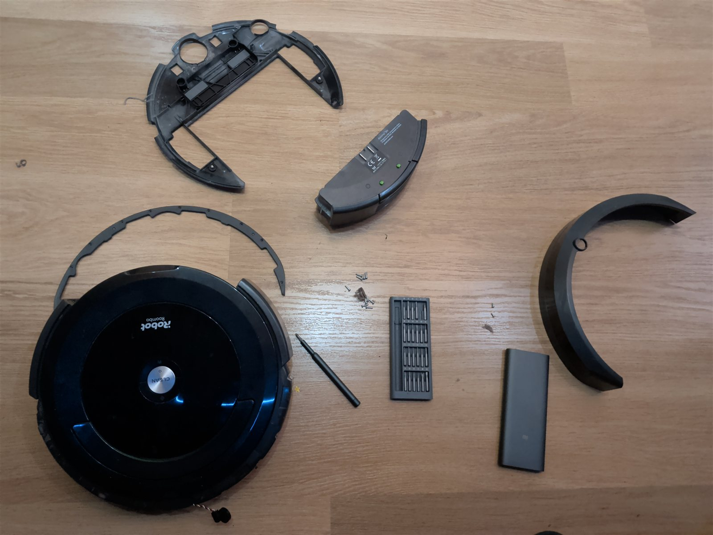
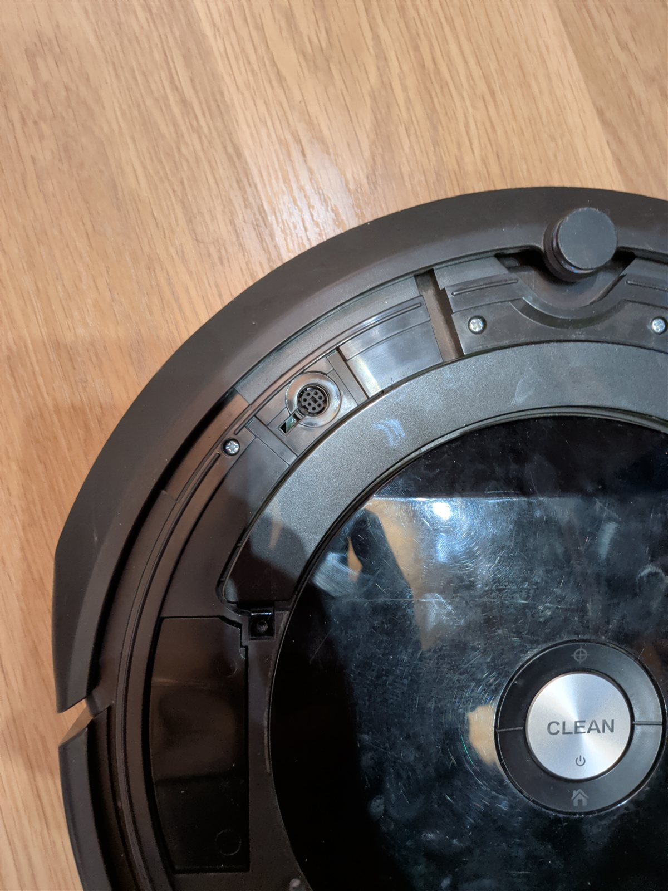
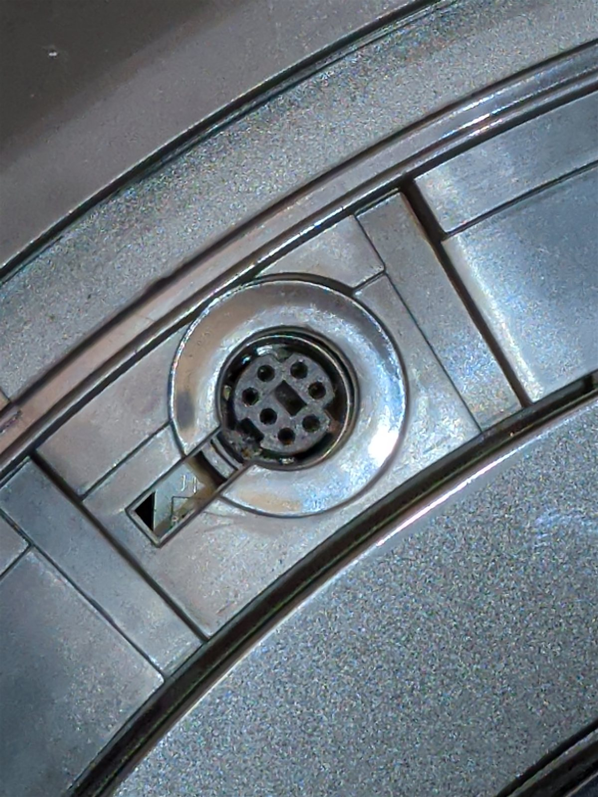
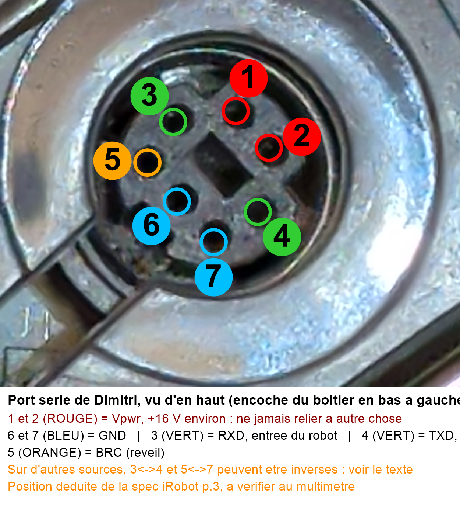
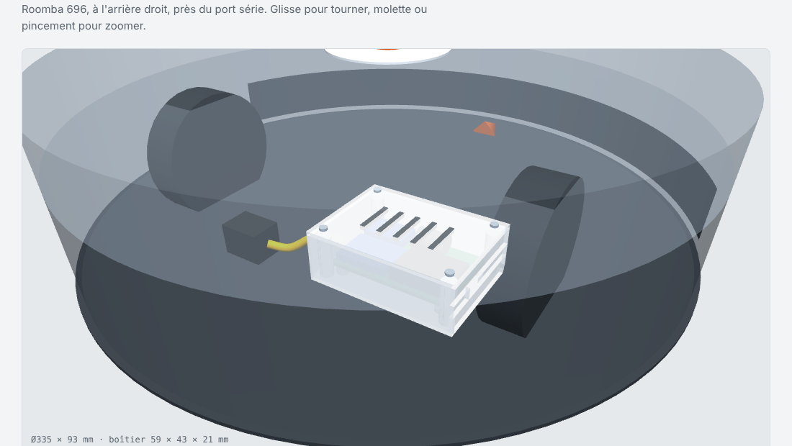

# OpenRobots — Aérobot ESP

Libérer un **Roomba 696** du cloud iRobot : un ESP32-C3 branché sur le port série du robot (Open Interface), géré par **ESPHome** et intégré à **Home Assistant**, avec une carte de la pièce, une manette pour le piloter et un planning local.

> **État du projet : démarrage.** Le robot est ouvert, le port série est repéré sur le dessus et le boîtier 3D est dessiné. Le firmware, la config Home Assistant et le mapper sont écrits mais **n'ont jamais tourné sur du vrai matériel** (rien n'a été compilé ni flashé, rien n'a été imprimé). Voir [`docs/ETAT_AVANCEMENT.md`](docs/ETAT_AVANCEMENT.md) pour le détail de ce qui est fait, vérifié et à faire.

## Objectif

| Fonction | Prévu |
|---|---|
| Contrôle local sans cloud (démarrer, arrêter, retour base) | oui |
| Planning géré par Home Assistant | oui |
| Retour automatique à la base / recharge | oui |
| Manette (joystick) dans le tableau de bord | oui |
| Carte d'une pièce de 20-25 m² avec la position du robot | oui, grossière (grille de 5 cm, sans lidar) |

Budget visé : **50 € maximum** pour toute l'électronique (le Roomba est déjà là). Les prix sont des estimations, à vérifier à l'achat.

## Matériel

| Pièce | Rôle |
|---|---|
| Roomba 696 (r696040) | robot, déjà possédé |
| ESP32-C3 SuperMini | cerveau Wi-Fi, parle au robot en série (115200 bauds) |
| MPU6050 (GY-521) | gyroscope pour le cap |
| Mini360 | convertit la batterie du robot (~16 V) en 5 V |
| NPN + résistances + condensateur | réveil du robot (BRC) et adaptation des niveaux |
| Perfboard 50 × 40 mm | porte tous les composants dans le boîtier |
| Boîtier imprimé en 3D | posé sur le dessus du robot, branché directement dans le port (voir [Le boîtier](#le-boîtier)) |

Liste complète et schéma de câblage : [`hardware/WIRING.md`](hardware/WIRING.md).

## Contenu du dépôt

| Dossier / fichier | Rôle | Statut |
|---|---|---|
| [`TUTORIEL.md`](TUTORIEL.md) | tutoriel pas à pas, sourcé, de l'ouverture du robot à la carte | rédigé, à compléter avec les vraies photos |
| [`docs/ETAT_AVANCEMENT.md`](docs/ETAT_AVANCEMENT.md) | où en est le projet, risques, prochaines étapes | à jour au 18/11/2026 |
| `firmware/` | config ESPHome (`roomba.yaml`) et composant C++ `roomba_oi` (flux de capteurs, pose, pilotage) | écrit, **non compilé** |
| `ha/` | package Home Assistant, tableau de bord, carte joystick | écrit, **non testé** |
| `mapper/` | grille d'occupation, rendu PNG, app AppDaemon, simulateur | cœur testé en simulation, app AppDaemon non testée |
| `hardware/` | câblage, brochage du port de Dimitri, boîtier 3D paramétrique ([`enclosure.scad`](hardware/enclosure.scad)) | brochage déduit, à confirmer au multimètre ; boîtier non compilé ni imprimé, position du port et hauteurs du dessus à mesurer |
| [`roomba-696-handoff.md`](roomba-696-handoff.md) | notes et sources de départ | référence |

## Démarrer

1. Lire [`TUTORIEL.md`](TUTORIEL.md) (sécurité, matériel, installation).
2. Copier `firmware/secrets.example.yaml` en `firmware/secrets.yaml` et le remplir. **Ne jamais publier `secrets.yaml`** (il est dans le `.gitignore`).
3. Compiler et flasher avec ESPHome (2025.8 ou plus récent, syntaxe `api: actions:`) :
   ```bash
   cd firmware
   esphome run roomba.yaml
   ```
4. Copier les fichiers de `ha/` dans Home Assistant (voir `ha/aerobot_package.yaml`, en-tête) et ceux de `mapper/` dans AppDaemon.
5. Tester le mapper sans robot :
   ```bash
   cd mapper
   pip install Pillow
   python simulate.py 900
   ```

## Où est le port série

Le port série est un **mini-DIN 7 broches sur le dessus du robot**, sous la bague décorative argentée. Sur Dimitri il est à l'**avant gauche**, environ 40° à gauche de la tourelle infrarouge vue de dessus (la tourelle est à l'avant), à environ 134 mm du centre (mesuré sur photo). **Il suffit de retirer la bague argentée** pour l'atteindre : pas besoin d'ouvrir le capot.

Dimitri a quand même été démonté assez largement (batterie, brosse latérale, pare-chocs, vis du dessous retirés), ce qui a servi aux photos ci-dessous.

<p align="center">
  
  
</p>

*À gauche : les pièces retirées. À droite : la tourelle infrarouge (à l'avant du robot) reste reliée au capot par des fils rouge et blanc. Si tu ouvres le capot, débranche son connecteur avant de soulever de plus de 2-3 cm, sans tirer sur les fils.*

<p align="center">
  
  
</p>

*Le port série, sur le dessus à l'avant gauche, près de la tourelle infrarouge (à gauche), et de près (à droite) : 7 trous, une clé rectangulaire au centre, la fente du boîtier en bas à gauche.*

### Brochage

<p align="center">
  
</p>

| Broche | Nom | Rôle |
|---|---|---|
| 1, 2 | Vpwr | batterie non régulée, environ 16 V (fusible 200 mA) : ne jamais relier à autre chose |
| 3 | RXD | entrée du robot, reçoit de l'ESP |
| 4 | TXD | sortie du robot, 0-5 V |
| 5 | BRC | réveil / anti-veille |
| 6, 7 | GND | masse |

La numérotation vient du schéma de la spec iRobot (p. 3) posé sur la photo. **Sûr** : 1 et 2 (Vpwr) et 6 (GND). **À confirmer au multimètre** : 3/4 et 5/7 peuvent être inversés si le schéma de la spec est une vue de dessous. En attendant, ne rien brancher dans 1 et 2, alimenter l'ESP en USB, ne prendre la masse que sur 6 et essayer 3/4 dans les deux sens. Détails : [`hardware/WIRING.md`](hardware/WIRING.md) et [`docs/ETAT_AVANCEMENT.md`](docs/ETAT_AVANCEMENT.md).

## Le boîtier

Toute l'électronique tient dans un boîtier imprimé en 3D **posé sur le dessus du robot**, centré sur le port série. Une fiche mini-DIN coudée descend dans le port par un trou du fond : rien ne passe sous le capot.

<p align="center">
  
  
</p>

*Aperçus 3D (modèle, pas une photo). À gauche : boîtier fermé, tourelle IR à gauche de l'image. À droite : couvercle transparent, avec l'ESP32-C3, le MPU6050, le Mini360, les composants passifs, les fils et la fiche coudée.*

| Caractéristique | Valeur |
|---|---|
| Encombrement | 56 × 88 mm, 22 mm de haut avec les pieds |
| Forme | bords intérieur et extérieur en arc, qui suivent le robot (rayon 56 à 144 mm) |
| Hauteur du robot avec le boîtier | ≈ 109 mm (93 mm sans) |
| Fixation | 4 pieds à deux hauteurs + adhésif double face épais (type VHB) |
| Couvercle | 4 vis M2 × 10 fraisées, lèvre de centrage, aération, trous pour la LED et BOOT/RESET, gravure « DIMITRI » |
| Flash de l'ESP | câble USB-C par une fente de la paroi arrière |
| Distances de sécurité | 8 mm du pare-chocs, au moins 15° de la tourelle IR |

Le modèle est paramétrique : [`hardware/enclosure.scad`](hardware/enclosure.scad), avec 4 pièces (`mock`, `box`, `lid`, `preview`). **Avant d'imprimer**, imprime le gabarit plat `mock` (1,2 mm) et pose-le sur le robot : son anneau doit entourer le port. Corrige au besoin `port_r`, `port_a`, `feet_in_h` et `feet_out_h` en haut du fichier. Étapes détaillées : [`TUTORIEL.md`](TUTORIEL.md), section 10.

## Comment ça marche

- Le Roomba nettoie avec son propre mode Clean. L'ESP reste en mode Passive, lit le flux de capteurs de l'Open Interface (pare-chocs, falaises, encodeurs, batterie) et calcule la position (x, y, θ).
- Le cap vient du gyroscope. Sur un contact frontal contre un mur, le firmware recale le cap sur un multiple de 90° (pièce rectangulaire).
- La manette envoie des commandes de pilotage à environ 10 Hz. Sans commande pendant 400 ms, les moteurs s'arrêtent.

## Limites connues

- Carte grossière : en simulation, les murs sont estimés à 25-40 cm près ; à mesurer sur le vrai robot.
- Dérive d'odométrie du Roomba 600 non mesurée : une calibration est indispensable.
- **Réveil depuis la base** : le robot (app 3.5.62) est probablement trop ancien pour se réveiller par BRC (la spec parle de firmware 3.8.2 ou plus). Solutions de repli décrites dans le tutoriel (appui sur CLEAN, etc.).
- Le brochage du port est **déduit** de la spec et de photos, pas encore mesuré.
- Le boîtier n'a pas encore été compilé dans OpenSCAD ni imprimé ; la position du port et les hauteurs du dessus sont estimées sur photo.
- Avec le boîtier, le robot monte à environ 109 mm : il peut ne plus passer sous certains meubles bas. Le retour à la base est aussi à tester (le boîtier ne doit pas gêner la tourelle IR).

## Sécurité

Le robot est alimenté par une batterie Li-ion : **retire-la avant toute intervention** et ne court-circuite jamais les broches 1 et 2 (Vpwr, ~16 V). Détails dans le tutoriel.

## Sources

Spec iRobot Roomba 600 Open Interface, projets ESPRoomba, dynodix/esphome-roomba, etc. : liste numérotée en fin de [`TUTORIEL.md`](TUTORIEL.md).
