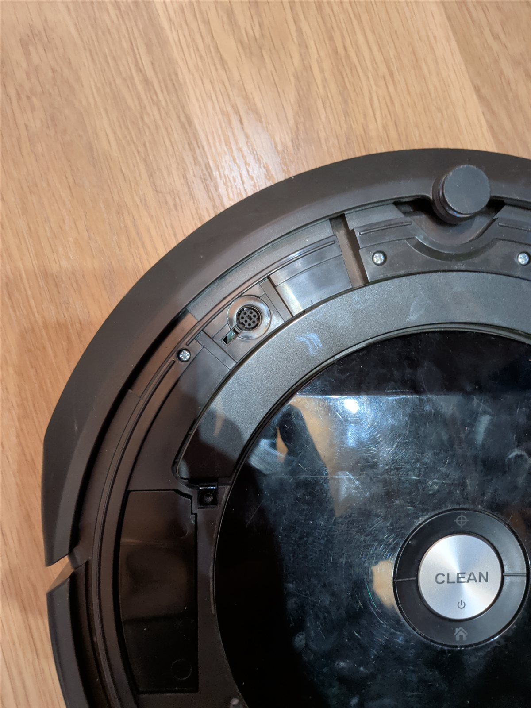
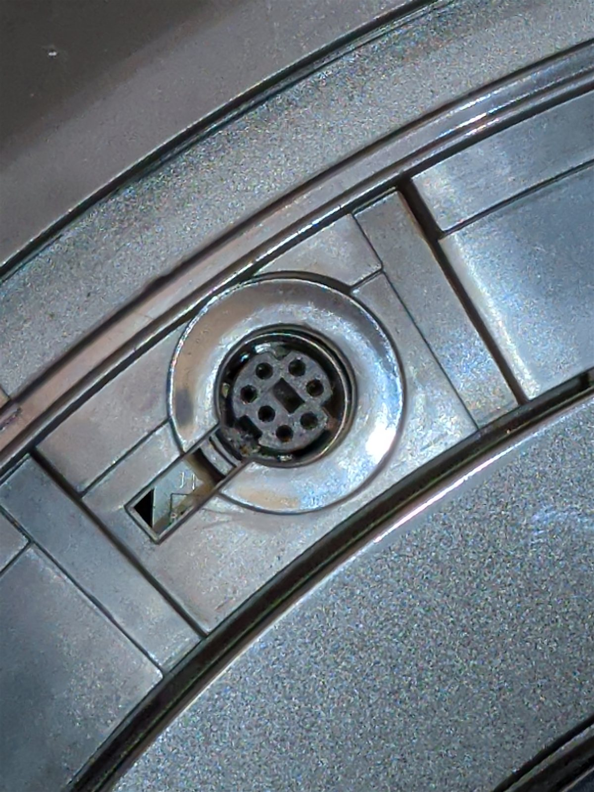
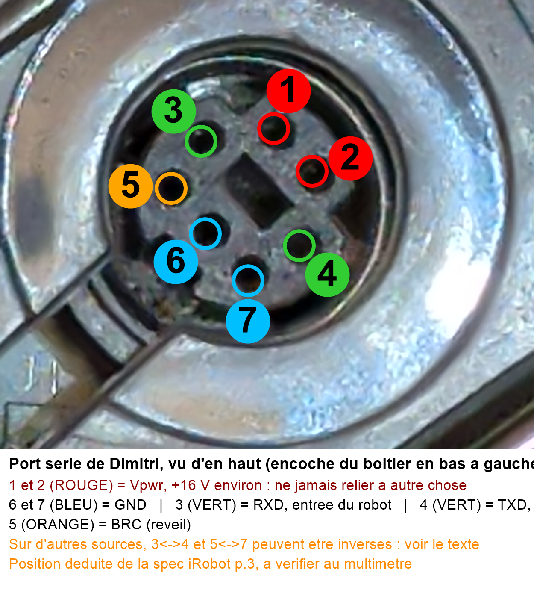

# Tutoriel Aérobot — de zéro à « Dimitri » connecté à Home Assistant, avec carte et manette

> Ce tutoriel est écrit pour être suivi **pas à pas, sans rien supposer**. Chaque étape dit *quoi faire*, *pourquoi*, *ce que tu dois voir* si ça marche, et *quoi faire sinon*.
> Les affirmations sont **sourcées** : `[S12]` renvoie à la liste des sources en fin de document, avec un niveau de confiance. Ce qui n'a **pas pu être vérifié** est marqué **⚠ NON VÉRIFIÉ**. Ne saute pas ces marques : elles disent où tu dois vérifier toi-même avant de continuer.
> Ce qui est écrit dans ce dossier (firmware, config HA, mapper) a été rédigé sans compilateur ESPHome ni Home Assistant à portée : **il est probable qu'il faille corriger quelques détails** à l'étape de compilation. Ce n'est pas un échec, c'est prévu (étape 4.6). Le **boîtier 3D**, lui, a été compilé (OpenSCAD 2021.01) : ses STL sont prêts dans `hardware/stl/`.
>
> **Dernière mise à jour : 18/11/2026.** Le port série de Dimitri est **sur le dessus** du robot (avant gauche, sous la bague argentée) et le boîtier se pose dessus : il n'y a plus besoin d'ouvrir le capot.

---

## Table des matières
0. [À lire avant de commencer](#0-à-lire-avant-de-commencer)
1. [Le cas de Dimitri (ton Roomba 696)](#1-le-cas-de-dimitri)
2. [Matériel et outils](#2-matériel-et-outils)
3. [Installer les logiciels sur ton PC Windows](#3-installer-les-logiciels-sur-ton-pc-windows)
4. [Étape « banc » : flasher l'ESP32 sans toucher au robot](#4-étape-banc--flasher-lesp32-sans-toucher-au-robot)
5. [Accéder au port série de Dimitri](#5-accéder-au-port-série-de-dimitri)
6. [Mesures de sécurité au multimètre](#6-mesures-de-sécurité-au-multimètre)
7. [Assembler l'électronique](#7-assembler-lélectronique)
8. [Premier dialogue avec le Roomba (alimenté en USB)](#8-premier-dialogue-avec-le-roomba-alimenté-en-usb)
9. [Alimenter l'ESP par le robot et mesurer le courant](#9-alimenter-lesp-par-le-robot-et-mesurer-le-courant)
10. [Imprimer le boîtier en 3D](#10-imprimer-le-boîtier-en-3d)
11. [Installation définitive sur le robot](#11-installation-définitive-sur-le-robot)
12. [Home Assistant : appareil, aspirateur, planning, tableau de bord](#12-home-assistant--appareil-aspirateur-planning-tableau-de-bord)
13. [La carte (AppDaemon + MQTT)](#13-la-carte-appdaemon--mqtt)
14. [La manette (joystick)](#14-la-manette-joystick)
15. [Calibrations (cap et distance)](#15-calibrations-cap-et-distance)
16. [Le problème du réveil depuis la base (firmware < 3.8.2)](#16-le-problème-du-réveil-depuis-la-base-firmware--382)
17. [Dépannage](#17-dépannage)
18. [Ce qui n'est PAS vérifié](#18-ce-qui-nest-pas-vérifié)
19. [Sources](#19-sources)

---

## 0. À lire avant de commencer

### 0.1 Ce que tu vas construire
```
Roomba 696 « Dimitri »  ⇄  ESP32-C3 (boîtier sur le dessus) ⇄  Wi-Fi  ⇄  Home Assistant
   port série OI              + gyroscope MPU6050                      ├─ aspirateur (start/stop/base)
                                                                        ├─ planning
                                                                        ├─ manette (joystick)
                                                                        └─ carte de la pièce
```
Le Roomba garde **son propre cerveau** pour nettoyer. L'ESP32 lit ses capteurs par le port série « Open Interface » (OI), lui envoie des ordres, et calcule où il est. Toute l'électronique tient dans un **boîtier imprimé posé sur le dessus du robot**, branché directement dans le port (aperçu : `docs/apercu-boitier.png`).

### 0.2 Règles de sécurité (à relire avant chaque séance)
1. **Batterie retirée** pendant tout démontage et toute soudure [S6][S7].
2. Le pin 1/2 du port (Vpwr) est à **~16-17 V** sur un Roomba 600 [S9] : **ne le laisse jamais toucher** RX, TX, BRC ni un GPIO de l'ESP. Un projet a grillé un ESP8266 en reliant son TX à cette tension [S9].
3. **Le TX du Roomba sort en 5 V** (« TTL 0-5 V » [S1 p.3]) : jamais directement sur un GPIO de l'ESP32 (diviseur obligatoire). Les GPIO de l'ESP32-C3 sont à considérer comme **non tolérants 5 V** (⚠ non vérifié dans le datasheet Espressif, par prudence).
4. **Le fusible interne du port est de 200 mA** (continu) et se déclenche au-delà de 500 mA en pointe [S1 p.3]. Tu vas **mesurer** ta consommation (étape 9).
5. Décharge-toi de l'électricité statique en touchant un radiateur/une partie métallique reliée à la terre avant de manipuler la carte (recommandation générale, non sourcée).
6. Avance par petites étapes, **teste après chaque étape**, et **prends des photos** avant de débrancher ou dévisser quoi que ce soit.

### 0.3 Comment lire les marques
- ✅ **Tu dois voir :** … → le résultat attendu.
- ❌ **Sinon :** … → que faire.
- 📷 → prends une photo.
- ⚠ **NON VÉRIFIÉ** → information incertaine, à contrôler.

### 0.4 Glossaire minimal
| Mot | Signification |
|---|---|
| **OI** | *Open Interface* : le protocole série documenté par iRobot pour piloter le Roomba [S1] |
| **BRC** | broche 5 du port : sert à réveiller le robot / le garder éveillé [S1] |
| **ESPHome** | outil qui transforme un fichier YAML en firmware pour ESP32 [S14] |
| **Flasher** | écrire le programme dans l'ESP32 |
| **Passive / Safe** | modes du Roomba : Passive = il fait ce qu'il veut (nettoie, charge), tu lis ses capteurs ; Safe = tu le pilotes, mais il garde ses protections (falaises, roues levées) [S1 p.7] |
| **GPIO** | broche d'entrée/sortie de l'ESP32 |
| **Multimètre** | appareil qui mesure tension (V), courant (A), continuité (bip) |
| **STL** | fichier 3D qu'on donne au slicer pour imprimer une pièce |

### 0.5 Suivre l'avancement
Le README affiche une **barre de progression** calculée à partir de sa « Feuille de route ». Quand tu termines une étape de ce tutoriel, ouvre le README sur GitHub et **coche la case correspondante** (`- [ ]` → `- [x]`) : une Action GitHub met la barre à jour toute seule en quelques secondes. Pense ensuite à faire `git pull` sur ton PC avant de modifier autre chose.

---

## 1. Le cas de Dimitri

D'après ta capture de l'app iRobot : **Product Name : Dimitri**, **Model : Roomba 696**, **SKU : r696040**, **Product Software : 3.5.62-95** (mis à jour le 8 juin 2023).

### 1.1 Pourquoi le numéro de firmware est important
La spec officielle iRobot (édition 2021) dit : *les firmwares Create 2 et Roomba 500/600 antérieurs à `release-3.8.2` / `release-stm32-3.7.7` ne se réveillent pas par impulsion BRC quand ils sont sur la base* [S1 p.7 et p.41 (annexe « bugs connus »)].

Si le « 3.5.62 » de l'app était le même numéro que celui de la carte mère, Dimitri serait **concerné** : **s'il s'endort sur sa base, l'ESP32 ne pourra pas le réveiller** (il faudra appuyer sur CLEAN).

### 1.2 Mais le numéro de l'app est-il le bon numéro ?
- 3.5.62 est une version du logiciel Wi-Fi des séries 600/800 publiée par iRobot en 2020 [S2][S3].
- **Rien ne prouve** que ce numéro soit celui que le robot affiche sur sa liaison série (`r3_robot/tags/release-…`). Un indice : la version « 3.2.6 » existe des deux côtés [S4], mais ce n'est pas une preuve.
- **La seule méthode documentée pour lire la vraie version** : envoyer l'opcode 7 (Reset) ; le robot imprime alors un message de démarrage qui contient la version, par ex. `r3_robot/tags/release-stm32-3.7.7` [S1 p.7-8, 41]. Un exemple réel sur un 630 : `r3_robot/tags/release-3.2.6:4975 CLEAN` [S4].
- **Le firmware fourni ici fait ça pour toi** : bouton « Lire version firmware » (étape 8.6). Ne présume donc de rien tant que tu ne l'as pas lu.

### 1.3 Ce que ça change dans le plan
| Cas | Conséquence | Que faire |
|---|---|---|
| Version série ≥ 3.7.7 / 3.8.2 | Réveil par BRC fonctionne | Rien de spécial |
| Version série < 3.8.2 (probable) | Pas de réveil par BRC sur la base | Section 16 : on **empêche** le sommeil, on **prévient** si il dort, et on prévoit une solution matérielle optionnelle |

> Un retour de terrain contradictoire existe : sur des 650 récentes, le robot s'endort au bout d'~1 minute sur la base et BRC ne le réveille pas [S5]. D'où la section 16.

---

## 2. Matériel et outils

### 2.1 Liste de courses (budget cible ≤ 50 €)
| Pièce | Rôle | Prix indicatif (⚠ à vérifier) |
|---|---|---|
| **ESP32-C3 SuperMini** | cerveau | ~7-9 € + port 3-6 € (Fruugo, relevé 07/11/2026 dans le fichier de passation) |
| **Mini360** (convertisseur abaisseur) | 16 V → 5 V | ~1-2 € |
| **MPU6050 « GY-521 »** | gyroscope pour le cap | ~2-4 € |
| **2 transistors NPN** (BC547 ou 2N2222) | commander BRC (+1 de rechange) | < 1 € |
| **Résistances** : 1 kΩ ×2, 4,7 kΩ ou 5,1 kΩ ×2, 10 kΩ ×2 | diviseur de tension, base du transistor | ~1 € |
| **Condensateur 470-1000 µF 16 V** | stabilise l'alim | < 1 € |
| **Fiche mini-DIN mâle coudée** (7 ou 8 broches), ou **câble OI/Create 2** à recouper (ex. Adafruit 2438 [S10], non lu en détail) | liaison au robot, la fiche descend dans le port par le fond du boîtier (étape 10.2) | ~3-6 € |
| **Perfboard (plaque à trous) ≈ 50×40 mm**, fil de câblage fin, gaine thermorétractable | assemblage | ~2-3 € |
| **Câble USB-C DE DONNÉES** (pas un câble de charge seule) | flasher l'ESP [S14b] | — |
| **Vis M2** : 4 × M2×10 auto-taraudeuses (couvercle), 4 × M2×6 (perfboard) | boîtier | ⚠ non relevé |
| **Adhésif double face épais** (type VHB), 4 pastilles Ø10 mm | coller le boîtier sur le robot | ⚠ non relevé |
| **Collier de serrage** 2,5 mm | tenir les fils dans le boîtier | ⚠ non relevé |
| **Filament** PLA ou PETG, environ 40 g | gabarit, boîtier, couvercle, cales | ⚠ non relevé |

Ce dont tu as besoin et que tu n'as peut-être pas : **un multimètre** (~10-15 €, indispensable), **un fer à souder + étain** (ou, à défaut, une planche d'essai « breadboard » pour les tests, mais le montage final doit être soudé).
Le budget de 50 € **n'inclut pas** le multimètre ni le fer à souder s'ils te manquent : dis-le-moi et je recalcule.
> ⚠ Les prix de ce tableau viennent du fichier de passation (relevés partiels du 07/11/2026) ou sont des ordres de grandeur : **ils n'ont pas été revérifiés**. Vérifie-les au moment de commander.

### 2.2 Outils pour ouvrir le robot
D'après le guide iFixit du Roomba 692 (même famille que le 696) [S6] : **tournevis Phillips #0 et #00**, un **spudger** (levier plastique) ou carte plastique, un outil d'ouverture plastique, un spudger métal fin. **Pas de Torx.** Prévois une **boîte à compartiments** pour les vis : il y en a **37 de tailles différentes** sur le 692 [S6].

**Sur Dimitri, l'essentiel est plus simple** : le port est sur le dessus, il suffit de retirer la **bague argentée à la main**. Tu n'as besoin du tournevis que pour la **trappe de la batterie** (sous le robot), et d'un **pied à coulisse** pour mesurer les hauteurs du dessus (étape 10.1). Une règle graduée fait l'affaire à défaut.

---

## 3. Installer les logiciels sur ton PC Windows

Ton PC a **Python 3.14.7** (vu pendant la préparation). La doc ESPHome exige **Python 3.12 ou plus récent** [S14] mais **ne dit pas si 3.14 est supporté** (⚠ NON VÉRIFIÉ). Pour éviter les surprises, on installe **Python 3.13** à côté.

### 3.1 Installer Python 3.13
1. Va sur https://www.python.org/downloads/windows/ et télécharge **Python 3.13.x (Windows installer 64-bit)**.
2. Lance l'installeur. **Coche « Add python.exe to PATH »** (en bas de la 1re fenêtre), puis **Install Now**.
3. Ouvre **PowerShell** (touche Windows, tape *PowerShell*, Entrée) et tape :
   ```powershell
   py -3.13 --version
   ```
   ✅ **Tu dois voir :** `Python 3.13.x`. ❌ **Sinon :** ferme et rouvre PowerShell ; vérifie que l'installation est terminée.

### 3.2 Créer un environnement ESPHome isolé (« venv »)
Un venv est un dossier qui contient *seulement* ESPHome, pour ne rien casser d'autre [S14].
```powershell
cd "D:\Document\Irobots esp"
py -3.13 -m venv .venv-esphome
.\.venv-esphome\Scripts\Activate.ps1
```
✅ Le début de ta ligne affiche `(.venv-esphome)`.
❌ **Sinon (message « l'exécution de scripts est désactivée ») :** exécute `Set-ExecutionPolicy -Scope CurrentUser RemoteSigned`, réponds `O`, puis recommence la 3e commande.

```powershell
pip install esphome
esphome version
```
✅ Tu dois voir un numéro de version. À la date de rédaction, la version stable annoncée est **2026.10.2** ; une bêta 2026.11.0b2 existe : **évite les bêtas** [S15].
Le premier `pip install` prend quelques minutes.

> **Alternative sans Python :** la doc ESPHome signale un installeur Windows 10/11 qui embarque son propre Python [S14]. Si le venv te pose problème, utilise-le (je n'ai pas détaillé son interface : ⚠ NON VÉRIFIÉ).

### 3.3 Pilote USB
L'ESP32-C3 a l'USB natif : **normalement aucun pilote** [S14b]. Si Windows ne reconnaît rien à l'étape 4, installe le pilote de la puce indiquée sur ta carte (CH340/CP210x) [S14b].

### 3.4 OpenSCAD et un slicer (pour le boîtier, étape 10)
- **Les STL sont déjà prêts** dans `hardware/stl/` : OpenSCAD ne sert que si tu dois changer une cote (position du port, hauteur des cales).
- OpenSCAD (2021.01 ou plus récent) : https://openscad.org/downloads.html
- Ton slicer habituel (PrusaSlicer, Cura, etc.). Je n'ai documenté que PrusaSlicer [S18].

---

## 4. Étape « banc » : flasher l'ESP32 sans toucher au robot

**But :** vérifier que l'ESP32, le Wi-Fi et Home Assistant fonctionnent, **avant** d'ouvrir le Roomba. On élimine ainsi la moitié des problèmes possibles.

### 4.1 Préparer le fichier de secrets
1. Dans l'Explorateur, ouvre `D:\Document\Irobots esp\firmware`.
2. Copie `secrets.example.yaml` et renomme la copie **`secrets.yaml`**.
3. Ouvre-le avec le Bloc-notes et remplace :
   - `wifi_ssid` / `wifi_password` : ton Wi-Fi **2,4 GHz** (l'ESP32-C3 ne gère pas le 5 GHz ; ⚠ vérification générale, non sourcée ici).
   - `api_key` : génère-la avec PowerShell :
     ```powershell
     python -c "import secrets,base64;print(base64.b64encode(secrets.token_bytes(32)).decode())"
     ```
     Colle le résultat (32 octets en base64, c'est le format attendu [S16]) entre guillemets.
   - `ap_password`, `ota_password` : mots de passe de ton choix (8 caractères mini pour l'AP).
4. **Ne partage jamais `secrets.yaml`.**

### 4.2 Brancher l'ESP32
Branche l'ESP32-C3 SuperMini à ton PC avec le câble USB-C **de données**. **Rien d'autre n'est connecté** (pas de Roomba, pas de MPU6050).

Trouve le port : clic droit sur le menu Démarrer → **Gestionnaire de périphériques** → **Ports (COM et LPT)** → une ligne « USB Serial Device (COM3) » ou similaire apparaît quand tu branches. Note le **COMx** [S14b].
❌ **Si rien n'apparaît :** essaie un autre câble (beaucoup sont « charge seulement »), un autre port USB, puis le **mode bootloader** :
- maintiens **BOOT**, appuie brièvement sur **RESET**, relâche **RESET**, puis relâche **BOOT** (variante : maintiens les deux, relâche ensemble) [S17][S17b].

### 4.3 Compiler et flasher
```powershell
cd "D:\Document\Irobots esp\firmware"
esphome run roomba.yaml --device COM3
```
(remplace `COM3` par ton port). `esphome run` valide, compile, téléverse puis ouvre les logs [S15b].
La **première compilation est longue (5-15 min)** : ESPHome télécharge la chaîne de compilation.

✅ **Tu dois voir :** à la fin, des logs qui défilent avec `WiFi Connected`, une adresse IP, et « API client connected » plus tard.

### 4.4 Premières erreurs possibles (et correction)
Ce firmware n'a **pas été compilé** par moi. Il est normal d'avoir peut-être des erreurs. Procédure :
1. **Lis la première erreur** (les suivantes en découlent), souvent juste avant `ERROR`.
2. Erreurs YAML (`mapping values are not allowed`, `Unknown key`) : problème d'indentation ou de nom de clé. Compare avec la doc du composant concerné (liens en [S14][S16]).
3. Erreurs C++ dans `components/roomba_oi/roomba_oi.cpp` : copie-colle l'erreur complète dans la conversation, je la corrige.
4. Si l'API ESPHome a changé (`api: actions:` introduit comme renommage de `services:` [S16] ; ⚠ la version exacte d'introduction n'a pas été établie), remplace `actions:` par `services:` et réessaie.

### 4.5 Ajouter l'appareil à Home Assistant
1. Dans Home Assistant : **Paramètres → Appareils et services**. Un encart **« Découvert : Aérobot (ESPHome) »** doit apparaître [S19]. Clique **Configurer**.
2. Colle la clé de chiffrement (`api_key`) si elle est demandée [S19].
3. Choisis une pièce, termine.
✅ L'appareil **Aérobot** apparaît avec ses entités (« Wi-Fi RSSI », « Flux robot actif »…).
❌ **Sinon :** Ajouter une intégration → ESPHome → saisis l'adresse IP vue dans les logs, port **6053**, et la clé [S19].

> **Pour l'instant « Flux robot actif » = off** : c'est normal, le robot n'est pas branché.

### 4.6 Si tout est vert
Tu as validé : le firmware compile, l'ESP se connecte au Wi-Fi, HA le voit. **Débranche l'ESP** : on passe au robot.

---

## 5. Accéder au port série de Dimitri

> **Sur Dimitri, c'est simple :** le port série est **sur le dessus**, sous la **bague argentée** qui s'enlève à la main, à l'**avant gauche** (environ 40° à gauche de la tourelle infrarouge, à ~134 mm du centre, mesuré sur photo). **Pas besoin d'ouvrir le capot** [photos du dépôt ; S41 ; S42]. Tu dois seulement **retirer la batterie** (étape 5.2) avant les mesures et le câblage.

<p align="center"> </p>

> **Avertissement honnête.** Aucune source trouvée ne décrit le démontage **exact du 696**. Les guides les plus proches sont ceux du **692** [S6] et du **690** [S7][S8]. **Tu adaptes.** Règle d'or : **si une pièce résiste, tu cherches la vis cachée au lieu de forcer.**

### 5.1 Préparer
1. Table propre, lampe, boîte à vis, **téléphone pour photographier chaque étape** 📷.
2. **Robot éteint, retiré de la base.** Vide le bac à poussière.
3. Retourne le robot sur un tissu doux.

### 5.2 Retirer la batterie (obligatoire) [S6][S7]
1. Retire la **brosse latérale** : sur le 692, une **vis Phillips de 4 mm au centre** la retient [S6].
2. Dévisse le **panneau de batterie** sous le robot. Sur le 690 : **4 vis de 6,4 mm** (Phillips #0) [S8] ; sur le 692 : 4 vis de 3,5 mm pour le panneau inférieur [S6]. **Compte tes vis et note leur longueur.**
3. Soulève la batterie **par ses deux languettes noires** [S6][S8] et débranche-la. ⚠ Ne tire pas sur les fils.
4. 📷 Photo de la batterie et de son connecteur.

✅ Tu dois voir : le robot sans batterie. Il **ne démarrera pas** sans elle (⚠ non sourcé).

### 5.3 Dégager le port (bague argentée)
1. Robot **sans batterie**, posé à l'endroit.
2. **Retire la bague argentée** à la main, en la soulevant par le bord [S12]. Ne force pas : si elle résiste, cherche un clip avec l'outil plastique. 📷
3. Le port apparaît à l'**avant gauche**, dans un logement à collerette métallique, à côté de la tourelle infrarouge (le petit cylindre noir à l'avant).

✅ **Tu dois voir :** un connecteur rond à **7 trous** avec une clé rectangulaire au centre (photo ci-dessus).

### 5.4 Ouvrir le capot (seulement si tu en as besoin)
Pour accéder au port, ce n'est **pas nécessaire** sur Dimitri. Garde ces infos pour une réparation (carte mère, brosse).

**Ce que disent les sources (sur d'autres modèles de la famille 600) :**
- Roomba **692** : après le panneau inférieur, **10 vis de 13,3 mm** (« holders »), **2 vis de 7,4 mm** (capteur du bumper), puis on **soulève le couvercle supérieur à l'outil plastique par les languettes latérales et centrales**, puis **15 vis de couvercle** (10 de 9,6 mm, 4 de 9,4 mm, 1 de 9,5 mm) [S6].
- Roomba **614** : il faut **retirer le bumper et débrancher sa nappe** avant d'ouvrir le dessus [S11].
- Roomba **690** : la **bague argentée externe s'enlève à la main**, le **cache central noir (logo + bouton) demande un spudger plastique**, et les deux capots plastiques se remettent **par clipsage** [S12].
- Un utilisateur dit que la procédure du 630 **ne marche pas sur un 690** [S13 — confiance faible].

**Démarche proposée (à adapter) :**
1. Bague argentée retirée (5.3).
2. Cherche des **vis visibles** sur le dessus et le dessous ; défais-les **toutes**, en rangeant par groupe (étiquette : « dessous-bords », « dessus-centre »…). Les vis de longueurs différentes ne doivent pas être mélangées [S6][S13].
3. **Ne tire pas** sur le bumper : sa nappe/câble relie un capteur à la carte. Si le bumper bloque l'ouverture : retire-le **doucement** et **débranche sa nappe** [S11] en tirant sur le connecteur, pas sur les fils.
4. Soulève le capot **par l'arrière** à l'outil plastique, en suivant le bord : clic des clips = normal. 📷 à chaque progression.
5. Stop si tu vois un **câble tendu** : trouve où il va avant d'aller plus loin.

> ⚠ La **tourelle infrarouge** reste reliée au capot par des fils rouge et blanc : débranche son connecteur avant de soulever le capot de plus de 2-3 cm, sans tirer sur les fils (photo `docs/photos/tourelle-ir-fils.jpg`).

### 5.5 Reconnaître le port OI
- La spec place un **mini-DIN 7 broches « à l'arrière droit, sous un cache plastique à rompre »** [S1 ; ⚠ cette formulation provient de résultats de recherche, le PDF n'a pas pu être relu mot à mot]. **Sur Dimitri, les photos montrent autre chose** : le port est sur le dessus, à l'avant gauche, sous la bague décorative.
- Sur le 690 d'un projet Hackaday, la **bague argentée cache le connecteur OI**, et le **trou dans le capot est trop étroit pour le mini-DIN complet** : l'auteur a fabriqué un **connecteur sur mesure** (JST en ligne) et fait passer ses fils sous la carte mère [S12].
- Sur d'autres modèles, des projets le décrivent **sous le capot supérieur** [S20][S21] ; sur la série 500, la spec le place « sur le dessus, sous le cache décoratif » [S41], ce qui correspond à Dimitri.

📷 **Photographie le port de près**, puis compare avec les images de la spec. Cherche **7 contacts** disposés en demi-cercle (mini-DIN).

### 5.6 Choisir comment te raccorder (3 options)
| Option | Avantages | Inconvénients |
|---|---|---|
| **A. Fiche mini-DIN coudée** (achetée ou récupérée sur un câble) | propre, réversible, **prévue par le boîtier** (descend par le trou du fond) | le logement du port peut être trop étroit pour certaines fiches [S12] : essaie la fiche dans le port **avant** de souder |
| **B. Souder 5 fils directement sur les contacts** | passe partout (projet 183524 [S9]) | demande d'ouvrir le capot et de la soudure fine ; irréversible |
| **C. Connecteur sur mesure** (broches Dupont dans une fiche imprimée) | réversible | à dessiner après avoir mesuré l'écartement des trous ; comme le projet RPi [S12] |

**Recommandation :** **A**, c'est ce que le boîtier attend. **C** si aucune fiche ne rentre. N'avance pas tant que tu n'as pas **identifié chaque broche** (étape 6).

---

## 6. Mesures de sécurité au multimètre

> **Pourquoi :** la numérotation des broches **vue de face n'est pas confirmée** par les sources (une discussion HA parle de pins « 1 à 7 de haut en bas » [S22], la spec Create 2 numérote vue du dessus de la prise femelle, certains câbles ont une numérotation inversée). **Tu dois vérifier au multimètre.**

### 6.1 Réglages de base du multimètre [S23]
- **Tension continue (V avec trait droit)** : câble noir sur **COM**, rouge sur **VΩ**. Se mesure **en parallèle** (sondes aux deux points).
- **Courant (mA)** : se mesure **en série** (on coupe le circuit et on intercale l'appareil) ; rouge sur **mA** (ou 10A), **puis remets le fil rouge sur VΩ après** (le calibre 10A est souvent sans fusible).
- **Continuité (symbole « bip »)** : l'appareil bippe si deux points sont reliés.

### 6.2 Identifier les masses (batterie DÉBRANCHÉE)
1. Mode **continuité**.
2. Une sonde sur une **borne négative (–) du connecteur de batterie** (repère « – »/« 0V » sur la carte, ou le fil noir), l'autre sur chaque contact du port, un par un.
3. Les **deux contacts qui bippent** = **GND** (pins 6 et 7 selon la spec [S1 p.3]).
4. 📷 Marque-les (ruban de couleur) → **GND**.

### 6.3 Mesurer Vpwr (batterie BRANCHÉE, robot éteint)
> ⚠ **Seul moment où tu manipules une source sous tension.** Pointes fines, **ne touche qu'un contact à la fois**, ne laisse jamais une sonde glisser sur un contact voisin.
1. Rebranche la batterie (bague argentée retirée, **ne l'allume pas**).
2. Multimètre en **V continu**. Sonde noire sur un **GND** identifié au 6.2, sonde rouge **sur chacun des autres contacts** un par un.
3. Note les valeurs :
   - **~12-17 V** sur **2 contacts voisins** → **Vpwr (pins 1 et 2)**. Un Roomba 632 a été mesuré à 16,2-16,9 V [S9] ; la spec dit seulement « non régulée » [S1 p.3].
   - **~0 V ou ~5 V** sur les autres selon l'état du robot (TX ≈ 5 V au repos possible ; ⚠ mesure à interpréter prudemment).
4. Débranche la batterie. **Écris** Vpwr = … V.

✅ **Résultat attendu :** tu as identifié **GND ×2, Vpwr ×2**, et **3 contacts restants** (RXD, TXD, BRC) que tu n'as pas encore nommés avec certitude.

### 6.4 Nommer RXD / TXD / BRC
Avec la spec [S1 p.3] : 3 = RXD (entrée du robot), 4 = TXD (sortie du robot), 5 = BRC, 6 et 7 = GND.

Les trous **ne sont pas alignés dans l'ordre 1 → 7** : leur position sur Dimitri a été **déduite** du schéma de la spec posé sur la photo, voir l'image ci-dessous et `hardware/WIRING.md`.

<p align="center"></p>

- **Sûr** (symétrie des trous et position de l'encoche) : 1 et 2 = Vpwr, 6 = GND. Les mesures 6.2 et 6.3 doivent le confirmer.
- **Incertain** : **3 et 4** (RXD/TXD) et **5 et 7** (BRC/GND) peuvent être inversés si le schéma de la spec est une vue de dessous.

Pour trancher **sans risque** :
- Le contact parmi 5/7 qui **bippe avec la masse** (6.2) est le GND (7) ; l'autre est BRC (5).
- Pour 3/4 : à l'étape 8, câble-les dans un sens. Si « Flux robot actif » reste à `off`, **inverse-les**. Une inversion de TX et RX est sans danger : les deux côtés restent en basse tension.
- En cas de doute, **ne branche pas** : redemande-moi avec une photo.

---

## 7. Assembler l'électronique

> Monte **sur breadboard d'abord** (sans soudure) pour tester, puis soude sur la perfboard.

### 7.1 Régler le Mini360 **avant** de le raccorder à quoi que ce soit [S24]
Le Mini360 (puce MP2307 selon Components101 ; d'autres sources parlent d'autres puces : lis le marquage de la tienne) accepte **4,75-23 V** en entrée et sort **1-17 V réglable** au potentiomètre (sens horaire = tension en hausse) [S24].
1. Alimente l'entrée **avec une source connue** (ex. bloc 9-12 V que tu as déjà, **polarité + / – à respecter**). Pas encore le robot.
2. Multimètre sur la **sortie**, **à vide** (rien de branché dessus).
3. Tourne la vis du potentiomètre **doucement** jusqu'à **5,0 V** (4,9-5,1 V).
4. **Marque** le potentiomètre au feutre pour ne plus y toucher.
✅ Sortie = 5,0 V stable.

### 7.2 Schéma
Voir `hardware/WIRING.md` (schéma ASCII). Résumé des liaisons :
| De | Vers | Remarque |
|---|---|---|
| Robot pin 1 (Vpwr) | Mini360 **IN+** | (via le fusible interne 200 mA) |
| Robot pin 6/7 (GND) | Mini360 **IN–** + GND commun | |
| Mini360 **OUT+** (5,0 V) | ESP32 **5V** | |
| Mini360 **OUT–** | ESP32 **GND** | |
| Condensateur 470-1000 µF | entre OUT+ et GND, **au plus près de l'ESP** | stabilise les pics Wi-Fi ; **respecte la polarité** (bande = –) |
| Robot pin 4 (TXD, 5 V) | → **5 kΩ** → point milieu → **ESP GPIO7 (RX)** ; point milieu → **10 kΩ** → GND | diviseur : 5 V × 10/(5+10) = **3,33 V** |
| Robot pin 3 (RXD) | ← **ESP GPIO6 (TX)** | un 3,3 V suffit comme niveau haut (⚠ constaté par plusieurs projets [S25], pas par la spec) |
| Robot pin 5 (BRC) | ← **collecteur** du NPN | |
| NPN **émetteur** | GND | |
| NPN **base** | ← **1 kΩ** ← **ESP GPIO10** | GPIO10 à 1 = BRC tiré à 0 V |
| MPU6050 **VCC** | ESP **3V3** | (⚠ la carte GY-521 accepte 3,3 ou 5 V selon les vendeurs ; 3,3 V = niveaux logiques cohérents) |
| MPU6050 **GND / SDA / SCL** | GND / **GPIO4** / **GPIO3** | |

**Pourquoi ces GPIO ?** Le C3 a trois broches de démarrage sensibles (**GPIO2, 8, 9**) [S26][S17] : GPIO8 = LED de la carte, GPIO9 = bouton BOOT. On les évite pour les signaux.
Le choix UART 6/7 et BRC 10 reprend ESPRoomba [S27] (tu peux le relire pour comparer).

**Pourquoi un transistor sur BRC ?** BRC est tirée au niveau haut côté robot ; on ne doit que la **tirer à zéro** [S28]. Le transistor évite d'imposer du 3,3 V ou de recevoir du 5 V sur le GPIO.

### 7.3 Contrôles AVANT de mettre sous tension (tu les fais même si tu es sûr)
Multimètre en **continuité, tout débranché** :
- [ ] **Aucun bip** entre Vpwr(IN+) et GND.
- [ ] **Aucun bip** entre Vpwr et n'importe quelle broche de signal (RX, TX, BRC, GPIO).
- [ ] **Bip** entre GND de l'ESP, GND du Mini360 et GND du port.
- [ ] Le condensateur a la bonne polarité.

### 7.4 Test sur table (sans le robot)
1. Alimente l'entrée du Mini360 avec ton **bloc 9-12 V** (pas le robot).
2. Mesure la sortie : **5,0 V**. Mesure sur l'ESP : **3,3 V** entre 3V3 et GND.
3. Branche l'USB à l'ESP **en plus** ? ⚠ **Non** : ne branche pas USB **et** 5 V Mini360 en même temps (⚠ pratique courante : la SuperMini a une protection selon les vendeurs, mais je n'ai pas de source) → utilise **l'un ou l'autre**.

### 7.5 Implanter les composants sur la perfboard (pour le boîtier)
Le boîtier attend une **perfboard de 50 × 40 mm**, vissée par ses 4 coins. Coupe-la à la bonne taille et perce 4 trous de **2,2 mm** à **2,5 mm des bords** (une vis M2×6 par coin). Garde libre un carré de **5 mm** autour de chaque trou.

Implantation prévue (coordonnées en mm depuis le coin de la plaque côté bouton CLEAN, côté USB) :

| Composant | Position (x, y) | Taille | Remarque |
|---|---|---|---|
| ESP32-C3 SuperMini | 0,5 ; 6 | 22,5 × 18 | **USB-C au ras du bord x = 0**, face à la fente de la paroi du boîtier |
| MPU6050 (GY-521) | 27 ; 6 | 21 × 16 | **à plat**, bien soudé ou vissé : la plaque doit rester rigide |
| Mini360 | 6 ; 27 | 17 × 11 | sous les **fentes d'aération** du couvercle |
| Condensateur (couché) | 27 ; 26 | Ø8 × 12 | au plus près de l'entrée 5 V de l'ESP |
| Résistances 1 k, 4,7-5 k, 10 k | 39,5 ; 25-33 | 6 × 2 | |
| Transistor NPN | 41 ; 36 | TO-92 | |

- Fais sortir les **5 fils vers la fiche** (Vpwr, GND, TXD, RXD, BRC) par le **bord y = 40** : c'est le côté du port dans le boîtier.
- Hauteur maximale des composants au-dessus de la plaque : **9 mm** au centre, **7 mm** le long des parois (la lèvre du couvercle descend de 2 mm). L'ESP sur ses barrettes monte à environ 6,7 mm avec son USB-C, le condensateur couché à 8 mm : place-le au centre.
- La LED et les boutons BOOT/RESET de l'ESP tombent sous de petits trous du couvercle (⚠ positions approximatives : vérifie sur ta carte et agrandis les trous si besoin).

---

## 8. Premier dialogue avec le Roomba (alimenté en USB)

**But :** vérifier la liaison série **sans** utiliser l'alimentation du robot : on alimente l'ESP **en USB** (câble sur ton PC) et on relie **seulement** TX, RX, BRC et GND au robot. Ainsi aucune limite de 200 mA ne s'applique encore.

### 8.1 Câblage minimal
- ESP32 branché en **USB sur le PC**.
- **GND** du port robot ↔ **GND** de l'ESP.
- Robot TXD → diviseur → GPIO7 ; GPIO6 → Robot RXD ; GPIO10 → 1 kΩ → base NPN, collecteur → BRC, émetteur → GND.
- **Pas de lien Vpwr** pour l'instant.
- Batterie rebranchée dans le robot ; bague argentée retirée, robot posé stable. Le boîtier n'est **pas encore** monté : on teste à l'air libre.

### 8.2 Allumer et regarder les logs
```powershell
cd "D:\Document\Irobots esp\firmware"
.\..\.venv-esphome\Scripts\Activate.ps1
esphome logs roomba.yaml --device COM3
```
(si tu avais fermé la fenêtre à l'étape 3, réactive le venv avec la ligne `Activate.ps1`).
Dans HA, regarde l'entité **« Flux robot actif »**.

✅ **Tu dois voir :** « Flux robot actif » = **on** et la **Tension batterie** ≈ **14-17 V** (batterie Li-ion 4S) puis **Batterie %** crédible [S1 p.23-26 pour les paquets de tension et de charge].
❌ **Sinon :**
1. Appuie une fois sur **CLEAN** pour réveiller le robot. Observe : la spec indique que le Roomba s'endort et que **l'OI est désactivée pendant le sommeil** [S29].
2. Appuie dans HA sur le bouton **« Réveiller »** (impulsion BRC + Start).
3. Vérifie **les croisements** : TX du Roomba → RX de l'ESP, et inversement. **L'erreur n°1** : TX/RX inversés.
4. Vérifie le débit : le Roomba est à **115200 bauds, 8N1** par défaut [S1 p.4].
5. Mesure TXD au multimètre : ~5 V au repos ? Sinon tu es peut-être sur le mauvais contact.

### 8.3 Tester les commandes (dans cet ordre)
1. **« Localiser (bip) »** : le robot joue une courte mélodie (l'opcode *Play* n'est autorisé qu'en **Safe/Full** [S1 p.20], le firmware passe en Safe, joue, puis revient en Passive).
2. **« Nettoyer »** : il part nettoyer. ⚠ Mets-le **sur une surface sûre** (sol, pas la table).
3. **« Arrêter »** : il s'arrête.
4. **« Retour à la base »** : il cherche la base (comme le bouton Dock) [S1 p.11].

### 8.4 Vérifier les capteurs
Dans HA, souffle sur les capteurs ou appuie dessus :
- Pare-chocs droit/gauche : **appuie** sur le bumper → le capteur change [S1 p.23].
- **Falaise détectée** : soulève et approche une main sous les capteurs avant.
- **Roue levée** : soulève le robot.
- **Sur la base** : pose-le sur la base → « En charge » devient on.

### 8.5 Vérifier le cap
1. Pose le robot sur le **sol**. Note **Pose theta**.
2. Fais-le pivoter **de ~90° vers la gauche à la main** (il ne doit pas déraper, tourne-le doucement) et relis.
3. ✅ **Le cap doit augmenter** (anti-horaire = positif). ❌ Sinon, il tourne dans l'autre sens : ajoute `id(roomba).set_gyro_scale(-1.0f);` dans le `on_boot` de `roomba.yaml` et reflashe.

### 8.6 Lire la vraie version du firmware (important)
1. Dans HA, **appuie sur « Lire version firmware »** (robot éveillé, hors base si possible).
2. Le robot **redémarre**, imprime son message de démarrage (c'est l'opcode 7 Reset, la seule méthode documentée [S1 p.7-8]) ; le firmware l'écoute 6 s puis relance la communication.
3. Regarde **l'entité « Version firmware robot »** et les logs (`Message de démarrage du robot : …`).
4. ✅ Tu dois lire quelque chose comme `release-stm32-3.7.7` ou `release-3.2.6` [S1 p.41][S4].
5. **Note la valeur.** C'est elle qui décide de la section 16.
❌ Si « introuvable » : copie l'extrait de log et envoie-le moi.

---

## 9. Alimenter l'ESP par le robot et mesurer le courant

### 9.1 Principe
Le port fournit Vpwr via un **fusible PTC de 200 mA** [S1 p.3] ; **ne dépasse pas 200 mA en continu**, et surtout pas 500 mA en pointe, sinon le fusible se déclenche. Un ESP32 en Wi-Fi a des pics de **300-500 mA sous 3,3 V** [S9][S20] mais, vu par le **16 V** à travers un convertisseur abaisseur, le courant **côté robot** est bien plus faible (~÷4). **Il faut le mesurer.**

### 9.2 Mesure en série
1. Batterie **débranchée**.
2. Coupe le fil de **Vpwr → Mini360 IN+** : intercale le multimètre en **mode mA** (rouge sur le connecteur mA, noir sur COM) [S23].
3. Rebranche la batterie. Lis le courant : au **démarrage Wi-Fi**, pendant la **connexion HA**, pendant une **commande**.
4. **Remets le fil rouge du multimètre sur VΩ** après.
✅ **Objectif : < 150 mA en continu, jamais > 200 mA.** Note la valeur max.
❌ Si le fusible se déclenche (l'ESP s'éteint, ne repart pas tout de suite) : attends quelques minutes (PTC), puis cherche la cause. Solutions possibles (⚠ hors spec iRobot, non vérifiées) : alimentation directe sur la batterie avec **fusible 0,5 A**, ou réduire la consommation (puissance d'émission Wi-Fi).

---

## 10. Imprimer le boîtier en 3D

> Le boîtier se pose **sur le dessus** du robot et coiffe le port série : la fiche mini-DIN coudée descend dans le port par un trou du fond. Le 696 fait environ **Ø335 × 93 mm** [S43] ; avec le boîtier, il monte à **≈ 109 mm**. Vérifie qu'il passe encore sous tes meubles. Aperçu : `docs/apercu-boitier.png`.

### 10.1 Mesurer et caler avec le gabarit
1. Imprime **`hardware/stl/mock.stl`** : un **cadre plat de 1,2 mm** (environ 10 minutes, ⚠ ordre de grandeur).
2. Pose-le sur Dimitri, bague argentée retirée : l'**anneau** doit entourer le port, le bord intérieur arrondi côté bouton CLEAN.
3. Mesure au pied à coulisse le **dénivelé** entre le capot central brillant, l'anneau gris et la piste du port.
4. Si l'anneau tombe à côté ou si les hauteurs diffèrent, ouvre `hardware/enclosure.scad` dans OpenSCAD et corrige en haut du fichier :

| Paramètre | Rôle | Valeur actuelle |
|---|---|---|
| `port_r` | distance centre du robot → centre du port | 134 mm (estimé sur photo) |
| `port_a` | angle du port depuis l'avant (tourelle), vers la gauche | 39° (estimé sur photo) |
| `feet_in_h` | hauteur des cales posées sur le capot central | 2 mm (⚠ estimé) |
| `feet_out_h` | hauteur des cales posées dans la piste du port | 5,2 mm (⚠ estimé) |

Le fond du boîtier doit passer **au-dessus de l'anneau gris sans le toucher**. Puis réexporte le gabarit (`part = "mock"` → **F6** → **Fichier → Exporter → Exporter en STL** [S18b]) et recommence jusqu'à ce qu'il tombe juste.

### 10.2 Fiche et fixation
- Fiche : une **mini-DIN coudée** (ou un câble sacrifié). Sa partie métallique descend dans le port par le **trou de Ø20 mm du fond** ; le corps reste dans le boîtier. ⚠ Vérifie que le corps fait **moins de 10 mm de haut** et que la fiche **rentre dans le logement du port** (sur un 690, le trou était trop étroit pour une fiche complète [S12]).
- Fixation : 4 pastilles d'**adhésif double face épais** (type VHB) sous les cales. Le boîtier reste démontable en tirant doucement.

### 10.3 Boîtier
1. Les STL sont déjà prêts dans `hardware/stl/` (`box`, `lid`, `feet`, `mock`), orientés pour l'impression. Si tu as changé une cote : `part = "box"` → F6 → exporter le STL, puis idem pour `lid` et `feet`. Le boîtier s'imprime **fond sur le plateau**, le couvercle **face gravée sur le plateau** (le STL est déjà retourné), sans supports.
2. Colle les **4 cales** (`feet`) sous le boîtier, dans les cercles gravés du fond : les 2 basses (2 mm) côté bouton CLEAN, les 2 hautes (5,2 mm) côté port.
3. Slicer (PrusaSlicer : importer → choisir imprimante/filament → **hauteur de couche 0,15-0,2 mm**, **remplissage ~15 %**, **aucun support nécessaire**, **« Slice now »** → exporter le G-code [S18]).

| Pièce | Fichier | Orientation | Dimensions | Volume plein |
|---|---|---|---|---|
| Gabarit | `mock.stl` | à plat | 56 × 96 × 1,2 mm | 1,2 cm³ |
| Boîtier | `box.stl` | fond sur le plateau | 56 × 93 × 18 mm | 20 cm³ |
| Couvercle | `lid.stl` | face gravée sur le plateau (déjà retourné) | 56 × 93 × 4 mm | 10 cm³ |
| Cales | `feet.stl` | à plat | 4 × Ø10 mm, 2 et 5,2 mm | 1,1 cm³ |

Les quatre pièces compilent sans avertissement et sont étanches (« manifold »), vérifié avec OpenSCAD 2021.01. Avec 15 % de remplissage, le tout fait bien moins de 40 g de PLA.
4. Si OpenSCAD affiche `not a valid 2-manifold` : des faces coïncident ; fais dépasser légèrement les formes soustraites [S18b].
5. Matériau : **PLA** suffit hors chaleur ; **PETG** si tu veux plus de tenue (⚠ recommandation générale, non sourcée).

---

## 11. Installation définitive sur le robot

1. **Soude** le montage sur la perfboard en suivant l'implantation 7.5, puis refais les contrôles de l'étape 7.3 sur la version finale.
2. Le **MPU6050** doit être **à plat et rigide**, **axe Z vertical**. Dans le boîtier, il est loin du moteur de brosse principale (vibrations ; ce moteur perturbe aussi les magnétomètres [S30], on n'utilise que le gyro).
3. **Visse la perfboard** sur ses 4 plots (M2×6), USB-C face à la fente de la paroi.
4. **Colle les 4 cales** dans les cercles gravés sous le fond : les 2 basses côté bouton CLEAN, les 2 hautes côté port (étape 10.3).
5. Passe la **fiche** par le trou du fond et serre les fils entre les deux plots avec un **collier**, sans les tendre.
6. **Avant de coller**, branche la fiche dans le port et fais **tous les tests** de l'étape 8 (commandes, capteurs, cap) puis **la mesure de courant** de l'étape 9, couvercle ouvert.
7. **Dégraisse** le dessus du robot sous les cales (alcool isopropylique, ⚠ conseil général non sourcé), pose l'**adhésif** sous les cales, puis presse le boîtier fermement pendant une trentaine de secondes, fiche bien enfoncée.
8. **Ferme le couvercle** avec 4 vis M2×10, sans forcer (vis auto-taraudeuses dans le plastique).
9. Si tu as ouvert la trappe de batterie ou le capot, referme-les dans **l'ordre inverse** (photos) et remets les **vis à leur place** (types différents).
10. La **bague argentée** ne se remet probablement pas : le boîtier occupe sa place au-dessus du port (⚠ non vérifié ; garde-la de côté).
11. **Désactive les plannings de l'app iRobot** pour éviter un double démarrage (⚠ conseil de bon sens, non sourcé).

**Derniers tests, boîtier monté :**
- [ ] Le robot **passe sous tes meubles bas** (hauteur totale ≈ 109 mm au lieu de 93).
- [ ] Le **pare-chocs** recule librement sans toucher le boîtier.
- [ ] Le robot **retrouve sa base** depuis plusieurs coins de la pièce : le boîtier ne doit pas masquer la tourelle infrarouge.
- [ ] Le câble USB-C se branche par la fente pour flasher (les mises à jour suivantes passent en Wi-Fi, OTA).

✅ Coche les étapes « Imprimer le gabarit puis le boîtier, monter l'électronique » dans la feuille de route du README.

---

## 12. Home Assistant : appareil, aspirateur, planning, tableau de bord

### 12.1 Activer les « packages » [S31]
1. Dans HA, installe **« File editor »** ou **« Studio Code Server »** depuis **Paramètres → Apps** (anciennement Add-ons) si tu n'as pas d'éditeur.
2. Ouvre `configuration.yaml` et ajoute (si absent) :
   ```yaml
   homeassistant:
     packages: !include_dir_named packages
   ```
3. Crée le dossier **`/config/packages/`**.
4. Copie **`ha/aerobot_package.yaml`** dedans, nommé `aerobot.yaml` (le nom de fichier = nom du package ; il doit être unique [S31]).
5. **Outils de développement → YAML → « Vérifier la configuration »**, puis **« Redémarrer »**.
❌ En cas d'erreur sur `template: - vacuum:` : cette syntaxe existe dans la doc HA actuelle [S32], mais **la version où elle est apparue n'a pas pu être établie** (⚠). Si ta version ne la connaît pas, commente le bloc `template:` ; les boutons ESPHome (Nettoyer, Retour…) restent utilisables directement.

> **Changement important :** depuis HA **2026.9**, `battery_level` n'existe plus sur l'aspirateur ; la batterie vient du capteur `sensor.aerobot_batterie` [S33]. Le package est déjà adapté.

### 12.2 Vérifier les entités
**Paramètres → Appareils et services → Aérobot** : repère les identifiants (ex. `sensor.aerobot_activite`, `button.aerobot_nettoyer`). S'ils diffèrent (accents, nom de l'appareil), **adapte** `aerobot_package.yaml` et `dashboard.yaml` (rechercher/remplacer).

### 12.3 Planning
Les plages sont dans `schedule.aerobot_planning` (**Paramètres → Appareils et services → Helpers** pour les éditer). Un bloc **ne peut pas passer minuit** [S34]. L'automation démarre le nettoyage **au début** d'une plage, si le robot est sur la base ou au repos, avec **batterie ≥ 80 %** (réglable).
> Le déclencheur utilisé est un changement d'état de l'entité planning (`off → on`) ; la doc HA propose aussi les déclencheurs `schedule.block_started` / `block_ended` [S34] (⚠ non testé dans cette config).

### 12.4 Recharge automatique
- **Fin de cycle** : si le robot passe de « cleaning » à « idle » plus de 20 s, HA envoie `return_to_base` (commande Seek Dock ; le robot va vers la base la prochaine fois qu'il capte ses faisceaux [S1 p.11]).
- **Batterie critique** : sous 20 % (réglable), retour à la base.
- **Charge** : sur la base en mode **Passive** le robot se recharge ; en **Safe/Full** il ne charge pas et se décharge [S1 p.4, 7]. **Le firmware repasse donc toujours en Passive après la manette** (30 s d'inactivité).

### 12.5 Tableau de bord
1. Copie `ha/www/aerobot-joystick-card.js` dans **`/config/www/`** (crée `www` ; **un redémarrage de HA est nécessaire** s'il n'existait pas) [S35].
2. **Paramètres → Tableaux de bord → ⋮ → Ressources → Ajouter** : URL `/local/aerobot-joystick-card.js?v=1`, type **Module JavaScript** [S35]. (Active le **mode avancé** dans ton profil si le menu Ressources n'apparaît pas ; ⚠ exigence non vérifiée.)
3. Nouveau tableau de bord → ⋮ → **Éditeur brut** → colle `ha/dashboard.yaml` sous `views:` (indente en conséquence).

---

## 13. La carte (AppDaemon + MQTT)

### 13.1 Ce que ça fait
Un petit programme Python lit la position du robot dans HA toutes les 0,5 s, construit une carte (grille de cases de 5 cm), la dessine en PNG et l'envoie à HA via MQTT. Il tourne dans l'app **AppDaemon** [S36].

### 13.2 MQTT
Tu as déjà Mosquitto. Contrôle : **Paramètres → Appareils et services → MQTT** est configuré [S37]. Le package crée l'entité **`image.carte_aerobot`** [S38] :
- `image_topic: aerobot/map/png`, `image_encoding: b64`, `content_type: image/png` (le contenu est en **base64**) [S38].

### 13.3 Installer AppDaemon
1. **Paramètres → Apps → Boutique → AppDaemon** (de *Community Apps*) → **Installer**.
2. Onglet **Configuration** :
   ```yaml
   python_packages:
     - Pillow
   ```
   (liste des options `python_packages`, `system_packages`… dans la doc de l'app [S36]). `ha_url` et `token` sont gérés automatiquement dans l'app [S36].
3. **Démarrer** l'app.
⚠ **Risque :** AppDaemon est basé sur Alpine ; l'installation de Pillow peut échouer faute de bibliothèques. Dans ce cas, ajoute dans `system_packages` les paquets d'images (ex. `jpeg-dev`, `zlib-dev` ; ⚠ noms non vérifiés) ou dis-le-moi : je prépare une version du mapper qui tourne sur ton PC.

### 13.4 Copier les fichiers
1. Trouve le dossier des apps d'AppDaemon : c'est un dossier de configuration de l'app, du type `/addon_configs/…_appdaemon/apps/` (⚠ chemin **non vérifié** ; la doc de l'app ne le précise pas dans ce que j'ai lu). Dans « File editor »/« Studio Code Server », ouvre `/addon_configs/`.
2. Copie dedans **trois fichiers** : `mapper/mapper_core.py`, `mapper/appdaemon/roomba_map.py`, et fusionne `mapper/appdaemon/apps.yaml` dans `apps.yaml`.
3. Redémarre AppDaemon. Dans les **Journaux** de l'app, cherche `roomba_map`.
✅ Dans HA : l'entité **Carte Aérobot** affiche une image (vide au début, puis le robot).

### 13.5 Réinitialiser la carte
Bouton **Aerobot : réinitialiser la carte** (input_button du package).

### 13.6 Ce que la carte sait faire (et ne sait pas)
- **Fait** : zone parcourue, points de contact des pare-chocs (murs/meubles), position/orientation du robot, base, rectangle estimé de la pièce.
- **Recalages automatiques** : retour sur la base = position remise à zéro ; contact frontal complet contre un mur → cap recalé sur 0/90/180/270° ; murs touchés ≥ 2 fois servent de référence.
- **Ne fait pas** : carte de précision (lidar). En **simulation** (pièce 5 × 4,5 m, 15 min, `python simulate.py 900`), les murs sont placés entre **6 et 43 cm** de leur vraie place selon le côté ; sur le vrai robot, **à mesurer**.

---

## 14. La manette (joystick)

1. Le tableau de bord (étape 12.5) contient la carte **« Manette »**.
2. Clique **« Mode manuel »** (passe le robot en **Safe**), puis **glisse** le rond bleu : le robot avance/tourne. **Relâche = arrêt.**
3. Le firmware **coupe les moteurs si aucune commande n'arrive pendant ~400 ms** (la spec OI ne coupe rien d'elle-même ; ce filet est dans **notre** firmware). Après **30 s** sans commande, retour en Passive pour que la charge reprenne.
4. **Réglage de vitesse** : entité « Vitesse max manuelle » (par défaut 200 mm/s).
5. **Sécurités** : en Safe, le robot garde les **protections falaise/roue levée** ; le firmware **interdit d'avancer** si un pare-chocs est enfoncé [S1 p.7].
6. Si les mouvements sont inversés, inverse `turn` ou `forward` dans `aerobot-joystick-card.js` (fonction `_send`).
❌ **Si rien ne bouge :** vérifie dans les **Outils de développement → Actions** que `esphome.aerobot_drive_xy` existe. Sinon le nom d'action diffère : dans HA, les actions ESPHome s'appellent `esphome.<nom_de_l'appareil>_<action>` [S16].

---

## 15. Calibrations (cap et distance)

### 15.1 Cap (gyroscope)
- **Biais** : le firmware le mesure seul quand le robot est immobile (visible : « Biais gyro », en °/s). Laisse-le **2 minutes immobile** au début.
- **Test du tour complet** : à la manette, fais-le tourner **sur place** de 360° (compte au chronomètre). Vérifie que « Pose theta » revient vers ~0/360°. Si l'écart > 10°, regarde le biais.

### 15.2 Distance (odométrie)
La spec : **508,8 comptes par tour de roue**, roue 72 mm → ~0,4445 mm/compte [S1 p.30-31]. Les encodeurs sont **à onde carrée** : le sens est déduit de la **vitesse commandée**, donc ils peuvent compter faux si la roue glisse [S1 p.30-31]. L'odométrie du Roomba est **peu précise** (un utilisateur de Create 2 rapporte ~10 % d'erreur sur 2 m [S39], une seule anecdote).
1. Sur le sol, trace un repère de départ et **un carré de 2 m × 2 m** (ruban adhésif).
2. À la manette, fais le tour du carré **au plus près** (vitesse lente), reviens au point de départ.
3. Compare **Pose X / Pose Y** avec la réalité : si le robot a parcouru 2 m mais indique 1,8 m → échelle = 2/1,8 = **1,11**. Mets-la dans `id(roomba).set_calibration(1.11f, 235.0f);` (`on_boot`), reflashe (en OTA maintenant).
4. L'entraxe (235 mm) peut aussi être ajusté si le **360° sur place** n'est pas à 360° (utilise le gyro comme référence).

---

## 16. Le problème du réveil depuis la base (firmware < 3.8.2)

### 16.1 Ce qu'on sait
- Passive : **le robot s'endort après 5 minutes d'inactivité « hors de la base »** ; en **Safe/Full** il ne s'endort jamais mais **ne charge pas** et se décharge profondément [S1 p.4, 7].
- La version 2015 de la spec conseillait une **impulsion BRC d'1 s toutes les minutes** pour éviter la veille ; celle de 2021 a remplacé ça par « passer en Safe/Full » [S1][S1b]. Le comportement réel n'est pas établi.
- **Réveil sur la base** par impulsion BRC : **ne marche pas avant 3.8.2 / stm32 3.7.7** [S1 p.7, 41].
- Retour d'utilisateurs : sur des 650 posées sur la base, le robot s'endort en ~1 minute et BRC ne le réveille pas [S5] ; « plus d'une fois par minute » est un conseil terrain [S28].

### 16.2 Ce que fait déjà notre firmware
1. **Impulsion de maintien d'éveil** toutes les 50 s en Passive quand le robot ne nettoie pas (approche de la spec 2015). ⚠ **Efficacité à vérifier** sur Dimitri.
2. **Détection du sommeil** : activité = « asleep » si plus de flux capteur.
3. **Notification HA** si le planning démarre alors que le robot dort (« appuie sur CLEAN »).
4. Tentatives de réveil toutes les 8 s (BRC + Start) — inutiles si le firmware est ancien, inoffensives sinon.

### 16.3 Test à faire (important)
1. Pose Dimitri sur la base, laisse-le **charger**. Dans HA, observe **« Activité »** pendant **30 minutes** puis **plusieurs heures**.
2. Si l'activité reste **« charging/docked »** : le maintien d'éveil marche → rien à faire.
3. Si elle passe à **« asleep »** : le robot dort. Appuie sur **CLEAN** : il se réveille → note le **temps avant le sommeil**.

### 16.4 Si Dimitri s'endort sur la base — options (de la plus simple à la plus avancée)
| Option | Principe | Statut |
|---|---|---|
| **1. Bouton physique** | Tu appuies sur CLEAN, puis HA reprend la main | marche à coup sûr |
| **2. Mise à jour firmware** | Le correctif existe depuis 3.8.2 / stm32 3.7.7 [S1 p.41]. Mais la dernière version Wi-Fi iRobot listée est **3.5.62** (2020) [S2][S3] : **aucune mise à jour connue**. | ⚠ à vérifier dans l'app |
| **3. Commander le bouton CLEAN** | Un transistor (ou optocoupleur) en parallèle sur les contacts du bouton CLEAN, piloté par un GPIO | **pas de source** ; à étudier ensemble après photos de la carte |
| **4. Contrôle local par le Wi-Fi iRobot** | Une intégration locale (roombapy, ou l'intégration HA « Roomba ») peut envoyer `start` ; cf. fichier de passation | **non testé** ; le Wi-Fi du robot pourrait réveiller le robot différemment |
| **5. Sortir de la base** | Lancer le nettoyage depuis la base quand il est éveillé | marche si éveillé |

> Je recommande : **tester 16.3 d'abord**. Ne te lance dans l'option 3 ou 4 que si c'est nécessaire.

---

## 17. Dépannage

| Symptôme | Cause probable | Remède |
|---|---|---|
| `esphome` introuvable | venv non activé | `.\.venv-esphome\Scripts\Activate.ps1` |
| Port COM absent | câble « charge seule » / pilote | autre câble ; mode bootloader (4.2) |
| Compilation : erreur C++ | code non testé | copie l'erreur → correction |
| HA ne découvre pas l'appareil | Wi-Fi 5 GHz, mauvais SSID | 2,4 GHz ; ajoute par IP:6053 |
| « Flux robot actif » = off | TX/RX inversés, robot endormi | croise ; CLEAN ; bouton « Réveiller » |
| Tension batterie absurde | mauvais niveau/diviseur | mesure TX (5 V) et le milieu du diviseur (3,3 V) |
| ESP redémarre en boucle | pic de courant / alimentation faible | condensateur, Mini360 à 5,0 V, mesure mA |
| Fusible du port déclenché | > 200 mA | attends, mesure, réduis |
| Cap tourne à l'envers | MPU6050 orienté autrement | `set_gyro_scale(-1.0f)` |
| Carte vide | AppDaemon non démarré, entités mal nommées | journaux AppDaemon ; `prefix` dans `apps.yaml` |
| Carte déformée | cap/distance non calibrés | étape 15 |
| Manette sans effet | nom d'action différent | Outils dév → Actions |
| Robot reste en Safe | oubli de quitter le mode manuel | bouton « Quitter » ; 30 s d'inactivité → Passive |
| Le gabarit ne tombe pas sur le port | position estimée sur photo | corrige `port_r` / `port_a` (étape 10.1) |
| La fiche ne rentre pas dans le port | logement trop étroit | autre fiche plus fine, ou option C (étape 5.6) |
| Le boîtier se décolle | surface grasse, adhésif trop fin | dégraisser, adhésif plus épais, vérifier la hauteur des cales |
| Le robot ne retrouve plus sa base | tourelle IR masquée par le boîtier | tester sans le boîtier pour confirmer, puis me le dire : on le déplace ou on le rabaisse |
| Le robot reste coincé sous un meuble | hauteur ≈ 109 mm avec le boîtier | barrière virtuelle, ou version plus plate du boîtier |

---

## 18. Ce qui n'est PAS vérifié

- Démontage **exact du 696** (vis, clips du capot) : extrapolé du 692/690/614 [S6][S11][S12]. L'**accès au port** (bague argentée) est, lui, constaté sur les photos de Dimitri.
- **Numérotation des broches vue de face** (à vérifier au multimètre, étape 6).
- **Tension réelle de Vpwr du 696** (~16-17 V sur un 632 [S9]).
- **Niveau logique réel de TX** (spec : 5 V [S1 p.3] ; un dépôt dit 3,3 V sur un 616, **non vérifié** [S40]) : **mesure-le**.
- **Tolérance 5 V des GPIO ESP32-C3** : datasheet illisible lors de la recherche ; **considérer non tolérant**.
- **Relation entre « 3.5.62 » (app) et le firmware série** : à lire par l'opcode 7 (étape 8.6).
- **Efficacité du maintien d'éveil** sur la base pour un firmware ancien.
- **Compilation** du firmware, **syntaxe `template: - vacuum:`** selon ta version de HA, **dossier des apps AppDaemon**, **installation de Pillow** sur AppDaemon, compatibilité **Python 3.14** avec ESPHome.
- **Précision de la carte** sur le vrai robot (seule une simulation a été faite).
- **Position exacte du port et hauteurs du dessus** du robot (pour caler le boîtier : gabarit `mock.stl`).
- **Boîtier** : jamais imprimé ; tenue de l'adhésif sur le capot brillant, passage de la fiche dans le logement du port, effet sur la tourelle infrarouge et retour à la base, possibilité de remettre la bague argentée.
- **Positions de la LED et des boutons BOOT/RESET** de l'ESP sous le couvercle (approximatives).
- Prix : estimations / relevés partiels.

---

## 19. Sources
Niveau : **H** = lu sur page officielle ou PDF constructeur ; **M** = lu mais partiel ou communautaire ; **B** = non vérifié ou secondaire.

### Spécification et firmware iRobot
- **[S1]** *iRobot Roomba 600 Open Interface Spec* (édition 2021-04-13), https://cdn.hackaday.io/files/1835247851890816/2021-04-13_iRobot_Roomba_600_Open_Interface_Spec-3.pdf — **H** (pages citées : 3-4 brochage/niveaux/fusible/débit ; 7-8 modes, veille, réveil, reset ; 11 boutons ; 20 song/play ; 21-22 stream ; 23-35 paquets ; 41 bugs connus). Lu par décodage du PDF.
- **[S1b]** même spec, édition 2015 : https://anrg.usc.edu/ee579/spring2016/Roomba/iRobot_Roomba_600_Open_Interface_Spec.pdf — **H** (impulsion BRC 1 s/min p.7 ; noms de bits p.23-29).
- **[S2]** iRobot, versions du logiciel Wi-Fi : https://support.irobot.ca/articles/en_US/Knowledge/541 — **M**
- **[S3]** historique des firmwares : https://robofaults.com/roomba/firmware/ — **M** (le 696 n'y est pas listé)
- **[S4]** exemple de message de démarrage `release-3.2.6` (Roomba 630) : https://hackaday.io/project/183524-controll-yer-roomba-600-series-with-esp8266/log/202538-interfacing — **M**
- **[S5]** retour terrain « le robot s'endort sur la base » : https://github.com/yahat/esp-roomba-mqtt — **B**
- **[S29]** sommeil/OI désactivée : https://www.yoctopuce.com/EN/article/driving-a-roomba-with-a-yoctopuce-module — **M**

### Démontage et matériel
- **[S6]** iFixit, *Roomba 692 Motherboard Replacement* : https://www.ifixit.com/Guide/iRobot+Roomba+692+Motherboard+Replacement/167779 — **M-H** (692, pas 696)
- **[S7]** iFixit, batterie : https://www.ifixit.com/Guide/iRobot+Roomba+690+Battery+Replacement/149554 — **H** (690)
- **[S8]** idem (miroir) : https://proxy.ifixit.com/Guide/iRobot+Roomba+690+Battery+Replacement/149554 — **H**
- **[S9]** Hackaday 183524 (Roomba 632 + ESP8266) : https://hackaday.io/project/183524-controll-yer-roomba-600-series-with-esp8266/log/202540-add-hardware et https://hackaday.io/project/183524/logs?sort=oldest — **M-H** (tension 16-17 V, fusible 200 mA, place 5,9×1,9 cm)
- **[S10]** câble Create 2 Adafruit : https://www.adafruit.com/products/2438 — **B** (fiche non lue)
- **[S11]** iFixit Answers, Roomba 614 : https://ts.ifixit.com/Answers/View/699525/How+do+I+open+the+top+of+the+Roomba — **M**
- **[S12]** Hackaday 178565, *Roomba RPi* (690) : https://hackaday.io/project/178565-roomba-rpi/log/191478-build-recap — **M-H**
- **[S13]** iFixit, 630 Top Bumper IR Sensor : https://www.ifixit.com/Guide/iRobot+Roomba+630+Top+Bumper+Infrared+Sensor+Replacement/99371 — **M**
- **[S20]** https://opensource.aoe.com/posts/hacking-roombas/ — **M**
- **[S21]** https://www.thesmarthomehookup.com/upgrade-your-old-roomba-to-a-smart-botvac-for-5/ — **M** (série 500)
- **[S22]** https://community.home-assistant.io/t/add-wifi-to-an-older-roomba/23282?page=4 — **M**
- **[S25]** https://github.com/johnboiles/esp-roomba-mqtt — **M**
- **[S27]** ESPRoomba : https://github.com/ShonP40/ESPRoomba — **M-H** (schéma incohérent avec le YAML, issue #4)
- **[S28]** https://www.crc.id.au/hacking-the-roomba-600/ — **M**
- **[S40]** https://github.com/jfernandez84/roomba-esp32-oi — **B**
- **[S30]** https://hackaday.io/project/178565 (magnétomètre perturbé) — **M**

### ESPHome / ESP32
- **[S14]** Installation : https://esphome.io/guides/installing_esphome/ — **H**
- **[S14b]** Connexion physique/USB : https://esphome.io/guides/physical_device_connection/ — **H**
- **[S15]** Versions : https://github.com/esphome/esphome/releases — **H** (2026.10.2 stable)
- **[S15b]** CLI : https://esphome.io/guides/cli/ — **H**
- **[S16]** API, actions, chiffrement : https://esphome.io/components/api/ — **H**
- **[S17]** Carte ESP32-C3 SuperMini : https://www.sudo.is/docs/esphome/boards/esp32c3supermini/ — **M**
- **[S17b]** https://randomnerdtutorials.com/getting-started-esp32-c3-super-mini — **M**
- **[S26]** GPIO/strapping ESP32-C3 : https://docs.espressif.com/projects/esp-idf/en/stable/esp32c3/api-reference/peripherals/gpio.html — **H**
- Autres pages ESPHome : `esp32` https://esphome.io/components/esp32/ ; `logger` https://esphome.io/components/logger/ ; `external_components` https://esphome.io/components/external_components/ ; `mpu6050` https://esphome.io/components/sensor/mpu6050/ ; `text template` https://esphome.io/components/text/template/ ; `button template` https://esphome.io/components/button/template/ — **H**

### Home Assistant
- **[S19]** Intégration ESPHome : https://www.home-assistant.io/integrations/esphome/ — **H**
- **[S31]** Packages : https://www.home-assistant.io/docs/configuration/packages/ — **H**
- **[S32]** Template (vacuum) : https://www.home-assistant.io/integrations/template/ — **H**
- **[S33]** Version 2026.9 (retrait de `battery_level`) : https://www.home-assistant.io/blog/2026/09/02/release-20269/ — **H**
- **[S34]** Schedule : https://www.home-assistant.io/integrations/schedule/ — **H**
- **[S35]** Ressources Lovelace : https://contributors.home-assistant.io/frontend/custom-ui/resources/ et https://www.home-assistant.io/integrations/http/ — **H**
- **[S37]** Mosquitto : https://github.com/home-assistant/addons/blob/master/mosquitto/DOCS.md — **H**
- **[S38]** MQTT image : https://www.home-assistant.io/integrations/image.mqtt/ — **H**
- Automations (nouvelle syntaxe `triggers/actions`) : https://www.home-assistant.io/blog/2024/10/02/release-202410/ — **H**
- **[S36]** AppDaemon (app HA) : https://github.com/hassio-addons/addon-appdaemon/blob/main/appdaemon/DOCS.md ; guide : https://appdaemon.readthedocs.io/en/latest/APPGUIDE.html — **H**

### Électronique et impression
- **[S23]** Multimètre : https://learn.sparkfun.com/tutorials/how-to-use-a-multimeter/all?print=1 — **M** (non ouvert en détail)
- **[S24]** Mini360 : https://components101.com/modules/mini360-dc-dc-buck-converter-module — **M**
- **[S18]** PrusaSlicer : https://help.prusa3d.com/article/first-print-with-prusaslicer_1753 — **H**
- **[S18b]** OpenSCAD → STL : https://en.wikibooks.org/wiki/OpenSCAD_User_Manual/STL_Import_and_Export — **H**
- **[S39]** Dérive d'odométrie (Create 2, anecdote) : https://answers.ros.org/question/263186/acceptable-of-odometry-error-of-autonomy_create/ — **B**

### Port et boîtier (ajoutés le 18/11/2026)
- **[S41]** *iRobot Roomba 500 Open Interface Spec* (port « sur le dessus, sous le cache décoratif ») : https://cps-vo.org/sites/cps-vo.org/files/cpsvo_file_nodes/iRobot_Roomba_500_Open_Interface_Specpdf.pdf — **M** (lu via un résumé de recherche)
- **[S42]** Forum Synthiam, Roomba 595 (port caché sous la bague décorative) : https://synthiam.com/Community/Questions/Roomba-595-Interface-Port-Where-9085 — **B**
- **[S43]** Dimensions du Roomba 696 (Ø33,5 × 9,3 cm) : https://icecat.co.uk/amp/p/vendorName/mpn/desc-37418826.html et https://www.epey.co.uk/robot-vacuum/irobot-roomba-696.html — **M** (fiches vendeurs)
- **[S44]** ESP32-C3 SuperMini (22,5 × 18 mm) : https://components101.com/node/3188 — **M**
- **[S45]** GY-521 / MPU6050 (≈ 21 × 16 mm) : https://openelab.io/products/mpu6050-gy521-six-axis-sensor — **M**
- Position du port sur Dimitri : photos `docs/photos/port-serie-position.jpg` et `tourelle-ir-fils.jpg` du dépôt — **H** (constat direct)
